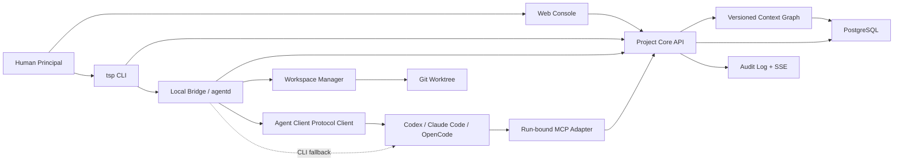

# 架构基线

- 状态：Confirmed
- 基线版本：0.4
- 确认日期：2026-08-14
- 适用范围：MVP 到小团队共享阶段

本文是当前项目的架构权威入口。产品动机、子系统细节和技术调研分别保留在其他文档中；若它们与本文冲突，以本文和已接受的 ADR 为准。

## 一句话结论

> 建设一个以项目事实为核心、以 Task/Run 为隔离单位、通过本地执行桥接不同编码 Agent 的轻量协作控制面；逻辑上分控制面和执行面，MVP 物理上仍采用模块化单体，避免提前分布式化。

## 已确认的关键决策

1. `Project / Feature / Task / Run / Defect / Artifact / Evidence / Proposal / Decision` 是平台自有核心领域，不交给某个 Agent 框架或外部项目管理工具定义。
2. 项目共享状态只由 Project Core 更新；Web、CLI、MCP 和本地 Bridge 都是客户端或适配器。
3. 本地编码 Agent 的会话控制首选 **Agent Client Protocol**；不支持时使用 CLI Adapter。
4. MCP 只向 Agent 暴露项目上下文和提交操作，不负责启动 Agent、调度任务或管理 Worktree。
5. 每个 Run 绑定独立身份、权限、上下文版本和 Git Worktree。
6. MVP 使用自有最小 Task Store；Beads、GitHub Issues 等以后作为同步适配器，不成为核心事实源。
7. MVP 由人主动发起本地执行，不实现云端入站唤醒、无人值守调度、远程沙箱和复杂工作流引擎。
8. 使用版本化 Project Context Graph 连接业务、架构、接口、代码、测试和部署；Agent 只消费按 Task 裁剪和授权的子图。
9. 产品由持续维护的 Requirement Revision 驱动；Task 分派给人，再由该成员授权 Agent Claim 并创建 Run。
10. PostgreSQL 是唯一数据库；本地开发和共享部署使用同一方言，`tsp` 一律通过 Project Core HTTP API 访问项目状态。

## 系统边界

### 控制面：Project Core

负责团队需要共同确认和追踪的事实：

- Project、Feature、Task 及其依赖。
- Requirement、Requirement Revision、Assignment 和 Claim。
- Feature Context Pack 与 Snapshot Version。
- Project Context Graph、来源、新鲜度和任务级投影视图。
- Run 身份、状态事实和审计记录。
- Proposal、Decision、Artifact、Evidence。
- 状态转换、并发检查和验收规则。

控制面不保存 Agent 的完整私有思考，也不直接操作开发者电脑上的文件。

### 执行面：Local Execution

负责只在本地可靠完成的动作：

- 创建和识别 Run Workspace。
- 创建、检查和清理 Git Worktree。
- 通过 Agent Client Protocol 或 CLI Adapter 启动编码 Agent。
- 向 Agent 注入 Run 绑定的 MCP Server。
- 采集日志、产物清单和验证证据。

执行面不能绕过 Project Core 直接修改项目正式状态。

## 目标逻辑架构



`agentd` 是逻辑组件，不要求 MVP 一开始就是常驻系统服务。MVP 中可由 `tsp task start` 为单个 Run 启动子进程；进入多设备和后台执行阶段后，再升级为只向云端发起出站连接的常驻 Bridge。

## 数据库决策 ADR：PostgreSQL 唯一

- 状态：Accepted
- 切换日期：2026-08-14
- 决策：Project Core 以 PostgreSQL 作为唯一事实存储；本地开发直接连接本机 PostgreSQL 16，共享部署连接受管或自建 PostgreSQL。SQLite 不再是运行时或测试方言。
- 访问边界：`core-api` 持有 `ACP_DATABASE_URL` 并负责数据库访问。`tsp` 不提供本地数据库直连模式，所有项目状态读写一律经 `core-api` HTTP；设备通常通过 `tsp auth login` 绑定，自动化可显式配置 `ACP_API_URL`。
- 迁移实现：Drizzle schema、迁移和查询已统一到 PostgreSQL 方言（`pg-core` / `node-postgres`）；数据库调用引入的异步边界已贯穿 application 用例层及其调用方；机器模式保持 JSON envelope 不变，并在没有 Bearer 设备凭据时以 `ACP_PRINCIPAL_CODE` 生成 `X-Principal-Code` 开发身份。
- 数据迁移：一次性搬运已将试点数据导入 `acp` 库；搬运脚本和 SQLite 运行时依赖在迁移验收后删除，不作为长期运维路径保留。

## 标识决策 ADR：数字主键与公开编码

- 数据库实体使用自增 `bigint` 主键，实体关系只保存数字 `*_id`；纯关系表使用数字复合主键。
- URL、API、Web、CLI 和工作区元数据只使用 20 位、无实体前缀的公开 `*_code`，创建时由系统生成。
- 登录输入是 `account`；用户公开编码用于资源引用和协作关联，两者不可混用。
- 旧字符串主键只作为迁移后的只读 `legacy_code` 查找别名，新客户端不再发送或展示。
- 完整决策和迁移约束见 [ADR-0010](adr/0010-numeric-primary-keys-and-public-codes.md)。

## MVP 物理部署

### 局域网共享（MVP）

```text
主机（任意一台机器）
├── Project Core + PostgreSQL（监听局域网）
├── Web Console
成员设备（各自电脑）
├── tsp（远程连接 Core）
└── Run 生命周期内的 agentd + Git Worktree
```

本地执行面始终留在成员自己的设备上，只有控制面共享；成员通过 CLI 邀请码加入，详细设计见[团队成员、CLI 加入与局域网共享](15-team-membership-lan-sharing.md)。所有模块仍通过明确端口和 API 边界交互，避免以后拆分时重写领域逻辑。单机使用是局域网共享的特例（全部组件在一台电脑）。

### 小团队共享

```text
云端：Web + Project Core + PostgreSQL
本地：tsp + agentd + Agent Harness + Git Worktree
```

本地执行面主动访问云端 HTTPS/SSE；云端不直接连接开发者电脑。远程唤醒需要设备注册、任务租约、权限和断线恢复，放到 P2。

## 代码结构建议

采用 TypeScript Monorepo，以降低 Web、CLI、MCP 和 Agent Client Protocol 之间的 Schema 重复：

```text
apps/
├── core-api/           # 模块化单体 API、审计事件、SSE
├── web/                # React Web Console
├── agentctl/           # 人和自动化使用的 CLI
└── agentd/             # 本地 Run 控制与 Agent/Workspace 适配
packages/
├── domain/             # 实体、值对象、状态机和不变量
├── application/        # 用例与事务边界
├── contracts/          # API、CLI JSON、MCP Schema、事件 Schema
├── context-graph/      # 图 Schema、投影、Graph Delta 和视图生成
├── persistence/        # PostgreSQL Repository Adapter
└── integrations/       # Git、Agent Client Protocol、MCP、GitHub、Beads 等适配器
```

建议技术基线：

| 层 | 选择 |
|---|---|
| 语言与包管理 | TypeScript、Node.js 当前 LTS、pnpm workspace |
| Core API | Fastify 5 模块化单体、REST/OpenAPI（@fastify/swagger）、SSE |
| Web | React 19 + Vite 7 + Tailwind v4 + TanStack Query；当前主链路为需求、HTML 原型设计、计划、任务、缺陷与交接工作台 |
| CLI（tsp） | Commander.js + Zod；机器模式稳定 JSON |
| 数据库 | PostgreSQL 16 + Drizzle ORM（唯一方言）；Repository 接口隔离 |
| 校验 | Zod：API 输入、CLI JSON、契约共用一套 Schema |
| 测试 | node:test（领域/CLI）、Vitest（Web）、Fastify inject（API） |
| 构建 | packages 用 tsc；tsp 用 tsup；Web 用 Vite |
| 本地通信 | CLI JSON、stdio；需要持续进度时使用 SSE |
| Agent 会话 | Agent Client Protocol/stdio，CLI Adapter 兜底 |
| Agent 项目工具 | Run 绑定的 MCP/stdio |
| 代码隔离 | 原生 Git Worktree |
| 项目上下文图 | Typed Property Graph + JSON Schema + SQL 表；应用层 BFS / Recursive CTE；Mermaid 投影 |

以上为实现级选型基线：单个库的版本升级不需要 ADR，替换选型（如 ORM、UI 方案、API 框架）需要。

## 核心不变量

这些规则应在领域层执行，而不是分散在 Web 或 CLI 中：

1. 所有正式状态变更都包含数据库内部数字 `principal_id`、`run_id`（如适用）、`base_snapshot` 和审计记录；对外契约使用对应公开编码。
2. 没有验收标准的 Task 不能进入 `ready`。
3. Run 必须绑定一个 Task、一个 Profile 和一个 Workspace。
4. Artifact 必须显式发布；未发布文件不属于项目状态。
5. Task 没有满足验收标准的 Evidence 不能进入 `verified`。
6. MCP 会话的 Run 身份在进程启动时绑定，不能由 Agent 请求参数覆盖。
7. 工作区清理必须经过引用检查、未提交变更检查和可恢复删除。
8. 页面展示状态尽量从 Run、Artifact、Evidence、Git/CI 等事实派生，不重复维护相互冲突的状态字段。
9. Context Node/Edge 必须有来源版本、Verification 和 Freshness；自动扫描不能直接产生 confirmed 业务语义。
10. 图查询必须先按 Principal/Run 权限过滤，再遍历和裁剪。
11. Agent 只能提交基于 Graph Snapshot 的 Graph Delta，不能直接覆盖正式图。

## 核心数据与存储边界

- 数据库保存结构化项目事实、版本、关系和审计事件。
- Git 保存代码及需要版本化的契约和文档。
- Artifact 首版保存引用、摘要、类型、来源 Run 和内容哈希，不复制托管 Git 已保存的文件。
- Evidence 保存命令、结果、时间、环境和报告引用；大型报告仍保存在 Git、CI 或本地归档位置。
- 本地 Workspace 保存私有过程文件，只有 Outbox 中显式发布的内容进入共享状态。
- Context Graph 保存跨来源关系和摘要；OpenAPI、Git、测试等原始内容仍由原系统持有。

## 协议职责

| 接口/协议 | 用途 | 不承担的职责 |
|---|---|---|
| REST/OpenAPI | Web、CLI、Bridge 访问 Project Core | 控制 Agent 会话 |
| CLI JSON | 人工操作、脚本和所有 Agent 的通用兜底入口 | 维护第二套业务规则 |
| Agent Client Protocol | 本地客户端启动和控制编码 Agent Session | 项目管理和 Agent 间委派 |
| MCP | Agent 读取项目上下文、上报状态和发布结果 | Agent 启动、任务调度、Worktree 管理 |
| SSE | 项目状态和 Run 事件的单向增量通知 | 耐久工作流和消息总线 |
| A2A | 后期连接远程独立 Agent Service | MVP 本地编码 Agent 控制 |
| AG-UI | 后期统一 Web 中的 Agent 流式交互 | MVP 项目事实 API |

## 端到端闭环

```text
人与 Agent 讨论并确认 Requirement Revision
→ 从需求拆分 Task 并分派给 Human Principal
→ 创建 Feature Context 与 Task
→ 绑定 Context Graph Snapshot 并生成 Task 子图
→ 负责人通过 tsp Claim，创建 Run、短期身份和 Worktree
→ agentd 通过 Agent Client Protocol 启动 Agent
→ Agent 通过 Run 绑定 MCP 获取上下文并报告进度
→ Builder 显式发布 Commit/Artifact
→ Builder 提交自测 Evidence 并更新为 self_tested/submitted
→ Builder 按需提交 Graph Delta
→ Verifier 在独立 Run 提交 Evidence
→ Project Core 校验状态转换并生成新 Snapshot
→ Workspace Manager 预览、归档并安全清理
```

## 明确延后

- 云端直接唤醒本地 Agent 与完全无人值守调度（常驻 Bridge、任务租约、离线恢复）；带预算的顺延领取（Claim Policy，见 docs/18）作为 P2 增强，不要求常驻进程。
- 跨设备自动恢复和故障转移。
- 多 Agent 自主组队和自由对话网络。
- Kafka、NATS、Temporal、OPA/OpenFGA 等独立基础设施。
- 托管远程沙箱和生产环境自动操作。
- 自研 Agent-to-Agent 协议或模型编排框架。

## 验证这套架构的三个 Spike

前置原型曾用 SQLite 证明 Context Graph 的完整性校验、子图裁剪、Mermaid 投影和递归遍历；2026-08-14 后运行时与测试统一使用 PostgreSQL。三个系统级 Spike 的验证目标为：

1. **任务闭环**：自有 PostgreSQL Task Store + Context Graph + 原生 Git Worktree 完成 Planner → Builder → Verifier。
2. **Agent 接入**：分别用 Codex、Claude Code、OpenCode 验证 Agent Client Protocol Session、权限、取消和隔离；不支持时验证 CLI fallback。
3. **薄 MCP**：只实现 `task_get_current`、`feature_get_context`、`artifact_publish`、`evidence_submit`，确认三个 Agent Harness 的 Schema 和身份绑定一致。

只有 Spike 证实当前边界不足，才引入 Beads 同步、常驻 Bridge、A2A、AG-UI 或工作流引擎。

## 决策记录

- [ADR-0001：以项目共同状态为协作中心](adr/0001-project-state-as-collaboration-center.md)
- [ADR-0002：逻辑双平面，MVP 采用模块化单体](adr/0002-logical-two-plane-modular-monolith.md)
- [ADR-0003：明确 Agent 协作协议边界](adr/0003-protocol-boundaries.md)
- [ADR-0004：自持有核心领域，外部系统通过 Adapter 集成](adr/0004-own-core-domain-and-adapters.md)
- [ADR-0005：使用版本化项目上下文图连接业务与实现](adr/0005-versioned-project-context-graph.md)
- [ADR-0006：以持续需求表驱动人负责的 Agent 交付](adr/0006-requirements-led-human-accountable-delivery.md)
