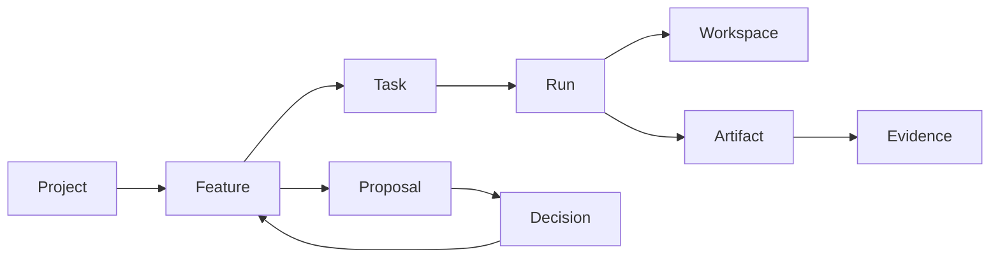

# 领域模型与协作流程

## 核心对象

| 对象 | 作用 |
|---|---|
| `Project` | 项目目标、成员、规则和当前状态 |
| `Feature` | 一个功能的业务边界、系统关系和协作空间 |
| `Requirement` | 稳定需求 ID 及当前生命周期 |
| `RequirementRevision` | 某次等待确认或已经确认的不可变需求版本 |
| `Task` | 可领取、可验收的工作契约 |
| `Assignment` | 将 Task 责任分派给 Human Principal |
| `Claim` | Assignee 授权一次 Agent Run 领取并执行 Task |
| `Run` | 某个 Agent 对任务的一次具体执行 |
| `Workspace` | Run 对应的隔离文件和代码空间 |
| `Artifact` | 代码提交、文档、报告等正式产物 |
| `Evidence` | 测试、构建、Review 等验证材料 |
| `Proposal` | 尚未生效的变更或方案建议 |
| `Decision` | 已经生效并影响项目状态的结论 |
| `Defect` | 测试或使用中发现的缺陷记录，承接 bug 提交、修复任务与复测闭环 |
| `ContextGraphSnapshot` | 某一项目与代码基线下的业务—实现关系图 |
| `GraphDelta` | Agent 或 Adapter 对图关系提出的版本化变化 |

这些对象由 Project Core 统一持有。GitHub Issues、Beads 或其他项目管理系统只能通过 Adapter 同步，不替代这套领域语义。

Decision 入库门槛（docs/21）：难以逆转 + 缺上下文会令后人惊讶 + 真实权衡的结果，三者齐备才记录为 Decision；否则只是讨论记录，不进入事实层。被拒 Proposal 按概念留痕（范围哲学/技术约束/战略决策）并用于去重，不写「太忙」类临时理由。

## 关系模型



## 任务契约

任务不是一句自然语言指令，至少应包含：

```yaml
task_id: TASK-101
feature_id: FEATURE-12
title: 实现邮箱密码登录
profile: builder

goal: 支持用户通过邮箱和密码登录
inputs:
  - FEATURE-CONTEXT-12
  - API-CONTRACT-4
context_graph:
  snapshot: 28
  focus_nodes:
    - feature.user-login
  depth: 2
scope:
  writable_paths:
    - src/auth/**
    - tests/auth/**
acceptance:
  - 正确密码可以登录
  - 错误密码返回统一错误
  - 单元测试通过
validation_seams:
  - 公共接口：POST /api/login 的行为
  - 测试位置：tests/auth/**
outputs:
  - git_commit
  - test_evidence
dependencies: []
```

`validation_seams` 声明测试/验证切入点（docs/21 吸收自 to-spec/tdd）：写任务前先确定公共接口边界与测试位置，随 Task 草案一起进入人工审阅；未经确认的 seam 不计入有效证据。

## 标准工作流

```text
人与 Agent 讨论需求
→ 生成 Requirement Draft 并澄清
→ Owner 确认 Requirement Revision
→ 关联 Feature 和功能上下文
→ 绑定 Context Graph Snapshot 与 Focus Node
→ 固定验收标准与关键契约
→ 拆分 Task、依赖并分派给人
→ Assignee 通过 CLI Claim
→ Agent 创建 Run 与独立工作区
→ 提交 Artifact
→ 必要时提交 Graph Delta
→ Verifier 提交 Evidence
→ 更新 Feature/Project 共同状态
```

## 建议的任务状态

MVP 只保留必要状态：

```text
draft → ready → assigned → running → self_tested → submitted → verified → closed
                               ↘ blocked
                               ↘ failed
```

状态约束：

- 没有验收标准不能进入 `ready`。
- 没有活动 Run 不能进入 `running`。
- 没有自测 Evidence 不能进入 `self_tested`。
- 没有正式产物不能进入 `submitted`。
- 没有验证证据不能进入 `verified`。
- Builder Run 不能自行进入 `verified` 或 `closed`。
- `blocked` 必须包含原因和下一行动。

页面上的 `working`、`waiting_review`、`ci_failed` 等运行视图应优先由 Run、Artifact、Evidence、Git 和 CI 事实派生，避免再维护一套容易冲突的权威状态。

## 任务来源分类

```text
requirement（需求拆解）/ ad-hoc（临时任务）/ defect-fix（缺陷修复）/ integration（对接联调）
```

- 只有 `requirement` 来源必须绑定 Requirement Revision；
- `ad-hoc` 与 `integration` 不绑定需求，但验收标准仍由人确认；
- `defect-fix` 绑定 Defect，验收标准由 triage 时确认的「期望行为」生成。
- 共性约束不变：任何来源的 Task 都须有验收标准才能 `ready`、有 Evidence 才能 `verified`。

详细设计见 [docs/19](19-software-engineering-entities-and-views.md)。

## 三种早期 Agent Profile

| Profile | 主要职责 | 默认权限 |
|---|---|---|
| `planner` | 需求、功能上下文、任务拆分、决策记录 | 写文档与项目状态，不写业务代码 |
| `builder` | 前端、后端和普通实现工作 | 写任务允许的代码路径 |
| `verifier` | 测试、Review、交付判断 | 读业务代码，写测试与报告 |

架构、安全、运维等先作为按需 Profile，而不是常驻 Agent。
