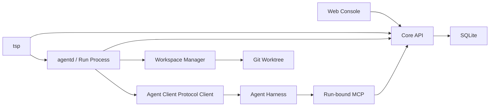

# MVP 实现架构

本文把[架构基线](00-architecture-baseline.md)落实为第一版可开发范围。目标不是一次完成云端多 Agent 平台，而是验证一个功能能被描述、隔离执行、验证、交付和清理。

## MVP 范围

MVP 必须打通：

```text
Feature Context
→ Task Contract
→ Run Identity
→ Git Worktree
→ Artifact
→ Evidence
→ Verified
→ Safe Cleanup
```

第一版支持一个 Principal 在一台电脑上运行多个 Agent；Schema 和 API 从第一天保留多用户、设备和共享部署所需标识。

## 进程与模块



### Core API

采用模块化单体，内部模块为：

- `projects`：Project、成员和规则。
- `features`：Feature Context Pack、Snapshot 和影响范围。
- `requirements`：Requirement Revision、确认和变更影响。
- `context-graph`：Context Node/Edge、来源、投影、新鲜度和 Graph Delta。
- `tasks`：任务契约、依赖、领取和状态机。
- `assignments`：Human Assignee 和 Agent Claim。
- `runs`：Run 身份、Workspace 绑定和执行事实。
- `artifacts`：正式产物引用、摘要和内容哈希。
- `evidence`：测试、构建、Review 和验收材料。
- `decisions`：Proposal、Review、Decision 和影响通知。
- `audit`：只追加的状态变更记录和 SSE 事件。

模块之间通过应用用例调用，不通过 HTTP 自己调用自己，也不允许客户端直接访问数据库。

### tsp

同时服务于人、脚本和不支持协议的 Agent：

```text
tsp project status --json
tsp feature context FEATURE-12 --json
tsp task list --assigned-to me --json
tsp task claim TASK-101 --profile builder
tsp task status --json
tsp task update --status self_tested --evidence EVD-381
tsp task submit --manifest outputs.yaml
tsp evidence submit --file test-report.xml
tsp task block --reason "API contract missing"
tsp workspace clean --dry-run
```

所有命令的机器输出使用稳定 JSON Schema；交互式提示只用于人类终端。

### agentd

MVP 中 `agentd` 是由 CLI 为 Run 启动的本地子进程，而不是开机常驻服务。职责是：

- 创建或恢复一个 Run。
- 准备 Workspace 和 Git Worktree。
- 启动 Agent Client Protocol Server 进程并管理 Session。
- 为 Agent 注入绑定当前 Run 的 MCP 配置。
- 记录可审计的工具、权限、退出和日志事实。
- Agent Client Protocol 不可用时调用已注册的 CLI Adapter。

### Run-bound MCP

首版只暴露：

```text
project_get_snapshot
feature_get_context
feature_get_context_graph
graph_get_node
change_get_impact_graph
task_get_current
task_report_progress
task_report_blocked
artifact_publish
evidence_submit
proposal_create
```

每个 MCP 进程在启动时获得短期 Run Credential。工具参数不接受 `principal_id` 或任意 `run_id`，防止 Agent 伪装其他执行身份。

## 数据库与一致性

- 单人 MVP 使用 SQLite 和正式迁移脚本。
- 每次状态命令携带 `base_snapshot`，使用乐观并发检查拒绝过期写入。
- 同一数据库事务中写业务事实和 Audit Event；SSE 只投递已提交事件。
- Task Store 是平台自有表，不把 Beads、GitHub Issues 或 Agent Runtime 设为隐式事实源。
- Context Graph 使用普通 Node/Edge 表、复合外键和端点索引；首版只允许最大深度受限的子图查询。
- 共享部署把 Persistence Adapter 切换到 PostgreSQL，领域和 API Schema 不变。

## Workspace 实现

```text
<workspace-root>/<project>/<task>/<run>/
├── project-state/
├── inputs/
├── repo/
├── private/
├── outbox/
├── cache/
├── logs/
└── .agent/workspace.yaml
```

创建顺序：校验 Task 和基线 → 创建 Run → 创建分支/Worktree → 写入不可伪造的本地绑定 → 启动 Agent。失败时记录 Run Failure 并回滚未完成的目录注册。

清理顺序：停止进程 → 检查引用 → 检查未提交变更 → 必要时生成 Patch → 移入回收区 → 延迟物理删除。首版不做无提示的递归删除。

## Artifact 与 Evidence

Artifact 首版不建设对象存储，保存：

```yaml
artifact_id: ART-1
run_id: RUN-201
type: git_commit
uri: git:repo-a@abc123
digest: sha256:...
summary: 实现邮箱密码登录
```

Evidence 必须关联验收标准和可重现信息：

```yaml
evidence_id: EVD-1
task_id: TASK-101
run_id: RUN-202
criterion: 正确密码可以登录
kind: test
command: pnpm test auth
result: passed
report_uri: file:outbox/test-report.xml
```

## MVP API 面

优先实现命令型用例，而不是通用 CRUD：

- `createFeatureContext`
- `createTask` / `markTaskReady`
- `startRun` / `reportRunFact` / `finishRun`
- `publishArtifact`
- `submitEvidence`
- `verifyTask` / `blockTask`
- `previewWorkspaceCleanup` / `confirmWorkspaceCleanup`
- `getContextSubgraph` / `submitGraphDelta` / `applyGraphDelta`

REST 和 CLI 名称可以不同，但必须调用同一个 Application Use Case。

## 测试边界

- Domain：状态机和不变量单元测试。
- Application：用例、权限和并发事务测试。
- Adapter Contract：SQLite/PostgreSQL、Git、Agent Client Protocol、MCP 的契约测试。
- E2E：Planner → Builder → Verifier → Cleanup 的真实仓库测试。
- Failure：Agent 异常退出、过期 Snapshot、Worktree 冲突、Evidence 不足和清理保护。
- Context Graph：悬空边、过期来源、越权路径、深度预算和 Graph Delta 冲突。

## MVP 不做

- 云端自动唤醒本地 Agent。
- 常驻设备管理、任务租约和断线恢复。
- A2A、AG-UI、Kafka、Temporal 或微服务拆分。
- 动态模型选择、Agent 自主组队和跨设备迁移。
- 托管完整对话、远程沙箱或生产环境执行。
