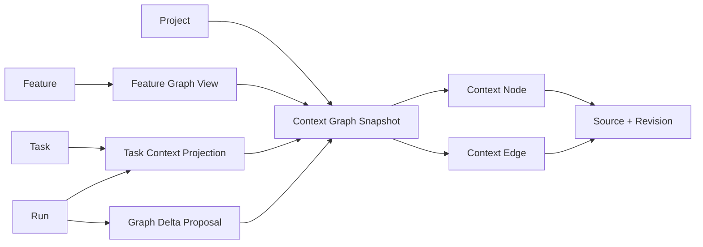

# 项目上下文图

## 目标

项目上下文图（Project Context Graph）把业务目标、规则、系统、接口、代码、测试和部署关系连接起来，使人可以看图，使 Agent 可以查询和裁剪结构化上下文。

它不是一张需要人工维护的巨型图片：

> 图模型是可版本化的项目事实，业务图、架构图、影响图和 Task Context 都是同一模型的投影视图。

## 与核心领域的关系



新增领域对象：

| 对象 | 作用 |
|---|---|
| `ContextGraphSnapshot` | 与 Project Snapshot、Git Commit 对齐的不可变图版本 |
| `ContextNode` | 一个具有稳定 ID 和类型的业务或技术对象 |
| `ContextEdge` | 两个节点之间有方向、有语义的关系 |
| `ContextSource` | 节点或关系的来源、版本和采集方式 |
| `ContextProjection` | 按焦点、深度、方向、权限和预算裁剪的子图 |
| `GraphDelta` | 对节点和关系的增加、修改、失效建议 |

## 分层节点模型

不把所有概念混在同一抽象层：

| 层 | 节点示例 | 主要来源 |
|---|---|---|
| 业务 | Actor、Capability、Use Case、Process、Rule | Feature Context、BPMN、DMN、人工确认 |
| 领域 | Domain、Bounded Context、Aggregate、Decision | 领域模型、ADR、决策记录 |
| 系统 | Service、Module、API、Event | C4、OpenAPI、AsyncAPI、部署目录 |
| 实现 | Code Symbol、Table、Configuration | Git、数据库迁移、代码扫描 |
| 质量与交付 | Test、Evidence、Deployment、Artifact | 测试、CI、部署清单、Run 结果 |
| 项目协作 | Feature、Task、Decision | Project Core |

首版节点和关系枚举见 [`project-context-graph.schema.json`](../schemas/project-context-graph.schema.json)。Schema 必须从小集合开始；只有真实项目出现无法表达的关系时才扩展。

## 节点和关系的可信度

`verification` 与 `freshness` 是两个独立维度：

```text
verification: proposed | inferred | confirmed
freshness:    current  | stale    | unknown
```

- `confirmed`：由责任人确认或来自已生效契约。
- `inferred`：由代码、数据库或配置扫描得出。
- `proposed`：Agent 或成员建议加入，尚未生效。
- `stale`：来源版本已经变化，当前关系需要重新验证。

每个节点和关系至少包含一个：

```yaml
source:
  kind: openapi
  uri: contract:API-CONTRACT-4#/paths/~1api~1login
  revision: "4"
```

没有来源的节点不能进入正式图快照。

## 图不是第二套事实源

图节点按来源分为两类：

### 平台拥有的语义

Project Core 直接拥有 Feature、Task、Decision 和已经确认的业务关系。更新它们必须经过 Proposal/Review/Decision 或对应领域用例。

### 外部事实的投影

OpenAPI、AsyncAPI、Git、数据库迁移、测试和部署配置仍是各自内容的事实源。Context Graph 保存它们的引用、摘要、版本和关系投影，不复制取代原始契约。

来源变化时：

```text
Source Revision Changed
→ 标记相关 Node/Edge 为 stale
→ Adapter 生成 Graph Delta
→ 自动更新 inferred 事实
→ confirmed 语义进入 Review
→ 生成新 Context Graph Snapshot
```

## Task Context Projection

Agent 不应默认收到完整项目图。Task 绑定图快照和焦点：

```yaml
task_id: TASK-101
context_graph:
  snapshot: 28
  focus_nodes:
    - feature.user-login
    - api.post-login
  depth: 2
  direction: both
  include_kinds:
    - business_rule
    - decision
    - api
    - service
    - test
  token_budget: 6000
```

投影顺序：

```text
读取指定 Graph Snapshot
→ 先按 Principal/Run 权限移除不可见节点和边
→ 从 Focus Node 按方向和深度遍历
→ 按节点类型和 Task Scope 过滤
→ 按重要度和 Token Budget 排序
→ 输出 JSON + 一页摘要 + Mermaid
```

必须先做权限过滤再查路径，避免隐藏节点的存在通过路径或数量泄露。

## 标准视图

| 视图 | 默认焦点 | 解决的问题 |
|---|---|---|
| Business Overview | Capability / Use Case | 为什么建设、服务谁、受什么规则约束 |
| Business Process | Process | 谁在什么条件下执行哪些步骤 |
| System Context | Feature / System | 功能涉及哪些人和外部系统 |
| Container/Component | Service / Module | 功能由哪些运行单元和模块实现 |
| Contract | API / Event / Entity | 输入输出和数据语义是什么 |
| Change Impact | Feature / Code Symbol | 修改会影响哪些规则、接口、测试和部署 |
| Acceptance Trace | Business Rule | 哪些 Test/Evidence 证明规则成立 |
| Task Context | Task | 当前 Agent 最少需要了解什么 |

系统架构视图采用 [C4 Model](https://c4model.com/diagrams) 的分层思想，并可通过 [Structurizr DSL](https://docs.structurizr.com/dsl) 导入或导出。业务流程和决策分别保留 BPMN/DMN 原始文件。Mermaid 用于轻量生成和文档内预览，不是正式图模型。

## CLI 与 MCP

建议 CLI：

```text
tsp graph validate
tsp graph get --node api.post-login --json
tsp graph feature FEATURE-12 --depth 2 --json
tsp graph impact --node service.auth --direction both
tsp graph path rule.no-account-disclosure test.auth-login
tsp graph delta submit --file graph-delta.json
```

建议 MCP：

```text
graph_get_node
graph_get_subgraph
feature_get_context_graph
change_get_impact_graph
graph_find_path
graph_report_delta
```

MCP Server 从 Run Identity 获得 Project、Task、Graph Snapshot 和权限范围；Agent 不能通过参数切换到其他项目或私有节点。

## Graph Delta

Agent 执行后不直接改正式图，而是发布：

```yaml
graph_delta_id: DELTA-42
base_graph_snapshot: 28
run_id: RUN-201
changes:
  - operation: add_edge
    from: api.post-login
    relation: calls
    to: service.risk-control
    verification: inferred
    source:
      kind: git
      uri: git:services/auth/login.ts#L42
      revision: b27e91d
```

Core 检查 Base Snapshot、节点权限、来源和冲突。自动扫描产生的关系默认是 `inferred`；影响业务语义、规则或 Owner 的修改必须 Review。

## 存储与查询

MVP 使用普通关系表：

```text
context_graph_snapshots
context_nodes
context_edges
```

图使用 `(graph_id, graph_snapshot)` 标识不可变版本；节点和边用包含图版本的复合外键保证同一快照内的引用完整性，起点和终点分别建立索引。深度受限的 Feature/Task 子图可以使用应用层 BFS 或 SQL Recursive CTE。

暂不引入 Neo4j、RDF 和 GraphRAG。只有出现大规模跨项目遍历、复杂路径分析或关系型查询成为可观测瓶颈时，才评估图数据库；语义搜索则作为图查询的补充，不替代稳定 ID 和关系。

## Web 展示

P1 可使用 [Cytoscape.js](https://js.cytoscape.org/) 显示可交互子图，因为它同时支持图遍历、集合过滤和多种布局。Web 首版只读，不提供自由拖拽后直接修改权威图；编辑行为必须形成结构化 Graph Delta。

业务流程如果需要在线查看或编辑，可使用 [bpmn-js](https://bpmn.io/toolkit/bpmn-js/walkthrough/) 读取 BPMN 2.0 文件。它与 Context Graph 的关系是“原始业务流程模型 + 图中引用”，不是把 BPMN 所有控制节点复制成平台领域对象。

## 当前可运行验证

仓库包含一个无第三方依赖的验证原型：

```text
schemas/project-context-graph.schema.json
schemas/context-graph.sqlite.sql
examples/context-graph/user-login.graph.json
tools/context-graph.mjs
tests/context-graph.test.mjs
tests/context-graph-sqlite.sql
```

运行：

```text
node tools/context-graph.mjs validate examples/context-graph/user-login.graph.json
node tools/context-graph.mjs subgraph examples/context-graph/user-login.graph.json feature.user-login 1 both
node tools/context-graph.mjs mermaid examples/context-graph/user-login.graph.json
node --test tests/context-graph.test.mjs
PowerShell: Test-Json -Json (Get-Content -Raw examples/context-graph/user-login.graph.json) -SchemaFile schemas/project-context-graph.schema.json
sqlite3 :memory: ".read schemas/context-graph.sqlite.sql" ".read tests/context-graph-sqlite.sql"
```
