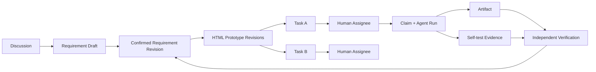

# 从需求讨论到开发交付

## 核心业务闭环

```text
人与需求分析 Agent 讨论
→ 人或 Agent 按模块上传一份或多份 Requirement Document
→ 团队成员共享、阅读和持续编辑文档
→ Agent 从文档提取稳定编号的 Requirement 条目到需求表
→ 人或 Agent 按需求生成可交互 HTML Prototype，并确认当前 Revision 可供开发
→ Agent 从需求点拆分并关联任务
→ 任务分派给具体成员
→ 成员授权自己的 Agent 通过 CLI 领取
→ 创建 Run、Workspace 和 Context Pack
→ Agent 开发并完成本地自测
→ 提交 Artifact、自测 Evidence 和任务状态
→ 独立验证后关闭任务与需求交付项
```

两个责任边界：

1. 需求文档是团队共享的完整语境，需求表是从文档梳理出的稳定工作视图；文档本身不承担审批流程。
2. 任务分派给人，Agent 是该成员授权的一次执行 Run，不是责任人。
3. 设计原型是需求和开发之间的独立协作产物，不是任务附件；HTML 负责呈现产品界面与交互，业务/数据/代码说明作为同版本 Markdown 配套文件保存。

## 需求讨论

需求分析 Agent 负责识别用户、场景、目标、范围、业务规则、验收标准和待澄清问题，并检查与已有需求、决策和接口的冲突。讨论结果可以直接上传为协作文档，再从文档提炼成需求点。

## 两层需求模型

一个项目可以有多份需求文档，不要求把所有需求塞进一篇长文：

```text
PROJECT-A
├── GENERAL · 产品目标与范围
├── IDENTITY · 账号、登录与权限
├── TASK · 任务与交付闭环
├── CLI · Agent 执行协议
└── DATA · 数据与部署
```

`Requirement Document` 保存可连续阅读的 Markdown 正文，并带稳定 `document_code`、模块标识、短摘要、关键词和 Revision。`Requirement` 是从文档提炼出的原子条目，使用稳定 `requirement_code`，负责关联 Feature、Task 和验收标准。项目总文档描述跨模块目标与约束，不替代这些需求文档。

## 需求文档生成与编辑协议

Agent 新建文档时先检索同项目的模块、标题和关键词，优先修订已有文档。只有出现独立主题、独立受众或正文明显过长时才拆新文档。正文建议使用稳定章节：背景、目标、范围内/范围外、用户与场景、业务规则、验收策略、开放问题。

- 项目成员可上传 Markdown / TXT 或在弹窗内新建文档；保存后立即对项目成员可读。
- 文档使用稳定分享链接，登录且属于项目的成员可以直接打开。
- 作者或项目 Owner 可编辑；保存时新增 Revision 并填写修改说明，历史内容不丢失。
- 文档不包含提交评审、批准生效等流程；需要交付追踪的内容进入需求表和任务看板。

## 持续维护的原子需求表

需求表是项目需求的当前投影视图。每条需求使用稳定公开编码，不断新增不可变 Revision：

```text
<requirement_code>
├── Revision 1：初始草稿
├── Revision 2：补充统一失败响应
└── Revision 3：补充失败锁定策略（当前确认版本）
```

建议字段：

| 字段 | 说明 |
|---|---|
| `requirement_code` | 稳定公开编码；数据库内部关系使用数字 `requirement_id` |
| `revision` | 不可变版本号 |
| `title` / `summary` | 标题与结构化说明 |
| `category` / `priority` | 类型和业务优先级 |
| `state` | 当前生命周期状态 |
| `acceptance_criteria` | 可验证的验收标准 |
| `constraints` | 安全、性能、兼容和范围约束 |
| `open_questions` | 尚未确认的问题 |
| `owner` | 对需求负责的人 |
| `source_refs` | 讨论、调研和 Decision 来源 |
| `document_code` | 来源需求文档公开编码 |
| `feature_code` / `task_codes` | Feature 与交付任务公开编码 |
| `context_graph_snapshot` | 业务与实现背景快照 |

需求状态：

```text
draft → clarifying → confirmed → implementing → delivered
                  ↘ change_proposed → confirmed
                  ↘ deprecated
```

`change_proposed` 不覆盖当前确认版本。新版本经 Owner 确认后才成为 Task 的新基线。

## 需求到开发之间的设计产物

结构化需求确认后，可以先生成一个或多个自包含 HTML 视觉原型，用来直接展示系统界面、页面状态、操作反馈和响应式布局。原型画面不是需求说明页；需求只作为来源关系。每个视觉原型 Revision 还可以伴随一份 Markdown 设计说明，记录业务逻辑、数据状态、代码实现提示、边界和注意事项。一个原型可关联多个 Requirement，一个 Requirement 也可以被多个原型覆盖：

```text
Requirement A ─┐
Requirement B ─┼→ Design Prototype → Revision 1 → Revision 2（当前）
Requirement C ─┘                         ├── prototype.html（视觉与交互）
                                       └── prototype.notes.md（业务/数据/代码说明）
```

原型状态为 `draft → ready → archived`。每次编辑创建不可变 Revision，开发默认读取原型头指向的当前版本。Web 在沙箱 iframe 中预览，允许自包含内联脚本，但通过 CSP 禁止网络请求、外部 frame、表单提交和父页面权限。

Agent 可以通过 CLI 完成同一条链路：

```text
tsp design list --project <project_code>
tsp design create --project <project_code> --title "登录流程" --file prototype.html --notes-file prototype.notes.md --requirements <requirement_code>
tsp design show <prototype_code> --output prototype.html --notes-output prototype.notes.md
tsp design revise <prototype_code> --file prototype-v2.html --notes-file prototype-v2.notes.md --change "补齐失败反馈"
```

原型不直接写入 Task。Task 关联 Requirement 后，领取时由服务端动态聚合相关原型的当前 Revision，并把 `.html` 与 `.notes.md` 一起导出到 `.agent/project-state/design/`，避免任务保存过时的原型引用。

## 从需求拆分任务

Agent 读取 Requirement 后可拆成一个或多个 Task；CLI/API 使用公开编码，服务端将其解析成数字关系，才能反向解析来源文档：

```yaml
task_code: <task_code>
requirement:
  code: <requirement_code>
  revision: 3
  document_code: <document_code>
feature_code: <feature_code>
title: 实现认证失败统一响应与锁定策略
assignee_user_code: <user_code>
profile: builder
scope:
  writable_paths:
    - services/auth/**
acceptance:
  - 账号不存在与密码错误返回相同响应
  - 第 5 次连续失败后锁定 10 分钟
context_graph_snapshot: 28
```

任务拆分 Agent 可以提出 Task Draft、依赖和建议负责人，但由项目成员确认分派。

## 分派与领取不是同一动作

`Assignment` 将任务责任分派给 Human Principal。负责人随后在自己的设备中授权 Agent `Claim`：

```text
tsp task list --assigned-to me --json
tsp task claim <task_code> --profile builder --repo <repo_path>
```

Core 校验当前 Principal 是 Assignee、依赖已经满足、没有冲突 Run，并检查 Profile 与 Scope。Claim 成功后创建：

```text
Task Claim
→ Run Credential
→ 独立 Workspace / Git Worktree
→ 全项目 Requirement Document 索引
→ 当前 Requirement 对应的完整 Requirement Document
→ Requirement Revision + Task Context Graph
→ 当前 Requirement 关联的 Prototype 索引与 HTML Revision 文件
→ Run-bound MCP / Agent Session
```

Claim 应可显式释放；后期再增加租约过期和后台恢复。

## 开发、自测和状态更新

```text
draft → ready → assigned → running → self_tested → submitted → verified → closed
                                ↘ blocked
                                ↘ failed
```

推荐 CLI：

```text
tsp task claim <task_code> --profile builder --repo <repo_path>
tsp task progress --summary "完成锁定策略，正在补充测试"
tsp task block --reason "缺少限流键决策"
tsp evidence collect --type self_test -- pnpm test auth
tsp task update --status self_tested --evidence EVD-381
tsp task submit --manifest outputs.yaml --evidence EVD-381
```

`self_tested` 必须关联自测 Evidence；`submitted` 必须关联 Artifact 和自测 Evidence。它们不等于独立验收。Builder Run 不能自行进入 `verified` 或 `closed`。

## 关系模型



## 产品界面

需求工作台包含两个并列视图：文档库左侧按模块分组、右侧完整阅读 Markdown，并支持上传、编辑和复制分享链接；需求表按行展示来源文档、Feature、验收标准、待澄清问题和关联任务数。所有录入与拆任务都在弹窗完成，不让输入框长期占用阅读面积。

设计工作台位于“需求”和“计划”之间：左侧为设计方案，中间默认显示桌面/平板/手机可交互视觉原型，并可切换到同版本配套说明，右侧为关联需求和 Revision 历史；新建与修订继续使用弹窗，不长期占用页面。

Project Context Graph 是需求和任务的辅助上下文，不再作为产品第一入口。
