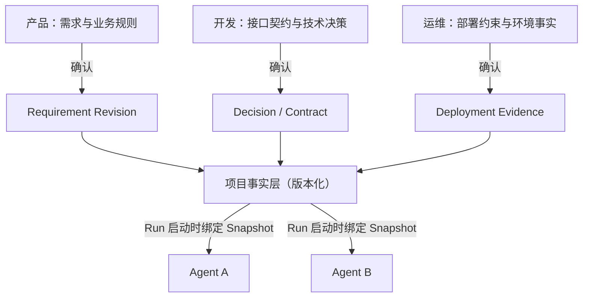

# 团队 Vibe Coding 的上下文同步与 Agent 执行模式

- 状态：Adopted（已采纳；关键结论收敛进 docs/00/01/07）
- 日期：2026-08-13
- 关联：[产品定位](01-product-positioning.md)、[路线图与 MVP Backlog](07-roadmap-and-backlog.md)、[从需求讨论到开发交付](11-requirement-to-delivery-workflow.md)
- 若本文与[架构基线](00-architecture-baseline.md)或已接受 ADR 冲突，以基线和 ADR 为准；本文作为待确认的设计输入

## 一句话结论

多人多职责、多 Agent 的 vibe coding 环境下，核心成本不是任务管理，而是**上下文衰减与黑盒**：信息在「人 → 文档 → 人 → Agent」的多跳转述中逐层衰减，Agent 各自基于不同理解执行，过程不可见。平台通过「确认即事实、事实即上下文」砍掉转述跳数，通过「快照绑定 + 偏差回流」把黑盒变成可见的版本差异，并通过「相关子图增量同步」解决团队并行场景下的信息同步。

## 1. 问题：个人 vibe coding 与团队 vibe coding 的鸿沟

### 1.1 个人单机场景

个人 vibe coding 在单机上是可行的，因为：

- 一个人脑内事实天然一致，事实源就是本人；
- 理解偏差可以被即时纠正，无需显式同步机制；
- 一个项目目录、一套上下文，Agent 转述衰减问题相对小。

此时平台价值有限，主要体现在工作区隔离、证据管理和任务追踪。

### 1.2 团队场景新增的三个问题

| 问题 | 表现 |
|---|---|
| 上下文衰减（代差） | 产品、开发、测试、运维各职责的人各自与 Agent 沟通，需求、接口、业务逻辑经多跳转述逐层失真；每多一跳，Agent 理解偏差放大一次 |
| 黑盒 | vibe coding 过程不可见；事后难以回答「这个实现基于哪个版本的需求、做了哪些假设、为什么偏离」 |
| 同步时延与规模 | 多个 Agent 并行工作时，接口与业务规则的变更无法及时到达相关方；大型项目上下文量超出 Agent 装载预算，全量同步不可行 |

## 2. 机制一：确认即事实，事实即上下文



原则：

1. 讨论过程不是事实，确认后的 Revision 才是（[docs/11](11-requirement-to-delivery-workflow.md)）。
2. 事实层是唯一权威（ADR-0001）；凡是跨职责传递的内容——需求、接口契约、业务逻辑、部署约束——必须经确认进入事实层。
3. 所有 Agent 从事实层消费同一份已确认内容，转述跳数从 N 降到 1。

这是对[产品定位](01-product-positioning.md)中 `FACT / ASSUMPTION / PROPOSAL / DECISION` 语义的团队化应用：vibe coding 可以随意讨论，但跨职责的正式内容必须落在事实层。

## 3. 机制二：快照绑定 + 偏差回流（去黑盒）

黑盒的解法不是直播 Agent 的思考过程（那会淹没人的交互），而是双向闭环：

```text
Run 启动 → 记录消费的 Snapshot 版本（它基于什么理解）
Run 过程 → 发现需求缺口 / 接口假设 / 规则冲突
         → 提交 GraphDelta 或 ChangeProposal（候选，不是事实）
Run 结束 → Artifact + Evidence + 偏差提案
        ↓
人确认偏差 → 成为新事实 → 后续 Run 的理解被修正
```

由此，「看板及其内部逻辑」的完整形态是：人看到的不仅是任务状态，还有每个任务的业务上下文、它基于哪版事实执行、vibe coding 过程中回流了哪些候选变更。黑盒被拆解为可见的事实版本差异。

## 4. 机制三：团队并行下的增量同步

大型项目 + 多 Agent 并行时，「如何快速同步信息」的关键设计点：

| 设计点 | 机制 | 现有地基 |
|---|---|---|
| 同步什么 | 只同步已确认事实的变更，不同步工作过程 | Requirement Revision / Decision |
| 同步粒度 | 相关子图 Diff，而非全量上下文（大型项目全量超出预算） | Context Graph 子图裁剪 + GraphDelta（ADR-0005） |
| 同步时机 | Run 启动拉取 + 会话中版本心跳 + 提交/发布前检查 | Run 绑定 Snapshot |
| 过期处理 | 绑定快照出现新 Revision 时标记 stale 并提示，不强制打断；由人/Agent 决定继续或更新基线 | 乐观并发与 `base_snapshot`（[docs/00](00-architecture-baseline.md) 不变量 1） |
| 契约漂移 | 接口契约变更自动出现在依赖方 Run 的上下文变更提示中 | Task 依赖与 `focus_nodes` |
| 事实冲突 | 两个 Run 提出矛盾的 GraphDelta 时暂停，交人裁决 | Proposal → Decision 流程 |

同步的单位不是「文档」而是「版本化事实 + 增量 Delta」。这是上下文预算约束下让多个 Agent 快速对齐的唯一现实路径。

## 5. Agent 执行模式分层

### 模式 1：人授权的执行者（MVP 基线）

```text
人 Claim → Run → 独立 Worktree → 提交 Artifact / Evidence
```

人的授权即安全阀门，现有领域模型已完整支持，无争议。

### 模式 2：编排者 Agent（可随 MVP 落地）

`planner` Profile 产出候选内容：需求提取、Task Draft、依赖关系、建议负责人；人确认后生效。

- 「编排」定义为：**Agent 生成候选方案，人在编排工作台一键确认/调整**，而不是 Agent 自主调度。
- 由 Proposal → Decision 流程承载，不需要新机制。
- 产品工作集中在编排工作台的交互：看拆解方案、调整依赖、确认分派。

### 模式 3：无人值守执行（P2 扩展，带预算委托先行）

「自动领取任务」意味着常驻执行面、任务租约、预算上限、失败熔断和暂停干预，复杂度跃迁一个量级；[架构基线](00-architecture-baseline.md)明确将其延后。

过渡形态「带预算的委托」：

```text
人一次性授权一个 Claim Policy（一条 DECISION 记录）：
    范围：Feature X 下的 ready 任务
    预算：最多 N 个任务 / 单任务最多 M 分钟
    停止条件：提交后必须人验收；任何任务失败即停
→ 编排者 Agent 在 Policy 边界内安排自动 Claim
→ 预算耗尽或触发停止条件 → 回到手动模式，人收口
```

设计要点：

- 人授权的是**策略**，编排者执行的是**策略内的分派**——授权源头与授权执行分离，「人负责」原则不被破坏（ADR-0006）。
- 领域模型仅需 Claim 增加可选的 Policy 来源，改动最小。
- 完全无人值守的常驻 Bridge 仍延后，须满足[docs/07](07-roadmap-and-backlog.md)的演进门槛（有真实协作问题证据后再引入）。

## 6. 部署运维：只记录事实

部署动作仍由既有 CI/CD 完成；平台只记录 `DeploymentEvidence`（版本、环境、验证结果、链接）挂到 Feature/Requirement 上。这样「发布过什么、谁验证的」进入项目事实，而平台不碰生产环境。P1 增加 CI 系统 Adapter 自动采集。与[架构基线](00-architecture-baseline.md)的延后清单（生产环境自动化治理）一致。

## 7. 交互：五个决策点旅程

交互不按「平台有哪些页面」设计，而按「人在哪里必须出现」设计——界面只在决策点出现：

| # | 决策点 | 人看到什么 | 人做什么 | 界面形态 |
|---|---|---|---|---|
| ① | 确认需求 | Agent 提取的需求草稿 + 待澄清问题 | 确认 Revision / 修改 / 打回 | 需求工作台（对话 + 需求表） |
| ② | 确认分派 | Agent 的任务拆解、依赖、建议负责人 | 调整并确认 | 编排工作台（看板 + 依赖） |
| ③ | 授权执行 | 待领任务 + 授权选项（单次 / 带预算委托） | Claim 或设置 Policy | 任务详情卡片 |
| ④ | 验收 | Artifact + 自测 Evidence + Verifier Evidence | 通过 / 打回 | 验证结果视图 |
| ⑤ | 发布确认 | 部署事实、版本轨迹 | 确认交付 / 记录部署证据 | 交付视图 |

五个决策点之外的一切——Agent 如何讨论、如何编码、如何自测——都是可观察但不需要操作的私有过程，仅需一个状态流视图。

## 8. 与现有文档的关系

- **已有地基**：[docs/11](11-requirement-to-delivery-workflow.md) 的确认责任边界、ADR-0005 的版本化 Context Graph、[docs/02](02-domain-model-and-workflow.md) 的三种 Profile、Proposal/Decision 流程。
- **本文新增的产品语义**：偏差回流的产品化呈现、团队增量同步提示、带预算委托、五个决策点旅程。
- **待确认的影响**：docs/07 中「无人值守」的表述细化为「带预算委托先行，完全无人值守仍延后」；docs/01 可吸收「上下文衰减与黑盒」作为核心价值表述。

## 9. 开放问题

1. Context Pack 的具体内容组织：接口契约、业务规则、代码结构如何编排，才能让 vibe coding 更准确、更快。
2. 同步提示（stale 提示、契约漂移）的界面形态。
3. 编排工作台的交互细节（拆解方案的呈现与调整方式）。
4. 带预算委托的 Claim Policy 完整字段与停止条件设计。
