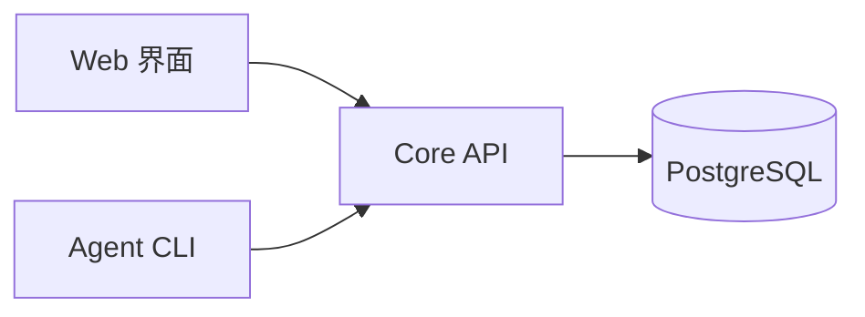

# 项目功能模块与架构设计

项目页分为「概览」「功能模块」「架构设计」。概览保留说明、参与指引与规范；功能模块复用原模块和 Feature 数据及管理功能，需求、任务关联保持不变。旧 `/projects/:code/requirements?tab=structure` 地址自动替换为 `/projects/:code/overview?tab=structure`，浏览器后退不会陷入旧入口。

## 架构资料

每份资料包含标题、用途摘要、图源、Markdown 架构说明和历史修订。支持以下格式：

| 格式 | 人工维护 | Agent 维护 | 预览 |
| --- | --- | --- | --- |
| Mermaid | 编辑文本并查看图表 | 读写 `.mmd` / `.mermaid` | 平台按图源生成 |
| draw.io | 在页面内打开画布编辑，也可导入 `.drawio` / XML | 读写 XML | 同版本 SVG 预览；无预览时从 XML 加载只读画布 |
| 图片 | 上传 PNG、JPEG、WebP | 上传或导出原始图片 | 页面内显示 |

图源是唯一可编辑来源，预览是对应版本的派生结果。说明、标题和图源一起修订，历史记录保持原有内容；修改图源而未提供新预览时清除旧预览，避免展示过时架构。图片文件不会自动变成可编辑节点。

架构资料是独立项目资源，不与 UI 原型混用；现有设计资料及其需求关联保持原意。数据库迁移 `0032_architecture_documents` 只增加架构资料表，不搬动现有模块、需求或文档。

文档库通过固定的「架构设计」目录归集这些资料，复用原文档编号、图源、说明与全部版本。文档库和项目架构页共享阅读器、编辑器及版本侧栏，直接预览 Mermaid、draw.io 或图片；任一入口修订后，两边读取同一新版本。迁移 `0033` 增加系统目录，不复制或改写架构资料。详细规则见[统一文档库与系统目录](39-unified-document-library.md)。

## 阅读与编辑权限

项目成员可以阅读和创建架构资料，作者及项目 Owner 可以修订；已归档项目禁止写入。每次修订提交编辑时读取的 `base_revision`，若当前版本发生变化，返回 HTTP 409，网页保留草稿供合并后重新提交。

读取历史版本时显示该版本自己的标题、摘要、图源和说明。图源支持下载，便于在外部工具继续编辑。新建、修订使用设备或 Web 登录身份，客户端不能通过请求正文替换作者身份。

## 共享 Markdown 图表

所有使用 `MarkdownDocument` 的页面都支持 fenced `mermaid` 代码块，包括项目说明、规范、需求正文和架构说明。例如：

````markdown

````

普通代码块保持原来的显示方式。语法错误只影响当前图表，正文和原始代码仍可阅读。Mermaid 懒加载并采用受限配置；图表以隔离的图片方式展示，图源不能开启页面脚本。

Mermaid 预览支持“适应宽度”和“原始大小”，复杂图可在图表区域内横向滚动。单图预览限制为 100,000 字符、1,000 条边；超过限制时仍可读取或下载已保存的图源，需拆分图表后再预览。平台统一管理渲染配置，图源中的初始化指令和 YAML 配置不会执行。

## CLI 与 API

```sh
tsp architecture list --project PROJECT_CODE
tsp architecture list --project PROJECT_CODE --query 总体
tsp architecture create --project PROJECT_CODE --title 总体架构 --file system.mmd --notes-file architecture.md
tsp architecture show DOCUMENT_CODE
tsp architecture revise DOCUMENT_CODE --base-revision 1 --change 补充缓存服务 --file system.mmd
tsp architecture show DOCUMENT_CODE --revision 1 --output system-v1.mmd
```

在已绑定的项目空间中可以省略 `--project`。`.drawio` / `.xml` 自动识别为 draw.io，图片按扩展名识别；其他扩展名可显式使用 `--kind mermaid` 或 `--kind drawio`。修订可仅更新标题、摘要、说明，省略的内容保持当前版本。`--preview-file` 可提交对应 SVG，`--clear-preview` 可清空派生预览。导出默认拒绝覆盖已有文件，显式 `--force` 才覆盖。

- `GET /projects/:code/architecture-documents?q=...`：标题、摘要检索，只返回索引。
- `POST /projects/:code/architecture-documents`：创建资料和首个版本。
- `GET /architecture-documents/:code`：读取当前图源、说明及完整历史。
- `PATCH /architecture-documents/:code`：提交 `base_revision`、`change_summary` 与修改字段。

写入字段为 `title`、`summary`、`content_kind`、`source_content`、`notes_markdown`、`preview_svg`。图源上限 6 MiB，预览 SVG 上限 2 MiB，说明上限 256 KiB；图片采用 Base64 data URL，因此原始图片大小应小于编码上限。

## draw.io 集成与运行环境

draw.io 画布使用其官方嵌入协议，默认需要访问在线编辑器；已保存的 SVG 预览不依赖编辑器加载。内嵌页面与主页面通过经过来源和窗口校验的消息交换 XML，SVG 仅作为图片展示。网络不可用时仍保留源文件编辑、下载和已保存预览，不会丢弃草稿。

实现参考：[Mermaid API](https://mermaid.js.org/config/usage.html)、[draw.io 嵌入协议](https://www.drawio.com/docs/reference/embed-mode/)。
