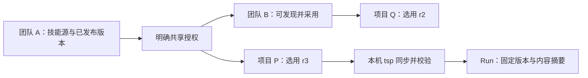

# Agent 工作台与团队技能库

日期：2026-10-18。状态：第一版实现说明。Git 导入、派生版本、多 Agent 自动安装适配与批量升级留待后续。

目标：让成员和自己的 Agent 接入 Team Synergy，维护可复用技能，在团队、项目之间明确共享，并让每次本地执行使用可追溯的技能版本。

## 1. 页面入口

在顶栏业务导航右侧、项目切换器左侧增加机器人图标按钮，名称为「Agent 工作台」。按钮支持悬停说明、键盘焦点、可访问名称和激活态。点击后切换顶栏的工作区导航，保留品牌、当前项目、语言和账号区域。

工作区分成两个主菜单：

| 菜单 | 内容 |
| --- | --- |
| CLI 接入 | 安装/升级说明、本人设备授权、当前目录绑定项目、连接检查、常用命令及排错 |
| 技能库 | 团队/项目自有与共享技能、项目采用列表；搜索、文件内容、版本、来源、共享与更新 |

路由 `/agent/connect` 和 `/agent/skills`，通过明确的团队/项目选择保存上下文。提供「返回项目」操作并恢复原页面。无团队身份但有项目权限的外部协作者也能进入，不强迫先加入团队。

技能库将技能源和项目采用分开，默认进入平台内置：

- **平台内置**：登录账号无需团队、项目或本机绑定即可发现、阅读已发布版本，下载包含来源、修订及哈希的完整 JSON 包。项目参数过期、无权或非法时，仍可浏览内置目录。
- **团队与项目自建**：按明确的团队或项目归属展示自有技能；不混入成员能看到的其他范围私有资料。
- **项目采用**：仅列所选项目主动采用的固定版本。显示来源、已用版本、可用新版、启用状态和本机同步说明；采用不转移所有权，也不会自动升级。
- **共享给我**：明确授权给当前团队或项目的技能。这里表示当前范围可使用的共享资源，不新建个人技能库。

来源信息与可用新版只显示已授权内容，不能通过技能详情枚举其他团队的私有项目或未共享版本。第一版不提供全局使用项目清单。

技能详情沿用现有文档阅读结构：左侧列表独立可达，右侧固定标题/操作区，正文在确定的滚动容器内滚动，版本记录可收起。内容页展示文件列表、`SKILL.md` 渲染、文本源码、版本及来源，不在预览时执行脚本。第一版通过版本切换检查内容，不提供自动差异合并。

CLI 接入页复用现有认证和项目绑定能力，不建立第二套账号体系。成员从当前平台下载含运行时的安装包，再通过浏览器确认授权，不需要源码或管理员手工发放绑定令牌。设备与登录会话分别管理：展示客户端类型、真实最后登录时间、当前客户端、重命名、单会话吊销和整台客户端吊销；没有心跳依据，不显示“设备在线”或“最近活跃”。设备令牌不作为长期可复制内容展示。部署和兼容规则见 [CLI 分发与设备会话](45-cli-distribution-device-sessions.md)。

## 2. 技能归属、共享、项目采用和本机同步

四件事需要各自清楚：

1. **归属**：谁维护这个技能。自建包支持团队或项目二选一的归属范围；平台内置包由仓库发布流程维护，普通账号只读。
2. **共享**：哪些其他团队或项目有权读取和采用它。
3. **项目采用**：某项目选中了哪个已发布版本，是否启用。
4. **本机同步**：CLI 把项目选定版本放到当前工作区，供本机 Agent 读取。

一个团队可以维护通用的代码评审、需求分析和发布检查技能；各项目保存自己的领域技能，并引用团队共享的通用版本。多个项目引用同一个版本，不复制出多份独立正文。



跨团队场景也采用“源范围授权 → 目标项目管理员选用 → 本机同步”。源团队发布并授权 r4 后，P/Q 显示有更新；项目管理员查看差异后分别决定升级，已有 Run 的版本不变。

## 3. 权限与外部协作者

沿用项目现有唯一负责人、管理员、成员、观看者模型，不再为技能创建另一套 Owner。技能维护人是编辑职责，不是额外所有权角色。

| 操作 | 默认权限 |
| --- | --- |
| 查看团队已发布技能 | 该团队有效成员；其他人必须获得明确共享授权 |
| 新建草稿/修订自己的技能草稿 | 对应范围的有写权限成员 |
| 发布、归档、管理他人草稿、对外共享 | 源团队或项目的负责人/管理员 |
| 将技能选入项目、升级、停用 | 目标项目负责人/管理员，同时满足源技能的采用授权 |
| 查看项目采用的技能包 | 具有项目读取权限，且该版本已被明确授权向该项目交付 |
| 本机下载同步 | 沿用当前用户/设备的读取权限，不授予额外业务写权限 |

团队管理员仍不会因此拥有私有项目管理权。项目管理员也不能编辑来源团队的技能。外部协作者只读取授权项目已采用的版本，不获得整个源团队库、其他版本或团队成员名单。

**共享到项目意味着项目读者能够读取交付的技能包。** 团队私有技能不能因为某成员在另一个项目是管理员，就自动扩散给该项目外部协作者。第一版要求源管理员明确授权目标项目；分享给团队时需明确是否允许其所属项目采用，以及是否包含外部协作者。默认不允许继续转授；界面显示受影响范围。

分享只授予使用，编辑来源技能需另有源范围权限。第一版没有转授、派生或变更归属接口；接收者不能再次共享来源技能。后续若支持派生，需要记录来源修订、转授限制及两侧授权。已获得文件的用户仍可手动复制，因此平台不能把接口权限描述为文件级 DRM。

撤销共享后，对应项目引用进入不可供新执行使用的状态，阻止新同步、新 Run、升级及恢复时重新下发被撤销包。旧 Run 保留修订、哈希和审计，查看历史包仍须满足当前有效授权。已经下载或正在本地运行的副本无法远程收回；撤销不等于已停止本地执行。此影响应在共享/撤销界面明确显示。

采用时与后续下载/新 Run 时都复核授权范围。若按“仅团队内部项目”策略采用的技能遇到项目新增外部成员，应显示待重新授权并停止新的包交付和执行使用，直到源管理员明确扩大授权或项目管理员停用该引用，不能自动向新增外部成员扩散。

## 4. 数据和版本

| 对象 | 最小职责 |
| --- | --- |
| Skill | 稳定编码、名称、描述、归属范围、维护人、草稿/已发布/归档状态 |
| SkillRevision | 完整文件清单、文件字节与哈希、修订号、变更说明、作者、发布时间 |
| SkillShare | 源技能、目标范围、确切修订列表、允许采用范围、外部协作者策略、授权/撤销审计 |
| ProjectSkillInstallation | 项目、来源技能、固定修订、包哈希、显式别名、启用状态、安装集合版本 |
| RunSkillManifest | Run 实际使用的安装集合版本、技能修订、包哈希及来源 |

技能包采用 Agent Skills 目录结构，最小为带 `name`/`description` 元数据的 `SKILL.md`，可附带脚本、参考资料和模板。需要保存完整包和相对路径，单独保存 Markdown 不能完整交付技能。[Agent Skills 规范](https://agentskills.io/specification) 第一版解析这两个必填文本字段，支持普通值、引号和块文本，不执行 YAML 标签或别名；其他字段随原文件保留。

每个修订的文件不可变，修改产生新修订；发布只是改变该修订的发布状态。采用平台 r1/r2 编号与 SHA-256 包摘要。共享明确的修订列表，不引入版本范围或自动追踪 latest；共享新修订后再由目标项目选择升级。后续 Git 导入应固定完整 commit。

同名技能要求显式别名，阻止静默覆盖。不对 Markdown 隐式拼接。每次采用、升级或停用都携带 `base_generation`，并在事务中推进项目安装集合版本；并发修改返回冲突。Run 在同一事务中读取完整集合。第一版按单个技能变更，不提供批量升级。

文档库可以链接到技能说明页；完整技能包、发布状态和共享关系由技能库维护，不复制进普通文档正文。

## 5. CLI、本地目录与 Run

已实现命令（编码使用平台公开编码）：

```sh
# 平台内置：账号认证，无需项目绑定；导出只写入指定的新目录
tsp skill catalog --platform
tsp skill search "reverse-project-docs" --platform
tsp skill show SKILL_CODE --platform --revision 1
tsp skill export SKILL_CODE --revision 1 --directory ./released-skill
# CLI 与 MCP 共用分页契约；不选项目，不执行脚本
tsp tools call list_platform_skills --input '{}'
tsp tools call read_platform_skill --input '{"skill":"SKILL_CODE","revision":1}'

tsp skill list --project PROJECT_CODE
tsp skill catalog --team TEAM_CODE
tsp skill search "review" --project PROJECT_CODE
tsp skill show SKILL_CODE --revision 3

# 目录上传保留 SKILL.md、scripts、references 等全部普通文件
tsp skill create --team TEAM_CODE --directory ./my-skill
tsp skill revise SKILL_CODE --directory ./my-skill --base-revision 1 --change "补充检查步骤"
tsp skill publish SKILL_CODE --revision 2

# 明确共享修订；团队项目采用与外部协作者需单独放行
tsp skill share SKILL_CODE --team TARGET_TEAM --revisions 1,2 --allow-projects
tsp skill share SKILL_CODE --project TARGET_PROJECT --revisions 2 --allow-external
tsp skill revoke SKILL_CODE SHARE_CODE

# 修改平台项目采用的版本，需要项目管理权限
tsp skill enable SKILL_CODE --revision 3 --alias code-review --project PROJECT_CODE
tsp skill update SKILL_CODE --revision 4 --project PROJECT_CODE
tsp skill disable SKILL_CODE --project PROJECT_CODE

# 检查或同步项目已选定版本，不改变平台版本选择
tsp skill sync --project PROJECT_CODE --check
tsp skill sync --project PROJECT_CODE
tsp skill manifest --project PROJECT_CODE

# Run 使用其自己的固定清单与目录
tsp skill sync --run RUN_CODE --workspace ./worktree
tsp skill archive SKILL_CODE
tsp skill archive SKILL_CODE --restore
```

项目同步写入 `<workspace>/.tsp/skills/<alias>/` 和 `.tsp/skills.lock.json`。锁文件记录来源、修订、包哈希和安装文件清单，可随项目版本控制共享；包目录应留在本机。认证数据沿用用户配置，不进入锁文件或仓库。`--workspace` 可指定目录；省略 `--project` 时使用该目录的项目绑定。

克隆仓库后仅有锁文件、整个技能包目录尚不存在时，同步会按当前有效授权和项目清单恢复技能包；已存在目录中的部分文件缺失或本地修改仍视为冲突，不自动覆盖。

Run 同步写入 `<workspace>/.agent/runs/<RUN_CODE>/.tsp/skills/`，不被普通项目同步覆盖。claim/attach 的 Context Pack 包含 `skills.md` 索引，输出 `skills_index`，运行环境提供 `ACP_SKILLS_INDEX_PATH`。交接继承源 Run 的版本；接收者仍须通过当前授权，包从技能 API 重新取得，受管目录不随交接代码快照传播。旧 Run 没有技能快照时保持空清单，不自动套用当前项目技能。

同步先取得并校验完整清单，再核对路径、本地修改和版本差异，分阶段写入并替换；可捕获的失败回滚到旧包和锁文件。遇到用户修改或路径冲突时保留文件并报告，不覆盖全局技能、AGENTS.md 或用户 Agent 配置。`--check` 不写文件。进程异常终止留下互斥锁时拒绝继续，需核实没有同步进程后处理现场；不能宣称所有崩溃都自动恢复。

任务 claim/attach 时从服务端取得一致的安装清单并记录进 Run，然后 CLI 下载需要的版本。Context Pack 先提供名称、用途、版本和本地路径，全文及资源按需读取。平台存包和管理授权，脚本仍由成员的本地 Agent/CI 执行。

Run 记录“当时使用了什么”，业务写权限仍实时检查。技能中的 `allowed-tools`、脚本或自然语言不能扩大账号、设备和 Run 的权限。

导入和同步不执行包内脚本。每包最多 200 个文件、总大小 6 MiB；校验相对路径、大小、逐文件与包哈希，拒绝路径穿越、大小写冲突、符号链接及 Windows 目录联接。第一版上传本机目录或 JSON 文件，不提供 ZIP 解压或 Git 拉取。许可证等文件作为包内容保留；凭据应使用本机环境或独立安全配置，不放进技能包。平台不声称能检测所有意外放入包内的秘密。

## 6. 开源参考与取舍

以下为 2026-10-18 官方资料检索结果；后续实施需固定所参考代码版本。

| 参考 | 已核实能力 | 本项目借鉴点 |
| --- | --- | --- |
| [iflytek/skillhub](https://github.com/iflytek/skillhub) | Apache-2.0，自托管技能 Registry，团队命名空间、版本、发布审核和审计 | 团队技能的发布和治理、文件和版本详情。TS 继续沿用自身唯一负责人和项目权限。 |
| [runkids/skillshare 项目技能说明](https://github.com/runkids/skillshare/blob/main/website/docs/understand/project-skills.md) | 项目 manifest、包含 commit/tree_hash 的锁文件、显式更新 | 固定依赖、本地同步、保护本地改动。 |
| [vercel-labs/skills](https://github.com/vercel-labs/skills/blob/main/README.md) | 多 Agent 安装、项目/用户范围、复用 Git/SSH 认证读取私有源 | Agent 适配与技能来源解析；团队授权仍由 TS 管理。 |
| [Agent Skills](https://agentskills.io/specification) | 开放技能目录格式和渐进读取约定 | 技能包的导入/导出兼容和按需上下文。 |

SkillHub 的命名空间允许多个 Owner，需要避免照搬到本平台。[命名空间文档](https://iflytek.github.io/skillhub/en/guide/namespace.html)

skills.sh Packs 的链接持有人无需认证即可查看/安装，官方明确其不做访问控制，不能把“不公开列出”的分享链接当作团队私有授权。[Packs 文档](https://www.skills.sh/docs/packs)

建议将这些机制整合到 TS 现有服务、权限、CLI 和审计中。第一版无需单独引入另一套 Registry 账号或成员体系。

## 7. 第一版范围与验收

第一版包括两个主菜单、CLI 接入说明、团队/项目技能包、不可变版本、明确共享、项目固定版本采用、本机同步、Run 使用清单。提供共享范围说明和本地冲突处理；保持基础检索与当前 i18n、文档阅读布局一致。

第二阶段再考虑 Git 按 commit 导入、派生版本差异合并、多 Agent 安装适配、批量升级。公共市场、自动升级、双向同步、云端执行和复杂审批暂不纳入。

验收至少覆盖：

1. 机器人入口、返回原项目、无团队的外部项目协作者访问、窄屏导航及中英文。
2. 团队/项目权限矩阵、猜编码直接访问被拒、共享不附带编辑权、私有项目不继承团队管理权。
3. 同一版本被不同项目引用，单个项目升级不改变其他项目及历史 Run；并发升级无混合清单。
4. 包导入/导出逐文件一致，旧版本可追溯，同名和本地修改冲突不覆盖，失败同步保留旧版本。
5. 外部成员可读范围、转授限制、撤销后新同步与新 Run 被阻止、历史审计保留。
6. 路径穿越/解压边界、脚本不自动运行、凭据不进包、普通技能声明不能扩大实际权限。

迁移 `0036_skills.sql` 仅增加技能相关表，保留已有项目资料和历史版本。技能管理员继续使用团队/项目既有角色，不迁移现有成员角色。

## 平台内置发布与无项目读取（2026-11-17）

`skills/reverse-project-docs/` 是平台发布源，构建产物进入已有不可变 release/revision 注册；同版本内容改变仍须拒绝。TencentDB Agent Memory 只是相关项目知识的检索投影，不决定技能版本或归属，也不是读取内置包的前提。

账号级 API 使用 `GET /skills/platform`、`GET /skills/platform/:code` 和 `GET /skills/platform/reader`；仅返回已发布平台来源，不能用团队私包编码绕过权限。CLI `--platform` 不能与 `--team/--project` 混用；MCP 的 `list_platform_skills/read_platform_skill` 不接受项目上下文。未登录 MCP 仍可初始化和列工具，实际读取返回登录指引；登录账号变化要求重建会话。

JSON 下载保留完整文件、发布版本、修订、来源及哈希，供阅读与归档；导出目录保留原始包文件。导出不是项目采用或宿主全局安装，不写项目锁、AGENTS.md 或宿主配置，不执行包内脚本。项目 `skill list/sync`、固定 Run 与授权撤销继续沿用原接口。
