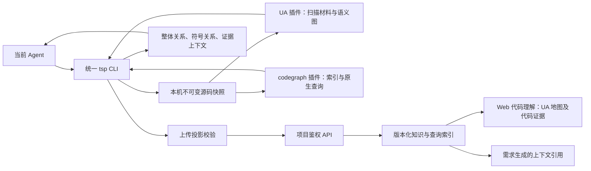
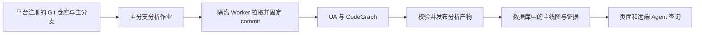

# UA 与 codegraph 插件接入方案

- 日期：2026-10-27
- 状态：实施设计；2026-10-27 已交付首个可运行切片，实际命令、验收记录和未完成项见 [60-code-understanding-first-slice.md](60-code-understanding-first-slice.md)。本文中的完整目标不能视为均已实现。
- 闭环复核：2026-10-27 补充第 12 节，明确分析交接、远端进度、版本选择、更新失效和需求导入衔接；当前实现以第 60 号文档列明的范围为准。
- 代码核对基线：`92728fbec04cfa34fee4421cb0a9319d1b755164`。
- 实验参考：`F:\workspace\team-synergy-labs\code-understanding-20261027`；实验产物仅作样本和回归依据，不作为生产数据或稳定协议。

## 1. 已确认的产品边界

1. 项目新增“代码理解”页面。UA 展示系统组成、模块职责、业务能力和流程；用户可下钻 codegraph 的符号、代码关系与证据。
2. Agent 通过现有平台 CLI `tsp` 获取两套工具的关系。codegraph 的主场是本机 CLI 原生分析查询；UA 同样提供可查询的整体关系，不能只有可视化页面。
3. 第一版由当前 Agent 主动分析并更新结果。CLI 提供固定源码材料、工具调用、校验和上传；不另外部署一个负责解释代码的模型服务。Web 只查看进度和结果，不编辑解释。
4. 两套引擎按插件接入，独立固定版本、检测兼容、升级和回退。第一版不建设插件市场。
5. 完整源码由分析执行端保管；service 接收关系、符号、相对路径/行号和有限证据片段。执行端可以是成员显式运行的 CLI，也可以是未来的服务端仓库 Worker，浏览器展示独立于执行端的文件系统。
6. 一个项目可关联多个仓库，各仓分别分析、项目视图汇总。跨仓关系必须提供明确依据。
7. 默认分析 Git 提交；需要分析修改中的代码时显式捕获工作区草稿。草稿不覆盖提交版本的结果。
8. 分析是独立能力，不增加项目“冻结”步骤，也不继承资料导入批次的审批和 apply 生命周期。“从代码生成需求”后续消费这里的上下文。

以下接口名称、存储设计、权限继承和实施顺序是基于现有代码提出的设计默认值，不把它们记成用户已经选择过的技术细节。

## 2. 总体接入方式



平台负责项目/仓库身份、权限、快照、分析记录、稳定查询协议和产物选择。插件负责对特定版本引擎的调用与结果转换。插件进程不接管平台凭证，也不直接上传原生 stdout。

### 服务器部署与源码来源

2026-11-12 已补齐服务端托管分析；成员 CLI 执行仍可独立使用。两条路径共用 integrations 中的安全源码捕获、插件锁和发布契约。

| 阶段 | 当前已实现的位置与数据 |
| --- | --- |
| 获取源码 | 服务端按已登记 remote_url 与 default_branch 拉取独立 bare 仓库，固定 commit 后读取 Git blob，生成独立 source 副本；作业不接收成员路径、分支或自定义命令。成员 CLI 仍可显式捕获自己的提交或草稿。 |
| 引擎执行 | UA 扫描、依赖与分批脚本和 CodeGraph 原生索引读取同一个固定副本。服务端随后调用配置的语义模型生成 UA 原生图，验证来源与图结构。 |
| 发布结果 | PostgreSQL 保存持久作业、租约、来源身份、文件指纹、图节点与边、语义说明和有界证据。完整源码与原生 SQLite 索引由分析执行端管理。 |
| 主线推广 | 完成事务检查租约、发起人权限、项目/仓库状态与来源配置，仅替换当前仓库的主线选择，保留其他仓库。失败不改变上一份可读主线。 |
| 页面与远端查询 | Core API 读取已发布产物。UA iframe 通过父页消息接收图，不接收凭证、电脑路径或源码读取接口。query_local_code 仍属于有原生索引的成员执行端。 |

服务器部署使用下列执行路径。



请求只传仓库编码和幂等键；未指定仓库时为项目内全部活动仓库。服务器从数据库取得唯一主分支和远端地址，按作业分配工作目录，不读取成员工作区注册文件。每仓库同时最多一项活动分析，同一请求重试返回原作业；新请求仍重新拉取当前主分支。成功后原子合并该仓的主线，旧分析继续供带出处的引用核对。首版由页面、CLI 或 MCP 按需请求，不包含 Git webhook 或周期自动跟踪。

托管 Worker 将源码与 CodeGraph 原生索引保存在其受控工作目录，数据库承载作业元信息、来源身份及已发布查询投影。完整源码阅读应定位仓库的对应 commit；首版未提供远程完整源码读取接口。依赖本机 run.json 的 Intake 命令仅适用于成员执行的分析，托管结果不展示该入口。

新托管作业记录真实 branch、commit、runner=server_git、引擎摘要、语义模型及覆盖范围。旧记录的 HEAD、WORKSPACE 或提交号不推断为主分支；按已保存来源保留。

#### 配置与入口

服务端需要管理员预先安装兼容的 UA 2.9.8 和 CodeGraph 1.6.2。配置 `TSP_CODE_ANALYSIS_ENABLED=1`、独立的 `ROOT`、`UA_ROOT`、`CODEGRAPH_ROOT`、`GIT_ALLOWED_HOSTS`、`MODEL_URL` 和 `MODEL`，完整键名见 [.env.example](../.env.example)。这些路径属于服务器部署配置。生产建议使用独立容器、受限账号和有配额的工作盘。

Git 只支持显式允许主机的 HTTPS 远端，禁用重定向、用户 Git 配置、凭据助手、hooks、submodule 与仓库脚本。私有仓库令牌通过 `TSP_CODE_ANALYSIS_GIT_TOKEN_FILE` 提供，并必须配置 `TSP_CODE_ANALYSIS_GIT_ALLOWED_REPOSITORIES` 精确仓库白名单。代理只通过 `TSP_CODE_ANALYSIS_GIT_PROXY` 显式配置；不继承个人代理。模型凭据通过 `TSP_CODE_ANALYSIS_API_KEY_FILE` 或对应环境变量提供，不进入作业、图或错误文本。

- 页面：分析来源内选择「更新主线分析」，新仓库的空状态也可发起。
- CLI：`tsp code analyze remote --project <project> --repository <repo> --idempotency-key <key>`；`remote-status --project <project> --job <job>` 或 `remote-list` 查询。无需本机仓库绑定。
- MCP：`request_code_analysis` 与 `get_code_analysis_status` 使用相同 API；仅需项目身份上下文，不需要源码路径。
- API：`GET /projects/:project/code-understanding/runtime`、`GET/POST .../analyses` 与 `GET .../analyses/:job`。后台 Worker 只在真实服务启用；借用数据库和隔离测试运行都禁止继承付费分析配置。

#### 首版覆盖与容量

CodeGraph 索引完整的安全文本快照。托管 UA 已改为全仓分批理解：对安全清单内每个文件读取完整 UTF-8 字节，按预算连续切段，包含测试、配置、空行及大型单行。每段身份与原计划比对，文件字节区间不得缺失或重叠；模型必须逐段返回事实，截断或未完成结果不计为覆盖。

完成文件事实后，长文件先跨段归并，引用宿主对原有效来源编号的证据目录；模型返回编号，宿主恢复原文件和行范围，未知编号、自由行号和无效 JSON 均不接受。随后核对调用方解释与被调用定义，再综合系统模块、能力、业务流程和依赖关系；所有文件有明确的主责归属。调用时传入某参数不代表定义实际使用它，跨文件纠正必须有定义处来源；依据不足或多页结论冲突时保留待确认。原始事实、核验和修改分别留审计，归并与核验协议各自进入缓存身份，不使有效源码分段缓存失效。

全局导览和审查独立生成，不把每批的模块、层和导览直接拼接。原生静态依赖与带源码范围的语义推断分别留证；审查中的严重问题阻止发布，警告以待确认内容公开保留。

候选综合和归并分别维护文件归属目录与论断证据目录：前者只含当前输入需要归纳的文件，模型返回宿主编号；后者可保留被调用定义等合法跨文件来源。模型必须完整覆盖归属目录，不能因依赖或证据提到页外文件而扩大归属范围，也不能自动把遗漏文件塞入无关候选。覆盖检查只证明结构范围可追溯，不证明模型理解正确。文件主责分配核对精确路径及数量，导览引用限定为真实节点，同时保留代码、测试及资料停靠点。

文件详情与系统概览分层保留。文件节点继续承载全部经核验的摘要、行为规则、依赖、未知和引用；`architecture-overview-1.1.0` 只提炼职责、核心共享不变量和跨模块契约，通过稳定文件索引定位详情。概览不逐层复抄细粒度规则和未知全文，未决计数由宿主按文件与断言身份计算，模型不能清零或升级为已确认、已落实、测试已通过。每次响应的文本与展开引用后的 canonical UTF-8 字节均有预算，整层需实际收敛；超限要求模型重新概括，不能靠截字或隐藏引用过关。目录覆盖、预算收敛与文件详情不变分别验证，最终仍需独立检查全局架构和可检索详情的语义质量。

实际语义抽查发现自由改写可能省略控制分支的关键例外，或在合并声明后漏选支持范围。1.1 协议将核心规则的选择和归类与规则内容分开：概览及最终架构只选择受控的父规则引用，由宿主恢复父项原文、完整证据和更保守的状态，跨层引用保持稳定。该约束保证相对于保留的父规则没有重新改写或裁掉出处，不保证所有细则都入选概览，也不证明父规则必然由源码蕴含、职责归类或自由叙述正确；这些仍需独立源代码检查。小尾组保留有限语义余量，整体预算和整层收敛门继续生效。

全局协议 `architecture-global-leaf-rules-1.1.0` 另外绑定原始 map 候选的作用域。规则必须返回合法的父项与 `origin_scope_id` 配对，宿主恢复原操作名称、职责、状态归属、用途、文件范围和出处，公开规则明确显示原作用域。把某条规则挂在较大的模块下，不会因此获得该模块全部动作的适用范围。这个目录只改变全局请求，上游分段、文件、一致性、map 与概览检查点不变。

自由叙述另设源码核验门：摘要的原文片段、每条用途／状态归属、流程步骤、规则应用和语义关系各自绑定断言身份。先从完整的候选目录检索实际操作或声明，检索结果只表示位置，不能批准事实；随后宿主读取固定快照内的完整定义及相关被调用守卫，用源码核对叙述。原断言和原始引用始终保留，选择的定义单独记录，不能用函数位置覆盖配置、类型或测试的原始出处。宿主还会读取未被所选定义覆盖的原始声明引用：小文件在已有阈值内完整读取，较大文件保留原范围，均核对路径、字节、行界和哈希。超预算不能裁正文或假称完整。原断言、候选目录、选择、实际源码和裁决分别留审计；声明、测试或调用转发不能冒充实现或运行结果。

检索请求最多 8 条断言、125KB，候选目录过大时完整分页；每条最多选择 8 个操作定义。源码核验按完整定义分组，不能截函数或省略被引用的守卫。原生调用、相对导入与守卫适配器仍受静态解析能力限制，未展开调用边界须明确保留；模型必须在缺少相关边界时判依据不足，不能把命名启发式称为形式证明。矛盾及角色／权限／状态谓词依据不足会阻止发布。

源码反馈触发按字段分批的修正，不重新生成整份架构：每个请求包含受影响字段原文、绑定断言、完整理由及已取到的完整源码正文。“依据不足”仍可能有可供缩窄结论的有效材料，不能丢掉这些正文后只让作者写占位说明。未引用任何来源的不足判定可携带对应真实上下文，但明确标作检索材料，不是支持原结论的证据。正文在请求内共享，每个字段仍只能使用它绑定的来源；缺失守卫和边界限制也要保留。宿主只合并白名单字段，保留其他字段、节点身份、次序与证据。无法支持的不可改写父规则移出肯定规则列表，并留下原文与撤回原因。字段修正明确选择替换或撤回；原字段与原因公开保留在未决记录中，对应撤回的推断边不再发布。不能靠给原事实加“待确认”字样跳过核验。

来源只支持定义时，宿主设置 `source_definition`，并给面向使用者的文字加上“来源定义，未声称实际执行”的限定；模型不能自行填写这个宿主字段。工作流配置支持其定义的步骤，测试支持其断言，文档支持其声明，均不证明已经运行、上线或验收。只有字段全部相关判定都有完整定义来源，修正器才可使用这个限定；实现层的必要守卫校验保持不变。

单字段完整材料超过 179KB 且所有阻断均为依据不足时，宿主可按旧字段哈希和完整原子片段的位置精确撤回这些片段。保留其余字符及完整私有材料，在公开未决记录注明宿主预算撤回原因，并重新核验剩余正文；不裁剪正文材料、不生成替代事实。包含矛盾的超预算字段仍直接失败。常规请求仍按整个字段打包，不引入未经绑定的拼接。

流程摘要、步骤和关系描述涉及顺序、消息方向或因果，即使没有权限关键词，也必须得到源码支持。每轮修正后重新检索并核验整个未撤回架构；最多三轮，且后续轮次被阻断的独立字段／规则来源必须严格减少，否则停止并保留旧主线。每轮审计独立保留，不能被后续轮次覆盖。字段和请求均有硬预算，不截源码、不提高上限绕过检查。该门仍须接受独立源码质量审查；模型核验结果不等于测试执行或形式证明。

核验标准 `static-conditional-1.1.0` 判断源码编排的条件、分支、调用和赋值。例如源码明确写出“当读取结果为 X 时调用 Y”，可以支持这个条件行为，无需把文件系统、浏览器存储或数据库驱动的实现也全部展开；它不证明真实环境返回了 X，也不证明外部写入成功。每个子句都必须对原主语及其量词范围成立，不能把两个客户端各自的行为合并成它们共有的行为，也不能在裁决理由里补足原文省略的条件后再批准原文。决定结论的本地业务守卫缺失、跨操作条件未提供，或叙述承诺外部效果时仍须判依据不足。判矛盾必须给出可见反例或相反条件，不能仅因未检索到类型、常量或文档就断言其不存在。旧标准的判定缓存只留作审计，不作为新标准的结论使用。

新标准按完整上下文单独保存已验证判定。上下文的原文、作用域、源码及守卫集合、检索身份、快照、模型和策略必须完全一致，才能跨分组复用；字段或来源变更会失效。分组只决定请求传输，不应让未变化的断言反复付费核验。每个判定仍通过同一套精确断言、引用和守卫验证，完整请求无效或截断时不能为其中的条目写入缓存；记录缓存来源模型，不能将旧代理结果伪装成本轮实时结果。

全局架构调用单独保留高推理强度，最多 65,536 completion tokens、480 秒；其余阶段预算和缓存身份保持各自策略。这里的 completion 包含服务报告的 reasoning tokens，不能把它们额外相加。`finish_reason=length`、超时或无效结构均不解析为成功、不写有效缓存；已有有效阶段可在同快照重试时复用，旧公开主线保留到新结果完整校验后再替换。模型端接受该上限不代表任意规模都能完成，仍需实际运行验证。

完整处理报告写入版本化 `semantic_analysis`，由服务器对照独立可信分段计划物化，成员发布接口不能自行提交托管全量报告。源码 SHA 来自冻结清单，关键节点和关系的证据进入标准 `evidence_ids`。业务规则、实体和跨模块交互通过 `domain_meta` 返回，CLI/MCP 可检索并读取，不仅存在于原生地图或私有中间文件。

文件的全部用途保留为 `domain_meta.userPurposes`，未知项保留为 `domain_meta.unknowns`；全局综合和审查的未知记录在全局模块的未决事项中完整公开。页面、原生阅读器与 CLI/MCP 检索读取同一组字段，旧数据缺少这两个可选字段时保持兼容。增加和合并关系时，只无损合并同文件相邻或重叠的来源区间，不按条数截掉独立证据。

模型并发通过 `TSP_CODE_ANALYSIS_CONCURRENCY` 配置（1–4，默认3），每次响应核对实际模型身份、完整性、结构、来源和敏感内容。检查点绑定项目/仓库、快照、引擎、模型、提示版本和输入摘要，复用前重新验证；取消/过期作业不会复活，后续新作业可复用有效阶段结果。

默认不跨模型路由复用缓存。管理员因账户额度等原因明确接受已有分析来源时，可用 `TSP_CODE_ANALYSIS_CACHE_ORIGIN_MODELS` 列出最多8个旧请求模型的精确 ID。当前模型缓存优先；后备查询只替换缓存身份里的模型项，快照、端点、引擎、提示、推理策略和任务输入仍须完全相同，并重新执行结构、来源和敏感内容校验。旧缓存保留原键和实际响应模型，不复制成当前模型的结果；实时响应仍只能匹配当前配置模型。产物的 `semantic_author.provenance`、执行元数据与私有质量报告分别记录 cache/live、原请求路由、响应模型和使用次数。同型号名称不证明不同服务路由使用相同权重，混合来源也不代替独立语义质量评估。

完整字节处理和文件覆盖不等于语义正确。质量需用预先冻结的业务/架构问题、源码范围和独立人工裁决验证，分别报告关键规则、拒绝条件、上下游、验证方法与遗漏。评估工具和旧版基线见[代码理解质量验收](experiments/code-analysis-quality/README.md)；不能用节点数量或模型自评分替代这一过程。

完整托管报告对应的 UA 地图响应带 `reader_profile=full_system`，阅读器保留模块、能力、流程、全局分层和导览，避免旧领域视图的拆分规则隐藏新关系。该标识由服务端已验证报告派生，不取自节点命名或模型自述；历史产物缺省沿用原阅读方式。文件和模块的规则、交互及待确认内容与来源一起可读。

源码捕获限 20,000 个对象、128 MiB 安全文本，每文件 2 MiB。浅层 Git fetch 发生在捕获检查之前，首版没有硬磁盘配额；执行端须配置容器或文件系统配额，并管理保留的源码/索引目录。源码捕获及引擎指纹核对包含同步步骤，超大仓还需进一步隔离到独立进程后再扩容。

本机原生索引和 service 的查询投影是两种产物。Agent 可在本机查询完整 codegraph 能力；远端 CLI/Web 只能查询已上传且获授权的内容。远端缺少原生分析能力时返回明确的能力错误，不静默将其包装成完整查询结果。

与 [项目上下文图](09-project-context-graph.md) 的关系：本功能是外部代码事实和解释的版本化来源，后续可作为 Context Graph 的投影输入。Feature、Task、Decision 仍使用平台已有领域模型。静态调用、Agent 推断和经过核实的业务事实分别标注，不能把语义解释升级为已确认需求。

## 3. 插件协议及升级边界

### 3.1 三层版本分别记录

| 层 | 负责内容 | 版本策略 |
| --- | --- | --- |
| 引擎 | UA 扫描/原生图；codegraph 提取、索引、原生查询 | 固定发行版及内容摘要，必要时记录源码 commit |
| 适配器 | 参数、进程管理、原生输出转换、UA 展示桥接 | 与平台协议分别版本化；声明已测试的引擎范围 |
| 平台协议 | 快照、分析运行、统一节点/边、查询结果和上传投影 | 带 schemaVersion；服务器兼容策略和迁移显式声明 |

建议插件 manifest 至少包含：`pluginId`、`adapterVersion`、`protocolVersion`、`engineVersion`、`engineArtifactDigest`、原生 schema/extraction 版本、输出 schema、支持的平台协议范围、OS/架构/runtime、入口和能力列表。

UA 插件声明材料准备、校验、概览、搜索、节点和关系等能力；codegraph 插件声明索引、状态、搜索、节点、callers、callees、context、impact 等实际支持能力。`describe/doctor` 探测失败返回 `unsupported_capability` 或兼容错误，不能依据插件名称猜测能力。

不允许上传任意包名、下载地址或 shell 命令让 service 执行。V1 采用受平台维护的两套适配器与版本锁；本机安装/升级命令在后续实现中使用固定来源与摘要校验。引擎安装脚本、自动下载 fallback 和遥测都纳入适配器控制，不能在查询时静默更换版本。

### 3.2 升级不是覆盖安装

1. 将新 runtime 安装在独立版本目录，运行兼容探测。
2. 对相同固定源码快照建立新索引和新 analysis run，不触碰旧索引。
3. 执行固定 fixture、原生查询、上传契约、双工具关联和旧版读取测试。
4. 验证成功后切换插件默认版本；对应新 run 成功发布后，Agent 才可通过显式视图选择更新项目的默认知识结果。
5. 失败保留旧默认值；回退恢复旧 runtime、旧索引和已发布结果指针。进行中的 run 继续使用其创建时固定的版本。

codegraph 普通数据库打开可能执行自动迁移，extraction 版本变化还可能要求重建。因此“复制新程序再打开旧数据库”不能作为升级或回退方案。历史查询必须用匹配的引擎和索引；若当前原生命令无法保证只读，使用可丢弃的查询副本，保留已验证索引原件。

UA Web 的渲染桥也固定版本并做兼容验证。历史平台投影应能只读展示；不能因为本机引擎升级而要求历史知识立即重算。两个项目的 MIT 许可及所分发第三方 notices 随插件保留。

## 4. 代码版本、知识版本和项目视图

### 4.1 三种身份不混用

| 对象 | 关键字段 | 含义 |
| --- | --- | --- |
| CodeSnapshot | repositoryCode、kind、commit/baseCommit、tree、manifestDigest、scope、排除项 | 实际被分析的代码集合 |
| AnalysisRun | snapshotId、runId、各插件/适配器版本、配置摘要、语义作者、产物摘要、覆盖率 | 对这份代码的一次分析 |
| ProjectView | revision、各仓 `{repositoryCode, snapshotId, analysisRunId}` | 项目整体图所选用的仓库版本组合 |

同一代码快照可以有多次分析，例如工具升级或 Agent 重新解释。成功产物追加保存，不原地改写历史结果；明确的保留/删除策略可后续独立实现。`branch` 是可移动标签，不是产物主键。界面显示“最近分析的提交”和分支采集时间；未获取远端状态时不声称已追上最新代码。

默认提交分析从指定 commit 的 Git 内容生成固定副本，不读取当前工作文件来冒充该提交。工作目录有修改时仍可分析 HEAD；CLI 清楚说明这些修改未包含。记录实际提取字节摘要、路径与换行处理规则，避免 Git 对象与平台行号脱节。

草稿需要显式参数，记录 baseCommit、dirty 状态、捕获范围及逐文件摘要。默认只取允许范围内的 tracked 文件，新增未跟踪文件需显式纳入。捕获前后校验内容一致性，后续两引擎只读取固定副本；若无法一致捕获则失败重试，不混入变化中的文件。跨仓捕获分别记录时间，不宣称多个仓库的工作区是原子快照。

manifest 独立于引擎扫描范围：源码快照描述捕获集合，每个引擎另报支持、忽略、失败和未解析文件。实验 UA 的 657 文件清单不能直接当成全仓清单。敏感文件、链接逃逸、二进制、大文件等沿用安全扫描约束；子模块需单独注册/捕获，否则标注未覆盖。Git 读取禁用 hooks、外部过滤器和隐式下载。

草稿使用独立列表和默认指针，永不更新提交分析的默认结果。切分支、同名文件或行号变化都不会改变历史产物所属的 snapshotId。

发布成功与选为项目当前视图是两个操作。分支结果分别归档，任意 feature 分支的分析成功不会自动替换项目默认版本。当前视图由 Agent 经 CLI 明确组合并选择，以预期 revision 做并发检查；这只是结果选择，不是审批或项目冻结步骤。完整选择规则及跨仓边失效见第 12 节。

### 4.2 双工具如何关联

每个节点携带 `repositoryCode + snapshotId + analysisRunId + provider + nativeId`。原生 ID 只在其分析范围内有意义，尤其不能把含行号的 codegraph ID 当成跨版本永久身份。

UA 模块/能力通过有来源的 `evidenceRefs` 连接同一快照下的文件、范围和 codegraph 符号。关联优先使用路径、内容摘要、范围及符号信息；多候选保留歧义，禁止仅凭名称强行连边。查询必须区分上游原生边、平台推导边和人工/Agent 解释边，并返回依据、验证状态、未解析原因与覆盖范围。

跨仓边两端都包含仓库和快照身份，证据需支持对应关系类型，例如依赖清单可支持“依赖包”，不能单独证明“运行时调用”。项目聚合默认仅使用全部满足权限的仓库；先鉴权再遍历、分页和计数。跨客户技能分享授权不会自动授权代码知识分享。

## 5. Agent 的 CLI 工作流（拟议命令）

下列是待实现的命令合同，不是现有可执行命令；参数最终按现有 Commander 风格落地。

```text
tsp code plugins list
tsp code plugins doctor --plugin codegraph

tsp code analyze prepare --repository <repo-code> --ref HEAD
tsp code analyze prepare --repository <repo-code> --workspace-draft
tsp code analyze status --run <run-id>
tsp code analyze resume --run <run-id>

# 当前 Agent 读取准备材料，按 UA 工作流补全职责、分层、关系和导览。
tsp code analyze checkpoint --run <run-id> --batch <batch-id> --file <result-file>
tsp code analyze validate --run <run-id>
tsp code analyze publish --run <run-id>

# 选择项目视图；发布历史/其他分支结果不会隐式改变当前视图。
tsp code view compose --selection <repository-runs.json>
tsp code view select --view <revision> --expected-current <revision-or-empty>

tsp code overview --repository <repo-code> --run <run-id> --engine ua
tsp code search --repository <repo-code> --run <run-id> --query <text>
tsp code relations --node <qualified-node-id> --direction both --depth 1
tsp code callers --node <qualified-node-id> --engine codegraph
tsp code context --repository <repo-code> --run <run-id> --task <task-text> --engine codegraph
tsp code impact --node <qualified-node-id> --engine codegraph
tsp code affected-tests --repository <repo-code> --run <run-id> --path <relative-path>

# 显式查询 service 上已上传的投影；不等价于本机原生 context。
tsp code overview --project <project-code> --view <revision> --remote
```

命令复用平台绑定、设备身份、仓库注册和 JSON envelope。统一查询返回选中的代码快照、分析版本、引擎来源、证据、覆盖/不确定项、截断及下一页信息。分页、深度和结果预算均有上限；一个查询内固定 ProjectView/run，不能翻页时自动换成新结果。节点不存在、旧快照、本地索引缺失、能力不支持、权限不足分别返回可处理的错误。

平台参数不直接透传原生 CLI。固定版本 codegraph 的 `context <task...>` 是任务文本召回，`impact <symbol>` 是符号影响，`affected [files...]` 返回受影响的测试文件。适配器分别映射为上例的 task context、精确节点 impact 和 affected-tests，保留各自含义；不能把测试文件集合叫作全部文件影响。精确节点上下文由节点、关系和证据查询组合，不能用任务文本召回冒充。若原生命令只接受名称/路径，适配器须按已选 nativeId 验证候选；原生命令无匹配时回退到其他同名定义的行为应被拦截，歧义明确返回。

`prepare` 先完成项目鉴权并幂等登记远端 run，再创建固定材料、运行 codegraph 索引并输出 UA 文件清单/import map/分析批次/产物模板与 Agent 指引。登记后 Web 即可查看进度，不必等待知识上传；本机路径和正文不在登记请求中。V1 新建平台分析要求 service 可达，登记失败不启动昂贵索引；已存在的本地分析和查询不会因临时断网被删除。Agent 使用当前会话完成解释；`validate` 检查 schema、引用完整性、快照一致性、范围合法性和上传投影。校验通过不代表业务解释已核实，不能给所有关系统一盖“可信”章。记录可取得的 Agent/模型及提示版本；模型 ID 未知时如实为空。

`publish` 仅上传知识结果。请求带幂等键和内容摘要，相同请求重试不重复创建结果，同键不同内容拒绝。长任务提供明确进度、失败原因和重试阶段；当前 CLI 执行时推送心跳，等待 Agent 解释时显示 `awaiting_agent`。心跳过期显示“状态待确认”，不因 Agent 思考时间长就宣判分析失败。进度更新按 run 的执行代次和事件序号去重，断网后由后续 CLI 调用补报；恢复不能使已取消运行重新进入成功状态。V1 无需新常驻任务调度器。

拟议阶段：`preparing → indexing → awaiting_agent → validating → uploading → succeeded`，另有失败、取消及各引擎状态。上传可恢复，但成功结果在摘要和引用全部校验后原子可见。部分产物可作为明确标注的运行详情查看，不更新默认完整结果；禁止把上一提交的 UA 和下一提交的 codegraph 混成同一次分析。

## 6. 本机数据、上传投影和权限

| 本机 user-space | service |
| --- | --- |
| 仓库绝对路径、Git 工作目录、捕获副本 | 平台项目/仓库编码、快照描述与文件摘要 |
| 原生 UA 输出、codegraph 数据库、完整源码上下文 | 允许字段中的结构、解释、关系、符号和有限片段 |
| 固定插件 runtime、版本锁、各 run 索引 | 插件/适配器版本、进度、产物摘要和查询投影 |

上传构造采用字段白名单，不透传原生 JSON extras、metadata、数据库、stdout 或绝对路径。signature/docstring/decorator 同样可能携带源码，按片段处理。证据片段限制单条行数/字节数及每文件、每次分析的累计数量/体积；还需按项目/仓库、相对路径及文件内容 hash，对全部仍可查询的历史 run 计算去重后的覆盖范围与字节预算，禁止多次分析逐段拼出完整文件。达到上限只保存定位和省略原因，不能通过换 run 绕过；上传和查询均受配额约束。

片段携带相对路径、原始内容摘要、行范围和截断/省略原因。敏感文件不参与片段上传；摘要/解释也需校验禁止夹带大段原文、凭证和本机路径。自动检查无法保证发现所有语义泄漏，需将仅本地字段与可上传字段在数据结构上分开，并以植入 canary 的 fixture 验证已定义规则。省略证据时明确标记，不伪造与原文件一致的证据 hash。

服务器在每个写入和查询入口核验 principal、项目、仓库归属与访问能力；不信任客户端提供的客户上下文或服务器文件路径。上传使用受限分块、总配额和摘要验证，数据不可变且并发发布不互相覆盖；默认结果指针按显式预期版本比较更新，冲突不静默覆盖另一 Agent 的选择。

权限默认沿用现有资料导入的源码可见性：Owner/Admin/Member 可读取获授权项目的代码知识，Viewer 不获取源码关系与片段；归档项目允许获授权读取，禁止新分析写入。具体复用 `read` 鉴权后追加源码可见性判断，不能用 `write` 鉴权替代读取而误伤归档查询。运维权限仅元数据，正文遵循 [ADR-0017](adr/0017-multi-customer-boundaries.md) 的支持授权。

共库多客户的 tenant/RLS 基础仍按 [整改清单](52-remediation-backlog.md) 和 [RLS 评估](57-multi-tenant-rls-assessment.md) 推进。新增模型与未来可信 tenant 上下文兼容，不把 team 当 tenant；在相关数据库边界真正上线并通过隔离验证前，不能宣布此功能已具备共库客户隔离。该依赖不应被“项目 ACL 测试通过”掩盖。

## 7. Web 如何保留 UA 的价值

平台页面提供项目/仓库/快照选择、进度、覆盖率、版本来源及历史切换。UA 的整体地图、分层、职责、搜索与导览是展示基准，不能退化成几张摘要卡片。第一版只读；解释变化来自新的 Agent 分析结果。

UA 当前 dashboard 不是稳定嵌入 SDK，并依赖本地 JSON 和 `/file-content.json`。采用版本化 presentation adapter：先验证可复用的图渲染及交互组件，将数据源替换为平台鉴权 API，将源码预览替换为有限证据提供器。平台壳负责权限和多仓版本；不把本地 Vite 文件服务暴露给 service，也不在 iframe 中直连用户本机端口。

这一复用需要一个实现前技术验证：固定实验图，检查图/层/搜索/导览、节点选择和证据下钻是否能脱离原文件服务。若上游组件耦合过深，保留 UA 产物协议，以平台维护的渲染实现满足同一交互验收；不能宣称存在尚未核实的官方嵌入 API。

codegraph 的 Web 部分展示所选符号的入/出关系、范围、来源和片段，附带可供 Agent 使用的对应 CLI 查询信息。不要求第一版部署 codegraph 原生 UI。项目聚合按仓库区分，缺失分析、草稿、歧义或覆盖不足直接显示。

## 8. 现有代码接入点

以下行号基于本文代码核对基线；新增路径均为拟议。

| 接入面 | 已有依据 | 拟议变更 |
| --- | --- | --- |
| CLI 注册/认证 | `apps/cli/src/index.ts:2705`；`api-client.ts:34` | 注册 `code-understanding.ts` 命令族；继续使用统一客户端和结果输出 |
| 本地身份 | `apps/cli/src/project-binding.ts:8`；`project-workspace.ts:87` | 复用 `.agent/repositories.local.yaml`，不另建项目仓库绑定 |
| 仓库读取 | `apps/cli/src/intake-source.ts:31`、`:60`、`:130` | 在回归测试保护下提取通用 repo context/安全读取；另建提交/草稿捕获模块 |
| 契约 | `packages/contracts/src/` | 新增 `code-understanding.ts`，独立于 intake 和文档 Agent 契约 |
| API | `apps/core-api/src/server.ts:118`、`:128`；`routes/intake.ts:15` | 新增 `routes/code-understanding.ts`，沿用认证和输入校验模式 |
| 应用权限 | `packages/application/src/project-access.ts:22`、`:65`；`intake-use-cases.ts` 的 accessProject | 新增 code-understanding use-cases，明确源码可见性及归档规则 |
| 仓库/工作空间模型 | `packages/persistence/src/schema.ts:99`、`:122` | 新快照与分析运行关联既有项目/仓库/工作空间，不存本机绝对路径 |
| 幂等/执行状态参考 | `packages/application/src/system-agent-use-cases.ts:139`、`:255` | 参考 request hash/执行令牌/心跳模式，不复用要求 document/base_revision 的 job 表 |
| 已有图/产物 | `packages/persistence/src/schema.ts:1169`、`:1247` | 明确代码分析聚合及不可变产物索引；未来用稳定引用接入 Context Graph，不按名称直接塞进现表 |
| Web 入口 | `apps/web/src/workspaceRouting.ts:1`、`:49`、`:171`；`App.tsx:55`、`:357`；`projectSwitching.ts:10` | 新增 understanding section、`CodeUnderstandingWorkbench.tsx` 和 `codeUnderstandingApi.ts` |

最小持久化职责是：源码快照、分析运行及每引擎状态、不可变产物/查询投影、项目视图版本与默认指针。具体表拆分在契约批次确认，避免为每个插件分别复制一套项目知识系统。产物存储位置复用平台适合的存储抽象，不把未经授权的存储 URI 暴露给客户端。

## 9. 分批实施与完成标准

每批先落实相应行为测试；提取现有通用代码前锁定已有行为。只增加实现必需模块，不在本任务中顺带清理整个 CLI。

| 批次 | 交付范围 | 必须通过的验收 |
| --- | --- | --- |
| K1 协议与兼容验证 | 平台契约、插件 manifest/lock、快照及身份规则、固定 fixture；验证 UA 渲染桥和 CG 原生查询边界；定义第 12 节交接契约 | 两套 pinned 引擎真实输出可被适配；未知版本/能力明确失败；原生 ID 不跨快照碰撞；产物白名单测试通过；UA 核心交互复用路径有可运行证据 |
| K2 本机分析与查询 | CLI 注册、共享 repo context、提交/草稿捕获、独立 runtime/index、UA 材料/checkpoint/resume/validate、CG 查询、UA 关系查询 | Agent 可仅经 CLI 从整体关系找到真实符号/证据；Agent 换会话可接续未完批次；dirty 工作树提交分析不混入修改；草稿一致；切分支不污染旧索引；缺失/未解析关系不伪造 |
| K3 服务端知识与进度 | schema/migration、项目权限、run 登记/状态、幂等分块上传、投影查询、项目视图选择 | publish 前进度可见；上传重试不重复；中断可恢复；失败/并发/其他分支不替换当前视图；更新仓库后旧跨仓边不自动沿用；越权在节点、边、计数、搜索、片段和产物下载均拒绝；完整源码与本机路径不入库 |
| K4 Web 代码理解 | 项目导航、UA 整体图、历史/草稿、进度、codegraph 下钻、多仓汇总 | 同一个 ProjectView 的 Web 与 CLI 引用一致；刷新/返回/切项目可用；无本机文件服务依赖；用户只读；大图按范围加载且显示截断 |
| K5 升级与运行验证 | 并存安装、契约/抽取版本检查、新索引、版本切换/回退、许可 notices；真实项目双引擎分析 | 新版本失败旧查询仍可用；旧 run 用旧 runtime/index；同快照升级可比较覆盖/关系差异；兼容及回退均有真实调用记录 |
| K6 需求生成消费 | 为代码生成需求提供版本固定、可裁剪的知识上下文及证据引用；适配 intake 的不可变知识来源类型 | 历史快照不被当前工作目录校验误拒绝；既有工作目录校验不削弱；需求引用可回到 repo/snapshot/run；区分代码现状、推断及期望需求；关联既有条目而不重复创建；缺失依据明确；不引入项目冻结状态 |

关键依赖：K1 后先完成 K3 中最小的鉴权/run 登记与进度接口，再联通 K2 的正式 CLI，随后完成 K3 上传和查询，再进入 K4。K2 的本机适配器及固定 fixture 可以先行验证，但模拟传输的通过不算正式 prepare 已可运行；K2/K3 联通前不对外启用这组命令。K5 的隔离与回退设计从 K1/K2 落实，K5 执行完整验收；K6 在 CLI/远端契约稳定后接入。每批写实际结果和剩余限制，不能用实验页面已能展示替代生产集成验收。

## 10. 验证矩阵及运行同步

- 快照：同 commit 重捕获、dirty HEAD、显式草稿、新增未跟踪文件、捕获中修改、重命名、行前插入、换行、链接/路径逃逸、子模块未覆盖。
- 多仓：同名路径/符号不串仓；跨仓边具备两端和证据；项目视图固定版本向量；分页期间新分析发布不改变当前查询。
- 查询：UA overview 到 codegraph callers/context 的真实链路；方向/类型/深度/预算；原生边与推断边；已知误连样例；缺失索引和不支持的能力；不声称静态分析覆盖动态行为。
- 数据边界：raw extras、docstring/signature、绝对路径、凭证 canary、超限/累积片段、同文件同 hash 多 run 不同窗口、未知字段、散列不符均按策略拒绝或明确省略；service 不新增完整源码读取接口。
- 权限：无登录、失效身份、Viewer、项目外用户、仓库归属伪造、归档读写、跨项目聚合、运维正文限制；多客户用真实数据库角色及租户事务验证，不能只 mock。
- 失败恢复：每阶段失败、重复上传、同键异文、断线、心跳过期、取消后迟到结果、并发指针更新、半成品/历史完整结果同时存在。
- 升级：原生 JSON 变化、schema/extraction 变化、安装中断、运行中升级、旧索引未被迁移、回退后同查询可运行、旧平台投影仍可读。
- 性能：使用实验项目规模作为测量样本，记录索引时间、查询预算/分页和 Web 首屏/下钻；设置可配置上限并验证，不先承诺未经测量的时延。

源代码始终在 `F:\workspace\team-synergy` 修改。实现各批后按仓库已有流程执行 lint、typecheck、相关单元/集成测试、迁移和静态检查；涉及生产功能的批次再构建、同步并验收 runtime。同步前核实实际服务目录为 `F:\workspace\team-synergy-runtime\team-synergy-service`，不覆盖用户配置/数据。

插件 runtime、索引、捕获副本等本机内容放在 `F:\workspace\team-synergy-runtime\team-synergy-user-space` 对应的本地工作空间范围内；通过已有 workspace 绑定定位，不把这台机器的路径硬编码进协议。源码仓库、运行 service 和用户工作空间三者职责分开，发布 service 不能顺带覆盖用户仓库或分析缓存。

本次仅形成方案，不安装新依赖、不改生产行为、不迁移数据库、不同步运行服务。实施从 K1 的协议与真实兼容验证开始。

## 11. 上游核对依据与待验证风险

本次核对的是本地已取得的固定版本（UA plugin 2.9.8 / core 0.1.0，codegraph npm 1.6.2），不是“最新版本”声明。上游入口：[Understand-Anything](https://github.com/Egonex-AI/Understand-Anything)、[codegraph](https://github.com/colbymchenry/codegraph)。下列路径相对实验目录，仅供核对；K1 将可分发 fixture、版本摘要和许可整理进可重复运行的验证资产。

| 事实 | 固定源码依据 |
| --- | --- |
| UA core 提供图 schema，但 dashboard 使用本地 JSON/源码接口 | `understand-anything-tool/understand-anything-plugin/packages/core/src/schema.ts:420`；`packages/dashboard/src/App.tsx:56`；`packages/dashboard/src/components/CodeViewer.tsx:155`（后两项同 plugin 根） |
| UA 语义层需要 Agent 工作流 | 同 plugin 根 `skills/understand/SKILL.md:289`、`:669` |
| codegraph context 默认含源码，原生 CLI 有结构化查询能力 | `codegraph-tool/src/bin/codegraph.ts:1307`、`:1435`、`:2319` |
| 数据库打开可能迁移，extraction 版本变化要求单独处理 | `codegraph-tool/src/db/index.ts:220`；`codegraph-tool/src/index.ts:1788` |
| UA extras、CG signature/metadata 不能直接上传 | UA `packages/core/src/schema.ts:420`；`codegraph-tool/src/db/schema.sql:31`；`codegraph-tool/src/extraction/tree-sitter.ts:1573` |
| CG 节点 ID 含行号 | `codegraph-tool/src/index.ts:1953` |

主要剩余风险：UA 渲染组件的可复用程度尚需运行验证；适配器需要随上游输出变化维护，无法保证任意版本即插即用；Agent 语义质量与动态调用覆盖不能由 schema 校验保证；共库客户隔离仍依赖既有 C-04 实施。每项均有上述批次的具体验证或上线前置条件。

## 12. 逻辑闭环复核与补全

复核结论：职责和数据方向合理；原方案需要补充下列交接契约才适合按批实施。以下是最小设计补全，不增加 Web 编辑、后台自动分析或项目审批步骤。

### 12.1 一次分析如何真正走完

| 环节 | 责任方与持久化交接物 | 完成条件 / 失败处理 |
| --- | --- | --- |
| 登记 | CLI 鉴权并创建 run，service 保存项目/仓库/工作空间、请求 ref、插件锁和状态 | 幂等响应；Web 此时即看见准备中；登记失败停止新建分析 |
| 捕获 | CLI 将实际 commit/草稿清单绑定到该 run，固定本机源码副本 | run 的代码绑定只完成一次，之后不可换代码；失败可见且不产生可选结果 |
| 结构分析 | 两套适配器产出结构材料、覆盖率、CG 索引和可供 UA 引用的符号索引 | 产物属于同一 snapshot；不支持语言写明覆盖缺口，不伪造节点；必需引擎执行失败则不发布为完整结果 |
| 语义分析 | 当前 Agent 读取 CLI 返回的指引和批次，写入明确的结果文件，通过 checkpoint 接收 | checkpoint 校验批次/snapshot/摘要，保存批次 revision、完成项、未决项；实际文件目录仅在本机返回 |
| 汇总校验 | CLI 合并 UA 语义产物，建立 UA↔CG 关联和反向索引，执行整体校验 | 同一次分析可从 UA 下钻符号，也可由符号查上层模块/能力；匹配不确定项显式保留 |
| 发布与选择 | CLI 上传允许投影，service 校验并保存成功 run；Agent compose/select 项目视图 | 发布失败留待重试；发布成功但选择冲突则保留结果并重新读取当前视图，不重算或覆写他人选择 |
| 消费与反馈 | Web/CLI 读取同一 ProjectView；需求生成固定该版本；问题反馈作为后续 Agent 输入 | 不静默改历史图，不因新分析发布自动改已生成需求 |

`prepare/status/resume` 必须返回机器可读的 `nextAction`、材料/指引路径、batchId、输入摘要、结果 schema 和剩余批次。每批状态至少区分未开始、已有可恢复结果、已接收及失败；Agent 自述“完成”不能代替文件摘要和校验。原子接收 checkpoint，冲突按预期 revision 拒绝；部分文件写入不视为完成。

`resume` 重新校验身份、执行代次、本机 snapshot、插件锁和已接收文件摘要，只返回剩余工作。Agent 换会话可以继续同一个本机 run；代码/插件要变更时创建新 run，不修改旧 run 的身份。取消使旧执行代次失效，迟到的进度和上传不得复活运行；已完整上传但尚未选择的结果与未完成上传分别处理。

### 12.2 项目视图由谁选择，更新后什么失效

V1 由 Agent 经 CLI 执行 compose/select，Web 只读。compose 输入各仓明确的 snapshot/run，并基于一个既有 view revision 保留未修改的仓库；首次 compose 可使用 empty 基准，输出新的不可变 ProjectView。select 使用预期当前 revision 原子切换；首次选择使用 empty。Agent 可连续执行发布与选择，无需人工审批。

不能按完成时间拼“各仓最新结果”，也不能把某个 feature 分支完成误当作项目默认分支更新。跨分支、历史版本回退和草稿视图通过明确选择表达；回退选择旧视图，生成选择事件而不删除新结果。默认提交视图不接收草稿，混合或纯草稿组合单独标为草稿视图。

跨仓关系存放在绑定确切 ProjectView 版本向量的关系产物中；Agent 提供依据，CLI 校验两端和证据。更新任一端仓库后，旧跨仓边只留在旧视图，新视图标为待复核或暂缺；重新验证依据和两端映射后才生成新边。V1 允许没有跨仓边的项目汇总，不凭模块同名补齐关系。

### 12.3 代码变化和理解纠错如何回到起点

每次 Agent 开始消费“当前代码”时，CLI 将选定知识与本机绑定仓库的实际 commit/范围/dirty 状态比较，返回匹配、已落后、存在未包含修改或无法判断，并分别显示快照/引擎覆盖范围。仅 Web 或仅远端查询无本机观测时，只展示分析版本与最近观测时间，不声称实时新鲜。

需要当前状态却发现知识落后时，Agent 显式发起新分析；用户需要历史状态则保持原 snapshot。V1 允许全量重建，不将增量算法设为完成前提。旧解释可作为参考材料，但新 run 中的关系、引用和覆盖必须重新校验；仅文件未变化不能证明其上层业务解释仍然有效。

用户指出解释错误后，当前 Agent 将反馈作为新分析输入，记录来源 run、改动原因和证据，再完成校验、发布与视图选择。已知误连的排除及理由应成为显式、可追溯的分析输入，避免重算时悄悄恢复；跨快照的排除必须重新定位和验证，不能沿用原生行号 ID。语义 diff 和自动增量修正可后续扩展，第一版不要求新的人工编辑台。

### 12.4 另一台机器或另一个 Agent 如何使用

获授权的 Agent 可直接经 `--remote` 读取整体关系、已发布符号关系和有限证据，无需获得原分析机器的索引。每个响应说明能力来源及是否裁剪；权限始终重新检查。

需要完整原生查询时，本机必须具备对应源码和插件。提交快照可通过已有仓库绑定和正常 Git 权限取回，再校验 manifest 并创建本地新 run；不能把重建出的原生 ID 冒充旧 run 节点。草稿无法仅凭服务器的 hash/片段重建；没有原始草稿副本就返回 `snapshot_unavailable`，远端投影仍可查。原设备缓存丢失也遵循同样规则，不承诺 service 能恢复完整源码。

### 12.5 与现有“从代码生成需求”的实际衔接

当前 `apps/cli/src/intake-source.ts:182` 的 `validateIntakeSource` 会重扫当前仓库，比较 manifest、commit、dirty 并核验当前文件；`apps/cli/src/intake-materials.ts:130` 的多来源校验也重扫当前输入。因此不能仅把历史图引用塞进现有 intake 文件后直接提交。

K6 增加有版本区分的“代码知识快照来源”：候选携带 ProjectView、各仓 snapshot/run、知识产物摘要和 evidenceRefs。校验该来源的授权、不可变产物摘要、引用归属及行范围；有本机固定副本时额外校验实际字节，没有源码时明确为已发布证据引用、不声称本机复验。现有工作目录来源继续保留原有强校验，不能为兼容历史知识而全局关闭指纹核对。

Agent 将代码已实现行为、业务解释/假设和希望新增的需求分别表达。候选继续沿用既有来源映射及业务条目身份；新 snapshot/run 是新证据版本，不是创建重复需求的理由。新知识到来时提供待复核输入，不自动覆写已确认需求正文；现有候选审阅和发布权限继续适用。

### 12.6 最小端到端验收故事

1. 在含未提交修改的仓库分析 HEAD：Web 先看到运行；Agent 完成部分 UA 批次后换会话，resume 仅给剩余批次；发布并选择后 Web/CLI 均对应 HEAD，明确修改未包含。
2. 显式分析同一仓库草稿：产生独立结果和草稿视图；提交视图不变。另一设备可查投影，但缺少草稿时原生查询明确不可用。
3. 两仓项目中更新一个仓库：新视图保留另一个仓库版本；旧跨仓边不沿用；feature 分支发布及旧任务迟到均不自动覆盖所选视图。
4. Agent 经 UA 能力→CG 符号→调用者→证据形成需求候选；再由符号反查能力。候选引用固定版本；当前工作目录换分支不使合法历史知识来源失效，既有工作目录来源校验仍有效。
5. 模拟插件升级失败、网络中断和取消：旧图/旧查询仍可用；重试不重复发布；取消后的旧执行不能改状态；回退恢复完整旧视图及相匹配的 runtime/index。

这些故事通过后才能称为运行闭环完成。本次仅完成设计闭环复核和文档修订。

