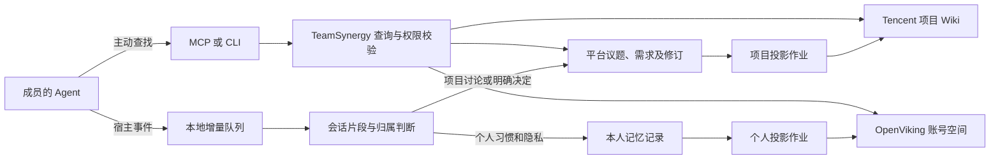

# TeamSynergy 原生记忆与 Agent harness 设计

2026-11-10 · 设计提案与可运行实验 · 首个宿主选 Codex CLI

后续实际落地：2026-11-11 已将普通项目文档的原生版本写入、统一 outbox、引擎投影、来源读取与原文分页接入生产用例，见 [项目文档记忆核心](70-project-document-memory-core.md)。本文保留早期提案和实验记录；现阶段正文主存仍为原生 PG，没有完成 Tencent 主存切换。

成员在已绑定的仓库中打开自己的 Agent，直接讨论业务或开发问题。Agent 通过 TeamSynergy 按需查项目背景和本人的工作习惯。会话结束一轮后，宿主将增量送入整理流程。其他成员随后能查到项目讨论并参与，原发言者的个人部分只在本人账号中演化。领取任务是可选的工作上下文。

## 接入方式

| 入口 | 第一版职责 | 选择依据 |
| --- | --- | --- |
| MCP stdio | 本地 `tsp memory mcp` 提供 `search_memory(query)` 查找、`read_project_decisions()` 读取已确认决定，以及 `read_memory(ref)` 展开授权来源。结果包含状态、范围、出处和版本 | 宿主在启动时发现能力，模型逐问题选择调用。Codex CLI 0.145.0 与独立 SDK 实测 search，真实本地模型实测 search 与决定读取。通用 ref 展开属于产品接口设计 |
| 宿主 hook | 捕获当前已绑定会话的新增用户和助手文本，持久入队即返回。Stop 是首个适配点，支持时加入压缩前检查与下一次启动补送 | 采集与模型是否选择工具独立。真实宿主发现了测试 Stop 命令并显示待信任，Stop 负载与增量行为已通过样本回放 |
| tsp CLI | 登录、工作区绑定、显示当前项目与账号、诊断、显式查找、纠正和撤回。无 MCP 的宿主可以调用相同读取 API。无 hook 的宿主使用显式会话导入，并显示最近捕获位置 | 现有设备身份和项目工作区绑定可以复用。CLI 与 MCP 共用服务端权限、查询与结果契约 |
| Tencent Memory Proxy | 留作支持修改模型端点、缺少宿主事件的可选适配器。能观测的内容、流式工具调用、会话归属需逐宿主验证 | 代理涉及模型流量，聊天记忆自动注入和 Agent 主动检索是两种触发机制。首版每个 session 唯一指定一个采集方，防止代理、上游插件和本地 hook 重复采集 |

命令名称是建议的产品接口。本轮可运行命令在各实验说明中。Codex 非托管 hook 的启用遵循宿主的定义审阅与信任流程。引导页应显示“读取已连接／采集待启用／上次同步时间”，成员可以先使用已可用的读取能力。[宿主验证](experiments/memory-harness-pilot/transport/README.md) · [Codex hooks](https://developers.openai.com/codex/hooks) · [OpenViking 宿主能力表](https://github.com/volcengine/OpenViking/blob/178a8cdfb41b51e7d24c4bf79a13cc54981e0ee8/docs/zh/agent-integrations/16-capability-reference.md)

## 两个引擎如何配合

兼容工作放在 TeamSynergy 的应用层。它解析当前成员、工作区和项目权限，给每个可引用片段分配稳定标识、来源修订、内容哈希与归属，将合格片段投递到目标引擎。客户端获得统一的查找和引用方式。两个引擎保留各自的底层文件、向量模型和 API 协议。

| 语义 | TencentDB Agent Memory | OpenViking | TeamSynergy 的处理 |
| --- | --- | --- | --- |
| 身份 | service/team/user/agent、Wiki 或 session | 当前用户密钥、user home，可有 peer | 服务端从当前有效 principal 和项目解析映射。一个项目对应独立资源范围，一个账号可在多个项目使用批准范围内的个人经验。peer 用于组织个人在某仓库的上下文，项目访问权由平台 ACL 决定 |
| 写入 | MemoryCore 可收会话并异步提炼，MemoryKnowledge 支持 raw 源、ingest、派生页面和搜索 | session 追加消息、提交并异步提炼、归档 diff，亦可读写特定 URI | 会话只捕获一次，按片段归属投递。首片优先用受控原文构建公共 Wiki。个人引擎只接收已提取的个人内容及条件。可保留合成的 owner-only session 来验证 OV 原生合并 |
| 读取 | Wiki 原文、生成页、原生搜索，命中需映射有效源 | 个人偏好、经验等类型按用户与条件查找，可按摘要、概览、正文深入 | 返回平台引用和证据类型。两个引擎分别排序并限制预算，合并时按来源去重。每个 ref 展开时再次检查原对象权限与当前修订 |
| 修订与撤回 | 同名 raw 内容可覆盖，Wiki 版本、源文件、索引状态各有含义 | 同一项目经验可能被再次提炼更新，session diff 可查，已保存的文件树快照可恢复 | 规范修订与引擎版本分别记录。平台先使失效片段停止召回，再更新下游索引或派生记忆。用来源关系找受影响条目。已同步的正式需求通过补偿修订纠正，保留审计 |

Tencent 的 L0–L3 表达从会话到事实、场景、画像的提炼。OpenViking 的上下文 L0–L2 表达目录摘要、概览与细节。接口适配应按“源片段／当前规范／检索命中”转换语义。旧 Hub 的 OV 适配器只接受特定目录、哈希文件名及 JSON 格式；OV 原生提炼产生的偏好文件需要新的读取映射。产品初期每一类记忆选择一个提炼写入方，保留引擎原生文件到平台来源版本的关联。[Tencent 技术说明](https://github.com/TencentCloud/TencentDB-Agent-Memory/blob/2002196f2d7c22ea267cfcaf67c5a6fa861df681/README.md#technical-implementation) · [OpenViking 上下文层级](https://github.com/volcengine/OpenViking/blob/178a8cdfb41b51e7d24c4bf79a13cc54981e0ee8/docs/zh/concepts/03-context-layers.md) · [运行实例兼容探针](experiments/memory-harness-pilot/engines/live-results.json)

## 从一句话到项目变化

1. **绑定会话。** 成员用 tsp 设备会话授权，并将工作区绑定一个可访问的项目。启动器持有短期会话绑定，包含实例、设备、账号、项目和宿主 session。Git remote 或 cwd 只用于定位候选绑定。遇到多个项目共用同一仓库时，先解决绑定歧义。模型工具输入只允许查询、范围收窄和引用。
2. **采集增量。** hook 记录宿主、事件序号、消息角色、稳定位置或消息 ID、内容哈希和本机游标。每条消息与服务端回执相对应。断网时写本地受限队列，确认持久接收后推进游标。重复消息复用回执，历史分叉、转录轮换或丢失来源进入对账。转录包含的命令输出、助手转述和粘贴的引语保留各自出处。
3. **拆分含义。** 整理器从同一句话提取多条最小片段，输出原文跨度、内容归属、适用项目或账号、涉及对象、候选状态和相关前文。一次操作指令随当前会话过期。我的提交习惯即使只适用于某仓库也留在本人空间。正文切片前处理凭据和私密字段。混合且边界不清的片段暂存于本人可见队列，澄清问题只指向有歧义的部分。
4. **共享讨论。** “超过七天也许要人工审核”形成退款议题的备选或讨论条目。第二位成员能按需检索它、看到“讨论中”、回复并形成新观点。按既有对象 code 和版本定位议题，标题相近时保留候选关联。对同一来源重放只记一次。个人风格、原始会话路径和私人上下文均使用账号可见范围。
5. **应用决定。** 操作者在当前上下文明示采纳时，将真实用户发言、指代的议题或方案、相关需求、预期修订和影响集合绑定在同一变更中。短事务内按项目材料栅栏顺序复查权限和对象版本，调用既有领域规则，写入议题决策、允许的需求修订、审计、幂等回执和投影作业。确定且有权就自动应用。对象不明确、冲突、变动范围超出原意则让原操作者回答一个具体问题。权限不足时向成员说明所需角色。已冻结的需求进入平台现有变更流程。
6. **记录落实。** 用两条事实分别表示“方案已采纳”和“何处已落实”。落实条目引用真实交付、验证或部署记录及环境。测试环境部署只支持相应环境的结论。确认需求后，已固定的任务基线仍由原合同变更规则推进。人工说明也应保留为“某人报告”，等待适用证据。

受管采集通道能提供比模型工具参数更好的来源信息。本地可编辑日志仍可能包含冒充操作者的引语。对导入日志仅生成候选，由经过身份校验的活动会话或平台既有操作表达采纳。正式写回需要语义、来源、目标和权限同时满足。解析 Git 偏好只影响适用场景中的格式和目标提示，推送权限由当前操作上下文决定。

项目背景、规划和业务逻辑也能独立形成知识。已有文档或代码说明了事实时，记录可见的原文版本、对象和关键摘录。工作中新增的、有出处的项目发现可直接生成知识条目。未决的需求问题进入议题，待其他成员补充。知识的适用范围由来源或明确决定给出，成员问全项目问题时也可能收到仅适用于指定模块或任务的答案，结果须显示这项限制。

## 查询、隐私与恢复

查询先取当前绑定与来源 ACL，可并行读项目有效决策、Tencent 项目知识和本人的 OV 记忆。项目背景问题以项目材料为主，风格问题先看本人，混合问题可以同时查两侧。已有知识版本和平台变更版本应同时返回。索引跟不上时，直接提供可授权的最新规范原文，并说明索引进度。空命中与引擎不可用分别表示。检索结果先带短摘录、状态、环境、来源与修订，模型再用 read 展开需要的内容。工具说明中写明查项目历史和个人习惯的场景，模型自主选择调用。

权限至少在搜索和展开引用时各检查一次。撤权、归档和来源权限变化后重新求有效角色。共同上下文快照保留可共享的正式材料，个人结果在请求时单独组合，交给下位成员时重新按其账号查询。不同客户间先按隔离部署或已有客户边界分区，团队成员关系与工作区 peer 都不能作为跨客户共享许可。[权限实现](../packages/application/src/project-access.ts) · [已有交接实现](../packages/application/src/handover-use-cases.ts) · [多客户约束](adr/0017-multi-customer-boundaries.md)

建议默认将完整转录留于成员设备，由成员开启指定项目的采集。服务器保存最小必要的证据片段，原始私有段与可公开摘录分别授权。跨端提炼若需要传输原文，应在接入界面标明处理位置和保留策略。支持暂停、查看本次产生的记忆、纠正和撤回。用户撤回来源后，后续搜索、缓存、分页引用都复查失效状态，后台重建受影响的派生项。会话保留时长和团队的可导出范围属于待试点的产品默认值。

业务提交与投影作业在同一 PostgreSQL 事务写入。作业绑定受众、固定目的地、来源修订与哈希。公共作业的输入只来自本项目已允许共享的摘录，个人作业凭所有者绑定写入其 OV 空间。模型只提出归属，服务端执行路由，worker 在发送前核对范围和撤销状态。远程 I/O 在事务外执行，保存 generation、远端 ID 和阶段。已知失败可重试，超时且不知是否落盘时先按固定标识和哈希对账。全源处理完成、可读内容与预期相符后，经版本比较激活新索引。过期作业作废。影子阶段引擎离线时可直接读取 PG 中的业务记录与正式原文。

建议增加四类持久数据，沿用现有账号、项目与业务对象编码体系。

| 数据 | 服务端约束 |
| --- | --- |
| 会话与来源片段 | 设备＋宿主会话＋项目绑定＋消息序号／稳定 ID 唯一；保存游标、原文跨度、哈希、作者角色和可见范围，迟到补录保留原事件顺序 |
| 记忆条目及修订 | 记录 owner 或 project、适用范围、对象引用、摘录及来源版本。讨论、采纳、落实分别关联讨论发言、决定修订及执行证据。更正指向被替代版本 |
| 引擎资源绑定 | 实例、账号／项目、引擎、资源标识共同确定目标，平台来源版本映射远端 Wiki／页或 OV URI。原型中依赖配置手工映射，正式模块按启用范围惰性建立并对账 |
| 操作回执与投影作业 | 既有命令回执记录业务操作，新增专用作业承载投递、租约、阶段和失败恢复。幂等键绑定事件、片段、目标及载荷摘要。冲突后在新版本上重新判断 |

## 文档主存决策

**首版保留 PostgreSQL 的业务记录与修订指针，先让 Tencent 承接普通项目 Markdown 原文的影子副本和公共检索。** 第二阶段可按文档类型，把验收合格的正文读写切到腾讯 raw 存储。需求状态、任务合同、验收、权限和业务事务继续由 TeamSynergy 维护。Wiki 生成页承担导航与检索，规范引用解析到具体原文版本。编辑入口始终落到同一条版本链。

真实隔离 Wiki 实验中，中文与 CRLF 字节哈希一致。两名编辑者都从同一初稿出发，先后提交同名文件，旧稿晚写后覆盖了已采纳版本，Wiki 版本从 1 到 2 再到 3。按“文档编码＋修订＋内容哈希”命名不同文件时，两个版本均可读回。已核对并清理本次创建的临时 Wiki。[运行结果](experiments/memory-harness-pilot/storage/result.json) · [复现脚本](experiments/memory-harness-pilot/storage/wiki-roundtrip.mjs)

切换正文主存需要由服务端写不可变版本文件，显式标记编码，读回哈希，再在 PostgreSQL 事务内比较旧修订、推进指针并排队索引。原文写成而事务失败时，旧指针仍有效，未引用文件由对账任务回收。影子期间抽查逐字节导出、并发编辑冲突、重启恢复、权限撤销、中文查询和整库备份还原。切换后的回退先导出并校验切换以来所有新修订。大小与格式覆盖以运行实例为准。上游 API 文档和同提交路由源码对上传限制和编码的描述已有差异，二进制附件需独立验收。[Wiki API](https://github.com/TencentCloud/TencentDB-Agent-Memory/blob/2002196f2d7c22ea267cfcaf67c5a6fa861df681/MemoryKnowledge/v3-api-memoryknowledge-doc.md) · [实际路由](https://github.com/TencentCloud/TencentDB-Agent-Memory/blob/2002196f2d7c22ea267cfcaf67c5a6fa861df681/MemoryKnowledge/src/routes/wiki.ts#L291)

切换后的 PG 记录保存当前修订、出处与正文指针。若 Tencent 离线，只有缓存版本和指针哈希一致时才展示缓存正文，其余显示正文暂不可用。恢复流程从备份重建原始字节并核对指针，索引可由原文重建。

## 实验如何改变设计

| 环节 | 本轮观察 | 设计后果 |
| --- | --- | --- |
| 会话分类 | 真实本地 Qwen 7B 在冻结的四个开发例上，朴素提示严格匹配 1/4。细化条件后 0/4，输出把消息正文当作来源 ID。由服务端约束可选来源 ID 与归属／状态组合后 3/4，预留四例 4/4 | 模型只提候选。服务端限制引用、核对原文片段并绑定版本；对来自私人或临时操作的片段另做公共发布资格判断 |
| 共享资格 | 最终分类器仍把“这一次修好后直接推送”标为项目设想。额外语义复核拦住此条，同时挡住了 6 条合格公共摘录中的 3 条 | 同一模型双重判断有明显召回代价。原型可先记录、影子比对、收集分歧样本。自动发布与写回需在独立、含混合隐私和引语的真实任务集验证 |
| 两引擎读取 | 已有授权样本的自然语言查询在两端都找到目标，OV 目标得分约 0.803。关键词写法只命中腾讯，两个引擎对无关问题均返回空，跨账号直接读取个人原文返回 403 | 按权限与意图路由，对匹配、降级、未命中和模型最终采用分别计数。各引擎分数保留原义 |
| 真实模型选工具 | 合成子串检索中，细化工具说明使两个相关问题均触发检索，命中仍为 0。切到真实 Bob 成员 CLI 后，旧查询分支过滤了 agreement，模型用个人经验答项目契约时缺少项目依据 | 建议在 MCP 增加 `read_project_decisions`，仅在模型询问有效决定时读取平台已确认来源。实验新增此工具后，模型在同题主动读到确认决定，能答出 6 MiB、包含前缀及最小结构校验；字节单位计算与 JSON 格式仍有误。该入口标记 formal_read |
| 正式写回 | SQLite 实际事务中 10 个案例通过，包含重复、载荷变更、撤权、目标漂移、回滚和已锁定需求。含义与角色由预标注合成样本提供 | 把现在分别开启事务的议题及需求用例抽成可在同一事务运行的内部操作，增加议题头、需求修订与影响范围的并发见证。下一轮用真实 PG 回放 |

测量采用固定本机模型和小样本，适合发现反例。公开摘录的逐字检查只证明可定位来源，仍可能漏掉否定词或错误理解引语。[分类输入与评分脚本](experiments/memory-harness-pilot/extraction/probe.mjs) · [第二次语义检查结果](experiments/memory-harness-pilot/extraction/review-public.json) · [业务写回实验](experiments/memory-harness-pilot/writeback/README.md)

旧成员 CLI 实验借用了 image-preflight 的任务范围。另写的窄版项目读取器只绑定实验账号与项目，复查实时 ACL、已发布代次、正文哈希及个人归属。自然问题找到了 1 个项目来源与 1 个个人来源，负例为零。直接读取的决定注明只适用于两个任务，网络记录中任务／旧简报请求为零。当前读取器白名单内只有这两份已知材料。通用来源解析、跨项目工作区选择及不同权限角色还属于后续产品开发。[项目级运行结果](experiments/memory-harness-pilot/engines/project-reader-results.json) · [模型端实验](experiments/memory-harness-pilot/agent-use/README.md)

将这个项目级后端接回 MCP 后，用同一模型重问三题。契约题先读当前决定，再检索到同一公开来源，正确回答 6,291,456 字节及最小结构校验，遗漏了 data URL 前缀计算。个人题在两个引擎各命中一项，最终答案未引用实际返回的经验 ID。算术题直接回答 42，零调用。由此建议将前一工具已返回的相同来源标成重复，对“我的习惯”优先呈现本人来源，并把作用域、关键限定与引用放在同一条结果内。下一次在新的留出问题上对照这种呈现是否改善采用率。[无任务的真实模型调用记录](experiments/memory-harness-pilot/agent-use/observed-live-project.json)

## 首个交付顺序

| 阶段 | 在 TeamSynergy 中落点 | 验收 |
| --- | --- | --- |
| 1. 原生按需读 | contracts 定义 search/read 返回值，application 组装当前权限下的来源，core-api 暴露账号会话 API，cli 实现 stdio MCP 和诊断。项目可独立于任务绑定 | 新宿主、无任务、两成员、两个项目。历史问题能查到正确状态与来源，个人风格只回本人，普通算术可直接回答。分别记录模型选工具率、真实命中和最后是否正确使用 |
| 2. 会话积累 | 首选已装 Codex，适配 Stop 和恢复游标。应用层按上述片段协议分流，Tencent/OV adapter 接投影作业。项目议题复用原讨论入口，账号页提供查看与撤回 | 混合一轮输入，B 能获知退款讨论并回复，A 能读自己的风格。涵盖无转录、重放、乱序、断网和历史变动。误公开或跨账号泄漏阻止扩大试点 |
| 3. 明确决定自动写回 | 在 packages/application 复用原议题及需求领域规则，packages/persistence 增加证据、幂等键和投影任务，接入现有审计 | 同一授权会话明确采纳一次，议题与需求各产生正确修订。权限冲突、来源变化及目标不明有明确反馈。相同事件重送零重复，确认后任务与部署仍依据原执行证据 |
| 4. 正文迁移试点 | 选择一个项目的一类普通 Markdown 文档，有版本指针、哈希、可恢复导出，再扩展其他文档类型 | 新旧读路径语义与字节一致、并发丢写为零、恢复后的来源与权限一致，再切换该类文档的写入方 |

进入团队试点前，应将上面的拆分实验合并为一次真实宿主会话，包含真实 Stop 投递、项目无任务检索、同一语句分流、双引擎投影、跨成员读取和 PG 事务写回。用冻结语料比较漏召回、错误采纳、遗漏语气条件、隐私误共享和需要澄清的频次，并记录冷／热耗时、每次提炼 token、入库延迟和回放结果。有来源的当前信息是否被正确使用，是下一轮比较不同 harness 或模型的主要指标。
