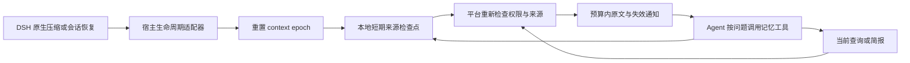

# 宿主压缩、暂停恢复与短期来源检查点

2026-11-11 · TeamSynergy 原生记忆切片

这轮把宿主真实的上下文变化接入记忆读取：DSH 压缩正文后先重置上下文代次，MCP 根据短期来源检查点重新核验、取回必要原文；进程退出后仍可恢复引用，执行许可不会随之恢复。TencentDB 和 OpenViking 的长期投影、业务对象存储与权限规则保持现有职责。

## 生命周期与数据流



检查点只保存来源编码、内容指纹、上下文代次和有效期，不保存来源正文、聊天、摘要、推送许可或设备凭据。它用于找回此前有依据的工作背景，不能替代任务状态、当前需求修订或宿主自己的会话摘要。

| 状态 | 保存与有效性 |
| --- | --- |
| 宿主工作上下文 | DSH 原生聊天与摘要，本轮实际执行原生压缩、持久化和恢复 |
| 来源检查点 | CLI 独立 SQLite，距上次成功读取 24 小时有效；按 API／账号／设备／工作区／项目／宿主会话隔离 |
| 读取回执 | MCP 进程内，绑定上下文代次，30 分钟有效；只代表该代次已交付的正文 |
| 动作许可 | 受控适配器内存；不进入检查点，重启不能复活旧令牌 |
| 长期知识 | PG 来源与修订，以及 TencentDB 项目／OpenViking 本人语义投影；恢复时继续由当前权限和来源状态裁决 |

每个 owner 最多 128 个活动检查点，每个检查点最多 40 个来源。`inspect` 和 `reset` 不延长已有引用的寿命；`new-chat` 清空引用。到期后丢弃旧引用，不能通过一次 reset 将它们续期。

## MCP 如何恢复，又如何控制开销

宿主为一场聊天设置独立的 `TSP_MEMORY_SESSION`，三个记忆工具随成功读取保存来源引用。未设置时继续使用原来的显式回执协议。普通宿主仍需在压缩后省略旧回执或明确重新读取原文。

启用检查点后，每次工具调用先读取上下文代次。代次变化或 MCP 进程重启时，先取得当前查询／简报，再通过认证的 `/memory/sources` 回读检查点来源。旧索引、旧摘要或本地指纹不能代替权限核验。不存在、已撤回或无权访问的来源只报告编码，不返回旧正文。

当前问题的直接结果优先，其后补充历史来源。一次恢复最多交付 6 条、8,000 个正文字符；超预算条目整条列入 `deferred_sources`，不截断限定条件。未交付的正文不会计入新回执的“已知来源”，后续可通过 `read_memory_source` 展开。恢复的历史记录仍保留原 `state`、修订和对象关系，不表示它已成为当前共识。

工具元数据增加 `context_epoch`、`context_reset`、`restored_sources` 和按需出现的 `deferred_sources`。数据读取期间若宿主重置或清除检查点，SQLite 的 epoch＋revision 比较会拒绝陈旧响应，返回 `memory_context_changed`，供当前上下文重试。

本轮同时收紧工具选路说明：一般近期背景先选简报，具体标识或主题先搜索；有足够证据即回答；已有读取已核验时效，不再例行按来源重复取文。缺原文、待展开来源或逐字核对时仍允许重读。

当前检查点仅覆盖 `search_memory`、`read_memory_brief`、`read_memory_source`。`resources/read` 保持原有全量快照协议，不写检查点，也不自动恢复历史来源。不能把工具路径的验证结论扩大到所有宿主入口。

## 宿主如何接入

[memory-dsh-lifecycle.ts](../apps/cli/src/memory-dsh-lifecycle.ts) 是可挂载的 Cordis 适配器，没有增加模型可调用工具，也不依赖新增 SDK 包。它订阅本机 DSH 0.2.1-rc.2 的原生事件：

- `compaction/summary` 后的 `compaction/end`，以及无需模型的 `compaction/prune`：同步重置代次；摘要已落地而后续报错时也保守重置。
- `agent/created` 且 `source=resume`：在恢复后的下一步前同步重置。
- 重置失败：阻断目标宿主会话的下一步，不继续使用旧回执；其他会话不因此被阻断。

调用的是固定 Node 可执行文件和 CLI 参数，不执行模型传入的命令。CLI 控制入口为：

```powershell
tsp memory context inspect --session <宿主记忆会话ID>
tsp memory context reset --session <宿主记忆会话ID> --reason compaction
tsp memory context reset --session <宿主记忆会话ID> --reason resume
tsp memory context reset --session <宿主记忆会话ID> --reason new-chat
tsp memory context clear --session <宿主记忆会话ID>
```

DSH 成员配置需要给该聊天的 MCP 子进程传 `TSP_MEMORY_SESSION`，同时挂载编译后的 `memory-dsh-lifecycle.js`，配置 `hostSessionId`、`memorySession`、`cwd`、`memberHome`、`cliPath`，可选 `auditFile`。`hostSessionId` 必须是实际 DSH 原生会话 ID，`memorySession` 与 MCP 环境变量一致。示例配置结构：

```json
{
  "id": "tsp-memory-dsh-lifecycle",
  "name": "file:///F:/workspace/team-synergy/apps/cli/dist/memory-dsh-lifecycle.js",
  "config": {
    "hostSessionId": "<实际DSH会话ID>",
    "memorySession": "<该聊天独立的记忆会话ID>",
    "cwd": "F:/workspace/team-synergy",
    "memberHome": "C:/path/to/member-agentctl-home",
    "cliPath": "F:/workspace/team-synergy/apps/cli/dist/index.js"
  }
}
```

这是每场 SDK 聊天独立配置的桥接，尚未全局安装。不能把一个固定 `memorySession` 放进多聊天共享的 MCP 进程当作动态路由；DSH Web/TUI 多聊天和原生工作目录变更仍需另外接入。当前自动化只验证了 DSH 的这条原生生命周期，未验证 OpenCode 或 Codex 的压缩与恢复。其他宿主可先用相同 CLI 入口，但需要分别核验其成功事件和恢复时序。

## 真实模型与原生生命周期验证

最终运行见 [result.attempt2.json](experiments/memory-harness-pilot/recovery/result.attempt2.json)，协议在请求前冻结。两组都使用真实 TencentDB Wiki/Core、OpenViking、隔离 PG、认证 HTTP、生产 CLI/MCP，工具描述与输入相同；区别是 tracked 启用检查点和可信原生事件适配器，untracked 不启用。

使用 DSH 0.2.1-rc.2，两组各 10 个持续聊天回合。通过本地 Magpie 使用 `workbuddy/deepseek-v4.1-flash`，共 **41/41** 响应经网关验证，HTTP 全部 200，无模型回退或传输故障。[Magpie 自身 usage 的独立核验](experiments/memory-harness-pilot/recovery/provider-usage.attempt2.json)在同一 UTC 时间窗匹配 41 个不同 response ID，`served_model=deepseek-v4.1-flash`、`swapped=false`。总计 input 13,990、cache-read 140,800、output 6,269 token，包含两个原生摘要请求；该聚合没有逐组归属，不能推算分组 token 节省率。

| 验证 | 实际结果 |
| --- | --- |
| 原生压缩 | 两组均调用 DSH `compactNow`，各 shadow 15 条消息，有效消息表面由 17 节点变为 3；完整历史原文的探针从存在变为不存在 |
| 压缩后恢复 | 历史来源已经落后于当前需求修订、不再出现在简报，但仍有权读取。tracked 首次读取自动取回原文、返回新决定并报告撤回来源；untracked 通过额外读取也找回正确依据 |
| 实际暂停／恢复 | 真正退出 DSH 进程，保留其原生持久化，再用 `session/resume` 恢复同一个 ID。两组均采用平台后来更正的记号和来源，不沿用被撤回版本 |
| 项目切换 | 原聊天先实际收到旧 MCP 绑定错误；真正重启并恢复同一原生会话后，模型读取新项目 13 秒来源，未引用旧项目知识。补上了上轮只有独立观察进程重接的缺口 |
| 许可边界 | 恢复前的一次模拟动作已经执行；恢复后的新适配器 ledger 拒绝旧 grantId，模型实际重试也没有新增效果。未执行 Git 或部署 |

原生摘要可能保留事实、来源 ID 或回执；完整工具原文消失不意味着模型忘记全部事实。历史原文消失由 DSH 的有效消息表面核验，不是另建空白聊天或手工删除模型历史。摘要正文没有被评测脚本改写。

untracked 的恢复回答首行包含正确 JSON，随后附加解释，因此冻结的整答 JSON 评分中 4 项字段检查为 false。原评分保留；[独立语义核验](experiments/memory-harness-pilot/recovery/semantic-assessment.attempt2.json)另按首行比较记号、当前 8 秒决定和来源，7 项均正确。该结果是输出格式失败，不能据此宣称对照组记忆事实错误。tracked 全部原始检查通过。

## 成本结果与边界

| 指标 | untracked | tracked |
| --- | ---: | ---: |
| 首次读取工具数 | 1 | 1 |
| 首次读取返回字符 | 828 | 935 |
| 压缩后恢复工具数 | 2 | 1 |
| 压缩后返回字符 | 1,345 | 1,066 |
| 进程恢复后工具数 | 4 | 1 |
| 进程恢复后返回字符 | 1,621 | 1,039 |
| 全场工具数 | 14 | 10 |
| 全场记忆工具返回字符 | 5,523 | 5,281 |

本次轨迹的工具数减少 28.6%，全部记忆工具返回仅减少 **4.38%**。检查点与恢复元数据本身增加开销，tracked 的部分普通读取甚至更大。首轮各 1 个工具只能说明当前样例的选路结果；与上轮不同语料中各 2 个工具不能作严格因果比较。

这些数字包含所有记忆返回文本，未把正文节约当作完整上下文或 token 节约。小样本、模型实际选路与不同原生摘要均有波动，适合证明恢复能力和发现反例，不能当一般项目的平均性能结论。提示明确要求核验当前资料，未验证任意后台变更的自主感知。

## 试验过程与自动化验证

首轮 6 个业务回合后，原生摘要达到 768 token 上限而截断，Magpie usage 的 stop reason 为 `length`；13 个指定模型响应保留并排除压缩验收。最终将双方摘要独立上限提高到 4096，业务回答仍限制 1600，并增加双方相同的无工具收尾回合，使原生压缩能够覆盖旧工具单元。协议在新请求前重新冻结，没有修改摘要来伪造原文丢失。[完整运行索引](experiments/memory-harness-pilot/recovery/run-index.json)

最终报告含 10 项运行文件哈希，逐项与当前产物一致，隔离数据库和临时宿主目录均已清理。CLI 记忆相关测试 **39/39**、build、typecheck、定向 ESLint 与三个新评测模块语法检查通过。覆盖 TTL、容量、损坏记录、可变快照注入、账号／项目／会话隔离、reset／clear 与在途读取竞争、恢复预算、延迟正文、许可重放及原生事件失败屏障。

主要实现文件：

- [memory-working-context.ts](../apps/cli/src/memory-working-context.ts)：受限的来源引用检查点和 CLI 控制。
- [memory-context.ts](../apps/cli/src/memory-context.ts)、[memory-mcp.ts](../apps/cli/src/memory-mcp.ts)：代次、来源回读、预算与显式展开。
- [memory-dsh-lifecycle.ts](../apps/cli/src/memory-dsh-lifecycle.ts)：宿主事件桥接。
- [memory.ts](../apps/cli/src/memory.ts)：命令注册与减少重复取证的选路说明。
- [recovery runner](../apps/core-api/tests/native-memory-recovery.mjs)：真实引擎、压缩与进程恢复对照。

没有新增依赖、修改上游 TencentDB／OpenViking、改成员全局配置或执行真实 Git 推送。

下一轮应在 OpenCode 的真实恢复路径复验，并做每聊天独立身份／工作区的宿主接入管理，再考虑多聊天共享进程。平台统一任务工作记忆、人工可见的未决事项与恢复入口仍需单独设计，不应把这个来源检查点描述为已经完成的团队工作台功能。
