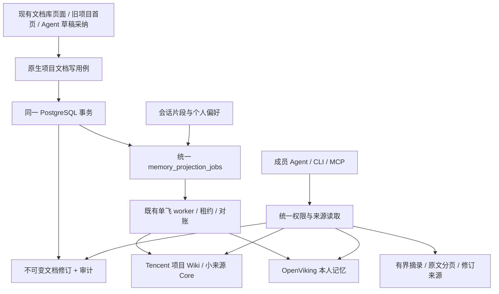

# 项目文档进入平台记忆主链路

2026-11-11 · 实际核心集成与剩余边界

这轮将普通项目文档接入 TeamSynergy 的原生记忆链路。成员沿用现有页面和 API 保存文档，业务事务同时提交不可变修订、审计和记忆投影任务；Agent 从相同修订读取当前背景。没有建立独立知识正文库、第二套队列或新的调度器。

此前已完成会话片段、议题／需求写回、引擎读取及宿主恢复，但普通项目文档没有自动进入该链路。这是本轮补齐的生产入口，不只是新增验证脚本。Web 页面无需改成另一个编辑器，它调用的原生写用例已经接入。

## 当前架构



| 职责 | 实际落点 |
| --- | --- |
| 业务事实与版本 | 继续使用 `project_documents` 和 `project_document_revisions`，正文没有复制到 `memory_fragments` |
| 原子入队 | 四处修订写入：普通创建、普通修订、旧首页保存、系统 Agent 修改稿采纳 |
| 统一异步投影 | 原 `memory_projection_jobs` 增加文档修订引用；fragment 和 document revision 恰好选一，文档仅投 Tencent |
| 长期检索 | Wiki 保留完整原生正文；不超过 4,000 字符的文档还写 Core，较长文档明确走 Wiki-only，未做长文向量分块 |
| 当前背景读取 | `searchEvidence`、`brief`、`readSources` 合并原生文档与既有来源，复用设备身份、项目 ACL 与账号有效性 |
| 原文展开 | `readDocument`／HTTP／CLI／`read_memory_document` 按不可变来源分页，不把整份大文档塞进模型上下文 |

OpenViking 仍接收本人偏好和经验，本轮没有把公共项目文档同时写进账号空间，也没有改动上游引擎源码。

## 数据与事务边界

新增迁移 [0055_project_document_memory.sql](../packages/persistence/drizzle/0055_project_document_memory.sql)：

- 原 outbox 的 `fragment_id` 允许为空；新增 `project_document_revision_id` 外键和唯一约束。
- XOR 保证每项作业只有一个来源；文档来源的目标必须是 Tencent。
- 回填活动项目中活动文档的当前修订，只插入引用，不复制正文。
- integrity 与项目归属巡检覆盖两个来源路径。

`enqueueProjectDocumentMemory(tx, revisionId)` 在原业务事务中运行。写入失败时，文档、修订、审计和作业一起回滚；文档版本冲突不会产生第二个任务；系统 Agent 同一采纳的重放不增加修订或作业。创建入口补上项目 aggregate fence，使归档先取得锁时，随后创建会等待并重新校验，不能在归档后落下新文档。

worker 继续使用原有 `SKIP LOCKED`、attempt／lease 栅栏和不可变远端命名。当前修订被替代、文档归档或项目归档时，旧作业停止投影；已在远端的旧索引候选也要经过当前读取规则过滤。公共文档不因为原作者账号停用而消失，读取者仍必须是当前有效成员。

## 来源不是另一个文档副本

文档来源使用 `project_document_revisions.code`，带 `sourceKind=project_document`、`documentCode`、`sourceRevision` 和 `state=documented`。`documented` 表示文档记载，不能自动表示“团队已经确认”或“实际已经完成”。议题的 discussed／confirmed 与执行证据仍独立。

当前记忆仅返回活动项目、活动文档的当前修订。旧来源编码不会重定向到新正文，而是返回不可读，要求重新检索；原文档页面的历史版本链仍保留。历史记忆展开策略还需单独设计，不能把“历史可访问”和“当前有效背景”混为一谈。

搜索、简报和来源回读使用最多 1,600 UTF-16 单元的正文摘录，明确提供 `excerpt.nextOffset`；展示标题最多 240 单元，并有 `titleTruncated` 标记。原生完整标题、正文和修订不变，避免合法长标题绕过正文预算。

新原文入口：

```text
POST /projects/:projectCode/memory/documents/read
  { source, offset?, limit?, query?, occurrence? }

tsp memory document <source> --offset <nextOffset> --limit 4000
tsp memory document <source> --query "文末约束" --limit 4000
tsp memory document <source> --query "验收标记" --occurrence last

MCP: read_memory_document({ source, offset?, limit?, query?, occurrence? })
```

`query` 与 `offset` 二选一，每次 2–8,000 单元，默认 4,000。返回 `range.offset / nextOffset / total / unit=utf16`。连续分页不拆开 surrogate pair；文档内查找缩减前置上下文，确保小页包含命中，查询本身超过页长则明确拒绝。分页工具每次都重新检查权限和当前版本，不接受模型指定账号。

`occurrence=first|last` 仅与 `query` 一起使用，默认 first。正文在介绍中提到“文末验收标记”等词时，last 能定位最后一处实际约束，避免多次取回文首。匹配使用转义后的字面内容，不接受任意正则表达式。

该第四个工具是显式原文读取，不参与原三个工具的回执／检查点协议；深页恢复、去重尚未完成。原检查点恢复的是文档来源及有界摘录。

## 已运行的真实链路

[真实投影结果](experiments/memory-project-documents/projection-live.json)由设备认证 HTTP 创建文档，直接进入原生事务和统一 outbox，再调用既有 worker：

- 中文短文与 4,000 字符以上长文均在真实 Tencent Wiki 保存完整正文，SHA-256 与不可变原生修订一致。
- 短文有 1 条 Core 记录，长文明确为 0；自然中文搜索命中 Wiki 与 Core，没有静默降级。
- 精确创建的 Wiki、Core 记录与隔离数据库已清理。

原生写入口既有 CRLF→LF 和 trim 规范化。首轮测试误把提交原始字节当作规范修订而失败，已保留并排除；最终核验以 `revision.content` 为准，没有改变原业务规范化。[投影运行索引](experiments/memory-project-documents/projection-run-index.json)

[真实读取结果](experiments/memory-project-documents/native-read.json)通过认证 HTTP、正式 CLI 和 MCP 验证了当前文档检索及文末原文定位；未登录、伪造 principal、跨项目和额外 actor 参数均被拒绝；新修订保存后旧 source 立即不可读，原作者停用不影响其他有权限成员读取公共文档。

相关自动化覆盖原子回滚、四个写入点、并发版本冲突、归档恢复、回填、FK／XOR、worker 租约被替换、远端篡改、当前修订过滤、长文分页、长标题预算及小页查询。真实模型接手结果独立归档，不能用模块测试代替模型能否正确使用来源。

## 原生文档由另一成员的真实 Agent 使用

通过本机 Magpie 的 DeepSeek V4.1 Flash，让 Bob 使用空白 OpenCode 1.14.21 会话接手 Alice 的原生文档，未领取任务、未预置会话记忆。两题分别验证短文当前规则与更新后的长文末尾约束。规则、原因、验证方法和 source 均来自原生文档，模型正确回答实施状态为 unknown。

Alice 通过原生 HTTP 更新为第二修订后，旧原生索引仍能命中，但平台拒绝旧 source。Bob 只引用当前修订，并实际调用第四个原文工具找到不在 1,600 单元摘录中的随机验收标记。第二修订 7,273 字符，完整 Wiki 哈希一致，Core 明确为 0；这不是把长文截成一条向量。

首次有效运行暴露重复页问题：文首提及查询词，两次 query 都返回同一前页，模型后来再按 offset 取得文末。增加 last 匹配后，以相同协议、相同两版正文、相同随机标记和问题复跑，结果如下：

| 更新后长文场景 | 优化前有效运行 | 加入 last 后 |
| --- | ---: | ---: |
| 全部工具调用 | 5 | 6 |
| 原文展开次数 | 3 | 2 |
| 全部记忆返回字符 | 15,362 | 9,670 |

模型实际使用 `occurrence=last`，定位到 offset 7,010，文末页正文为 263 字符。总返回少 37.05%，但模型又执行了带回执的核验，所以总工具数上升，不能声称调用次数也减少。初版场景两次均为 2 个工具、1,376 字符。这是两个受控问题的轨迹，不是通用性能或引擎开关的因果比较。

两轮均为有效通过，各 8 个指定模型响应；原运行和成本反例保留。最终网关审计全 200；[Magpie 自身 usage 独立汇总](experiments/memory-project-documents/handoff-provider-usage.attempt2.json)核对 8 个不同 response ID，实际 served model 为 `deepseek-v4.1-flash`、swapped=false。聚合 token 没有逐题／逐工具归属，不能用返回字符节约率推算完整 token 或费用节约。

[最终模型结果](experiments/memory-project-documents/handoff-result.attempt2.json)附 13 项运行文件哈希，全部与实际代码一致。[运行与对照索引](experiments/memory-project-documents/handoff-index.json)区分两个有效迭代。引擎资源、原生临时账号所在隔离数据库和宿主临时目录已清理；没有运行 Git 或部署动作。本轮没有实跑 OpenCode 原生压缩恢复，也没有测模型对 OpenViking 本人记忆的使用，不能扩大结论。

最终相关回归：CLI 47/47、核心读写／投影／原记忆 22/22、既有文档与项目首页 21/21。五个相关 package 的 build／typecheck 通过；定向 lint 无 error，原项目文档文件两处既有非空断言 warning 保留。新迁移只在隔离数据库验收，未应用到当前运行服务的数据库。

## 仍未完成的产品核心工作

1. **正文主存切换**：PG 仍是原生正文与版本的权威来源，Tencent 是完整影子原文和检索投影；没有删除旧正文、切换生产数据库或宣布迁移完成。后续主存切换需要不可变原文指针、哈希、并发比较、导出和恢复验收。
2. **资源绑定管理**：记忆路由仍受 `TSP_MEMORY_ENABLED` 与引擎配置控制，项目／账号引擎映射仍由配置提供。新建项目尚不会自动创建 Wiki 或账号空间，需要平台管理入口和资源生命周期。
3. **其他业务来源**：需求、架构、测试资料在文档库里是原对象的关联视图，本轮没有复制它们制造第二份数据。原生需求／任务／缺陷的一切修改尚未自动进入统一记忆。
4. **可见的产品管理面**：索引进度、失败重试、来源状态与撤回的完整页面还没加入。本轮已有编辑页面继续工作，但这不等于记忆管理产品界面已完成。
5. **多聊天宿主接入**：新增 OpenCode 1.14.21 单聊天桥接及回归，其他聊天无法借用同一检查点。共享 MCP 的安全动态路由、原生压缩／恢复真实复验仍需继续，不能把静态单聊天配置当作多聊天完成。[对应版本插件契约](https://github.com/anomalyco/opencode/blob/v1.14.21/packages/plugin/src/index.ts) · [对应版本压缩流程](https://github.com/anomalyco/opencode/blob/v1.14.21/packages/opencode/src/session/compaction.ts)

## 本轮主要代码

- [schema 与统一 outbox](../packages/persistence/src/schema.ts)、[事务入队](../packages/application/src/project-document-memory.ts)
- [原生文档写入口](../packages/application/src/project-document-use-cases.ts)、[旧首页入口](../packages/application/src/project-use-cases-project.ts)、[Agent 草稿采纳](../packages/application/src/system-agent-use-cases.ts)
- [文档来源与原文](../packages/application/src/memory-document-sources.ts)、[统一读取用例](../packages/application/src/memory-slice-use-cases.ts)
- [真实引擎投影](../apps/core-api/src/memory-engines.ts)、[API](../apps/core-api/src/routes/memory.ts)、[CLI/MCP](../apps/cli/src/memory-mcp.ts)

未新增依赖，未修改 TencentDB／OpenViking 上游代码，未改成员全局配置，未执行真实 Git 推送。
