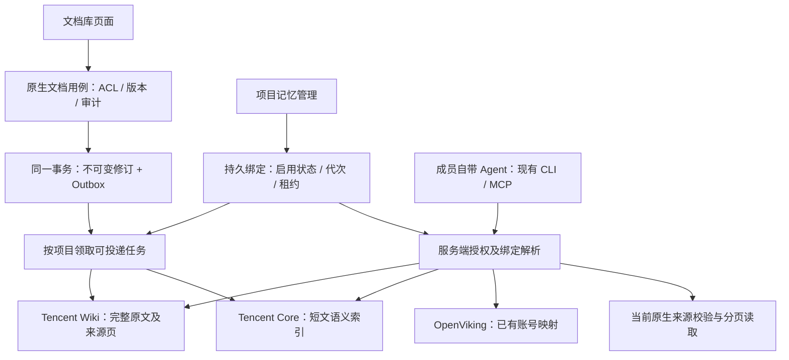

# 项目记忆控制面与本地升级

本轮把项目记忆的配置、状态和恢复接入 TeamSynergy 原有文档库。管理员在项目页面启用，服务器创建并绑定腾讯 Wiki；Agent 沿用原来的 CLI / MCP 记忆工具，由服务器解析当前绑定。浏览器和 Agent 都不接触引擎密钥或自行指定 Wiki ID。

## 已实现的边界

| 数据 | 当前权威来源 | 用途 |
| --- | --- | --- |
| 项目、成员、需求、任务、缺陷及权限 | 原生 PostgreSQL 领域模型 | 业务操作、授权、审计 |
| 项目文档及不可变修订 | 原生 PostgreSQL | 编辑、版本冲突检测、来源分页读取 |
| 项目记忆绑定与同步策略 | `project_memory_bindings` | 启用、暂停、资源恢复、并发隔离 |
| 项目检索材料 | Tencent Wiki 原文 / 来源页及短文 Core 索引 | 共享检索，由原生来源二次校验 |
| 账号私有偏好 | 已有个人记忆路径及 OpenViking 适配器 | 账号隔离的偏好与经验检索 |

**正文主存尚未从 PostgreSQL 迁走。** 腾讯是可重建的检索投影，不能把“已同步”解释为方案已确认或工作已完成。账号到 OpenViking 的自动开通、迁移与管理页面不在本轮实现范围内；本地新配置不把真实平台账号映射到已有试验账号。

## 读取与写入

项目未启用或已暂停时，检索继续走原生项目数据。暂停停止新的腾讯任务领取与引擎检索，不隐藏或删除项目文档。已经发出的外部请求可能完成；其旧代次不能将任务确认成已同步，也不能通过旧检索结果扩大当前查询的来源集合。

项目绑定由服务器持久化，重启不依赖重写项目配置文件。静态旧配置仍可使用；一旦有数据库控制记录，以数据库为准，包括显式暂停。

## 管理 API

所有接口要求已认证的会话或设备身份，使用现有项目权限。GET 对可读成员开放，写操作要求项目管理权限；项目归档、账号停用和成员权限会在事务内复核。

| 方法与后缀 | 行为 |
| --- | --- |
| `GET /projects/:code/memory/management` | 连接状态、当前文档同步数及来源；不含正文、引擎资源 ID 或凭据 |
| `POST .../management/enable` | 空对象请求；领取 provisioning 租约，创建或复用 Wiki，代次校验后绑定 |
| `POST .../management/pause` | 保留资源，关闭同步与引擎检索；递增代次，阻止旧回调生效 |
| `POST .../management/retry` | 当前文档重试；验证既有资源，失效时按受保护的代次重新建立连接 |

三个 POST 均直接返回管理 DTO 的标准 envelope。请求不得携带 actor、Wiki ID、团队 ID 或密钥。状态接口在全局记忆开关关闭时仍可读取，显示服务未配置；启用与重试返回 503，暂停仍可使用。

列表只展示最多 100 份当前原生文档，计数包含全部当前文档，并标记截断。历史修订、归档文档、个人记忆不进入该管理列表。

## 资源开通与恢复

服务器配置新增可选的 `projectProvisioning` 模板：`teamId`、`userId`、可选 `semanticAgentId`。它是服务写入身份，浏览器不能修改。项目 Wiki 名固定为 `tsp-memory-<projectCode>`，校验实际返回的项目名、团队、所有者和资源 ID；本地部署的 Tencent create 按 service/team/name 幂等。

`provisioning` 租约为两分钟。并发启用只产生一个有效开通票据；租约过期可重领。网络返回不确定时，后续操作按同一资源名恢复，不盲目删除资源。暂停和重新开通都会改变代次，旧的完成回调不能覆盖新状态。

重试先授权，再纯读取验证已有 Wiki。只有明确 404 才自动恢复资源；503、超时和身份不符返回服务不可用，不替换已绑定资源。只有仍启用且代次匹配时，才能领取修复票据。此限制避免旧重试请求在等待引擎期间覆盖另一位管理员的新暂停。资源失效时，仅将当前项目、当前修订的已同步文档标记为待重试，保留尝试次数，随后重新投递。

旧静态 Wiki 明确返回 404 时，可以沿用静态配置中的服务写入身份创建替代资源，并由数据库绑定接管；超时和身份不匹配不会触发替换。首次从旧配置导入时也会在新绑定确认事务内重排当前文档，避免“旧状态已同步、新资源却为空”。同一绑定恢复不会重排已同步文档。

Worker 的最后确认与暂停共用项目 advisory fence，并再次匹配代次。任务租约与尝试次数另行保护投递确认。旧来源和其他项目的内容即使仍留在远端，也必须经过当前原生来源校验才能返回给 Agent。

## 界面

入口在项目文档库标题下，默认收起来源详情。负责人可启用、暂停、恢复和重试，成员可看状态和当前版本来源。来源可以跳回原文；文档保存后刷新本项目状态。读取失败、403、项目切换和项目不匹配时，不展示旧缓存中的来源与管理按钮。

窄屏把操作按钮放到说明下方，复用现有卡片、按钮和中英文文案。真实浏览器验收见 [界面证据](experiments/memory-platform-rollout/ui-verification.json) 与 [截图](experiments/memory-platform-rollout/ui-memory-verified.png)。截图中的文档属于独立恢复库的联调项目。

## 本地升级与回退

升级前原库为 0052。先用 PostgreSQL 一致性快照备份并恢复到全新库，逐表校验全部 80 张表的行数和内容 SHA256，以及迁移、列、约束、索引、函数指纹；恢复未复制 owner / ACL，此项不属于相等性证明。备份在工作区之外且目录仅当前用户可访问。

新版本先在独立恢复库的 `18080 / 15173` 联调，再升级本地原库的 0053–0056。迁移只增加记忆结构及当前文档投影任务，不迁移或删除原文。原运行 checkout 及其未提交修改不覆盖。

本地原服务现使用当前工作区版本，监听 `127.0.0.1:8080 / 5173`。原有 79 张业务表内容校验未变，410 项关系检查无孤立记录。原 TeamSynergy 项目通过现有设备账号的只读验收；其记忆保持未启用，负责人可从文档库开启。本轮未自动将真实项目文档投影到腾讯，也未自动开通真实账号的 OpenViking 私有资源。

第一层回退是用当前新版本关闭 `TSP_MEMORY_ENABLED`，继续使用 PostgreSQL 文档库。旧版本严格检查其打包迁移头，不能直接连已升级库作为完整回退；需要将升级前备份恢复到另一个新库再指向旧版本，保留已升级库以保护后续新写入。

备份与升级证据：

- [初次一致性恢复](experiments/memory-platform-rollout/backup-verification.json)
- [隔离环境登录与服务烟测](experiments/memory-platform-rollout/staged-smoke.json)
- [真实管理链路探针](experiments/memory-platform-rollout/management-live.json)
- [原本地环境升级结果](experiments/memory-platform-rollout/local-rollout.json)

## 验证与后续工作

新增应用和 HTTP 集成覆盖权限、资源注入防护、并发启用、静态配置兼容、暂停 / 恢复、资源丢失修复，以及投递中、最终确认前、重试中的三种暂停窗口。完整性与租户清单已包含新绑定表。[本轮相关测试 106 项通过](experiments/memory-platform-rollout/checks.json)，类型检查和构建通过，lint 为零错误、69 个现有警告。真实引擎探针另行验证自动开通、中文非字面召回、来源原文、暂停回退和服务实例重建后的绑定恢复；它不是模型效果评测。

当前超过 4000 字符的文档保留完整 Wiki 原文，但跳过单条 Core 向量，尚未实现长文分块语义召回。本轮短文的中文效果不能代表长文效果。

接下来优先补账号私有记忆的自动开通与撤销，以及长文分块检索，再设计正文主存迁移。主存迁移需要独立存储接口、不可变版本条件写、全量校验、故障恢复和明确切换点；不能把当前检索投影直接改名为文档主存。
