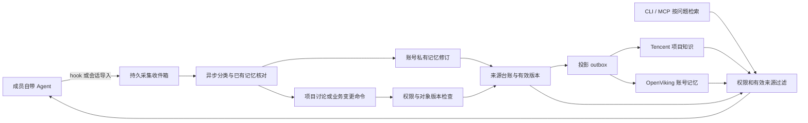

# LobeHub Personal Memory / White-Box Memory 对比

2026-11-11。本文为官方源码调研和演进建议；本地已交付能力以代码核验表为准。本轮引擎修复与性能数据见 [73-memory-engine-optimization.md](73-memory-engine-optimization.md)。

本文对照表中的 TeamSynergy 实现是本次个人记忆治理改造前的快照。解除采集绑定、个人修订/撤回、账号页面及真实联调的后续落地见 [75-personal-memory-governance.md](75-personal-memory-governance.md)。

结论：最值得借鉴的是**可管理的记忆对象、来源与变更记录、提炼流水线、画像摘要与按需检索分离**。这些能力应补在 TeamSynergy 的双引擎骨架之上。我们的主线仍是团队围绕项目形成、讨论和更新共同背景，个人风格与隐私按账号隔离。

## 调研版本与概念

固定版本为 [canary@3f6ccbab65775af6325d081d0fcf227beea5d4b2](https://github.com/lobehub/lobehub/commit/3f6ccbab65775af6325d081d0fcf227beea5d4b2)，提交时间 2026-11-11 08:52:49 UTC。本轮核对官方文档与源码，没有运行 LobeHub 服务。

- **Personal Memory** 描述围绕用户积累的长期背景与偏好，实际分类为 identity、activity、context、experience、preference。[CLI 分类](https://github.com/lobehub/lobehub/blob/3f6ccbab65775af6325d081d0fcf227beea5d4b2/apps/cli/src/commands/memory.ts#L9-L11)
- **White-Box Memory** 描述结构化、可查看和可编辑的体验。当前文档允许自动提炼后检查、编辑、删除，没有逐条人工批准的保证。[官方介绍](https://github.com/lobehub/lobehub/blob/3f6ccbab65775af6325d081d0fcf227beea5d4b2/docs/usage/start.mdx)、[当前 Memory 说明](https://github.com/lobehub/lobehub/blob/3f6ccbab65775af6325d081d0fcf227beea5d4b2/docs/usage/getting-started/memory.mdx)
- 文档把 User Memory 与 Agent Self-Learning（Labs）分开，工具提示词也把通用执行流程、技能与检查清单指向 skill/workflow 管理。因此 experience 分类不能直接等同于 Agent 获得了经过验证的通用工作方法。[工具职责](https://github.com/lobehub/lobehub/blob/3f6ccbab65775af6325d081d0fcf227beea5d4b2/packages/builtin-tool-memory/src/systemRole.ts#L22-L29)

## 与当前真实实现的对照

| 维度 | LobeHub 已读实现 | TeamSynergy 当前实现与缺口 |
| --- | --- | --- |
| 记忆归属 | 核心 user memory 按 userId 过滤，查询代码明确没有 workspace 列。Persona 按个人归属生成；版本列表、删除和恢复限制在 personal scope，getPersona 仍使用兼容 workspace 的 userMemoryProcedure。[隔离条件](https://github.com/lobehub/lobehub/blob/3f6ccbab65775af6325d081d0fcf227beea5d4b2/packages/database/src/models/userMemory/where.ts#L41-L65)、[Persona API 范围](https://github.com/lobehub/lobehub/blob/3f6ccbab65775af6325d081d0fcf227beea5d4b2/apps/server/src/routers/lambda/userMemory.ts#L254-L267) | 已有项目 ACL 和个人 scope。项目讨论、决定与来源由平台业务规则约束；个人 context 中提到项目，并不形成团队公共真相。 |
| 个人分类 | 五类独立结构、对应字段与管理命令。[Preference schema](https://github.com/lobehub/lobehub/blob/3f6ccbab65775af6325d081d0fcf227beea5d4b2/packages/database/src/schemas/userMemories/preference.ts#L10-L60) | 当前只有 preference 个人片段，支持 project/account 适用范围。没有完整的个人身份、经历、风格分类模型，也没有个人修订、撤回和失效 CRUD。[本地 schema](../packages/persistence/src/schema.ts) |
| 主存与检索 | PostgreSQL 分类表与 pgvector，1024 维，HNSW cosine 索引。[基表](https://github.com/lobehub/lobehub/blob/3f6ccbab65775af6325d081d0fcf227beea5d4b2/packages/database/src/schemas/userMemories/base.ts#L8-L51) | 当前文档正文和不可变修订仍在 PG，Tencent 是检索投影；个人片段也有 PG 记录并投递 OV。文档主存尚未切到 Tencent。[文档事务](../packages/application/src/project-document-use-cases.ts) |
| 提炼入口 | 有会话读取、已有记忆召回、Gatekeeper、分类提炼、embedding 与持久化流程；另有手动与 hourly workflow，启用取决于部署。[提炼入口](https://github.com/lobehub/lobehub/blob/3f6ccbab65775af6325d081d0fcf227beea5d4b2/apps/server/src/services/memory/userMemory/extract/extractTopic.ts#L361-L433) | Capture 仍要求 topicCode + requirementCode；个人偏好也走需求绑定。分类在 HTTP 内同步等待模型，异步的是后续引擎投影。[契约](../packages/contracts/src/memory.ts)、[提炼器](../apps/core-api/src/memory-extraction.ts) |
| 白盒界面 | 查看、分类编辑和删除有前端及 API。Preference 已读手动编辑链路仅改正文/updatedAt，未见该链路重建向量或 Persona。[编辑链路](https://github.com/lobehub/lobehub/blob/3f6ccbab65775af6325d081d0fcf227beea5d4b2/src/store/userMemory/slices/base/action.ts#L289-L350)、[数据库更新](https://github.com/lobehub/lobehub/blob/3f6ccbab65775af6325d081d0fcf227beea5d4b2/packages/database/src/models/userMemory/preference.ts#L30-L71) | 已有项目文档/记忆面板和投影状态控制，个人主要只有 brief/search/read，没有记忆编辑、撤回产品入口。不能把项目面板当成完整个人白盒产品。[面板](../apps/web/src/ProjectDocumentsWorkbench.tsx)、[管理路由](../apps/core-api/src/routes/memory-management.ts) |
| 来源与归并 | 提炼保存 messageIds/source/sourceId；Context consolidation 有 before/after 操作与 revertRun，检查后续依赖。[来源](https://github.com/lobehub/lobehub/blob/3f6ccbab65775af6325d081d0fcf227beea5d4b2/apps/server/src/services/memory/userMemory/extract/persistLayers.ts#L54-L66)、[撤回](https://github.com/lobehub/lobehub/blob/3f6ccbab65775af6325d081d0fcf227beea5d4b2/packages/database/src/models/userMemory/consolidation.ts#L810-L839) | 项目已有来源、修订见证、幂等回执、议题撤回/新决定替代和有效来源过滤；个人 preference 缺少等价的变更与撤回链。 |
| 状态与可用性 | hypothesis 与 active 都可见，过滤 superseded/rejected；userLocked/state 字段存在。[可见性](https://github.com/lobehub/lobehub/blob/3f6ccbab65775af6325d081d0fcf227beea5d4b2/packages/database/src/utils/memoryVisibility.ts#L4-L10) | discussed/confirmed 区分方案是否采纳，brief 说明确认不代表实现。没有 implemented/fact 独立状态，任务/缺陷/测试事实也尚未全面接成来源。 |
| 画像与检索 | 内置工具支持多查询和分类/时间/标签过滤，后端 hybrid search；另有 UserMemoryInjector 和派生 Persona。[检索工具](https://github.com/lobehub/lobehub/blob/3f6ccbab65775af6325d081d0fcf227beea5d4b2/packages/builtin-tool-memory/src/manifest.ts#L93-L175)、[注入器](https://github.com/lobehub/lobehub/blob/3f6ccbab65775af6325d081d0fcf227beea5d4b2/packages/context-engine/src/providers/UserMemoryInjector.ts#L28-L72) | CLI/MCP 已有按需 search/brief/source/document，含回执去重与恢复检查点。实际主动调用仍取决于模型；没有完整的个人画像编译与失效机制。 |
| 自带 Agent | CLI 有 list/edit/delete/persona/extract/status。已读 MCP Bridge 不能证明 Personal Memory 默认作为通用 MCP 提供给任意外部 Agent。[CLI](https://github.com/lobehub/lobehub/blob/3f6ccbab65775af6325d081d0fcf227beea5d4b2/apps/cli/src/commands/memory.ts)、[MCP 边界](https://github.com/lobehub/lobehub/blob/3f6ccbab65775af6325d081d0fcf227beea5d4b2/packages/heterogeneous-agents/src/builtinMcp/LobeBuiltinMcpServer.ts#L76-L112) | 已有 Codex/DSH/OpenCode 的读取或单聊天生命周期适配；尚非统一多聊天接入管理。采集与检索仍需分开验证，不能只因装了工具便宣称闭环。 |

说明：对 LobeHub 手动编辑链路的观察是“已读路径未见同步重嵌入/重编 Persona”，不据此断言整个系统不存在其他补偿任务。新 Context consolidation 的撤回能力也不能扩展成所有五类记忆均有可靠冲突裁决。

## 最值得带回来的设计

### 1. 把记忆对象做完整：归属、类型、状态相互独立

建议统一记忆记录至少包含：稳定 ID、owner scope、kind、适用项目/仓库、来源会话与消息、证据类型、当前 revision、替代/撤回关系、更新时间、有效期限、人工锁定标识和派生索引状态。

项目背景、业务规则、需求讨论与实现证据走项目 scope；个人风格、习惯和隐私走账号 scope。个人记忆可以记录“我关注项目 A”，并引用项目知识当前版本；不应复制一份私有项目事实后，把它当成其他成员必须服从的公共规则。

通用方法经验另设经验证的经验/流程对象，保留适用条件、成功证据和失效原因。不能从一次助手自述“已解决”自动推导出可靠 skill。

### 2. 白盒要贯穿修改后的实际使用

每条记忆应能回答：谁的、适用哪里、源自哪句话/哪个修订、属于讨论/结论/实施证据中的哪一层、为什么被召回、上次怎样修改，以及当前索引是否追上了正文。

编辑产生新修订，撤回使旧版本立即无法作为有效来源引用，再由 outbox 更新/删除 Tencent 与 OV 派生副本；画像、来源回执和工作检查点也需要 revision/epoch 失效。索引失败应可见、可重试。逻辑不可引用与远端物理删除应分别展示，不能通过 UI 隐藏便声称已经清除全部副本。

个人入口放在账号的“我的记忆”；项目入口放在项目知识/共识空间。任务详情可以引用相关记忆，但会话积累不以领取任务为前置条件。

### 3. 将采集、整理、业务变更和索引拆成可观察的步骤

建议演进流程如下，新增环节属于待实现方案：

会话先绑定账号、项目、仓库和 session，topic/requirement/task 作为可选关联。只有实际更新业务对象时才要求明确目标、权限和版本。范围不清、冲突或权限不足时提问；在权限范围内且目标明确的讨论记录与更新可自动完成。

项目设想继续可检索，结果明确显示“尚未确认”。confirmed 表示方案采纳；implemented 必须引用代码、测试或发布等执行证据，且按不同证据类型分别表示完成范围。人的确认、模型置信度与实际完成度应分别记录。

### 4. 保留 Agent 按需检索，画像只做可控摘要

默认启动仍只获得检索能力与身份/项目绑定，按当前问题主动读取背景。可借鉴 Persona 作为轻量派生摘要，由工具按需获取，或在用户显式配置后限量提供稳定偏好。不要默认把全部个人经历和项目事实注入启动上下文。

CLI 用于连接、诊断和治理；MCP 提供统一语义查询与来源展开；hook 负责独立采集与压缩/恢复事件。三者共享服务端权限与来源协议。DSH/OpenCode/Codex 的会话增量、去重、撤回传播、来源引用和恢复仍需分别实测。

## 用用户的 Git 习惯检验分类

| 会话内容 | 应如何处理 |
| --- | --- |
| Conventional Commits、提交说明用中文 | 个人工作偏好；默认保留当前项目适用范围，明确声明通用后再提升到账号通用偏好。 |
| 本项目提交到 origin/dev、提交前同步最新代码 | 若表达本人在该仓库的习惯，记为私有偏好并限该项目/仓库；只有明确表达团队已采用的共同规范，才结合出处、意图和权限写共享约定。归属不清时询问。 |
| “这个 bug 改好后提交并推送” | 当前任务/会话的执行授权，有范围、时效与消耗规则；记忆不能永久授予后续推送权限。 |
| “这次先不要推送” | 当前会话约束优先；不因已有偏好默认执行，也不把一次禁止误写成永久习惯。 |
| “方案就按这个做” | 记录方案确认，实施、测试与上线分别等后续证据。 |

当前一次性授权 ledger 有实验验证，但尚未接成生产 Git 执行闸门，也不控制任意 shell；新设计不能把该保护视为已经全平台生效。[本地 ledger](../apps/cli/src/memory-authorization.ts)

## 建议下一轮交付顺序

1. **解除会话采集对需求的强绑定**，增加持久收件箱和后台整理，保留现有来源校验、幂等回执与权限约束。验收无任务讨论、个人偏好、重复 Stop、离线补送、冲突提问。
2. **最小个人白盒闭环**：偏好与经验证的个人经验起步，身份资料按需增加，加来源、适用范围、修订、锁定、撤回及“我的记忆”页面；编辑后重索引，旧引用与画像同时失效。验收用户改偏好后另一空白会话读新值、旧值不可作为有效依据。
3. **扩展项目证据与共识治理**：需求/任务/缺陷/代码测试事件进入统一来源协议；提供讨论→采纳→实施证据的可追溯变化，支持依赖检查后的撤回与替代。验收讨论可见但未实施、成员 B 接手、跨项目隔离、撤回后下游提示受影响。

存储权威位置应独立明确：当前 PG 文档修订是实际主存。将来若按原目标让 Tencent Wiki 承载正文，需要单独设计内容修订引用、元数据提交与恢复、迁移校验及回滚；不能因为 LobeHub 使用 PG，就认定应整体迁移持久层，也不能把现有检索投影描述成已完成主存替换。

本轮借鉴范围落在产品治理、提炼生命周期与 harness 协议；LobeHub 的个人记忆模型为团队共识提供了参考组件，项目共享的权限、事实状态和业务版本仍由 TeamSynergy 负责。
