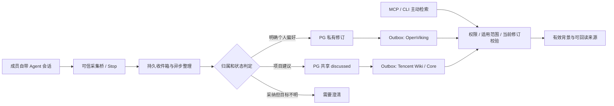

# 会话采集与个人记忆治理

2026-11-11。依据 [LobeHub 对比](74-lobehub-memory-comparison.md) 实施。参考其可查看、可纠正的个人记忆治理；TeamSynergy 继续分别维护团队项目共识和账号私有记忆。

## 边界与验收

- 账号、项目、会话、事件足以采集，议题/需求及其版本见证整组可选；半组绑定拒绝。无绑定的项目建议只形成 discussed 项目背景，不创建假需求或确认完成事实。采纳业务方案仍须明确目标、权限与来源版本。
- 未绑定会话经持久收件箱返回 202，后台提炼并提供状态；相同事件重放幂等，改变原文/绑定必须使用新事件。Stop 不等待模型。旧的绑定业务采集接口保留同步兼容路径。
- 个人记忆查看、编辑、撤回仅限本人。归属与适用范围分开：项目限定的个人习惯仍为私有，不因提到仓库或分支就共享。编辑不能扩大适用范围。
- 管理使用稳定 root source，引用使用具体 revisionSource。编辑/撤回/恢复新增不可变修订，expectedRevision 防止覆盖并发修改；旧引用即时失效，历史仅本人可读。
- 投影遵循归属：个人只写 OpenViking；项目公开内容写 Tencent Wiki/Core。outbox 带 operation/generation/attempt 栅栏，编辑撤回清理旧版本；晚到写入不能将撤回内容重新变成有效来源。
- 页面显示范围、来源、历史、同步状态与可恢复错误。区分平台已撤回与远端副本清理完成。CLI 与 MCP 复用服务端规则，客户端缓存不能复活失效引用。
- 自带 Agent 仍通过本地 Magpie 使用 DeepSeek V4.1 Flash。实测无任务会话采集、空白会话读取、修改后读取新版本、旧引用失效、撤回后不可检索、其他成员和跨项目隔离、项目讨论不升级为已实施、同步重试与乱序防护。

## 最小接口

- `POST /projects/:project/memory/capture-events`：入队；`GET /projects/:project/memory/captures/:code`：状态；`POST .../:code/retry`：失败重试，保持原始见证。
- `GET /memory/personal`：本人列表；`GET /memory/personal/:source`：详情；`PATCH .../:source`：expectedRevision + text + reason；`POST .../:source/withdraw`：expectedRevision + reason。
- 私有详情包含稳定 source、revisionSource、revision、active/withdrawn、适用范围、来源、历史及投影状态。列表支持 active/withdrawn/all；写入不接受指定其他 owner 或修改 applicability。

## 实施与验证顺序

1. 追加迁移、可选绑定、个人修订领域规则和权限回归。
2. 采集收件箱/API/后台 worker、引擎投影与清理栅栏，覆盖失败和竞态。
3. CLI/hook/MCP 与“我的记忆”页面，验证并发冲突不丢草稿。
4. 备份、隔离数据库迁移与真实双引擎联调，随后更新经核验的本地服务。
5. 用真实 harness 和模型执行闭环；保留来源与运行证据，独立审查后记录实际收益和限制。

## 结果

### 已实现

- `/account/memory` 是所有登录成员可用的个人页面，提供使用中/已撤回筛选、来源项目筛选、来源和修订历史、编辑、撤回、编辑并恢复，以及索引更新/旧副本清理状态。来源项目筛选不等于适用范围。
- 会话采集不要求任务、议题或需求。收件箱先持久化原始事件，再异步整理；事件原文哈希、身份、会话和事件 ID 决定幂等性。失败可重试，目标不明进入澄清，不凭上下文猜测业务对象。
- 私有记忆在 PostgreSQL 保存不可变修订。稳定 `source` 用于管理，`revisionSource` 用于具体引用；原文来源和适用范围不因编辑改变。撤回立即阻断普通检索，远端删除在后台完成；恢复创建新修订。
- 个人数据只投影 OpenViking。项目公开讨论投影 Tencent Wiki/Core，明确标记 `discussed`。项目讨论不会因为可检索就成为已确认或已实施事实，私有偏好也不会因为与项目有关就进入公共知识库。
- MCP 读取仍由服务端验证身份、项目权限、适用范围和当前修订。检索引擎负责扩展候选，PostgreSQL 当前记录负责决定可见性与有效性。普通 Agent 工具不返回管理历史，旧引用和旧会话回执不能绕过撤回。
- Inbox 在写入领域数据前校验 lease/attempt，并将领域更新和 ACK 放在同一事务。投影 worker 对 operation/generation/attempt 做栅栏校验，并串行处理同一私有片段的远端写删；晚到写入保留补偿删除意图。

### 本地服务与页面验证

迁移 0057 只扩展修订结构，0058 增加收件箱，0059 最后放宽业务绑定约束。没有放宽仓库迁移检查规则；[59 条迁移演练](experiments/personal-memory-governance/migration-rehearsal.json)保留 79 张业务表内容，418 项关系检查无孤儿记录。

浏览器在隔离克隆库实际执行了 r1 编辑期间另一客户端产生 r2、保留草稿并核对后保存 r3、撤回 r4、恢复 r5。来源身份与项目适用范围保持不变。隔离页面没有配置真实引擎，正确显示排队/清理中；它只证明页面和 API，远端同步由单独真实联调证明。正式页面已在本地 `http://127.0.0.1:5173/account/memory` 验证登录及读取成功，未把验证用偏好写入真实账号。

### 验证事故与恢复

最终回归曾误将业务库 `acp` 的连接传入旧的 `persistence.test.mjs`。该套件直接对调用者指定的库执行 DROP SCHEMA / TRUNCATE，导致业务库被清空。这是执行范围判断错误；原结果的测试通过不能用作安全验收。

已停止原 API，保留受影响库，使用本轮事前完成校验的 10:41:02 UTC 备份，在独立恢复库恢复并迁移至 0059。恢复时 79 张业务表哈希与事前备份一致，4 个账号、3 个项目、64 个任务、35 条需求；418 项关系检查无孤儿。正式 API 已切换到恢复库；[恢复记录](experiments/personal-memory-governance/recovery.json)保留数据库身份和校验时点。独立审查在 UTC/ISO 相同序列化条件下再次核对 79 张表，仍无差异。

新增 `scripts/test-database-guard.mjs`，在 persistence、application、core-api 三个危险测试入口连接前要求专用 test 库名，拒绝业务库、系统库和恢复/演练库；URL 解析错误也使用固定提示，避免输出凭据。后续回归只使用本次新建、核对 OID 的专用测试库。旧失败日志保留。

[日志核查](experiments/personal-memory-governance/recovery-log-audit.json)在备份开始至停服期间发现 19 次 HTTP 请求，没有写请求；它不能证明没有数据库直连或后台写入。恢复保证的是事前备份内容，不能据此保证备份后的所有新增写入均已恢复。私有启动入口位于本轮 runtime 备份目录的 `launch-api.ps1`，使用恢复库配置；不能继续使用受影响 `acp` 作为业务运行库。此入口将异步整理固定为本机 Magpie `/v1`、`workbuddy/deepseek-v4.1-flash`，密钥及连接串不入仓库。

### 验证边界与后续目标

本轮个人记忆落地的是明确表达的偏好，尚未声称能自动抽取任意经历、隐私或完整个人画像。收件箱保留原始会话事件，并不代表已经实现完整原始会话保留/自动过期策略。无绑定公共讨论可检索，但通用讨论的编辑、撤回、关联需求与晋升共识工作台尚未完成。

DSH/OpenCode 使用真实原生会话和真实模型，通过可信 stdin 桥采集选定用户发言；没有新增这两个 harness 的原生自动全量会话采集 hook。Codex 已有 Stop 路径复用持久队列。新偏好声明可先确认收到，不为登记原文重复检索；询问既有偏好或冲突时仍需要主动取证。

### 最终真实联调

[g 的独立验收](experiments/personal-memory-governance/20261111-governance-g/acceptance.json)通过：使用生产 guidance，DSH 0.2.1-rc.2 的 6 个真实会话共 14 轮，OpenCode 1.14.21 的 2 个空白会话；Agent 和整理器都通过本机 Magpie 请求 `workbuddy/deepseek-v4.1-flash`，42/42 响应返回 200 且模型标识全部匹配。136 次引擎 HTTP 请求没有失败。

9 项事实检查涵盖无任务采集、无目标采纳澄清、同聊天修订及旧引用失效、新聊天使用新修订、其他成员只能读取公共讨论、账号偏好跨项目而项目偏好不跨项目、撤回及物理副本删除、本人历史保留、Tencent 中只有共享讨论。非字面问题分别通过 OpenViking 以及 Tencent Wiki+Core 找到有效来源。全部临时 Wiki/Core 记录、新 OV 用户/个人正文和隔离数据库均已核对身份后清理。

另一位独立 Agent 阅读 Bob 的两条原始回答，确认它把共享条目标为讨论、未见采纳决定，并明确“没有证据表明已实施”不等于“确认未实施”；它对自己的风格与截图目录回答未知，没有复述 Alice 私有偏好。这个结论不是自然语言正则打分，也没有真人参与评分，更不代表所有回答都经过逐条语义审查。原始 `result.json` 的 `accepted=false` / `pending` 保留不改，由独立 [review](experiments/personal-memory-governance/20261111-governance-g/independent-review.json) 和 `acceptance.json` 合并验收。

a–f 运行保留原件，不将其拼接成成功率：a 的早期 Agent 中止没有可靠故障原因；b 使用过诊断专用 writer 提示；c 是工具结果观测器未处理 items 包装；d/e 是自然语言正则误报。随后取消自然语言自动打分，以来源事实硬校验加独立原文审查验收。

f 的首次 OpenViking upsert 确实未通过写后校验，其原 HTTP 根因仍未确证，12 秒 deadline 只是怀疑。原测试遇到首次 needs_reconcile 即终止，未等待生产 outbox 的 retry lease；现仅修正验证器，让它在真实 lease 下最多等待 3 次/120 秒，保留每次失败和精确读回，未改生产 worker 的 deadline。[单条真实丢 ACK 注入](experiments/personal-memory-governance/20261111-projection-diagnostic-c-injected/result.json)证明 12 秒超时后，按实际剩余 lease 等待，再次处理 62ms 同步成功，正文哈希一致，没有重复 write，最终物理清理成功。这个注入用例不调用 Agent/分类器，也不算入 g 的 42 次模型请求。

验证范围仍是两个成员的小型合成软件场景，不能据此声明大规模并发效果、原生全自动采集或真实 Git 推送已验证。旧聊天已经见过的文本无法从模型上下文中抹去；撤回保证当前来源失效和后续空白聊天不再召回。

### 最终代码检查

- 安全隔离库重跑相关合同、领域、API、投影、持久层测试 **120/120**，零跳过；[专用库创建与清理记录](experiments/personal-memory-governance/regression-verification.json)保留测试 PID、时间和名称/OID核验。
- Web 全量 **401/401**，CLI 记忆相关 **56/56**；测试库保护 **3/3**，迁移规则 **3/3**。
- 工作区构建和类型检查通过；追加 0059 后重新构建 core-api，已复制完整 59 条迁移。最终 lint 为 **0 error / 69 warning**，本轮目标模块没有新增错误。
- 浏览器真实验证并发草稿、修订、撤回与恢复；正式 API `/ready`、页面、Magpie 模型清单和独立 OV embedding 服务均返回 200。正式服务使用恢复库配置，私有配置未入仓库。

### 核心改动位置

| 职责 | 实现 |
| --- | --- |
| 会话收件箱与可选业务绑定 | [capture queue](../apps/core-api/src/memory-capture-queue.ts)、[memory routes](../apps/core-api/src/routes/memory.ts)、[contracts](../packages/contracts/src/memory.ts) |
| 个人修订、撤回与权限 | [personal use cases](../packages/application/src/personal-memory-use-cases.ts)、[personal routes](../apps/core-api/src/routes/personal-memory.ts) |
| 双引擎派生同步与个人用户分配 | [projection](../apps/core-api/src/memory-engines.ts)、[personal runtime](../apps/core-api/src/memory-personal-runtime.ts) |
| Harness 采集和 MCP 当前来源 | [CLI capture](../apps/cli/src/memory-capture.ts)、[personal CLI](../apps/cli/src/memory-personal.ts)、[MCP](../apps/cli/src/memory-mcp.ts) |
| 账号记忆工作台 | [UI](../apps/web/src/PersonalMemoryWorkbench.tsx)、[API client](../apps/web/src/personalMemoryApi.ts) |
| 测试连接前保护 | [guard](../scripts/test-database-guard.mjs)、[regression](../tests/test-database-guard.test.mjs) |
