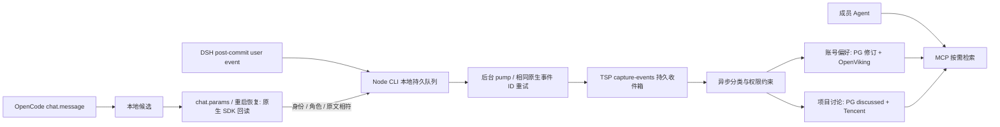

# 测试隔离与原生会话采集

2026-11-12。本轮按用户要求处理测试隔离与原生采集闭环，不再追求恢复历史测试数据的准确性。后续文档同步讨论只形成[引用式记忆方案](77-project-memory-source-references-proposal.md)，未改变现有项目的开关或同步行为。

## 数据边界

测试使用独立 PostgreSQL 16 实例，loopback `127.0.0.1:55432`，独立目录 `F:/workspace/team-synergy-runtime/test-postgres`。凭据重新生成，测试身份不是超级用户，不读取业务配置或备份中的连接串。测试默认入口由 runner 创建新库，固定实例身份、名称/OID、owner、run token 和 fixture token；破坏性操作前再次核验。普通命名包含 test 不能作为隔离证明。

中央 pg preload 在连接前拒绝错误地址、端口、身份和凭据，在连接后核对真实 cluster identity。各历史 DROP/TRUNCATE helper 与 native allocator 共用同一 fresh-fixture 协议。直接运行需要 SQL 的测试但没有有效 run lease 时失败关闭。测试 scope 的管理员能力不会传给成员 Agent；成员只获得当前项目的 TSP 设备身份和必要的模型连接。

真实双引擎联调同样使用新实例：Tencent Core `18520`、Wiki `18524`、OpenViking `21933`，目录位于 `F:/workspace/team-synergy-runtime/test-memory-engines`。程序与已安装官方依赖可只读复用；数据、监听器和管理凭据独立。Ollama 的模型计算服务可共享，业务记忆存储及凭据不共享。

## 插件、Hook 与 MCP 的分工

MCP 提供模型按当前问题主动调用的只读工具。原生插件/Hook 读取宿主生命周期，负责来源可靠的会话采集；CLI 则提供固定进程入口、本地持久队列和配置生成。不能让模型调用一个写工具来替代“谁实际说过这句话”的宿主来源证明。



### DSH 0.2.1-rc.2

原生 `session/event` 是提交后的事件流；`session/flush` 是等待的持久化检查点。只接收被选定会话、工作目录、账号下的 `user/message`，要求 `role=user` 且 `source.kind=user`；插件注入的 user-role 消息、工具内容、助手回答及 subagent 不进入用户采集。flush 只等本地入队，不等平台 HTTP 或模型。恢复历史 seed 不重新产生用户事件，resume/idle 只补投既有 outbox。

来源：[固定版本生命周期](https://github.com/deepseek-ai/deepseek-harness/blob/e8f7b93a344964de3dca1ace9e72b6e4d6de87cb/docs/agent-lifecycle.md)、[事件与持久化检查点](https://github.com/deepseek-ai/deepseek-harness/blob/e8f7b93a344964de3dca1ace9e72b6e4d6de87cb/docs/event-producer-consumer.md)。仓库地址与本机安装包元数据一致。

### OpenCode 1.14.21

`chat.message` 位于原生存储之前，因此这里只本地暂存。`chat.params` 在用户消息保存之后、模型调用之前，使用原生 SDK 按 session/message ID 读回；只有普通用户文本且原文精确相符时才确认投递。启动、idle/error 边界补偿回读与重放。不能在 Hook 尚未保存成功时直接把候选当作共享项目事实。

来源：[固定版本插件接口](https://github.com/anomalyco/opencode/blob/v1.14.21/packages/plugin/src/index.ts)、[消息写入流程](https://github.com/anomalyco/opencode/blob/v1.14.21/packages/opencode/src/session/prompt.ts)、[模型前置流程](https://github.com/anomalyco/opencode/blob/v1.14.21/packages/opencode/src/session/llm.ts)。当前官网已演进，不能把新版接口直接套到本机版本。

## 接入方式

在已登录并绑定项目的工作区执行，宿主会话 ID 必须来自实际创建的原生会话：

```powershell
tsp memory native setup --harness dsh --host-session <native-session-id>
tsp memory native setup --harness opencode --host-session <native-session-id>
```

默认在本人私有目录生成一个新配置目录；`--output` 仅接受新建绝对目录，不覆盖既有文件，也不修改用户全局 harness 设置。DSH 输出 capture、lifecycle 和原生 MCP client 的 patch；OpenCode 输出本地插件及其 MCP 配置。把输出的 profile 明确加载到对应会话。不是静默启用其他聊天的全量采集。

配置固定账号/设备/项目 fingerprint、工作目录和单个宿主会话。切账号或项目后，旧配置失败关闭，不把旧 spool 投给新身份；需重新确认接入。配置包含路径和 fingerprint，不包含设备令牌或引擎/数据库凭据。OpenCode 的 Bun 宿主使用显式绝对 Node 路径运行 CLI，避免误将 OpenCode 可执行文件当 Node。

本地 `staged` 仅表示候选，`ready` 表示可投递，`accepted` 仅代表平台已持久接收，不代表已经提炼。模型只读工具不暴露本地候选、管理历史或原生入队接口。后台 pump 有界重试；未确认数据仍保留，后续原生事件或宿主重启继续补投。当前文本上限 4000 字符，不静默截断或采附件内容。

## 验收要求

- 业务地址/身份、伪造或缺失 lease、替换 OID、错误 cluster marker 在 DDL 前拒绝；测试凭据不能连接业务实例。
- 真实 DSH/OpenCode 宿主产生用户消息，插件自行采集；测试控制器不向 TSP 转发用户原文。
- 核对原生消息 ID/角色/文本 hash 与平台事件；重复与重启不重采，助手/工具/注入内容不混成用户来源。
- API 暂不可用时本地保存，恢复后后台投递；共享讨论与私有偏好分别进入正确引擎。
- 空白会话检索、编辑后的新修订、撤回后的失效与物理清理、其他成员与跨项目隔离。
- Agent 与整理器仍通过本机 Magpie 使用 DeepSeek V4.1 Flash，实际模型响应单独记录；语义审查与机械来源检查分开。

## 结果

[完整原生闭环验收](experiments/native-session-capture/20261112-native-capture-a/acceptance.json)通过，原始实验与模型审计保持不改，独立 Agent 语义审查另存：

- **16/16 机械事实检查**：两种宿主自动采集、DSH seed 不重采、OpenCode 保存后重启恢复、仅新测试 API 短暂离线后的补投、原生用户事件一一映射、控制器不转发原文，以及既有个人修订/撤回/隔离治理检查。
- **44/44 模型响应**为指定 `workbuddy/deepseek-v4.1-flash`，全部 HTTP 200、零 transport failure；Agent 和异步整理器都通过本机 Magpie。6 个 DSH 会话含 14 条用户输入，3 个 OpenCode 会话含 4 条输入，其中 1 条 `noReply` 专门验证原生持久化后的重启补采，不冒称该条调用了模型。
- 原生采集只对两个明确授权的 writer 会话启用，6 条原生用户消息的身份/原文 hash 与平台收件箱对应，控制器转发次数 **0**。其余 reader 会话通过只读 MCP 验证检索。没有静默采集所有聊天。
- 非字面检索确实经过专用 Tencent Wiki/Core 和 OpenViking，账号偏好与共享讨论分别归属正确。旧来源在编辑、撤回后不可用，物理副本清理完成；测试 Wiki/Core、OV 用户/正文、fresh PG 均已核验身份后清理。
- 独立 Agent 阅读 Bob 两条原答，确认它只把建议描述为 `discussed`，不肯定已采纳或实施，并对本人的私人风格/目录回答未知。没有真人参与评分，未将全部回答逐条语义评分。

测试数据库已通过独立实例与角色验证，120 项领域/API/持久层回归、15 项 agentd、6 项隔离负例和 3 项迁移策略检查通过。早期全量 CLI 回归为 214 通过、1 个真实引擎 opt-in 用例未启用而跳过；后续新增/修改的原生 outbox **8/8**、OpenCode capture/lifecycle **21/21**、DSH capture/lifecycle **17/17** 均通过。完整类型检查通过，lint 为 0 error / 69 条既有 warning。不能把 opt-in 跳过声称零跳过全套。

静态复核发现并修复两项真实边界问题：OpenCode 本地暂存失败现在向宿主明确报错；100 条坏 staged 候选不再遮蔽第 101 条合法消息，支持精确 ID 查询与有界游标恢复。OpenCode 另验证原生 session 目录及 parentID，拒绝误填其他项目或 subagent 会话。真实模型闭环在这些修复后完成。

专用引擎隔离另有[验证记录](experiments/native-memory-capture/20261112-test-engine-isolation/validation.json)。首次启动曾发现回环 HTTP 被系统代理截获，专用进程显式设置 NO_PROXY 后恢复；中间 probe 的清理判定失败及恢复证据保留，不覆盖为成功。

### 边界

这仍是两个成员的小型合成软件场景，不证明任意规模并发或所有积压量下的恢复。恢复分页和后台 pump 都有上限，超出时保留待处理数据。旧聊天已经见过的内容不能从上下文抹去，撤回保证当前来源失效和后续新聊天不再召回。没有执行真实 Git 推送；CI 配置已改但尚未在线执行。测试工具使用当前安装的 DSH/OpenCode 固定版本，新版本需重新核对宿主事件协议。

### 主要实现

- 隔离入口：[runner](../scripts/run-tests.mjs)、[连接与租约检查](../scripts/test-database-guard.mjs)、[pg preload](../scripts/test-postgres-preload.mjs)、[SQL 配置](../scripts/provision-test-postgres.mjs)、[引擎配置](../scripts/provision-test-memory-engines.mjs)。
- 原生采集：[本地队列/CLI bridge](../apps/cli/src/memory-native-capture.ts)、[DSH](../apps/cli/src/memory-dsh-capture.ts)、[OpenCode](../apps/cli/src/memory-opencode-capture.ts)、[CLI 命令](../apps/cli/src/memory.ts)。
- 真实验证：[native entry](../apps/core-api/tests/native-memory-native-capture-e2e.mjs)、[DSH 宿主](../apps/core-api/tests/native-memory-dsh-capture.mjs)、[OpenCode 宿主](../apps/core-api/tests/native-memory-opencode-capture.mjs)。
