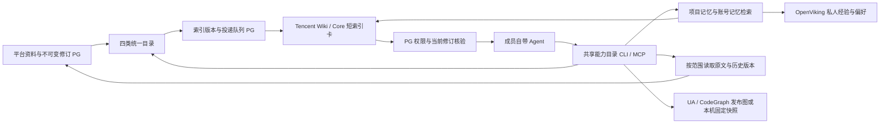

# 项目资料轻量索引与统一 Agent 能力

## 本轮实施边界与文件计划

2026-11-12：项目资料正文及修订继续由平台业务库保存。后台静默生成目录、不可变引用、版本和有界语义摘要，不把全文复制成另一份权威资料。成员侧移除启用开关；运维暂停、故障与积压仍需可观察。

1. `packages/contracts/src/project-materials.ts`、application catalog/query 与 core-api routes：统一项目、需求、架构、测试四类资料的 list/glob/grep/read，逐次鉴权、明确版本与范围，正则放有时限的隔离执行器。
2. application/project memory、core-api worker、persistence 新迁移与 Web panel：复用 outbox，自动发现资料并生成轻量索引；失效引用实时拒绝。历史全文清理必须证明来源归属，混合来源不冒充已清理。
3. `apps/cli/src/agent-capabilities.ts`、`memory-mcp.ts`、相关 CLI commands：复用一个能力目录、输入校验和调用实现。保留旧 memory MCP 名称及会话回执；新 CLI 工具入口与 MCP 使用同一分派逻辑。代码查询明确区分远端已发布投影与本机固定快照，不称作 LSP。
4. system-agent Skill bundle：补齐已接入 UA/CodeGraph 的规则分析 Skill 引用闭包，保留固定上游版本、证据校验、候选审阅流程。不得把实现推断当已确认需求，或把静态测试设计当测试通过。

真实服务兼容修复计划：Tencent 新 Wiki 的元数据为 draft，现有 page/write 虽建立搜索索引，却不更新元数据，search/page/ls 因此仍返回空。先增加三条隔离 SQLite 回归，再仅对“零 raw 文件、成功建索引”的手工页面更新为 ready；有待加工 raw 文件或索引失败时不得改变状态。该修复只需 service/route 的小改动，不改变文档主存，也不上传正文来触发 ingest。

现有 memory/native capture、上下文回执及代码查询已有回归测试。先保留这些行为，再增加跨入口一致性、四类资料、越权/过期引用、输出预算和自动索引回归。数据库测试只能通过 `scripts/run-tests.mjs` 分配的独立测试库；不使用业务库运行测试。

## 记忆关联的现状

目前具备来源追溯、会话关联、修订/替代链，以及独立的代码图、任务依赖图。Tencent Wiki 内部链接与 OpenViking 目录/关系能力不等于平台已经具备可查询的语义记忆图。本轮不新增图数据库。

后续可在平台中为不可变来源修订增加有类型的关系：支持、反驳、依赖、替代；每条边必须有证据、权限范围和生命周期。关系检索仍应实时校验两端的当前有效性；私人关系不能扩大项目可见范围。

## 已实现的数据流



- 资料指项目、需求文档、架构文档、测试资料四类。需求、任务、缺陷等业务对象仍保留各自存储，不迁入记忆引擎。
- 原生项目文档保存事务立即维护派生索引；其他资料通过后台每轮一个项目的轮转发现变化。未配置服务时仍有原文查询能力，不伪报语义索引就绪。运维显式暂停会持久保留，成员页面不再提供启用/暂停按钮。
- 索引卡只含目录、引用、当前修订、元数据指纹和最多600字符的摘要。优先使用业务资料已有 summary，否则使用有界摘录或标题，`summaryOrigin` 明示其来源；本轮没有增加 LLM 摘要生成器。
- 对外统一 `source`/`sourceCitation` 为不可变修订编码；`objectCode` 是资料管理编号，不能替代修订引用。记忆命中先复核当前目录与项目权限；历史修订可显式读取，返回 `current:false`，不能恢复成当前共识。
- 索引资料状态为 `documented`。这表示有资料记载，不能代替 `discussed`、`confirmed` 的议题状态，也不能代替提交、测试或发布的执行收据。
- 原始正文不进入新的 Wiki raw ingest 或 Core 记录。历史全文副本按精确来源清理；混合来源派生页保留 `legacy_cleanup_pending`，平台已阻断旧引用成为当前检索证据，后续需重建这些派生页。

## CLI / MCP 同一能力目录

`tsp tools list` 与 `tsp mcp` 的 `tools/list` 使用相同定义，`tsp tools call` 与 MCP `tools/call` 使用同一个会话分派器。原 `tsp memory mcp` 入口与六个记忆工具名称保留。当前默认13个读取工具，按业务域分为：

| 业务域 | 工具 |
| --- | --- |
| 项目/私人记忆 | `search_memory`、`read_memory_brief`、`read_memory_source`、兼容旧原生文档的 `read_memory_document` |
| 本人偏好 | `list_personal_memories`、`read_personal_memory` |
| 项目资料 | `list_project_materials`、`glob_project_materials`、`grep_project_materials`、`read_project_material` |
| 代码背景 | `read_code_catalog`、`query_code_graph`、`query_local_code` |

宿主显式开启 `--allow-personal-management` 后额外提供本人记忆编辑/撤回。写前验证当前项目适用性与 expectedRevision，不返回历史或已撤回正文，不产生推送等执行授权。登录、设备令牌、原生采集队列、插件安装等控制操作不作为模型工具暴露。这里的能力对齐指这套知识读取与记忆治理能力，不宣称所有任务/需求管理 CLI 已变成 MCP 工具。

```powershell
tsp docs index --query "退款"
tsp docs glob "requirement/*.md"
tsp docs grep "超时|重试" --mode regex --context-lines 2 --limit 20
tsp docs read "requirement/<文档对象编码>.md" --start-line 10 --end-line 30
tsp tools call read_project_material --input '{"sourceCitation":"<20位修订编码>","limit":4000}'
tsp tools call query_code_graph --input '{"run_code":"<20位分析运行编码>","query":"refund","limit":20}'
tsp mcp
```

glob 匹配的是 `sourceKind/objectCode.md` 稳定虚拟路径；查标题用 list.query，查正文用 grep。grep 正则在有时限、并发槽和资源限制的 Worker 中执行，返回行号、修订引用与截断状态；不执行任意 URL 或 shell，不检索二进制附件。资料大范围搜索有目录/输入/输出上限，触限会明确返回不完整标记。

代码图查询已有符号与关系、调用者/被调用者、影响范围、受影响测试等固定版本能力，但它们不是 LSP。本轮未新增语言服务器，也没有把分析图当作实时编译器真值。代码导览仅返回与当前页节点有关的有界上下文，避免节点分页仍携带整份导览。

## 代码反哺资料的 Skill

现有 `spec-production` 2.2.0 已吸收 `xsoway/codebase-graph-prd-rules` 两种方法，固定上游 `98d6a7222b3bdce3c2fbdd78bfa818b4ed2d50aa`：全项目逐模块清点、单模块深入分析。保留 MIT 来源说明；沿用 UA 导航、CodeGraph 定位、原始固定源码复核的链路，不另装 Graphify。

本轮修复的是系统文档 Agent 的分发缺口：原包只有3段文件，却要求读取未打包的 business-rules 引用。现在递归检查并打包9段引用，42,577字符，有统一60k字符/80k序列化字节上限。它仅在调用系统文档 Agent 时使用，成员每次记忆检索不会灌入整份 Skill。Skill 正文和版本未改，候选仍走现有审阅与采用流程。

## 验证与本地落地

- [真实双客户端结果](experiments/project-material-index/20261112-index-g/result.json)：专用18520/18524/21933引擎、新建中央55432测试库，四类原生 HTTP 写入后由真实后台定时 worker 自动完成绑定与投影。Wiki/Core 卡片约0.8KB，不含正文尾部随机验收标记。
- 空白 DSH 0.2.1-rc.2、OpenCode 1.14.21 均完成目录发现→按需原文→准确修订引用与标记核对，并区分资料记载与实际落实。7/7实际模型响应经本地 Magpie 返回指定 `workbuddy/deepseek-v4.1-flash`，无模型降级。两位 Agent 都选择了目录入口；不能把这次结果宣称为 Agent 必然主动采用语义检索，双引擎命中由独立 API 链路核对。
- 事实验收与格式验收分开保存：最终 DSH 使用自然语言描述 documented，格式不是严格枚举，事实及引用正确；OpenCode 严格格式也通过。修订编码必须精确一致，验收标记只允许 token 或其完整原文标签行，不接受其他编号、近似值或实施声明。
- a/b保留真实服务失败记录，定位并修复 Tencent draft 状态与手工索引不一致；c/d/e/f保留检索路径、来源字段与格式判定迭代记录，没有覆盖成成功。旧失败报告的 databaseRemoved=false 是抛错后未写成功标记，不能引用为完成证明；最终g明确核验了外部资源与测试库清理。
- 相关领域/API/迁移/持久层/Skill回归：125通过、1项可选真实运行时检查跳过；CLI相关72通过；Web相关54通过；Tencent新增兼容修复所在的18项回归通过、类型检查通过。全仓类型检查、构建通过；lint为0 error、69条既有warning。没有新增依赖。
- 本地运行库升级0059→0061前已备份约14MB，数据库身份/OID核对通过；四类原始资料及修订表升级前后指纹一致。API8080、Web5173、Tencent8420/8424已恢复。成员页面实测显示“索引可用，已索引31/31份资料”，无启用开关、当前索引无积压。
- 本地仍有7个历史混合来源副本处于清理待办、5个历史副本已完成精确清理。当前31份索引已经就绪；不能声称历史物理全文全部清空。

Tencent 本次额外改动为 `MemoryKnowledge/src/store/wiki-service.ts` 与 `src/routes/wiki.ts`：仅零 raw 文件且手工索引成功时将 draft Wiki 元数据更新为 ready。有 raw 待处理或索引失败时不提升状态。补丁已固定为本机 Hub 的 `patches/tencent-manual-index-readiness.patch` 并加入启动校验，五份补丁的预期源码树核对通过。OpenViking 本轮未修改底层代码。
