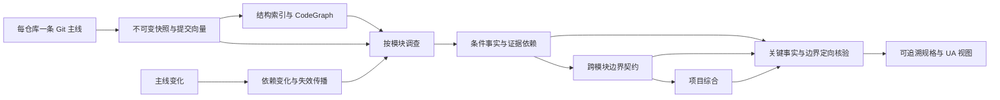

# 模块调查、跨模块综合与增量理解

2026-11-17。状态：已完成一轮受限模型试验和独立匿名评审，质量未达到生产替换条件。旧全仓逐句核验循环保持暂停，本方案没有替换生产分析器、迁移数据库或发布新的项目主线。

## 要解决的问题

当前链路按生成段落拆分断言，再为断言定位和核验源码。一个工厂函数可能包住多项业务操作；为证明其中一条结论，核验器仍需展开调用、权限与守卫。父段落改写又会改变核验输入，即使部分结论和源码没变，仍可能重复定位、展开与核验。增加并发不能消除这类重复工作。

新的处理单位应当是带条件、依赖和证据的业务事实，以及模块之间的边界契约。先围绕业务入口调查模块，保留查过什么、得出了什么、什么尚不清楚；跨模块综合使用这些记录。最后集中核查关键行为与跨模块关系，再生成供人阅读的说明。

这会降低重复取证的机会，但也有代价：模块调查可能遗漏入口，显式依赖可能不完整，抽样无法保证全部描述准确。因此必须同时保留覆盖清单、未知项、保守失效规则和独立质量评审，不能只比较“通过率”。

## 目标数据流

### 来源与项目版本

每个登记仓库只维护一条项目主线。服务端按仓库地址和配置的主分支捕获源码，形成不可变快照；成员电脑的工作目录不作为服务端事实来源。多仓库项目使用提交向量，例如仓库 A 的 commit/snapshot 与仓库 B 的 commit/snapshot，不能用某一个 commit 代表整个项目。

分析结果引用捕获时的来源向量。主线后来更新，只表示存在待分析变更；不能把旧规格显示成新提交的理解结果。历史链接继续绑定原运行及快照，默认页面展示各仓库已发布的主线，不要求普通阅读者反复选择版本。

### 三种覆盖分别计量

| 覆盖类型 | 说明 | 不能据此声称 |
| --- | --- | --- |
| 结构覆盖 | 捕获文件、解析符号及静态关系的范围 | 文件中的业务语义已经读懂 |
| 语义调查覆盖 | 模块作者实际读取并解释的入口、操作和来源范围 | 所有条件都已独立核验 |
| 定向核验覆盖 | 已核查的关键事实、边界和描述样本 | 未审查文本同样正确，或实际运行已通过 |

CodeGraph 用于导航和提出调查线索，源码用于核对实际条件。返回对象方法、动态绑定和框架路由可能缺少静态调用边。缺少 caller 边不能证明没有调用；需要保留路由到用例、身份参数到守卫等显式证据。

## 分层产物与职责

| 产物 | 必要内容 | 更新边界 |
| --- | --- | --- |
| 来源清单 | 仓库身份、commit、snapshot、相对路径、完整文件 hash | 每次捕获固定，不能覆盖旧字节 |
| 模块调查记录 ModuleDossier | 职责、用户入口、状态所有者、已读范围、条件事实、提供/消费接口、未知项 | 入口或模块依赖变化后重查受影响部分 |
| 条件事实 StableFact | 主体、行为、对象、操作者、前提、结果、例外、观察类型、风险 | 语义或依赖变化则重新判断 |
| 证据绑定 EvidenceBinding | 仓库、commit/snapshot、路径、文件 hash、行范围、连续引文 | 新快照需重新审计或精确重绑 |
| 依赖 Dependency | source、guard、caller、route、policy、config、schema、background | 依赖字节变化沿事实向上失效 |
| 边界契约 BoundaryContract | 生产者/消费者、身份来源、参数与结果、调用顺序、状态、错误、双方 fact IDs | 任一侧事实或契约语义变化则失效 |
| 展示 Presentation | 说明文字、图节点、导览、事实/契约引用 | 纯排版和措辞变化可独立处理 |

一个事实应当表达有限的行为与适用条件，例如“在指定任务/Run 状态且通过项目权限、交接和执行守卫后，某类操作者可提交”。“系统保证所有提交都安全”包含过多无法独立审计的范围，不应作为事实单位。

事实 ID 是逻辑身份；语义指纹是其内容版本，两者分开。生产实现需要持久分配 ID，并在后续调查中对齐旧事实，识别新增、修改、撤回和拆分。当前实验 `run.mjs` 使用 `task:F1` 等运行内 ID，只证明后续指纹与传播机制，尚未实现跨次调查的自动事实对齐。

### 模块调查

先用入口、符号目录和依赖关系定位，再按操作读取源码。作者需要回答：谁发起、身份从何而来、允许在哪些状态执行、先检查什么、写入什么、失败或交接时如何处理。模块记录同时保存实际读取范围与未解决的问题。

避免为每个问题返回整个大型工厂。可以读取操作范围及其守卫、调用端和实际依赖；若依赖仍不明确，标注未知并留下待查入口。调查者不能从静态分析推导出网络、进程或持久化在所有运行条件下的保证。

### 跨模块综合

综合者从两侧记录建立契约，而不是拼接文件摘要。一个涉及 API、应用用例和 agentd 的行为至少需要交代：

1. API 从可信会话取得哪些身份，传给哪项用例；客户端输入有哪些边界。
2. 用例怎样检查项目访问、任务/Run 状态、交接、设备和执行租约，哪些分支存在例外。
3. 交接怎样改变来源执行状态、租约与目标执行身份；哪些步骤需要显式确认。
4. 本地监督如何观察服务端状态、网络失败与租约过期；哪些行为是周期检查，哪些没有运行保证。

契约必须引用双方事实及来源。动态映射无法由当前索引或源码确定时，保留 unresolved；不能靠同名函数、邻近节点或合理猜测补出关系。

### 定向核验

所有高风险事实和跨模块契约均进入审查；普通描述使用预先固定的抽样规则。引用的仓库、hash、范围与当前字节始终机械检查。审查输出支持、矛盾、未知或撤回，保留具体理由和证据。

有新增真实证据时才进行受限补查或修订；没有新增证据时，不通过扩大段落、重复请求或削弱判定门槛追求全部通过。预算耗尽要输出不完整产物，不能把该轮缺少审查包装成成功。

## 增量更新与复用

当前原型使用两层指纹：事实语义加分析协议/模型身份；显式依赖列表加完整文件内容 hash。契约引用事实指纹，项目摘要引用事实和契约指纹。展示文本不进入事实语义指纹，但新增条件、因果、保证或行为范围必须进入语义字段。

| 变化 | 处理 |
| --- | --- |
| 仅展示文本、排版变化 | 当前证据审计通过后，可复用事实判定 |
| 前提、结果、例外、操作者等语义变化 | 事实及相关契约、摘要失效 |
| guard、policy、route、config 等完整依赖文件变化 | 即使函数体或调用图没变，依赖事实仍失效 |
| 调查范围之外的无关资料变化 | 不自动扩大受影响集合 |
| 新 commit 中依赖字节相同 | 先绑定新来源向量并审计当前字节，再判断复用 |
| 行号变化但引文仍唯一存在 | 可精确重绑引用；文件 hash 已变化仍触发依赖失效 |
| 依赖缺失、跨仓身份不明、引文重复或找不到 | 保持 stale/unknown，不提升为已核验 |

完整文件 hash 较保守，会让同文件中的无关修改也触发失效。第一阶段接受这种额外开销，避免错误复用权限结论。后续可研究函数、配置键和契约级依赖，但必须先证明没有漏掉闭包、调用端和外部规则。

`facts.mjs` 提供指纹、manifest 差异、引用审计、唯一连续引文重绑及复用判断。它不负责证明模型结论正确，也不自动发现全部依赖。调用方仍须保证事实和契约引用完整，不把稳定 hash 当成已审查标志。

## 服务端落地与失败恢复提案

建议沿用现有项目、仓库、分析运行和发布边界，增加模块级工作单元，而非新增另一套项目真值库：

1. **捕获与结构阶段**：固定每仓库主线快照，校验文件清单；结构索引完成后即可用于检索，但不冒充语义完成。
2. **影响计算阶段**：比较旧新来源与显式依赖，生成受影响模块、事实、契约和综合清单。未知依赖保守重查。
3. **调查阶段**：每项模块工作具有输入指纹、模型/协议身份、请求与上下文预算、检查点、实际读取审计。任务只读取固定快照。
4. **综合与审查阶段**：使用同一来源向量的模块结果，拒绝混合新旧仓库向量；完成关键边界审查，显示剩余 unknown 与覆盖。
5. **发布阶段**：候选与当前主线分离；只有完整满足发布策略的候选才能替换当前指针。失败保留上一份已发布结果与原始审计。

超时、格式错误、provider 错误和预算不足是独立失败类型。恢复只复用输入完全相同、来源完整、响应通过校验的检查点；模型、协议、来源或实质输入变化后重新计算受影响工作。不能自动换模型后把耗时当作同条件对照，也不能在没有新证据时无限重试。

回退应当是撤销候选或恢复上一发布指针，保留历史来源和错误记录；不修改原始快照，不覆盖旧报告，不回滚业务文档。队列租约、并发任务去重、权限审计及发布事务仍需生产实现，本实验不声称已经完成。

## 本次小范围对照

### 固定输入与控制变量

使用 TeamSynergy 服务端已捕获的 Git 提交 `c87aefbbece35c0bf9ccad32a5084ad85b4edb9d`，snapshot 为 `6ad78c2f560c323270d182a0b4fd10ed0d802591203e1ca48431c69060105bf8`。主要目标为 16 个文件，分为任务提交/验收与交接/agentd 两个调查模块。两组均可在同一不可变快照中按需读取实际 import/export、守卫和路由依赖；新增读取必须记录路径、hash 与字节，不能进行全仓语义遍历。

先生成两个模块记录及一个共享跨模块草稿，再将相同草稿交给两种审查策略：

- A 调用未修改的 `selectArchitectureClaimSources` 和 `reviewSemanticArchitectureClaims`，保留其父段落作用域、来源展开及判定要求。达到请求/上下文上限时如实输出 incomplete，不裁剪必要源码或放宽解码器。
- B 审查全部关键事实与跨模块边界，并按固定规则选一项普通描述。按“模块事实”和“跨模块契约”分成两个固定批次，保留原断言、完整父作用域及所需事实/来源；缺证输出 unknown，不自动重写共享草稿。

共享调查和综合成本单列，A/B 各自记录新增审查成本。该试验隔离审查策略，不能据此推断整条生产管线的加速比例。历史全仓运行不作为同条件 A 组。独立问题与评分依据在生成前冻结；生成者不能读取标准答案，最终以匿名产物交给独立评审。

### 冻结预算

| 项目 | 限制 |
| --- | --- |
| provider/model | 本地 Magpie，`workbuddy/deepseek-v4.1-flash`；不自动切换 |
| 单请求输入 | 序列化 messages 不超过 70 KiB，包含会话历史 |
| 单请求输出/超时 | `max_tokens: 8192`，60 秒 |
| 模块调查 | 每模块最多 3 回合、6 条事实、100 KiB 返回源码；每次取证结果不超过 28 KiB |
| 综合 | 最多 1 请求，选最多 6 条共同事实和 2 项跨模块契约 |
| A / B | A 最多 5 请求；B 最多 2 请求 |
| 初始硬上限 | 16 请求；当前阶段配额合计最多 14 请求，失败请求同样计入 |
| 增量重分析 | 另列预算，最多 4 请求；readiness probe 单列 |

模型温度为 0、thinking disabled、reasoning effort low。输出截断、错误模型身份、协议错误与失败请求均保留，不自动重复。精确恢复只读取该实验目录内的相同请求/响应，检查配置、请求与响应 hash，不读取生产语义缓存。

这些是请求参数；provider 仍报告了非零 reasoning tokens，成本以实际 usage 为准。调查目前使用宿主执行的 JSON inspect 协议，尚未采用模型原生 tool-call schema。

本轮调试明确了四项上下文规则：导航索引与证明材料分开，最终整理时可移除导航元数据，完整取证内容仍保留；综合阶段读取模块事实与来源指针，不重复发送全部正文；审查阶段将重复引文及父作用域放入唯一目录，保留每条引用的仓库、hash 和范围；检索耗时只进入运行指标，新会话上下文不携带这种非确定值。旧实验的精确恢复仅为兼容已发请求保留原 timing，并重新核对当前来源。

早期驱动存在未在提示中声明的数组长度与引用存储限制，造成有效响应被宿主拒绝。调整为有界保存完整条件后，保留原失败审计。对 HTTP 200、模型身份正确、正常结束且仅因指定存储限制失败的综合/增量响应，显式启用本地重校验并记录独立回执；综合错误数组最多 24 项，增量事实描述最多 2000 字符，契约描述最多 4000 字符。仅开放三种确定的阶段/调用名/原失败组合，其他失败仍拒绝恢复；不重新调用模型，不覆盖原失败记录，不放宽来源、身份、覆盖或结论判定。

### 实验实现范围

| 文件 | 当前职责 |
| --- | --- |
| `scripts/code-understanding-pilot/facts.mjs` | 纯内存指纹、依赖传播、证据审计与重绑 |
| `scripts/code-understanding-pilot/context.mjs` | 固定快照校验、只读范围/静态投影查询、来源审计 |
| `scripts/code-understanding-pilot/transport.mjs` | 模型请求预算、超时、严格身份与响应检查、私有精确恢复、真实用量记录 |
| `scripts/code-understanding-pilot/run.mjs` | 预检、两模块调查、共同草稿、原 A 接口/B 审查、增量变体与可选 guard 重分析 |
| `scripts/code-understanding-pilot/report.mjs` | 汇总每次实际请求、阶段用量、未知指标与宿主失败，不重复计算精确缓存命中 |
| `scripts/tests/code-understanding-pilot.test.mjs` | 无数据库的纯算法回归 |

离线变体覆盖展示变化、语义变化、guard 内容变化、显式 route 绑定变化、无关文件变化、引用重绑和多仓库身份边界。另需实际重分析一次私有内存中的 guard 变体，并检查相关事实与契约的结论；这不等于测试修改后的程序已运行正确。

### 实测结果与决策

使用同一本地 Magpie / `workbuddy/deepseek-v4.1-flash`。两个模块分别形成 6 条候选事实，综合选择 6 条共同事实和 2 项契约。实际向调查者返回 14 段、78,309 字节，涉及 8 个文件；16 个目标文件都核对了 hash，但不能因此声称全部读懂。

| 阶段 | 实际 HTTP 请求 | 请求累计耗时 | provider 总 tokens | 累计 messages 字节 |
| --- | ---: | ---: | ---: | ---: |
| 共享调查与综合 | 7 | 77.792 秒 | 98,809 | 313,134 |
| A 原定位/核验策略 | 1 | 30.760 秒 | 24,974 | 54,588 |
| B 两批定向审查 | 2 | 66.525 秒 | 47,371 | 137,269 |
| 增量重分析，含失败响应 | 3 | 62.589 秒 | 49,829 | 150,746 |
| 三次早期驱动试跑 | 3 | 24.668 秒 | 18,442 | 54,585 |
| 合计 | 16 | 262.334 秒 | 239,425 | 710,322 |

累计请求耗时不等于端到端时间：首个请求至末个响应跨约 39 分钟，包含驱动修正、审查和恢复间隔。readiness probe 另计 1 请求、60 tokens、约 10.358 秒。独立 native subagent 的用量未知。没有 HTTP 重试或 provider 切换，所有已发生失败都计入；3 条响应仅在本地重新校验存储上限，保留原始失败审计。

A 完成定位后，下一核验请求为 96,717 字节，超出共同的 71,680 字节预算，结果 incomplete。B 最终两批实际为 66,614 / 70,655 字节，审查了全部 8 个选定项目。B 的完成成本高于 A 已发生的部分成本；A 被预算截断，不能计算公平的完成耗时比例，也不能宣称 B 全链路更快。

独立评审在生成前冻结 8 道问题，匿名产物的共同内容完全一致。语义覆盖均为 **7/24**：核心 submit/verify/guard 事实基本正确，但缺少 claim、完整交接/workspace 和 agentd 的关键内容。B 的已审查可用覆盖为 7/24，A 因未完成审查为 0/24；A 未审查不等于其候选事实错误。这是单次探索试验，B 的分批和编码根据执行反馈调整，不是完成方法学预注册的性能结论。

引用机械检查通过：8 个事实引用及 B 的 17 个审查引用都匹配固定源码的 hash、行范围与引文。语义支持仍有缺口：`task:F2` 的引用止于 660 行，部分写入尾段位于 662–688；`task:F4` 缺少第 9 行状态常量；`handover:F2` 关于 renew/start/state 的描述超出所引 1–70 行。没有发现严重无依据运行保证，但“引用字节正确”和“整条事实获得完整支持”必须分开。

增量变体仅在私有内存把 guard 第 40 行 `0/0` 改成 `-1/0`。独立评审确认新条件及 submit/verify 影响推导正确，负 epoch 的实际可达性和运行时行为仍未知。旧的 8 个 binding 均因新来源向量进入 unknown；5 个可精确重绑，3 个不能重绑，必须保持未解决。阶段 `complete` 只表示执行结束，不能当成全部引用已验证或可以发布。

原始报告位于本机独立 runtime 的 `module-understanding-pilot-20261117/`：`cost-report.json`、`experiment/pilot-04/semantic-coverage.json` 与 `evaluation/assessment-20261117.json`。模型请求、原始失败及局部重校验回执均保留，评分依据未变。

### 根据结果修订的下一步

1. 在模型自由调查前建立入口覆盖清单，分别覆盖 claim/submit/verify、交接准备/激活/workspace、agentd 运行与监督。未覆盖关键入口时标记 partial；不能因为选中的 8 项都获支持就宣称理解完整。
2. 将结论拆到前提、例外和副作用，分别绑定支持来源；补证缺失的状态常量、持久化尾段及消费者实现，不退回整工厂反复展开。
3. 将结构引用有效、语义支持充分、业务覆盖完整设为三个独立状态。缓存复用仍需完整依赖与当前来源审计；未知引用不能通过执行状态提升。
4. 在更多典型模块影子运行，保留相同来源与模型，复测完整成本和遗漏率。当前只进入这些有针对性的改造，不进行全量重跑或主线替换。

## 进入生产改造的判断条件

先判断有限样本是否值得继续，再决定是否替换生产核验路径：B 应提供足够有用且可追溯的理解，不能用全部 unknown 获得形式通过；关键错误必须显式暴露；guard/route 变化不能错误复用旧结论；成本账应包含实际失败和重复上下文。

下一阶段按低风险顺序推进：先让事实/契约 manifest 与现生产结果并行保存，再在典型模块做影子增量，随后接入模块工作队列和候选发布。完成更多模块、动态调用、配置变化、跨仓关系和不同语言的验证后，才考虑扩大语义覆盖。旧来源与发布结果在迁移期间保留可回退路径。

本次未验证全仓理解质量、原生 CodeGraph 进程查询性能、服务端任务编排、CLI/MCP 全链路发布、所有语言或运行时业务保证。固定投影查询的耗时不能代表原生插件完整开销，单次样本也不能证明长期稳定成本。
