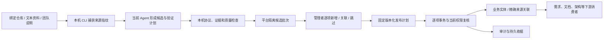
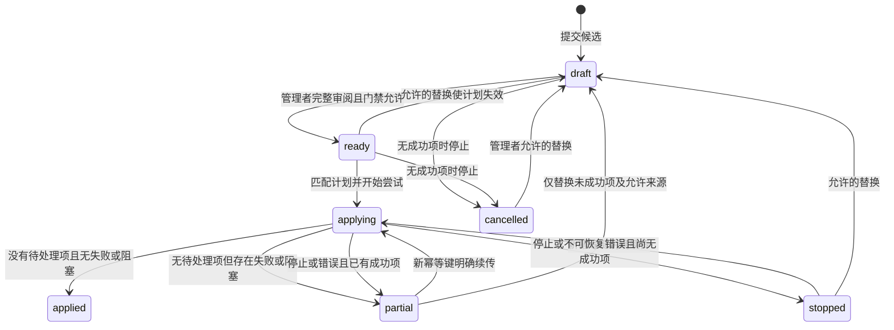
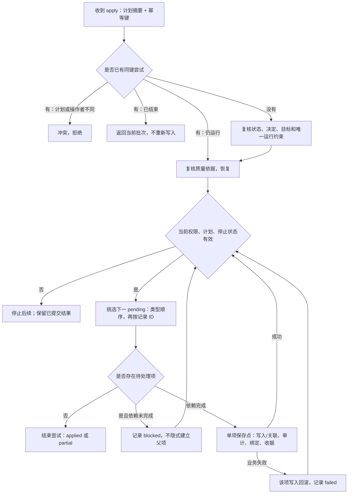

# TeamSynergy：代码与资料逆向规格专项

> 文档性质：当前实现的逆向业务规则初稿，供产品、测试与维护人员复核；不是已批准的新需求。
> 适用代码：`92728fbec04cfa34fee4421cb0a9319d1b755164`。生成日期：2026-11-09。
> 方法：`codebase-graph-module-rules` Skill；Graphify 定位后回查源码。下文规则默认标为 **SOURCE_REVIEWED（静态源码已复核）**。本次没有执行真实发布、数据库业务、生产接口或外部模型调用。

## 1. 范围与证据边界

### 1.1 已知事实、缺口及最小假设

| 类别 | 本次结论 | 依据或处理 |
| --- | --- | --- |
| 已知事实 | 本模块从绑定仓库、文本资料和团队说明形成候选；本机 `prepare` 不调用模型，候选由当前 Agent 填写。 | `apps/cli/src/intake.ts:55-111` |
| 已知事实 | 候选先进入隔离批次，管理员逐项选择新增、关联或跳过，再执行带摘要的计划。 | `packages/application/src/intake-use-cases.ts:182-205`、`packages/application/src/intake-use-cases.ts:237-275` |
| 已知事实 | 发布会创建项目模块、Feature、需求文档、结构化需求或架构文档；新结构化需求仍为草稿。 | `packages/application/src/intake-use-cases.ts:427-438`、`packages/application/src/intake-entity-writers.ts:67-85` |
| 信息缺口 | 未读取客户真实候选、数据库数据、审阅决策或负责人意图；不能确认实际业务资料完整度。 | 本次仅静态分析，见第 10 节的待确认项。 |
| 术语冲突 | 实现中的 frozen/冻结指固定**该候选批次的发布计划与质量依据**；不是项目冻结，也不等于正式需求基线批准。下文称为“固定发布计划（此提交已有流程）”，源码标识保持原样。 | `packages/application/src/intake-use-cases.ts:124-127`、`packages/application/src/intake-quality-gate.ts:43-60` |
| 可能过期项 | 本文不覆盖工作区尚未提交的 UA/codegraph 代码理解接入；不能以当前页面或运行服务的后续状态反证该提交。 | 本文固定提交边界。 |
| 范围外 | 新版知识图插件、团队真正的业务决策、生产发布、负责人批准、真实测试执行和性能测量。 | 与本次逆向试验分开。 |
| 最小假设 | 把“逆向生成文档”映射为现有 `intake` 链路，而非系统文档 Agent 的单篇文档修改功能。 | `apps/cli/src/intake.ts:38-40`、`apps/core-api/src/routes/intake.ts:13-55` |

### 1.2 图谱与源码复核记录

全项目 Graphify 图谱有 5,200 个节点、16,335 条边、205 个社区；其中 16,049 条边标为 EXTRACTED，286 条为 INFERRED。扫描发现 553 个代码文件，43 个代码文件未提取到符号。94 个文档未运行语义提取；因此文档、数据文件或没有符号的代码须由源码补查，图谱未命中不能解释为功能不存在。

实际执行的模块导航命令（路径相对于隔离试验根目录）：

```text
graphify query "intake review publication source quality" --seed createIntakeUseCases --graph artifacts/graphify-out/graph.json --budget 4800 --depth 2
graphify path createIntakeUseCases writeRequirement --graph artifacts/graphify-out/graph.json
graphify explain writeRequirement --graph artifacts/graphify-out/graph.json
```

查询记录为 `artifacts/queries/intake-agent-query.txt`、`intake-agent-path.txt` 和 `intake-agent-write-requirement.txt`。路径查询返回一跳 `createIntakeUseCases → writeRequirement`，标为 EXTRACTED；源码进一步说明调用发生在逐项发布的分支中，而不是“创建用例工厂便写入需求”（`packages/application/src/intake-use-cases.ts:376-450`）。

图中少数 `source_file` 是外部模块标签或构建目录引用，不属于本次快照中的可定位源码。本节所有业务规则均在 `source` 快照中重新打开相应文件后确认，不直接把图节点标签转换为文件事实。

一个检索限制：种子查询返回 124 个节点和 685 条边，工具报告约 35,028 token，超过请求的 4,800 token 预算；说明中称节点全部容纳后不再丢弃边。本次保存完整日志，仅阅读相关结果与实现，不把返回规模当作规则覆盖率。

## 2. 模块定义、角色与关系

本模块解决“从现有材料形成可审阅规格，并受控建立项目事实”的问题。它区分材料、候选解释、审阅计划、真实写入收据四个阶段。“固定发布计划（此提交已有流程）”仅用于防止已审阅内容在写入前被替换，不应呈现为项目生命周期中的冻结步骤，也不是本文提出的新流程。

| 角色或边界 | 可做什么 | 不能由此推导什么 | 实现依据 |
| --- | --- | --- | --- |
| 本机 Agent / 具备写权限的成员 | 准备材料，填写候选，校验，提交草稿；作者可替换本人尚未固定计划的候选。 | `prepare` 不代表模型已生成内容；作者身份不能绕过当前项目权限。 | `apps/cli/src/intake.ts:55-138`、`packages/application/src/intake-use-cases.ts:72-83`、`packages/application/src/intake-use-cases.ts:210-224` |
| 项目 Owner/Admin 等管理者 | 逐项审阅、固定计划、开始发布及停止已审阅计划。 | 审阅计划不是独立内容核验或正式需求批准。 | `packages/application/src/intake-use-cases.ts:237-275`、`packages/application/src/intake-use-cases.ts:281-306` |
| Viewer / 非当前有效成员 | 本模块拒绝 Viewer；其他人员仍须通过当前项目访问控制。 | 系统全局管理员身份不自动提供项目源材料访问权；明确受邀的外部项目成员仍按其项目角色判断。 | `packages/application/src/intake-use-cases.ts:72-83`、`packages/application/src/project-access.ts:40-75`；已定义测试 `packages/application/tests/intake.test.mjs:260-273` |
| HTTP API | 会话鉴权、严格协议解析、项目范围、事务与收据。 | API 不读取用户原仓库；manifest/证据格式有效不证明其业务含义正确。 | `apps/core-api/src/routes/intake.ts:15-55`、`packages/contracts/src/intake-quality.ts:128-148` |
| 正式业务实体 | 接收明确新增；或作为已存在目标被显式关联。 | 关联不会自动覆盖原正文，发布也不自动将需求变为 approved。 | `packages/application/src/intake-use-cases.ts:411-448`、`packages/application/src/intake-entity-writers.ts:78-85` |



### 2.1 输入、输出与上下游

- 输入：项目绑定、可选仓库与显式范围、稳定来源 namespace、文本资料 key、来源清单和文件摘要，以及 Agent 填写的候选、证据、验收与验证计划（`apps/cli/src/intake.ts:55-109`、`packages/contracts/src/intake.ts:49-73`）。
- 本机输出：`intake.json`、`context.json`、固定版本 Skill 与引用材料；企业档位另含模板和档案计划。本机绝对资料路径只存在于本机映射文件，不放入公共来源包（`apps/cli/src/intake.ts:89-111`、`apps/cli/src/intake-materials.ts:75-111`）。
- 平台输出：候选批次、逐项决策、质量报告、计划摘要、发布尝试、创建/关联/跳过数量、逐项错误及真实目标编号（`packages/application/src/intake-use-cases.ts:101-132`、`packages/persistence/src/schema.ts:1397-1435`）。
- 下游：创建的结构化需求、文档和架构进入既有项目领域流程；此模块没有自动为它们执行正式评审或业务验收（`packages/application/src/intake-entity-writers.ts:49-99`）。

## 3. 实体、状态与数据约束

| 实体 | 作用 / 关键身份 | 状态与约束 | 来源 |
| --- | --- | --- | --- |
| 候选包 | 项目、仓库或纯资料、namespace、来源清单、候选 key | 1–500 项候选、1–20,000 个来源文件；最多 10 MiB；严格字段与引用约束。 | `packages/contracts/src/intake.ts:5-7`、`packages/contracts/src/intake.ts:62-141` |
| 批次 | 保存某次提交及其修订、来源、质量和计划 | `draft / ready / applying / applied / partial / cancelled / stopped`；提交键在项目+作者范围唯一。 | `packages/persistence/src/schema.ts:1397-1412` |
| 候选项 | 批次内 key、kind、内容、决定、目标 | `pending / applied / bound / skipped / failed / blocked`；批次内 key 唯一。 | `packages/persistence/src/schema.ts:1413-1420` |
| 来源关联 | 项目+仓库或纯资料+namespace+kind+source_key → 目标 | 仓库型与纯资料型均有唯一性约束；纯资料不伪造 repository_id。 | `packages/persistence/src/schema.ts:1421-1427`、`packages/persistence/drizzle/0042_intake_material_sources.sql:1-8` |
| 发布尝试 | 批次+幂等键+固定计划+操作者+结果数组 | `running / completed / stopped`；同批次最多一个 running。 | `packages/persistence/src/schema.ts:1428-1435` |
| 业务目标 | Module、Feature、需求文档、Requirement、Architecture | 目标指纹包含受管理元数据与当前修订；不是只比较正文。 | `packages/application/src/intake-targets.ts:11-47` |



该图是主要分支的静态摘要；`applying` 禁止替换，`applied` 禁止替换和重新审阅。停止不删除已提交实体，不能把状态图理解为全批次回滚（`packages/application/src/intake-use-cases.ts:210-244`、`packages/application/src/intake-use-cases.ts:281-294`）。

## 4. 主流程与恢复分支

1. 在已绑定工作空间显式选择仓库范围或文本资料；CLI 读取当前工作文件而不冒充提交内字节，记录 commit、dirty、来源和排除项（`apps/cli/src/intake-source.ts:108-151`）。
2. CLI 采集和生成空候选模板，Agent 根据实际来源填入规格；空 `items` 不能进入正式校验/提交（`apps/cli/src/intake.ts:107-111`、`apps/cli/src/intake-source.ts:167-178`）。
3. `validate` 执行协议、来源复验和规则报告；`submit/replace` 可保存协议有效、仍有质量 blocker 的草稿。企业 blocker 会阻止固定新发布计划（`apps/cli/src/intake.ts:114-146`、`packages/application/src/intake-use-cases.ts:249-254`）。
4. 管理者为每项给出 create/bind/skip；平台复核依赖、已有来源关联和目标指纹，绑定内容、决定和质量依据生成计划摘要（`packages/application/src/intake-use-cases.ts:255-275`）。
5. `apply` 复核当前管理权限和固定依据，创建或恢复持久尝试；逐项重新检查权限、停止状态和依赖。每项成功独立提交，失败在该项保存点内回滚（`packages/application/src/intake-use-cases.ts:299-357`、`packages/application/src/intake-use-cases.ts:376-463`）。
6. 网络中断而尝试仍 running 时，原键用于恢复；尝试已 completed/stopped 时原键只重放状态。对 partial/stopped 用新键明确续传，已经成功项不重做（`packages/application/src/intake-use-cases.ts:306-348`、`packages/application/tests/intake.test.mjs:450-489`）。



## 5. 业务规则表

以下 32 条均表示该提交的实现观察，不等于建议沿用所有现有行为。测试断言是待执行验证目标。

| ID | 条件 / 触发 | 决策与结果 | 例外 / 运行控制 | 源码依据 | 可观察测试断言 |
| --- | --- | --- | --- | --- | --- |
| INT-001 | 运行 `prepare` | 读取平台上下文并生成材料、固定 Skill 与空候选；内容须由 Agent 填写。 | 不自动调用模型；空候选读取时报错，不可把模板当成产出。 | `apps/cli/src/intake.ts:55-111`、`apps/cli/src/intake-source.ts:167-178` | prepare 后 `submitted=false` 且 items 为空；未填写时无法提交。 |
| INT-002 | 选择仓库或资料来源 | 至少提供仓库或一份文本材料；纯资料不用 scope/untracked，且不得声称 Git 状态。 | 项目、平台地址、仓库登记必须与本机绑定一致；仓库须为根目录。 | `apps/cli/src/intake.ts:66-87`、`apps/cli/src/intake-source.ts:31-39`、`apps/cli/src/intake-source.ts:60-71`、`packages/contracts/src/intake.ts:78-91` | 错项目、错平台或资料伪造仓库均拒绝。 |
| INT-003 | 确定范围和输出目录 | 仓库范围显式给出，去重后按路径序排列；代码范围与资料合计最多 50 项。 | 输出必须是新目录，不能递归进入资料；纳入未跟踪文件时输出必须在仓库外。 | `apps/cli/src/intake-source.ts:74-76`、`apps/cli/src/intake.ts:72-84`、`apps/cli/src/intake-materials.ts:34-38` | 重复 scope 得到稳定集合；输出重用/递归被拒。 |
| INT-004 | 扫描代码和资料 | 仅纳入允许的 UTF-8 普通文本；默认代码仅 Git 跟踪文件，新增未跟踪文本须显式纳入。 | 拒绝链接路径、敏感/生成目录；单文件最多 2 MiB，合计最多 20,000 文件；采集前后指纹不一致则失败。 | `apps/cli/src/intake-source.ts:10-15`、`apps/cli/src/intake-source.ts:89-151`、`apps/cli/src/intake-materials.ts:90-106` | 不安全输入不进入清单；采集期间改文件必须重新 prepare。 |
| INT-005 | 增加文本资料或团队说明 | 每个来源使用唯一小写 key，并投影为 `materials/<key>/…`；绝对资料根只留本机映射。 | key 长 1–40，`repository` 保留；最多 49 个补充来源；团队说明不是自动批准事实。 | `apps/cli/src/intake-materials.ts:15-31`、`apps/cli/src/intake-materials.ts:75-111` | 公共来源清单没有本机根目录；重复 key 被拒。 |
| INT-006 | 提交候选协议 | 最多 10 MiB、500 候选；候选/文件 key 唯一，证据摘要须匹配清单，父引用类型和模块关系必须一致。 | 未知字段、可识别凭证、空需求正文、错误 AC/验证引用均拒绝。 | `packages/contracts/src/intake.ts:49-73`、`packages/contracts/src/intake.ts:94-141` | 不能用任意字段夹带覆盖命令或伪造来源。 |
| INT-007 | validate、submit 或 replace 前 | CLI 重新核对来源清单、commit、dirty、扫描方式及证据行号/摘要。 | 来源变化、缺本机资料映射或证据行越界时，拒绝继续上传；不允许仅手改指纹绕过。 | `apps/cli/src/intake.ts:114-146`、`apps/cli/src/intake-source.ts:182-193`、`apps/cli/src/intake-materials.ts:114-150` | 修改来源后 submit 不发生网络上传。 |
| INT-008 | 选择档位 | 默认 pilot；enterprise 使用共享质量契约。 | 已有企业批次不可改回 pilot；历史空档位固定新计划前须明确选择。 | `packages/contracts/src/intake.ts:64-64`、`packages/application/src/intake-use-cases.ts:218-218`、`packages/application/src/intake-use-cases.ts:246-248` | 企业降档与未定档位审阅被拒。 |
| INT-009 | 读取或修改候选 | 人员须当前有效且有项目权限，Viewer 不可访问；提交需 write，审阅和 apply 需 manage。 | 每项发布重新读取当前权限；作者或全局管理员身份不能替代项目权限；已受邀外部成员按项目角色判断。 | `packages/application/src/intake-use-cases.ts:72-83`、`packages/application/src/project-access.ts:40-75`、`packages/application/src/intake-use-cases.ts:188-188`、`packages/application/src/intake-use-cases.ts:242-242`、`packages/application/src/intake-use-cases.ts:378-380` | 撤销管理权限后不得继续新增后续项。 |
| INT-010 | 首次提交或同键重试 | 草稿只写入候选表，不立即创建业务实体；同项目+作者+键的相同载荷重放原批次。 | 同键不同载荷冲突；兼容历史 pilot 载荷的重放不能改写后来确认的档位/计划。 | `packages/application/src/intake-use-cases.ts:182-205`、`packages/persistence/src/schema.ts:1408-1412` | 重试不重复建批次；更换作者是不同提交身份。 |
| INT-011 | 替换候选草稿 | 必须匹配 revision；修改允许项后递增修订，清除计划/固定质量依据，回 draft。 | applying/applied 不可改；已 applied/bound 项、内容与来源必须保持原样；成员仅改本人未固定计划候选。 | `packages/application/src/intake-use-cases.ts:210-232` | 不得借部分失败批次重写已成功资料。 |
| INT-012 | 审阅候选 | 对每项恰好给出 create、bind 或 skip；完成审阅才产生 ready 计划。 | 不能漏项、重复决策 key；applied/cancelled 不重新审阅，applying 先停止。 | `packages/contracts/src/intake.ts:184-188`、`packages/application/src/intake-use-cases.ts:237-256` | 少一个决定就不能固定计划。 |
| INT-013 | 子项新增或关联 | 不可依赖被 skip 的父项；bind 的目标归属须与候选父层级一致。 | 已来源关联必须显式 bind 到同一目标，不能通过新批次重复 create。 | `packages/application/src/intake-use-cases.ts:135-142`、`packages/application/src/intake-use-cases.ts:257-267` | 父模块跳过时，不能保留子需求 create。 |
| INT-014 | bind 现有目标 | 只接受当前项目、匹配 kind、匹配预览指纹的目标。 | 指纹覆盖受管理字段和修订；审阅及逐项提交时再次复核，漂移即拒。 | `packages/application/src/intake-targets.ts:11-47`、`packages/application/src/intake-use-cases.ts:332-335`、`packages/application/src/intake-use-cases.ts:411-419` | 目标标题/归属变化也能让旧计划失效，而非仅正文变化。 |
| INT-015 | enterprise 固定计划 | 必交的 11 类档案应恰好各一份；必须章节有正文；必交档案至少两处不同证据。 | 13 个目录类型中 onboarding、risk 可选；相同路径+摘要+行范围换 symbol 不算新证据。blocker 草稿可存，但不得固定新计划。 | `packages/contracts/src/intake-quality-catalog.ts:12-76`、`packages/contracts/src/intake-quality.ts:101-128`、`packages/contracts/src/intake-quality.ts:151-173`、`packages/application/src/intake-use-cases.ts:249-254` | 复制证据或只补空标题不能通过企业门禁。 |
| INT-016 | 声明能力覆盖 | included 能力须有关联 Feature、具体 Requirement、完整规格、AC 和逐条验证计划；排除/未知应说明原因。 | 这是对“声明清单”计数，不证明未发现能力不存在；未解决来源冲突进入 blocker。 | `packages/contracts/src/intake-production.ts:24-74` | 仅有 11 类档案而无能力规格，不可宣称需求覆盖完成。 |
| INT-017 | 质量检查为 eligible | 仅表示规则门禁允许；仍需阅读源码、确认业务意图与运行结果。 | 源码语义核验、负责人批准、运行测试彼此独立；本流程返回 approval=not_requested、content_verified=false。 | `packages/application/src/intake-quality-gate.ts:31-41`、`packages/contracts/src/intake-quality.ts:128-148`、`packages/application/src/intake-use-cases.ts:120-125` | 发布成功时也不能将批准字段改成 approved。 |
| INT-018 | 固定与恢复发布依据 | 计划绑定批次、计划修订、候选内容摘要、按 key 排序的决策和实质质量依据；开始/恢复时再校验。 | profile、payload、规则版本、决定或报告实质内容变化会使依据失效，须重新审阅；stop 仅递增治理修订并刷新 report.batch_revision 时不因此失效，报告指纹刻意排除此字段，原计划修订保留。逐项仍检查固定签名。 | `packages/application/src/intake-use-cases.ts:26-26`、`packages/application/src/intake-use-cases.ts:272-275`、`packages/application/src/intake-use-cases.ts:289-291`、`packages/application/src/intake-quality-gate.ts:19-22`、`packages/application/src/intake-quality-gate.ts:43-60`、`packages/application/src/intake-use-cases.ts:384-388` | 旧 plan_hash 不能发布新内容；单纯 stop 的治理修订不强迫重新审阅。 |
| INT-019 | 新 apply 请求 | 计划摘要匹配；批次仅 ready/partial/stopped 可启动；每批最多一个 running 尝试。 | 候选均有决定，绑定与依赖仍有效；错误或阻塞项复位 pending 后，才续做未成功项。 | `packages/application/src/intake-use-cases.ts:317-344`、`packages/persistence/src/schema.ts:1433-1435` | 两个不同请求键并发，不能产生两个运行中的发布者。 |
| INT-020 | 已存在同键 attempt | 计划和操作者须相同；running 才恢复，completed/stopped 返回当前状态。 | 旧键不等于重新开始；partial/stopped 明确续传使用新键。 | `packages/application/src/intake-use-cases.ts:306-348`、`apps/cli/src/intake.ts:164-178` | 停止后重放旧键不新增实体，新键仅处理剩余项。 |
| INT-021 | 挑选下一项前 | 当前仍有管理权限、attempt running、批次 applying、未停止且计划未变，才继续。 | 无这些资格立即终止循环；不是排序低。 | `packages/application/src/intake-use-cases.ts:376-388` | 改 stop_requested 后，已提交资料保留、后续不发布。 |
| INT-022 | 多个 pending 候选 | 顺序为 module→feature→requirement_document→architecture→requirement；同类型按记录 ID 升序。 | 无按 assessment、标题、artifact_type 或来源行号排业务优先级；输入枚举和唯一 ID 使空值/重复 ID 排序不适用。 | `packages/application/src/intake-use-cases.ts:27-28`、`packages/application/src/intake-use-cases.ts:390-390` | 即使需求先出现在输入数组，也不得先于其父项建立。 |
| INT-023 | 排到某项但依赖未完成 | 记录 blocked，不隐式创建模块/Feature/文档；继续其他独立项。 | 只有 applied 或 bound 父项算完成；skip 并非完成依赖。 | `packages/application/src/intake-use-cases.ts:23-27`、`packages/application/src/intake-use-cases.ts:399-403` | 父项失败后子项无业务实体，但独立架构仍可成功。 |
| INT-024 | 单项 create/bind | 用子事务保存点把实体、修订、来源绑定、审计、项状态和收据一起提交。 | 单项业务错误全部回滚并记 failed；已成功的其他项不整体回滚。 | `packages/application/src/intake-use-cases.ts:404-460` | 注入绑定失败后，本项实体/版本/审计均不可残留。 |
| INT-025 | 资料锁冲突、死锁或序列化错误 | 完整单项事务重试，等待不持有治理行锁；窗口约 5 秒，退避从 20 ms 递增至最多 100 ms。 | 仅自定义资料忙、40P01、40001 可重试；窗口耗尽返回冲突并保留运行尝试供原键恢复，不当成业务 failed 项。 | `packages/application/src/intake-use-cases.ts:33-40`、`packages/application/src/intake-use-cases.ts:147-156`、`packages/application/src/intake-use-cases.ts:349-360`、`packages/application/src/intake-use-cases.ts:453-455` | 短暂冲突不重复创建，也不产生虚假的业务失败收据。 |
| INT-026 | 同来源跨批次接入 | 来源身份包含项目、仓库或纯资料、namespace、kind、source_key；映射唯一。 | 键保持稳定才可复用关联；更改 namespace 是新来源身份，不能声称仍自动去重。 | `apps/cli/src/intake-source.ts:155-164`、`packages/application/src/intake-use-cases.ts:413-444`、`packages/persistence/src/schema.ts:1421-1427` | 同一来源后续批次必须显式 bind 同一目标。 |
| INT-027 | 创建实际目标 | 新 Module/Feature 使用各自项目末尾顺序；新需求文档初版为 active，新结构化需求初版为 draft，保留 AC 与 gaps。 | bind 不走 create writers，不覆盖已有目标正文。 | `packages/application/src/intake-entity-writers.ts:23-43`、`packages/application/src/intake-entity-writers.ts:49-85`、`packages/application/src/intake-use-cases.ts:416-445` | 成功接入需求后状态仍 draft，版本为 1。 |
| INT-028 | 主动停止 | applied 批次直接返回，不改状态或修订；其余批次有成功项则 partial，draft/ready 且无成功项为 cancelled，其余无成功项为 stopped；对应运行尝试标 stopped。 | 带 base_revision；已审阅计划仅管理者可停止。stop 保留已提交目标与收据，不是撤销。 | `packages/application/src/intake-use-cases.ts:281-294` | 停止后数量不继续增长，历史成功记录仍可读；对已 applied 批次 stop 无状态变更。 |
| INT-029 | 没有 pending 项 | 有 failed/blocked 则批次 partial，否则 applied；尝试 completed。 | skipped 不算 applied/bound 成功数；若全部 skip 可结束，但不说明必交档案已发布。 | `packages/application/src/intake-use-cases.ts:23-23`、`packages/application/src/intake-use-cases.ts:112-125`、`packages/application/src/intake-use-cases.ts:390-395` | 发布完成、目录完整、内容已核验必须分开呈现。 |
| INT-030 | 已捕获 attemptId 后发生非可重试错误 | 对仍 running 的该尝试执行停止清理，设置持久 stop_requested；按已有完成项转 partial/stopped。 | 捕获发生于运行尝试的恢复依据检查前或初始事务成功返回后；首次 manage 检查在查询既有尝试之前，若此处失败则未捕获 attemptId，不修改可能已有的 running 尝试。可重试冲突走 INT-025。 | `packages/application/src/intake-use-cases.ts:300-313`、`packages/application/src/intake-use-cases.ts:347-371` | 执行中撤权会停止已捕获尝试；撤权后才发起、在入口被拒的请求不会顺带清理旧尝试。 |
| INT-031 | 做历史 diff 或本机导出 | 仅比较同项目、同 namespace、同仓库；忽略时间戳与集合顺序噪声，按声明证据和父子关系计算受影响项。导出正文、规格、AC 和验证计划。 | 不复验历史来源是否仍存在；导出写新目录，不提交也不表示批准。 | `apps/cli/src/intake-delivery.ts:25-60`、`apps/cli/src/intake-delivery.ts:63-80` | 只改 analyzed_at 不应制造变化；改变父项会扩散至关联子项。 |
| INT-032 | 服务端接受来源和状态声明 | 服务端检查包结构与 manifest 一致性；真实本机字节/行数由提交前 CLI 复验。质量报告保留 source.complete/dirty 的边界。 | 直接 API 的摘要声明不等于原仓库已被服务端读取；不得把 client_reported 测试状态当作实测。 | `packages/application/src/intake-use-cases.ts:44-56`、`apps/cli/src/intake.ts:125-130`、`packages/contracts/src/intake-quality.ts:128-148` | 候选证据结构正确时，仍显示未进行独立源码/运行核验。 |

## 6. 资格、排序与运行时控制分层

### 6.1 三层决策

| 层 | 参与判断的因素 | 不参与该层的因素 | 依据 |
| --- | --- | --- | --- |
| 资格过滤 | 当前身份/项目权限、协议与来源、档位 blocker、逐项决定、计划摘要、批次状态、目标指纹和依赖 | 不用“优先级低”解释权限不足、来源过期或父项失败 | INT-002、INT-006–019、INT-021 |
| 候选排序 | 仅对 pending：kindOrder，再按数据库记录 ID 升序 | 无人工业务权重；证据等级、关键字、标题、正文先后、artifact_type 不是排序键 | INT-022 |
| 运行时控制 | 每批一个 running；每项重新鉴权；资料互斥、保存点、有限重试、停止标记、持久收据 | 排得靠前不保证成功；被 skip、blocked、failed 与被排后面不同 | INT-019–030 |

### 6.2 各排序的精确含义

| 位置 | 排序字段与方向 | 空值 / 并列处理 | 后置判断与终止 | 来源 |
| --- | --- | --- | --- | --- |
| 扫描清单与 manifest | 安全相对路径，JS ordinal 升序；不是 locale 排序 | 路径非空；去重；重复来源路径在协议层拒绝 | 安全读取、摘要和两次采集一致性；无文件则失败 | `apps/cli/src/intake-source.ts:74-76`、`apps/cli/src/intake-source.ts:108-151`、`packages/contracts/src/intake.ts:145-147` |
| 候选内容身份 / 决策签名 | item.key / decision.key ordinal 升序 | 非空、最长 100，重复 key 拒绝；区分大小写 | 此顺序用于摘要稳定，不承诺发布优先级 | `packages/application/src/intake-use-cases.ts:26-26`、`packages/application/src/intake-use-cases.ts:58-60`、`packages/contracts/src/intake.ts:16-16`、`packages/contracts/src/intake.ts:96-97` |
| 批次列表 | intake_batches.id 降序 | ID 唯一且非空，不需额外并列键 | 项目范围；实现未设本模块列表分页上限 | `packages/application/src/intake-use-cases.ts:170-175` |
| 候选读取 | intake_items.id 升序 | ID 唯一，保持持久记录顺序 | 发布前再筛 pending 并按 kindOrder 排序 | `packages/application/src/intake-use-cases.ts:91-91`、`packages/application/src/intake-use-cases.ts:390-390` |
| 发布挑选 | module(0)、feature(1)、requirement_document(2)、architecture(3)、requirement(4)，再 ID 升序 | kind 枚举非空、记录 ID 唯一；不存在按空标题排序的规则 | 再检查依赖、指纹和绑定；失败记 failed/blocked；没有 pending 才结束 | `packages/application/src/intake-use-cases.ts:27-28`、`packages/application/src/intake-use-cases.ts:390-419` |
| 既有目标展示 | 拼接各类当前项目目标，无明确业务 ORDER BY | 不承诺同类目标返回次序 | 过滤归档/废弃或无效归属；供显式 bind，不是自动最优匹配 | `packages/application/src/intake-targets.ts:12-48` |
| 新 Module / Feature 在项目中的顺序 | 当前项目 max(sort_order)+1；Module 无现值时从 0 开始 | Module 可显式传 sortOrder；本 intake create 分支未传该值 | 这是新实体展示顺序，与候选发布顺序不同 | `packages/application/src/intake-entity-writers.ts:23-43`、`packages/application/src/intake-use-cases.ts:427-429` |

## 7. 异常与运营分支

| 场景 | 用户可见结果与下一步 | 保留内容 | 静态来源 |
| --- | --- | --- | --- |
| 本机材料变化 | 不上传；重新 prepare 并复核候选。 | 旧候选文件不会自动覆盖。 | `apps/cli/src/intake.ts:84-84`、`apps/cli/src/intake-source.ts:182-193` |
| 企业质量 blocker | 可保存草稿查看报告；修复后再审阅。 | 草稿及质量报告。 | `apps/cli/src/intake.ts:125-138`、`packages/application/src/intake-use-cases.ts:249-254` |
| 目标指纹 / 归属漂移 | 重新预览目标并审阅，不自动覆盖正文。 | 原目标、已成功项和原收据。 | `packages/application/src/intake-use-cases.ts:332-335`、`packages/application/src/intake-use-cases.ts:416-425` |
| 单项业务写入失败 | 本项 failed；子项可能 blocked；其他独立项继续。 | 先前已提交的成功项。 | `packages/application/src/intake-use-cases.ts:401-460` |
| 短暂资料忙 / 死锁 / 序列化冲突 | 约 5 秒窗口内重试；耗尽后原键可恢复 still-running 尝试。 | 已提交项与 durable attempt。 | `packages/application/src/intake-use-cases.ts:147-156`、`packages/application/src/intake-use-cases.ts:349-360` |
| 撤权或不可恢复错误 | 已捕获尝试后失败：停止后续，无成功项 stopped，有成功项 partial；若最初鉴权就失败，直接拒绝，不清理尚未捕获的既有尝试。 | 已提交业务事实，不进行全批次删除。 | `packages/application/src/intake-use-cases.ts:300-313`、`packages/application/src/intake-use-cases.ts:347-371`、`packages/application/src/intake-use-cases.ts:376-380` |
| 主动 stop | 非 applied 批次读取递增后的 revision；明确恢复时用新键。已 applied 批次直接返回原状态与修订。 | 真实发布收据与当前实体。 | `packages/application/src/intake-use-cases.ts:281-294`、`packages/application/src/intake-use-cases.ts:306-348` |

未发现该 intake 模块自身的定时重试队列或后台调度入口。发布由本次 `apply` 调用串行推进；网络中断后的持久状态不等于服务端会自动继续调度。该结论仅限已复核的注册出口与 apply 主链（`apps/core-api/src/routes/intake.ts:13-55`、`packages/application/src/intake-use-cases.ts:299-357`、`packages/application/src/intake-use-cases.ts:466-466`）。

## 8. 测试范围与用例矩阵

**以下 T01–T26 全部为 PROPOSED / NOT RUN。** 它们给出复现准备、操作和观察点；不代表本次实际执行了已有测试。应用/数据库场景应在隔离数据库中运行，错误注入采用测试专用桩或触发器；不访问生产系统。已有测试文件仅证明该提交定义过这些断言。

| ID / 优先级 | 前置数据 | 操作 | 可判断预期与观察点 | 追溯 / 已定义测试线索 |
| --- | --- | --- | --- | --- |
| T01 / P0 | 已绑定项目与干净小仓库 | prepare 后不填 items，尝试读包/提交 | 有固定材料和空模板；拒绝空候选；平台无新业务实体 | INT-001；`apps/cli/tests/intake-cli.test.mjs:89-104` |
| T02 / P0 | 两项目、外来仓库登记 | 用项目 A 绑定读取 B 仓库或错平台 | 项目/平台/仓库错误；无上传、无候选持久化 | INT-002；`apps/cli/tests/intake-cli.test.mjs:213-223` |
| T03 / P1 | 资料目录、已有输出目录、未跟踪文本 | 让输出进入输入目录或 include-untracked 的仓库内 | 输出递归/覆盖拒绝；原资料不变 | INT-003；`apps/cli/tests/intake-cli.test.mjs:331-366` |
| T04 / P0 | 敏感名文件、链接、二进制、2 MiB 边界文本 | capture；采集中由桩改变文件 | 不安全文件不进入 manifest；变化导致 source_changed | INT-004；`apps/cli/tests/intake-cli.test.mjs:224-269` |
| T05 / P1 | 两份纯文本资料及 team-note | 纯资料 prepare，再改 key 或删本机映射 | 公共路径虚拟化；相同 key 冲突；缺映射不能 submit | INT-005/007；`apps/cli/tests/intake-cli.test.mjs:270-330` |
| T06 / P0 | 合法候选的副本 | 注入未知字段、重复 key、伪摘要、跨模块父项 | 协议拒绝，隔离候选和业务表都不增加 | INT-006；`packages/contracts/tests/intake.test.mjs:25-76` |
| T07 / P0 | 已 prepare 并填好的候选 | 修改源码或资料后 submit | 本地拒绝；API 请求桩收到 0 次提交 | INT-007；`apps/cli/tests/intake-cli.test.mjs:105-126` |
| T08 / P0 | enterprise 批次、历史 profile=null 批次 | 企业改 pilot；历史不选档位 review | 两者均不能固定新计划 | INT-008；`packages/application/tests/intake.test.mjs:177-194` |
| T09 / P0 | Owner/Admin/Member/Viewer/外部无权限主体 | 各角色读、submit、review、apply | Viewer/外人拒绝；Member 不能执行 manage 阶段 | INT-009；`packages/application/tests/intake.test.mjs:260-273` |
| T10 / P0 | 相同项目、作者、submit 键 | 相同载荷重发，再改正文重发 | 首次与重放同批次；不同正文冲突；无重复实体 | INT-010；`packages/application/tests/intake.test.mjs:289-301` |
| T11 / P0 | ready 或 partial 批次且已有成功项 | 替换未成功内容；再改成功项来源 | 允许替换时旧计划失效；成功项/证据变化被拒 | INT-011；`packages/application/tests/intake.test.mjs:195-205`、`packages/application/tests/intake.test.mjs:504-509` |
| T12 / P0 | 模块→Feature→需求候选 | review 少一项；父项 skip、子项 create | 不生成 ready；修订与业务实体不应部分变化 | INT-012/013；`packages/application/tests/intake.test.mjs:302-311` |
| T13 / P0 | 已绑定现有目标及其指纹 | 审阅后改变目标标题或模块归属再 apply | 指纹/归属冲突；不覆盖原正文 | INT-014；`packages/application/tests/intake.test.mjs:425-435`、`packages/application/tests/intake.test.mjs:511-524` |
| T14 / P0 | 企业候选缺必交档案；同位置复制证据 | submit、validate、review | 草稿可存，报告 blocker；固定计划失败；换 symbol 不凑数 | INT-015；`packages/application/tests/intake.test.mjs:106-132` |
| T15 / P0 | 档案齐全但 included 能力无 Feature/规格/AC | evaluate/review | 覆盖仍 pending/gaps，不因目录齐全通过规格覆盖 | INT-016；`packages/contracts/src/intake-production.ts:43-64` |
| T16 / P1 | 全部规则结构有效并完成 apply | 读取 detail | 分别显示实际创建/关联/跳过；approval 未请求、content_verified=false | INT-017/029；`packages/application/tests/intake.test.mjs:133-154` |
| T17 / P0 | 两个内容相同、各自已审阅的多项批次 | A 篡改正文、profile、实质报告或决定再 apply；B 先成功发布至少一项，再 stop 为 partial，之后用新键恢复 | A 的实质变化使依据失效、不启动新 attempt；B 仅治理 batch_revision 改变仍能按原计划续传 | INT-018；`packages/application/tests/intake.test.mjs:155-176`、`packages/application/src/intake-quality-gate.ts:19-22`、`packages/application/src/intake-use-cases.ts:289-291` |
| T18 / P0 | 一个 ready 批次 | 并发同键请求；再并发不同键请求 | 同键无重复创建；不同键仅一个 running 发布者 | INT-019/020；`packages/application/tests/intake.test.mjs:331-346` |
| T19 / P0 | 12 个独立候选，测试桩让每项慢提交 | 发布中 stop，然后旧键/新键分别请求；全部完成为 applied 后再 stop | 已成功数保留；旧键不继续，新键续剩余项；最终对 applied 的 stop 不改状态/修订 | INT-020/028；`packages/application/tests/intake.test.mjs:472-489`、`packages/application/src/intake-use-cases.ts:281-294` |
| T20 / P0 | 模块、Feature、文档、架构、需求乱序输入 | apply 并读取收据先后 | kindOrder 后 ID；父项先完成；不是按标题或来源行排序 | INT-022；`packages/application/src/intake-use-cases.ts:390-438` |
| T21 / P0 | 父模块写入专用桩失败，独立架构可写 | apply | 模块 failed，子项 blocked，独立架构仍成功，无隐式父项 | INT-023/024；`packages/application/tests/intake.test.mjs:450-469` |
| T22 / P0 | 在写来源关联时注入异常 | apply 单项 | 该项实体、修订、审计、绑定全部回滚，仅留下失败收据 | INT-024；`packages/application/tests/intake.test.mjs:450-463` |
| T23 / P0 | 隔离资料锁争用或注入 40001 | 释放后重试；另一次持续超过窗口 | 短暂冲突恢复无重复；耗尽返回可恢复冲突且原尝试仍 running | INT-025；`packages/application/tests/intake.test.mjs:347-413` |
| T24 / P0 | 两个 running 批次且各有一项成功；A 正执行，B 请求已中断但尝试持久存在 | 撤销管理权限：A 继续处理下一项；B 才以旧键重新请求 | 两者都不可新增；A 已捕获的尝试停止并保留成功项，B 在入口被拒且旧 running 尝试不被该请求修改 | INT-009/021/030；`packages/application/tests/intake.test.mjs:492-501`、`packages/application/src/intake-use-cases.ts:300-313`、`packages/application/src/intake-use-cases.ts:347-371` |
| T25 / P0 | 已发布来源与相同 namespace 的新批次 | 再 create；再显式 bind 原目标 | create 冲突；bind 不新增目标版本；纯资料也不重复绑定 | INT-026/027；`packages/application/tests/intake.test.mjs:84-105`、`packages/application/tests/intake.test.mjs:414-424` |
| T26 / P1 | 两份历史包，仅改时间与排序，再改父项或证据文件 | diff；导出到新目录 | 时间/集合顺序无差异；真实变更影响相关子项；导出保留 AC/计划且 submitted=false | INT-031；`apps/cli/tests/intake-cli.test.mjs:367-389` |

## 9. 数据、配置与集成边界

- 使用 PostgreSQL 保存候选批次、项、来源绑定、发布尝试与审计。事务写入和唯一索引共同约束并发；本次没有连接数据库验证索引实际部署状态（`packages/persistence/src/schema.ts:1397-1435`）。
- 来源版本包含提交、dirty、扫描范围和逐文件摘要；当前 intake 捕获的是工作区文本字节，不能只看 commit 忽略 dirty。捕获默认 `complete=false`，需要分析者真实说明能力范围（`apps/cli/src/intake-source.ts:108-151`）。
- CLI 与 API 共享 Skill 协议版本；prepare 会拒绝平台与本机版本不匹配。质量规则版本也参与固定依据；不存在“只要上次检查通过，规则升级后永远有效”的承诺（`apps/cli/src/intake.ts:85-87`、`packages/application/src/intake-quality-gate.ts:49-60`）。
- HTTP 入口要求已认证会话；错误响应不回显整包来源正文或凭据（`apps/core-api/src/routes/intake.ts:9-11`、`apps/core-api/src/routes/intake.ts:15-55`）。
- 本流程没有真实下游发送或外部结算依赖；Agent 如何理解材料及用户是否认可需求属于人工/模型判断边界。质量规则不会自动调用 Agent 语义审查（`packages/contracts/src/intake-quality.ts:128-148`）。

## 10. 需求待确认

| 问题 | 为何不能从代码自动下结论 | 建议确认材料 |
| --- | --- | --- |
| 现有各状态与审阅角色是否符合未来产品工作流？ | 本文仅反向描述当前实现；代码存在并不等于产品应继续如此。 | 负责人认可的状态/权限矩阵与真实场景。 |
| 如何界定“本项目完整能力清单”？ | production coverage 的分母是声明清单，不是自动发现的全部业务。 | 入口盘点、业务访谈和独立漏项审查。 |
| 哪些文档必须正式审批、谁承担语义确认？ | 此模块明确返回 approval 未请求，不代替其他评审流程。 | 文档评审、需求基线及岗位责任制度。 |
| 从材料解释到候选，是否需要模型级审计与评测？ | 本机 Agent 执行质量与输入提示不是本模块的运行可观测事实。 | 当前模型/提示/工具版本、人工评价和失败案例。 |
| 旧批次保留、敏感文本检测和全文留存采用什么策略？ | 本文没有读取真实保留策略或客户配置；识别模式不能证明完全无敏感信息。 | 真实数据分类、保留/删除要求和测试样本。 |
| 新版 UA/codegraph 知识是否作为原生 intake 来源？ | 本文固定提交中没有后续未提交接入实现。 | 新版提交、快照协议及新的端到端验收。 |

## 11. 代码追溯索引

| 关注点 | 直接实现位置 | 主要规则 |
| --- | --- | --- |
| 命令入口、本机准备、复验与导出 | `apps/cli/src/intake.ts:38-178` | INT-001–007、INT-020、INT-031 |
| Git/文本采集与稳定来源身份 | `apps/cli/src/intake-source.ts:20-193` | INT-002–007、INT-026 |
| 纯资料与混合材料来源 | `apps/cli/src/intake-materials.ts:15-150` | INT-003–007 |
| 候选、证据、父子和决定协议 | `packages/contracts/src/intake.ts:49-147`、`packages/contracts/src/intake.ts:184-191` | INT-006、INT-012–014 |
| 企业目录与结构/文本门禁 | `packages/contracts/src/intake-quality-catalog.ts:12-76`、`packages/contracts/src/intake-quality.ts:106-186` | INT-015、INT-017、INT-032 |
| 声明能力、规格深度和验收覆盖 | `packages/contracts/src/intake-production.ts:13-74` | INT-016 |
| 当前权限、草稿、审阅与状态推进 | `packages/application/src/intake-use-cases.ts:72-83`、`packages/application/src/intake-use-cases.ts:182-294` | INT-008–014、INT-028 |
| 固定质量依据 | `packages/application/src/intake-quality-gate.ts:31-60` | INT-017–018 |
| 尝试、恢复、排序、单项事务与异常 | `packages/application/src/intake-use-cases.ts:299-463` | INT-019–025、INT-028–030 |
| 当前目标与初次业务写入 | `packages/application/src/intake-targets.ts:11-54`、`packages/application/src/intake-entity-writers.ts:23-99` | INT-014、INT-026–027 |
| 表和索引演化 | `packages/persistence/drizzle/0039_project_intake.sql:1-36`、`packages/persistence/drizzle/0041_intake_quality_gate.sql:1-6`、`packages/persistence/drizzle/0042_intake_material_sources.sql:1-8` | INT-010、INT-019、INT-026 |

## 12. 验证记录

- 已执行真实 Graphify query、path、explain；图谱仅导航。已逐项回查上表所列源码、协议、SQL 与测试定义。
- 已确认现有测试定义覆盖权限、来源变化、候选关系、门禁、幂等、保存点回滚、互斥重试、撤权与恢复；本次没有执行这些业务测试。
- 没有调用运行服务、真实数据库、下游业务或额外语义提取模型；没有提交/审阅/发布真实候选。
- 引用有效性、章节、Mermaid 及敏感信息检查由试验交付阶段统一执行；以最终试验验证记录为准，不能把文档检查写为业务行为通过。

