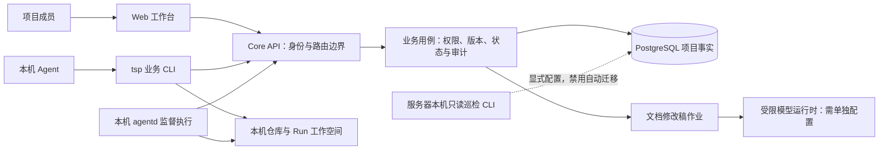
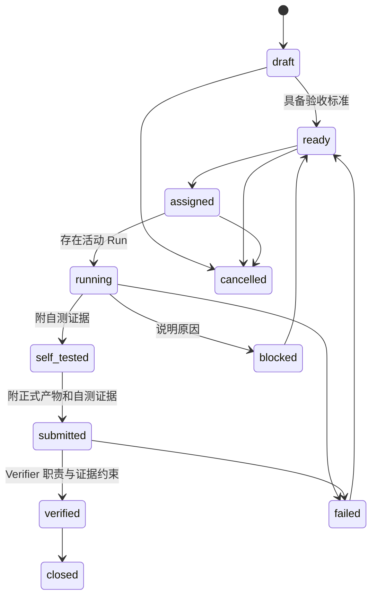
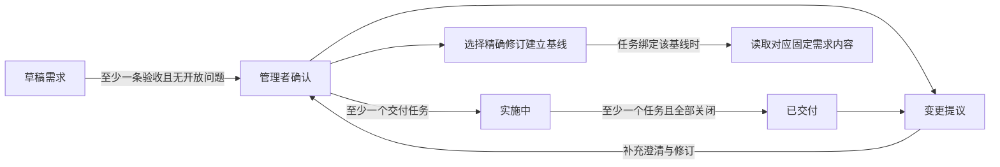
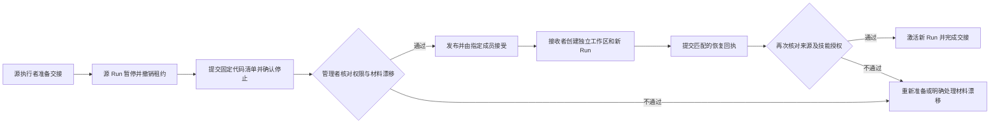
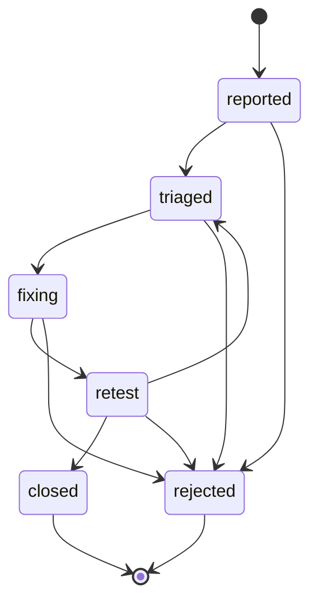

# TeamSynergy 现状业务规则基线

> 基于 `codebase-graph-business-rules` Skill 的实际试跑产物，供产品、运营和测试阅读。记录代码当前实现，不代替对未来需求的确认。

## 1. 范围与证据边界

### 1.1 已知事实、缺口与最小假设

| 类别 | 本次约定 |
| --- | --- |
| 项目与代码版本 | TeamSynergy，Git 提交 `92728fbec04cfa34fee4421cb0a9319d1b755164`；以 Git archive 的 660 个文件为固定材料。 |
| 比较目的 | 与前面的 UA/codegraph 实验使用同一提交，检查另一套 Skill 对业务文档的组织效果。 |
| 未覆盖的工作区内容 | 当前未提交的 UA、codegraph、原生阅读器接入代码不属于这份快照，不将它们写成该提交已有功能。 |
| Skill 版本 | `xsoway/codebase-graph-prd-rules`，提交 `98d6a7222b3bdce3c2fbdd78bfa818b4ed2d50aa`；采用全项目执行规范及文档契约。 |
| 图谱工具 | Graphify `0.9.104`，源码提交 `6c8002eca4acad58db6160eabcb466e61fc35afb`，Python 3.12.8，包含 SQL 语法支持。 |
| 解释方式 | Graphify 只做本机结构提取；业务解释由当前 Agent 按 Skill 逐项回查固定源码完成。未为 Graphify 配置语义模型凭据。 |
| 信息缺口 | 没有读取生产数据库内容、实际部署参数、外部模型协议响应、真实任务调度结果或客户访谈。 |
| 冲突与可能过期项 | 已有 README/设计文档可用于发现术语；若与实现不同，以已标明位置的源码为准。例如普通业务 CLI 使用 HTTP，但服务端本机巡检命令存在显式直连数据库的例外。 |
| 范围外 | 修改业务实现、改变现有需求正文、执行发布/采用操作、调用真实模型或下游、启用租户隔离。 |
| 最小假设 | 相对路径和行号均属于上述提交；测试断言是建议验证目标，不表示本次执行成功。 |

### 1.2 图谱构建与查询

在隔离实验目录中执行，下面的 `source` 是固定代码快照，`artifacts` 是独立输出目录：

```text
GRAPHIFY_BACKEND=none
GRAPHIFY_QUERY_LOG_DISABLE=1
graphify extract source --code-only --max-workers 4 --out artifacts
graphify cluster-only artifacts --no-label --no-viz
graphify query "intake publication dependencies" --seed createIntakeUseCases --graph artifacts/graphify-out/graph.json --depth 2 --budget 3500
graphify path createIntakeUseCases writeRequirement --graph artifacts/graphify-out/graph.json
```

| 实测项目 | 结果与含义 |
| --- | --- |
| 结构提取输入 | 553 个文件；包含代码、SQL、JSON/YAML 等工具支持的结构输入。 |
| 原生图 | 5,200 个节点、16,335 条边、205 个社区。社区使用本地聚类；未请求模型命名。 |
| 边的工具标记 | 16,049 条 `EXTRACTED`，286 条 `INFERRED`。这些标记描述提取来源，不证明业务结论正确。 |
| 未作语义提取 | 94 个非代码输入；另有 12 个未分类文件被跳过，依赖锁文件按工具规则忽略。Dockerfile、nginx 配置等不能宣称已由该图完整解释。 |
| 无符号告警 | 工具报告 43 个代码输入未提取到符号；其中可能仍有文件级节点，不能简单从输入数减去 43 当作覆盖率。 |
| 可定位来源 | 节点/边位置字段涉及 542 个实际快照文件；另有 7 种位置值属于外部模块名或未构建 dist 引用，不能直接作为业务规则的源码引用。 |
| 查询限制 | 若所有节点能放入预算，工具仍可能输出全部边；实际记录过约 4,800-token 请求返回约 35,000-token 结果。已限制查询范围，截断结果不当作完整邻接。 |
| 样例路径 | `createIntakeUseCases → writeRequirement` 的结构路径存在，但业务上仍需经过审阅、计划校验和逐项处理；图上的一跳不能替代真实执行顺序。 |

证据等级统一如下：

- **SOURCE_REVIEWED／静态已复核**：阅读了所引源码的条件、状态或副作用。下文规则默认采用此等级。
- **GRAPH_LEAD／图谱线索**：用于定位候选入口或关联；`EXTRACTED` 和 `INFERRED` 均须回到源码确认。
- **待确认**：当前源码未给出足够依据，或属于实际部署/业务期望问题。
- **PROPOSED_NOT_RUN／建议测试未执行**：写明数据、操作与观察点，未据此声称接口、数据库或运行环境已验证。

## 2. 系统地图

TeamSynergy 把需求、任务、执行记录、资料和证据保存在共享项目状态中。Web 与普通业务 CLI 通过 API 处理项目操作；本机 Agent 与工作空间负责代码文件和进程。服务器本机诊断工具另有只读数据库入口。



源码入口：`apps/core-api/src/server.ts:57-70`、`apps/cli/src/api-client.ts:35-61`、`apps/agentd/src/api.ts:9-39`。巡检例外：`apps/cli/src/db-plan-tenants.ts:5-23`、`apps/cli/src/db-check-orphans.ts:5-23`。单篇文档模型边界见 M12。

## 3. 业务模块目录与入口

以下 13 个模块是为业务阅读做的归组，不是数据库中的另一套模块实体。

| 模块 | 业务入口/目的 | 主要代码范围 |
| --- | --- | --- |
| M01 身份与会话 | 登录、设备授权、会话续用和吊销 | auth、device-authorization、login-security |
| M02 团队与项目治理 | 成员有效权限、所有权和归档边界 | project-access、member、ownership、project-use-cases |
| M03 项目结构与计划 | 模块、功能、阶段、里程碑和首页组织 | project-structure、project-home |
| M04 需求协作 | 想法、议题、决策、文档评审 | requirement-collaboration |
| M05 需求与基线 | 需求正文、结构化需求、精确版本绑定 | requirement-document、requirement、baseline |
| M06 任务交付与执行 | 领取、Run、租约、自测、独立验证和关闭 | task-service、execution、task-state-machine、agentd |
| M07 跨人交接 | 固定交接材料，由目标人员恢复新运行 | handover、handover-workspace |
| M08 项目资料 | 原生文档、目录、标准、设计原型和架构资料 | project-document、design-prototype、architecture-document |
| M09 测试与缺陷 | 版本化用例、执行结果、失败结果与缺陷闭环 | testing、defect |
| M10 技能资产 | 技能版本、共享授权、安装及 Run 清单 | skills-use-cases、skills-access、skills-run |
| M11 代码/资料逆向规格 | 本机候选、逐项审阅、固定计划和受控写入 | CLI intake、intake-use-cases、quality-gate、entity-writers |
| M12 文档系统 Agent | 对授权的单篇原生文档生成修改稿，确认后采用 | system-agent-use-cases、worker、runtime |
| M13 运维与审计 | 账号治理、审计读取、完整性及客户映射盘点 | admin-governance、audit-export、tenant-inventory |

模块入口与实际判断条件分别在第 6 节给出；不要把“源码中存在一个命令”理解为所有角色都能执行。

## 4. 核心实体、状态与数据关系

| 实体/概念 | 业务含义与边界 | 定位依据 |
| --- | --- | --- |
| 团队角色、项目角色、Agent Profile | 团队/项目的 Owner、Admin 等决定协作权限；planner/builder/verifier 是执行职责，不能相互替代。 | `packages/contracts/src/schemas.ts:7-18` |
| 项目与成员策略 | 项目可采用私有、团队可读、团队可写策略；实际权限还受显式成员、唯一所有权和账号状态影响。 | `packages/application/src/project-access.ts:41-74` |
| 项目模块、Feature、阶段和里程碑 | 负责组织工作；业务阅读目录 M01–M13 不会自动创建这些数据对象。 | `packages/persistence/src/schema.ts:69-97`；具体维护规则见 M03。 |
| 需求文档、需求修订与需求基线 | 文档和结构化需求有各自正文/修订；基线绑定选定需求版本，不能泛化为整项目冻结。 | `packages/persistence/src/schema.ts:327-356`、`packages/persistence/src/schema.ts:825-925`；细节见 M05。 |
| Task | 有目标、验收条件、产物及可选需求/基线等来源绑定；状态转换受证据和身份限制。 | `packages/contracts/src/schemas.ts:32-78`、`packages/domain/src/task-state-machine.ts:17-29` |
| Run | 一次执行记录，状态包括 active、suspended、preparing、transferred、completed、failed、cancelled；不等同于 Task 状态。 | `packages/contracts/src/schemas.ts:80-82` |
| 项目原生文档 | 与需求文档分开存储；系统文档 Agent 的来源是获授权的原生文档快照。 | `packages/application/src/system-agent-use-cases.ts:54-77`；详见 M08、M12。 |
| 测试结果与缺陷 | 测试记录保留执行时用例版本；只有满足约束的失败结果可关联缺陷。 | `packages/application/src/testing-use-cases.ts:266-290` |
| 技能版本与 Run 清单 | 被授权、被安装、被某个 Run 固定是三个不同的事实。 | M10 的授权、安装及下载规则。 |
| 逆向规格批次/候选/尝试 | 候选先成为待审阅材料，审阅决定创建、绑定或跳过；写入计划与每次尝试分别保存。 | `packages/contracts/src/intake.ts:157-191`；详见 M11。 |



状态图仅覆盖 Task；没有用它替代 Run、文档作业或逆向规格批次的状态机。这里的独立验证指 Verifier 职责和对应 Run，不能据此推导已经强制验证人与 Builder 是不同自然人；具体实现边界见 BR-06-05。依据：`packages/domain/src/task-state-machine.ts:17-29`、`packages/domain/src/task-state-machine.ts:76-96`、`packages/domain/src/task-state-machine.ts:122-129`。

## 5. 端到端业务链路

### 5.1 从需求材料到可验收交付


这是多个模块的组合阅读路径，不代表存在一个自动执行全部步骤的后台总调度器。各操作资格、分支和失败保留策略见 M04–M07、M11；Task 的基本 guard 见 `packages/domain/src/task-state-machine.ts:76-96`、`packages/domain/src/task-state-machine.ts:122-129`。

### 5.2 从测试失败到缺陷处理

测试执行先记录用例快照与结果；失败结果再选择当前项目的已有缺陷或按合法 Feature 新建缺陷。相同缺陷关联可幂等返回，换绑冲突需处理。缺陷随后遵循自身状态流转，不应把“已登记缺陷”当作修复或回归已经通过。依据：`packages/application/src/testing-use-cases.ts:266-290`；缺陷状态边界见 M09。

## 6. 按模块合并的业务规则

以下各表的“测试断言”均为建议验证目标。已阅读实现不等于运行过对应测试；规则的失败回滚范围以各模块实际事务边界为准。

### M01 账号、会话与设备授权

**目标与角色。** 用户通过账号验证获得设备会话；需要使用本机 CLI 的用户另行批准 CLI 安装身份。入口为 Web/CLI 登录、改密、注销和设备授权请求，输入包括账号、密码、设备名称和安装身份。输出为登录结果、独立会话或结构化拒绝；密码值和会话凭据不属于本文产物。上游是客户端登录界面，下游是项目权限及执行租约。证据等级：`SOURCE_REVIEWED`，只确认静态实现。

**图谱导航。** 实际执行以 `createAuthUseCases` 为种子的 `query --context call --depth 1 --budget 4500`，以及 `path createAuthUseCases createDeviceLogin --directed`；后者返回一跳 `EXTRACTED`。记录见 `artifacts/queries/governance-auth-narrow.txt`、`artifacts/queries/governance-auth-path.txt`，最终规则仍逐条复核源码。

| ID | 条件 | 决策与结果 | 例外/控制 | 源码依据 | 测试断言 |
| --- | --- | --- | --- | --- | --- |
| BR-01-01 | 资格过滤：提交账号密码 | 账号先规范化；空账号、空密码或超过 128 字符的密码拒绝。未知账号与错误凭据使用同一对外错误 | 未找到用户仍执行替代密码散列验证；不能据此声称所有时间侧信道均已排除 | `packages/application/src/auth-use-cases.ts:44-56` | 未知账号和错误密码均得到 `auth_credentials_invalid`，不返回账号存在性 |
| BR-01-02 | 运行控制：账号仍在锁定期或本次登录失败 | 未过期锁定返回 `slow_down`；失败计数达到配置阈值时建立锁定；成功登录清零 | 失败结果在事务中以返回值结束，使失败计数和审计得以提交；不把失败当作整笔事务必然回滚 | `packages/application/src/auth-use-cases.ts:58-85` | 连续错误请求改变失败计数；锁定期拒绝；锁定到期后按实现重置并重新计数 |
| BR-01-03 | 资格过滤：账号要求更改初始密码 | 初始密码没有有效到期时间或已到期时，不发放本次登录会话；审批 CLI 授权的账号必须已完成初始改密 | 账号一般登录与 CLI 授权批准的门槛不同，不能合并成“只要登录就可批准” | `packages/application/src/auth-use-cases.ts:79-84`；`packages/application/src/device-authorization-use-cases.ts:36-48` | 过期初始密码登录失败；仍需改密的用户不能批准 CLI 请求 |
| BR-01-04 | 资格过滤与副作用：用户更改密码 | 新密码须为 8–128 字符并验证当前密码；事务再次核对密码散列后更新，清除初始改密和锁定状态 | 吊销其他设备；提供有效当前会话时，仅保留该会话，同一安装的其他会话也吊销；未提供当前会话时不会据本文保证“保留本机登录” | `packages/application/src/auth-use-cases.ts:90-115` | 当前密码错误不改密；改密后其他设备及同安装其他会话失效 |
| BR-01-05 | 运行控制：为用户建立设备会话 | 安装身份按用户、客户端类型、安装 ID 复用；已有安装的秘密摘要必须匹配。新设备或恢复已吊销设备受 10 台有效设备上限约束 | 设备名称不能为空且最长 200 字符；同一设备重新登录新增独立会话，默认有效期 90 天；不能把设备 ID 当作会话 ID | `packages/application/src/auth-device.ts:10-58` | 第 11 台有效设备被拒绝；同安装正常重登不额外占设备名额，但产生新会话 |
| BR-01-06 | 运行控制：注销、吊销及解析会话 | 注销只吊销所用会话；吊销设备会同时吊销其会话和运行租约。解析时拒绝已撤销、过期会话及已吊销设备 | 有效用户状态也参与解析；设备吊销比当前会话注销范围更大 | `packages/application/src/auth-use-cases.ts:120-145`；`packages/application/src/auth-device.ts:62-87` | 注销一个会话不等于吊销整台安装；设备吊销后该设备的会话及执行租约不可用 |
| BR-01-07 | 资格过滤与轮询控制：CLI 设备授权 | 请求须使用 CLI 安装身份；用户明确批准或拒绝；批准且账号仍有效后才可一次性兑换独立设备会话 | 过期/已兑换请求拒绝；过快轮询增加间隔，最高 60 秒；浏览器批准不等于 CLI 复用浏览器会话 | `packages/application/src/device-authorization-use-cases.ts:16-26`；`packages/application/src/device-authorization-use-cases.ts:36-72` | 待批准返回 pending；拒绝后不能兑换；成功兑换后再次兑换失败 |

本模块没有业务候选排序。资格过滤和失败锁定、设备上限、授权轮询是不同控制，不写成“登录优先级”。异常输出包括错误凭据、锁定、设备身份不符、设备数量超限、授权过期和授权拒绝。

**建议测试（`PROPOSED / NOT RUN`）。**

| ID | 前置数据 | 操作 | 可观察结果 | 优先级 |
| --- | --- | --- | --- | --- |
| GT-01-01 | 有效账号及可控登录锁定配置 | 错误登录至阈值，再正确登录 | 锁定拒绝且失败审计/计数已保存；到期后按实现解锁 | P0 |
| GT-01-02 | 10 台有效设备；其中一安装有两个会话 | 分别尝试新增安装、同安装登录、当前会话改密 | 新安装被限；重登仍可发会话；改密后的吊销范围符合 BR-01-04/05 | P0 |
| GT-01-03 | pending 的 CLI 授权请求 | 快速轮询、批准、兑换两次 | 间隔递增；只一次成功；后续凭据仅在测试客户端保留 | P1 |

### M02 团队、项目、成员与所有权

**目标与角色。** 有效账号创建团队，团队管理者建立项目；项目负责人、管理员、协作者及只读成员通过不同能力协作。入口为团队/项目创建、成员授权、所有权转移和归档。输入为目标团队/项目、人员编码、角色、成员策略及转移请求；输出为协作空间、当前有效能力、成员变更或拒绝。下游覆盖所有项目资料与任务写入。证据等级：`SOURCE_REVIEWED`。

图谱使用 `resolveProjectAccess` 的一跳调用邻域，记录于 `artifacts/queries/governance-project-query.txt`。这里描述的是团队/项目授权，不将其扩写成客户隔离或数据库 RLS。

| ID | 条件 | 决策与结果 | 例外/控制 | 源码依据 | 测试断言 |
| --- | --- | --- | --- | --- | --- |
| BR-02-01 | 资格过滤：有效用户创建团队，或团队管理者创建项目 | 非空名称；创建者成为新团队/项目的唯一负责人。项目创建实际接受团队 Owner 或 Admin | 注销交接中的账号不能新建团队/项目；部分错误文案写“只有 Owner”，但执行判定使用允许 Owner/Admin 的 `isProjectManager` | `packages/application/src/team-use-cases.ts:48-64`；`packages/application/src/project-use-cases-project.ts:47-76`；`packages/application/src/project-access.ts:22-26` | 普通团队成员建项目被拒绝；团队 Admin 可创建；pending deletion 不能创建 |
| BR-02-02 | 资格过滤：读取有效项目身份 | 优先使用唯一负责人，其次显式项目角色，最后按团队成员策略继承；`private` 不继承，`team_write` 继承 Member，其他非 private 策略按代码继承 Viewer | 无效/已删除用户不产生有效身份；显式角色可覆盖团队继承角色；不是“取各来源中最高角色” | `packages/application/src/project-access.ts:41-55` | 同时有团队写权限与显式 Viewer 的用户仍按显式 Viewer；private 的无显式授权成员无权限 |
| BR-02-03 | 资格过滤：项目能力检查 | Owner/Admin/Member/Viewer 可读，Viewer 不可写；Owner/Admin 可管理一般内容和成员；管理员任免、策略、所有权转移和归档能力仅 Owner | 平台管理员标志没有出现在该有效项目角色函数中，不能据平台身份推导自动拥有全部项目正文权限 | `packages/application/src/project-access.ts:23-26`；`packages/application/src/project-access.ts:65-74` | Viewer 写入拒绝；Member 管理拒绝；Admin 任免管理员不获准 |
| BR-02-04 | 资格过滤：增改成员或移除显式授权 | 只能直接授予 Admin、Member、Viewer；Owner 受保护，不能通过一般角色编辑产生或移除 Owner；Admin 不能任免/移除 Admin | 重新加锁并复核有效用户、项目状态与授权；变更与审计同一事务 | `packages/application/src/member-use-cases.ts:14-25`；`packages/application/src/member-use-cases.ts:43-70`；`packages/application/src/member-use-cases.ts:81-98` | 给一般成员接口传 Owner 拒绝；Admin 修改另一 Admin 拒绝；失败无角色变更 |
| BR-02-05 | 运行控制：撤销显式授权或降为只读后将失去写能力 | 先检查该成员未完任务，以及 active/preparing/suspended Run；存在时要求先交接 | 移除显式授权后会重新计算团队继承，未必失去项目访问；若仍继承 Member，不把“删显式记录”写成“立刻撤销全部写权限” | `packages/application/src/member-use-cases.ts:28-39`；`packages/application/src/member-use-cases.ts:73-80` | 有未完任务的写权限丢失被拒绝；移除覆盖后恢复继承写权限的分支单独验证 |
| BR-02-06 | 资格过滤与事务：接收所有权转移 | 请求仍 pending、未到期、当前负责人仍等于发起时负责人，并由接收人本人接受，再次复核接收资格 | 接受后同时更新唯一负责人和管理成员关系；旧负责人保留管理成员关系；不能把“发起转移”当作已生效 | `packages/application/src/ownership-use-cases.ts:143-175` | 非接收人、过期请求、所有权已变化均不接受；成功后只有新的唯一负责人字段生效 |
| BR-02-07 | 资格过滤：归档/恢复项目及归档后的普通写入 | 归档和恢复动作只允许项目 Owner；归档项目的一般 write/manage 检查拒绝，读取角色解析仍存在 | owner 能力与普通 write/manage 检查不同；归档不等于删除所有历史记录 | `packages/application/src/project-use-cases-project.ts:248-265`；`packages/application/src/project-access.ts:65-74` | Admin 不能归档；Owner 归档后普通资料写入失败；合法历史读取仍可用 |

本模块的核心选择是**角色来源优先序**，并非遍历人员时的业务优先级。成员展示使用姓名升序、公开编码升序作并列键；这只影响展示，不增加授权。依据：`packages/application/src/member-use-cases.ts:103-114`。

**建议测试（`PROPOSED / NOT RUN`）。**

| ID | 前置数据 | 操作 | 可观察结果 | 优先级 |
| --- | --- | --- | --- | --- |
| GT-02-01 | 同一用户同时有团队继承角色和显式项目角色 | 改变显式角色与项目策略后读取、尝试写入 | 身份来源按 BR-02-02 选择，不能用“最高角色”错误放权 | P0 |
| GT-02-02 | 成员有未完任务；另一成员为唯一 Owner | 尝试撤写、移除 Owner、Admin 任免 Admin | 分别被未交接、所有权保护、管理员任免门槛拒绝 | P0 |
| GT-02-03 | 一个 pending 转移请求和两名并发操作者 | 非接收者先接受、接收者再接受、重复接受 | 只合法且尚 pending 的请求能改变负责人；并发重试不产生两个唯一 Owner | P1 |

### M03 项目结构、交付功能、阶段、里程碑与首页

**目标与角色。** 项目管理者用功能模块、Feature、阶段、里程碑组织交付，再选择首页资料。入口是结构工作台和对应 CLI/API；输入包括名称、排序清单、归属、排期、状态及首页文档绑定，输出是结构记录、交付计数和配置结果。上游是项目权限，下游是需求、任务与文档。证据等级：`SOURCE_REVIEWED`。图谱记录为 `artifacts/queries/governance-structure-query.txt`。

| ID | 条件 | 决策与结果 | 例外/控制 | 源码依据 | 测试断言 |
| --- | --- | --- | --- | --- | --- |
| BR-03-01 | 资格过滤：创建功能模块 | 当前有效项目管理者才能创建；模块名称去空白后非空 | 实际允许 Owner/Admin；错误文案中的“只有 Owner”不作为更窄规则 | `packages/application/src/project-structure-use-cases.ts:158-177` | Viewer/Member 创建被拒绝；Admin 和 Owner 的合法创建均可走入写入 |
| BR-03-02 | 排序/选择：调整模块顺序 | 提交清单必须恰好覆盖当前项目全部模块且无重复，按清单位置写入 `sort_order` | 列表按 `sort_order ASC, id ASC`；其他项目编码、遗漏或重复都使整次调整拒绝 | `packages/application/src/project-structure-use-cases.ts:146-151`；`packages/application/src/project-structure-use-cases.ts:183-207` | 重复、缺少一个模块、混入外项目模块均拒绝；相同 sort_order 按 id 升序展示 |
| BR-03-03 | 资格过滤：阶段与日期 | 管理者创建阶段；名称非空，日期为有效的 `YYYY-MM-DD`，同时存在开始/结束时结束不得早于开始 | 空日期规范为 null；不把阶段允许单端日期扩写为 Feature 也允许 | `packages/application/src/project-structure-use-cases.ts:274-307`；`packages/application/src/schedule.ts:5-21` | 非法日期和反向区间拒绝；阶段仅填一端的行为与 Feature 区分 |
| BR-03-04 | 资格过滤：Feature 归属及排期 | 指定模块、里程碑必须在同项目；有排期时必须同时填开始/结束，并选择已有完整日期范围的里程碑，Feature 区间须落在其内 | 不填两个日期时可不排期；移除或变更里程碑后仍重验日期条件 | `packages/application/src/project-use-cases.ts:114-137`；`packages/application/src/project-use-cases.ts:276-315`；`packages/application/src/schedule.ts:24-53` | 半段排期、无目标里程碑、越出目标日期范围均拒绝；跨项目归属拒绝 |
| BR-03-05 | 资格过滤：里程碑建立与完成 | 阶段必须属于同项目；创建时不能直接 completed；更新为 completed 时至少存在一个未归档 Feature，且这些 Feature 全为 delivered | 指定且找到的负责人必须是非 Viewer 项目成员；当前创建代码对“指定但查无此人”会按无负责人保存，作为待确认缺口列出，不补写不存在的拒绝规则 | `packages/application/src/project-structure-use-cases.ts:438-478`；`packages/application/src/project-structure-use-cases.ts:550-557` | 空里程碑不能完成；只剩 archived Feature 也不能完成；无效负责人编码分支按现实现记录 |
| BR-03-06 | 运行控制：更新里程碑区间 | 修改后的里程碑范围不能排除已有排期 Feature；更新与审计同一事务 | 里程碑列表计数区分 Feature 总数/delivered 数和任务总数/closed 数，不能将任意状态数量等同于完成比例 | `packages/application/src/project-structure-use-cases.ts:391-409`；`packages/application/src/project-structure-use-cases.ts:559-601` | 缩小里程碑范围排除 Feature 时拒绝；计数中 cancelled 任务不当成 closed |
| BR-03-07 | 资格过滤与绑定：配置首页资料 | Owner/Admin 在活动项目中配置；绑定文档必须同项目、活动状态，并位于 `overview` 系统目录 | 字段省略表示不改，null 表示解除绑定；其他目录的有效文档也不能充当该首页资料 | `packages/application/src/project-home-use-cases.ts:87-126` | 外项目、归档或非 overview 目录的文档拒绝；null 解除、未传保留 |

本模块排序属于人工排列和稳定展示，不决定任务领取资格。里程碑列表也按 `sort_order ASC, id ASC` 返回，计数在取数后聚合，无“未完成排最后”等附加业务排序。依据：`packages/application/src/project-structure-use-cases.ts:371-419`。

**建议测试（`PROPOSED / NOT RUN`）。**

| ID | 前置数据 | 操作 | 可观察结果 | 优先级 |
| --- | --- | --- | --- | --- |
| GT-03-01 | 两个项目各有模块，目标项目两模块 sort_order 相同 | 提交不完整/跨项目排序清单，再读取列表 | 无非法部分排序；并列按 id 升序 | P1 |
| GT-03-02 | 有日期的里程碑与其下 Feature | 半段排期、越界，再缩小里程碑范围 | 对应缺失/越界/冲突拒绝，不悄悄裁剪 Feature 日期 | P0 |
| GT-03-03 | 空、仅 archived、未全 delivered、全 delivered 四类里程碑 | 尝试 completed | 只有有未归档且全部 delivered 的分支通过 | P0 |

### M04 想法、议题、决策与文档评审

**目标与角色。** 将观察记录为想法，在议题中保存讨论和决策，围绕一篇需求文档的固定修订收集评审意见。协作成员可提出想法与反馈，项目管理者拥有正式决策/结论能力。输入为项目、议题或文档编码、文本、记录类型、投票或结论；输出包括记录、状态更新和评审轨迹。下游为需求文档及需求条目；评审结论不在这里自动改写正文。证据等级：`SOURCE_REVIEWED`。图谱记录为 `artifacts/queries/governance-requirements-narrow.txt` 和 `governance-requirements-path.txt`。

| ID | 条件 | 决策与结果 | 例外/控制 | 源码依据 | 测试断言 |
| --- | --- | --- | --- | --- | --- |
| BR-04-01 | 资格过滤：创建/修改想法 | 有项目写权限且标题去空白后非空才能创建；修改由作者或项目管理者进行 | Viewer 不能因曾是作者而获得写权限；修改状态也须属于允许集合 | `packages/application/src/requirement-collaboration-use-cases.ts:159-160`；`packages/application/src/requirement-collaboration-use-cases.ts:185-220` | 普通成员不能改他人想法；作者降为 Viewer 后不能修改 |
| BR-04-02 | 资格过滤与状态：向议题添加记录 | 归档议题拒绝；正文非空且类型合法。decision 要 manage，其他记录要 write；decision 令议题 decided，decided 后 feedback 令其 reopened | 已解析的被替代记录必须是同议题的历史 decision；未找到被替代编码的处理不能凭名称推断为强制拒绝 | `packages/application/src/requirement-collaboration-use-cases.ts:317-346` | Member 不能发布 decision；反馈重开已决议题；不能替代另一议题的决策 |
| BR-04-03 | 运行控制：撤回记录 | 作者或管理者可撤回非 decision 记录，保留正文和撤回原因/操作者；decision 只能通过新决策替代 | 归档议题、已撤回记录拒绝。撤回后按剩余决策及其后反馈重算 open/decided/reopened | `packages/application/src/requirement-collaboration-use-cases.ts:352-378` | 决策撤回被拒绝；撤回反馈不删除历史，并按剩余记录恢复议题状态 |
| BR-04-04 | 选择与幂等：发起需求文档评审 | 文档维护人或管理者发起；绑定发起时文档的当前修订记录，而非浮动最新正文；该修订已有评审则返回已有评审 | 当前代码查询到已有评审即复用，不限于 open，因此不能声称同修订关闭后自动生成第二轮 | `packages/application/src/requirement-collaboration-use-cases.ts:422-437` | 文档再修订后，旧评审仍绑定旧修订；重复发起同修订不产生新的逻辑评审 |
| BR-04-05 | 资格过滤与覆盖：提交评审意见 | 仅 open 评审接收合法投票；需要项目写权限；同一评审、同一用户再次投票覆盖其旧意见 | 这是“一人一份当前意见”，不是每次点击增加一票；关闭后不再接收 | `packages/application/src/requirement-collaboration-use-cases.ts:453-465` | 同人改票后只剩一条当前投票；关闭后追加/改票失败 |
| BR-04-06 | 资格过滤与并发：关闭评审 | 由项目管理者给合法结论；事务中再次核对 manage，并以仍 open 的记录为更新条件 | 没有“票数达到某阈值自动通过”的实现条件；竞争关闭时未更新到记录的一方收到已关闭错误 | `packages/application/src/requirement-collaboration-use-cases.ts:469-486` | Member 不能关闭；两方并发关闭只有一个更新成功；结论不是按票数自动计算 |

**顺序与例外。** 撤回后的议题状态计算按 `created_at ASC, id ASC` 查看有效记录，再取最后一条 decision，检查它之后是否仍有 feedback；这不是“最新更新时间优先”的规则。依据：`packages/application/src/requirement-collaboration-use-cases.ts:370-374`。同一模块的正常讨论、决策替代、反馈重开、撤回和评审关闭均在本节合并。

**建议测试（`PROPOSED / NOT RUN`）。**

| ID | 前置数据 | 操作 | 可观察结果 | 优先级 |
| --- | --- | --- | --- | --- |
| GT-04-01 | decided 议题含一个后续 feedback | 撤回 feedback；尝试撤回 decision | 前者保留撤回轨迹并重算状态，后者拒绝 | P0 |
| GT-04-02 | 文档 R1 有 open 评审，文档另产 R2 | 在 R1 评审投票并改票，再查看两版 | R1 绑定不漂移；一人一份当前意见；R2 不替换 R1 正文 | P0 |
| GT-04-03 | 同一 open 评审和两位管理者 | 并发关闭为不同结论 | 仅一个 open→closed 更新成功；不以投票数量代替管理者结论 | P1 |

### M05 需求文档、需求生命周期与版本基线

**目标与角色。** 保存可修订的需求叙述和可跟踪的结构化需求，并为执行选定精确需求内容。项目写成员可录入草稿，文档负责人/管理者维护文档，项目管理者推进需求状态并建立基线。输入为模块/来源文档/兼容 Feature 绑定、正文、验收条款、开放问题及选择的需求修订；输出为修订、状态或带内容摘要的基线。上游为 M04 和资料导入，下游为 Feature 和任务执行。证据等级：`SOURCE_REVIEWED`。图谱记录为 `artifacts/queries/governance-baseline-query.txt`。

| ID | 条件 | 决策与结果 | 例外/控制 | 源码依据 | 测试断言 |
| --- | --- | --- | --- | --- | --- |
| BR-05-01 | 资格过滤：创建需求文档 | 活动用户有项目写权限，解析到有效模块，标题、摘要及正文非空；摘要省略时可由正文/标题导出 | 换行统一为 LF；归档项目不能新增；不能把“摘要可省略”误写成“可保存空摘要” | `packages/application/src/requirement-document-use-cases.ts:206-245` | 空标题/正文拒绝；未手填摘要但可导出时成功；归档项目拒绝 |
| BR-05-02 | 资格过滤与版本：修订需求文档 | 文档负责人或管理者拥有当前写权限，文档未归档；摘要、正文、变更说明必填，追加下一修订并更新当前指针 | 修订与审计处于同事务。该接口未收客户端 expected revision，不声称具备显式乐观 CAS；并发冲突的产品错误呈现需专项验证 | `packages/application/src/requirement-document-use-cases.ts:368-443` | 合法修订不覆盖旧修订；缺变更说明拒绝；降权后原作者也不能继续写 |
| BR-05-03 | 资格过滤：创建结构化需求 | 必须有有效项目范围绑定，标题/背景目标非空，只能从 draft 开始；支持旧版 Feature-only 调用 | draft 可暂无验收条款、保留开放问题；不得把草稿写入等同于已确认需求 | `packages/application/src/requirement-use-cases.ts:297-357` | 无绑定或直接指定 confirmed 均拒绝；可创建带待确认问题的 draft |
| BR-05-04 | 资格过滤：推进需求生命周期 | 仅 Owner/Admin 可按允许状态图推进；confirmed 至少有一条验收且无开放问题；implementing 至少有关联任务；delivered 要至少一个任务且全部 closed | 不能以“所有现存任务都已关”的空集合判断让零任务需求交付；cancelled 任务也不满足该全部 closed 条件 | `packages/application/src/requirement-use-cases.ts:30-37`；`packages/application/src/requirement-use-cases.ts:732-759` | 无 AC/仍有问题不能确认；零任务不能实施/交付；含 cancelled 任务不能按此规则交付 |
| BR-05-05 | 资格过滤：修改已经确认的需求内容及绑定 | 正文/标题/验收/问题变更仅允许 draft、clarifying、change_proposed；其他状态需先进入变更提议；重新绑定仍须留在原项目且至少保留一项范围关系 | 无变化时不必新增正文修订；不得通过换绑定跨项目转移需求 | `packages/application/src/requirement-use-cases.ts:40`；`packages/application/src/requirement-use-cases.ts:574-615` | confirmed 直接改正文拒绝；合法变更提议后可修订；跨项目重绑拒绝 |
| BR-05-06 | 资格过滤与快照：创建需求基线 | 管理者在活动项目填写名称、范围、原因，选择不重复的有效需求/修订。所选需求当前必须 confirmed/implementing/delivered，且属于唯一目标项目 | 正文/验收/开放问题来自指定修订；标题和状态来自采集时的需求主记录，不应称为“完整历史时点的所有元数据” | `packages/application/src/baseline-use-cases.ts:36-45`；`packages/application/src/baseline-use-cases.ts:68-83`；`packages/application/src/baseline-use-cases.ts:169-192` | 重复、跨项目、不存在修订和当前 draft 的需求不能入基线；选旧修订时核对内容与头部元数据来源 |
| BR-05-07 | 顺序、并发与完整性：保存/读取基线 | 按公开需求编码排序后计算内容摘要；持项目聚合锁建立新版本；提供父基线时必须与当前最新一致。读取重新计算摘要，不符即拒绝 | 这是精确需求内容的不可变基线，不是项目必须经过的“冻结步骤”；当前状态合格也不代表选中的历史修订在当时已被确认 | `packages/application/src/baseline-use-cases.ts:49-64`；`packages/application/src/baseline-use-cases.ts:173-198` | 过时父基线拒绝；篡改任一基线项目后读取触发 integrity error；输入顺序不改变相同选择集合的内容摘要 |

**主链路。** 下图只表达已读的需求状态主流程；`deprecated`、回退澄清等分支以代码允许表为准，不由图补充承诺。



任务读取已绑定基线时，按项目和基线匹配并验证，再按需求编码提取固定内容；这不表示每个任务都必然已绑定基线。依据：`packages/application/src/task-service.ts:659-662`。

**建议测试（`PROPOSED / NOT RUN`）。**

| ID | 前置数据 | 操作 | 可观察结果 | 优先级 |
| --- | --- | --- | --- | --- |
| GT-05-01 | draft 各缺 AC、含开放问题；另有零任务 confirmed | 分别确认或进入 implementing/delivered | 命中对应前置条件，状态与内容不被“顺便升级” | P0 |
| GT-05-02 | 需求 R1/R2 内容不同，当前头部标题已更新 | 选择 R1 建立基线后读取 | 正文/AC 为 R1；标题/状态按采集主记录，基线结果固定且摘要可复验 | P0 |
| GT-05-03 | 一个已存在父基线；两位管理者持同一父编码 | 并发新建后再用旧父编码重试 | 项目锁串行化，过时父基线请求拒绝；不是覆盖既有基线 | P1 |

### M06 任务、Run、执行租约与验收关闭

**目标与角色。** 把交付工作写成带验收标准的任务，由 Assignee 以活动 Run 执行和提交，由 Verifier Profile 的另一个 Run 提供验证证据，再由项目管理者关闭。上游是 Feature/需求/基线，输入为任务合同、领取身份、base snapshot、执行租约及产物/证据；输出包括任务状态、Run/本机 Agent Session、产物和审计。证据等级：`SOURCE_REVIEWED`。图谱实际执行 `query --seed assertExecutionWrite` 和 `path createExecutionUseCases assertExecutionWrite --directed`，记录于 `artifacts/queries/governance-execution-query.txt`、`governance-execution-path.txt`；另执行 `supervise` 一跳查询与 `supervise → terminateProcessTree` 有向路径，得到一跳 EXTRACTED 调用，记录于 `artifacts/queries/governance-agentd-query.txt`、`governance-agentd-path.txt`；关系仅为定位线索。

| ID | 条件 | 决策与结果 | 例外/控制 | 源码依据 | 测试断言 |
| --- | --- | --- | --- | --- | --- |
| BR-06-01 | 资格过滤：创建交付任务 | 必须关联有效 Feature、有效用户，且至少有一条验收标准；非 Viewer 成员可提 ad-hoc，其他来源只接受项目管理者 | 绑定需求时复核其同项目归属并记录来源修订；任务合同不是无约束的自由文本待办 | `packages/application/src/project-use-cases.ts:359-403` | 空验收、Viewer 或 Member 创建非 ad-hoc 任务拒绝；外项目需求绑定拒绝 |
| BR-06-02 | 资格过滤与并发：执行人员领取 | 同任务不能已有 active Run；普通领取必须 assigned、当前用户为 Assignee、Profile 相符、base snapshot 相同、依赖任务全部 closed | 事务持任务锁和项目聚合锁；依赖 cancelled/failed 不当作 closed；Verifier 对 submitted 的领取走专门分支 | `packages/application/src/task-service.ts:421-450`；`packages/application/src/task-service.ts:479-530` | 两人并发领取只有一个活动 Run；非 Assignee、过时快照或未完成依赖不能领取 |
| BR-06-03 | 资格过滤：每次执行写入 | Run/任务/用户必须匹配且 Run active；当前项目仍有写权，且没有 preparing/published/accepted/restoring/ready 交接 | task 与 Run epoch 都为 0 的旧任务兼容不带设备租约；推进 epoch 后必须有匹配当前设备、代数、摘要和有效期的租约。不能写成“全部历史 Run 从来都必须有租约” | `packages/application/src/execution-guard.ts:9-54` | 撤权、暂停 Run、交接未完或旧 epoch 都拒绝；epoch=0 兼容分支另测 |
| BR-06-04 | 运行控制：提交产物与自测 | 提交者必须拥有该活动 Run，任务仍 running，base snapshot 匹配；要求 self_test 且 pass、非空且合法的验收引用；成功按受保护状态转换进入 submitted | 该提交检查不要求自测引用已覆盖全部 AC；不能与验证阶段的全覆盖要求混写。状态更新以旧状态/快照为并发条件 | `packages/application/src/task-service.ts:811-888` | 冒用 Run、失败自测、空/未知 AC 引用、旧快照拒绝；提交不等于 verified |
| BR-06-05 | 资格过滤与覆盖：验证交付 | 使用归属于该用户和任务的 active Verifier Run；任务须 submitted，快照匹配，证据类型 verifier_review；pass 必须覆盖全部不同验收 ID | 当前已读门槛区分 Run/Profile，未见强制验证人的人员 ID 与原 Builder 不同；不得将“独立 Verifier Run”扩大为“系统已强制不同自然人” | `packages/application/src/project-use-cases.ts:542-619`；`packages/domain/src/task-state-machine.ts:120-127` | Builder Profile 验证被拒绝；重复写 AC-1 不能替代缺失 AC-2；Profile 和人员隔离分别验收 |
| BR-06-06 | 资格过滤与事务：关闭交付 | 仅项目管理者可关闭 verified 任务，需匹配 base snapshot、无未决交接；变更和审计同事务 | 关闭后检查 Feature 其他任务；不存在非 closed/cancelled 任务且 Feature 当前 active 时，投影为 delivered。需求 delivered 的条件另按 M05，不与此规则混用 | `packages/application/src/project-use-cases.ts:703-792` | 普通成员或未验证任务不能关闭；审计失败不留下已关闭任务；failed 任务阻止 Feature 自动交付 |
| BR-06-07 | 幂等与运行控制：登记并在本机托管 Agent 执行会话 | 服务检查执行身份/租约及技能清单；相同 Run、设备、epoch、start key 的同请求返回已有会话。本机启动前再续租，启动后持续续租和上报 | 同 key 换命令或 prompt 拒绝；已有 starting/running 会话拒绝重复；服务已登记但本机无 journal 时拒绝重复启动；明确授权拒绝会终止进程，网络不可达只允许使用剩余有效租约 | `packages/application/src/execution-use-cases.ts:88-124`；`apps/agentd/src/index.ts:17-58`；`apps/agentd/src/supervisor.ts:20-76` | 相同启动重试不重复进程；失效代数/明确撤权触发停止；短暂断网与租约过期分开断言；登记 starting 不等于外部进程成功 |

**本机过程与服务状态的边界。** agentd 以本机 journal 保存进程和结果，状态上报再次检查设备/租约，服务已终态的记录不继续更新。watchdog 明确拒绝立即调用进程树终止；网络不可达且租约仍有效时才允许继续。子进程退出后保存 finished/failed 及诊断；失去写权导致最终上报失败时，本机仍保留 journal，不能据此断言远端状态一定同步完成。本地 stop 只操作与当前凭据身份匹配的本机记录并尝试上报，不能作为跨设备远程终止保证。依据：`packages/application/src/execution-use-cases.ts:111-124`；`apps/agentd/src/supervisor.ts:49-76`；`apps/agentd/src/index.ts:72-86`。

**主链路（接口路径，非穷举状态）。** 领域状态机还包含 blocked、failed、cancelled 等分支；本次没有运行 Agent 命令、执行数据库业务动作或验证外部进程结果。


**建议测试（`PROPOSED / NOT RUN`）。**

| ID | 前置数据 | 操作 | 可观察结果 | 优先级 |
| --- | --- | --- | --- | --- |
| GT-06-01 | assigned 任务、两个并发客户端及一项未 closed 依赖 | 并发领取，再关闭依赖后重试 | 依赖未完成拒绝；完成后仍不产生两个活动 Run | P0 |
| GT-06-02 | epoch 已推进的活动 Run；另有 epoch=0 旧 Run | 用旧设备/代数提交，并单独测旧兼容路径 | 新模式拒绝旧租约；旧兼容不能绕过项目撤权或未决交接 | P0 |
| GT-06-03 | 任务有 AC-1、AC-2 | Builder 提交；Verifier 用重复 AC-1 的 pass 验证 | 验证因缺 AC-2 拒绝，状态不进 verified；自测提交与验证覆盖要求分别断言 | P0 |
| GT-06-04 | verified 任务，Feature 下另一任务 failed 或 cancelled | 管理者关闭本任务 | failed 阻止 Feature 自动 delivered；其余仅 closed/cancelled 且 Feature active 时允许事实推进 | P1 |
| GT-06-05 | 正在运行的本机托管进程及可控服务响应 | 分别模拟明确拒绝、短暂网络不可达、断网直至租约到期 | 明确拒绝立即停止；短暂断网只在剩余租约内继续；到期停止并保留本机结果；不要求失权后的最后状态上报必然成功 | P0 |

**六模块核对中待确认的产品/工程边界。** 文档维护 API 的并发错误协议、找不到里程碑负责人时是否应拒绝、决策替代编码查无记录时是否应拒绝、Verifier 是否必须与原 Builder 为不同人员，以及历史修订基线采用当前标题/状态是否符合产品定义，均不由本次逆向文档擅自补成新需求。上文仅报告当前已读实现，不声称已进行运行时验证。

### M07 跨人交接与本机恢复

**目的与角色。** 把尚未完成的执行任务交给另一名协作成员，同时保留原执行者、固定上下文与运行历史。源执行者准备材料并确认停止；项目管理者发布或批准来源漂移；指定接收者接受、恢复并激活自己的新 Run。此处的“管理者”依据 `isProjectManager`，不能仅按错误提示中的“Owner”字样缩窄为唯一所有者。来源：`packages/application/src/handover-use-cases.ts:207-225`、`packages/application/src/handover-use-cases.ts:301-450`。

**输入、输出与依赖。** 输入为任务/源 Run/目标成员、任务版本、停止确认、代码快照清单与恢复回执；输出是交接记录、上下文快照、新工作区/Run 及新执行租约。上游为任务合同、需求基线、项目资料和固定技能清单；下游为接收者的本机恢复与后续任务执行。数据涉及 `taskHandovers`、`contextSnapshots`、`runs`、`workspaces`、`runLeases` 与命令回执。源码中的创建新目录记录不证明真实文件已正确恢复，真实恢复内容由客户端回执报告。来源：`packages/application/src/handover-use-cases.ts:87-177`、`packages/application/src/handover-use-cases.ts:384-419`。

| ID | 条件 | 决策与结果 | 例外/控制 | 源码依据 | 测试断言 |
| --- | --- | --- | --- | --- | --- |
| BR-07-01 | 准备交接 | 只允许 `running`/`self_tested` 的 builder 任务，由当前受派者的活动 builder Run 发起；目标须为另一名有效、非 Viewer 的项目成员 | 任务版本不符、已有未决交接或目标失权均拒绝；成功后增加执行代次、暂停源 Run 并撤销其未撤销租约 | `packages/application/src/handover-use-cases.ts:301-339` | 同任务已有未决交接时，第二次不同请求不得产生第二条交接；旧租约不能继续有效 |
| BR-07-02 | 源执行者提交草稿或停止确认 | 只有源执行者及其准备设备可提交；代码清单必须匹配项目登记的有效仓库 | 准备授权有到期限制；停止确认必须明确为已停止并提供允许的确认方式；不能仅凭准备操作认定本机进程已停 | `packages/application/src/handover-use-cases.ts:217-222`、`packages/application/src/handover-use-cases.ts:344-365` | 错设备、过期准备授权或 `stopped=false` 均拒绝；停止确认不得由接收人冒充 |
| BR-07-03 | 发布交接 | 项目管理者只能发布准备中的交接；必须已有停止确认和代码快照清单，并重新核对目标权限及材料版本 | 来源漂移阻止发布；可批准继续旧材料，但任务合同变更不能豁免，且批准会清除就绪回执 | `packages/application/src/handover-use-cases.ts:207-215`、`packages/application/src/handover-use-cases.ts:367-376`、`packages/application/src/handover-use-cases.ts:462-470` | 无停止确认不能发布；批准材料漂移不能绕过任务合同变化 |
| BR-07-04 | 接受与恢复 | 仅指定接收者可接受；恢复必须提供独立工作区和准确快照提交，为接收者创建 `preparing` 的新 Run，并复制固定技能清单 | 已绑定其他设备或已有恢复尝试时拒绝新尝试；同一幂等键、请求和设备可继续原请求，不能跨设备复用 | `packages/application/src/handover-use-cases.ts:227-237`、`packages/application/src/handover-use-cases.ts:378-409` | 重试返回相同目标 Run；目标目录不得等于源工作区；错提交不能创建可用恢复 |
| BR-07-05 | 就绪与激活 | 就绪回执须匹配设备、尝试、上下文摘要及代码提交；激活时再次检查漂移与技能授权，再将源 Run 记为 transferred、新 Run 记为 active，并转移任务受派人 | 目标必须有匹配就绪回执；源 Run 须仍 suspended、新 Run 须仍 preparing；完成后的重复激活只接受匹配幂等回执与设备 | `packages/application/src/handover-use-cases.ts:410-450` | 错上下文摘要或撤销技能授权阻止激活；幂等重试不得创建第二个目标 Run |
| BR-07-06 | 取消、过期及列表读取 | 管理者、源执行人或目标成员可取消未决交接；目标 preparing Run 被取消，交接按时效记为 cancelled 或 expired；列表按记录 ID 升序 | 取消实现没有自动把暂停的源 Run 恢复为 active；已 cancelled/expired 的重试直接读取现有状态。列表排序不是交接资格优先级 | `packages/application/src/handover-use-cases.ts:452-476` | 取消后目标 Run 不得激活；不得把取消结果误写为“源执行自动恢复” |



图为静态业务路径，不是本次真实交接运行记录。代码侧准备授权约 30 分钟、交接有效期约 24 小时；是否需要可配置有效期属于产品待确认项。来源：`packages/application/src/handover-use-cases.ts:313-335`。

### M08 项目资料、标准、设计原型与架构文档

**目的与角色。** 项目文档库统一展示原生资料、需求文档、架构资料和测试资料，但各来源仍通过自己的业务用例维护。有效项目协作者可按写权限创建原生资料；已有资料的创建者/负责人及项目管理者承担维护责任。输入为目录、正文、图源/原型内容、需求关联和变更说明；输出为当前头信息和保留的历史修订。上游为项目权限与需求；下游为资料阅读、任务上下文及单篇文档 Agent。来源：`packages/application/src/project-document-use-cases.ts:60-105`、`packages/application/src/project-document-use-cases.ts:413-509`。

| ID | 条件 | 决策与结果 | 例外/控制 | 源码依据 | 测试断言 |
| --- | --- | --- | --- | --- | --- |
| BR-08-01 | 新建或修订原生文档 | 需要项目写权限及有效项目；新建时标题、正文非空，同时保存第 1 版正文和审计 | 归档项目拒绝写入；普通成员只能修订自己创建的文档，项目管理者可修订；不能把“能够读取”当作“能够维护” | `packages/application/src/project-document-use-cases.ts:56-75`、`packages/application/src/project-document-use-cases.ts:340-392`、`packages/application/src/project-document-use-cases.ts:568-595` | Viewer 或非作者普通成员不能修订；成功创建后存在首版历史 |
| BR-08-02 | 在固定资料集合内创建内容或目录 | 需求/架构/测试等关联资料从原业务页面维护；原生文档可写系统角色仅含 standards、overview | 任一系统目录祖先均禁止新建/移入子目录；根目录保留名不可占用，同级活动目录名按大小写不敏感判重 | `packages/application/src/project-document-use-cases.ts:65-94`、`packages/application/src/project-document-use-cases.ts:252-275` | 不能在“需求”系统集合中塞入普通文档或子目录；大小写变化不能绕过目录重名 |
| BR-08-03 | 原生文档修订 | 保存变更说明，锁定文档后增加版本并追加历史；提供 `baseRevision` 时核对当前版本 | 原生文档的基础版本参数在此用例中可省略，不能宣称所有调用都强制乐观并发；历史读取按修订号降序 | `packages/application/src/project-document-use-cases.ts:478-506`、`packages/application/src/project-document-use-cases.ts:517-595` | 带旧基础版本的修订拒绝；省略参数的路径应另测，不能套用强制 CAS 假设 |
| BR-08-04 | 设计原型修订 | 负责人或项目管理者可修订未归档原型，并追加不可变内容修订；本次提交的需求列表替换旧关联 | `requirementCodes` 未提供时按空列表处理，随后清除旧关联；此接口未提供与架构资料相同的基础修订参数 | `packages/application/src/design-prototype-use-cases.ts:321-400` | 不提供需求列表的修订会清除关联；不得误写成自动保留旧关联。并发覆盖体验待运行验证 |
| BR-08-05 | 原型关联需求 | 按需求编码解析，并确认每个需求属于原型所在项目；关联保存在项目原型与需求之间 | 跨项目需求不能借原型进入当前项目；不是全局任意绑定 | `packages/application/src/design-prototype-use-cases.ts:113-123`、`packages/application/src/design-prototype-use-cases.ts:359-380` | 用另一个项目的需求编码修订原型应拒绝，原有内容不应被该事务部分替换 |
| BR-08-06 | 架构文档修订 | 需要项目写权限、作者或管理者资格、正整数基础修订和非空变更说明；在行锁内比较基础修订，再追加新修订 | 归档项目、旧基础修订或缺失当前修订均阻止保存；此保证属于架构资料，不自动扩展到原型接口 | `packages/application/src/architecture-document-use-cases.ts:122-163` | 两个请求使用同一基础修订时，不得都覆盖为有效新头版本 |

**展示顺序与未决项。** 固定资料库的目录按 `sort_order ASC, id ASC`；集成文档列表再按中文标题比较排序，这只是阅读顺序。原型修订的并发冲突处理和“省略需求列表即清空”是否符合产品预期，应明确审阅。来源：`packages/application/src/project-document-use-cases.ts:191-245`、`packages/application/src/design-prototype-use-cases.ts:359-388`。

### M09 测试定义、执行证据与缺陷闭环

**目的与角色。** 项目成员维护用例/测试资料的精确版本，记录某环境和被测版本上的实际执行结果，再将失败结果连接到缺陷与修复任务。作者或管理者可修订定义，具备写权限的协作者可登记执行；缺陷分诊、关闭和拒绝需要管理者。输入为用例与资料版本、结果和证据；输出为执行快照、缺陷关联与状态审计。上游为模块/需求/仓库/任务；下游为修复任务和回归。来源：`packages/application/src/testing-use-cases.ts:48-73`、`packages/application/src/testing-use-cases.ts:143-159`、`packages/application/src/defect-use-cases.ts:174-228`。

| ID | 条件 | 决策与结果 | 例外/控制 | 源码依据 | 测试断言 |
| --- | --- | --- | --- | --- | --- |
| BR-09-01 | 修订测试用例或资料 | 需要项目写权限且为作者/管理者，提交正确基础修订及变更说明；新建修订保留旧内容 | 模块、需求、资料、Git 仓库引用均须归属当前项目；基础修订冲突时拒绝 | `packages/application/src/testing-use-cases.ts:48-65`、`packages/application/src/testing-use-cases.ts:143-159` | 跨项目引用或过期基础修订不能生成新头版本 |
| BR-09-02 | 登记执行结果 | 每次须提交 1–500 个结果，同一用例只能出现一次；每条结果指定确切用例修订，关联资料也必须指定确切版本 | 结果类型限 not_run/pass/fail/blocked/skipped；系统保存用例内容快照，不把用户提交的 pass 当作平台亲自执行过测试 | `packages/application/src/testing-use-cases.ts:209-217`、`packages/application/src/testing-use-cases.ts:245-260` | 0、501 条或重复用例均拒绝；定义后续修订不得改写已存执行快照 |
| BR-09-03 | 从结果关联缺陷 | 仅 fail 结果可关联；现有缺陷须属同项目，也可按结果快照新建缺陷，再写回结果关联 | 已关联同一缺陷可重复读取；试图改绑另一缺陷冲突。自动提取相关需求仅在用例恰好关联一条需求时进行 | `packages/application/src/testing-use-cases.ts:266-306` | pass 结果不得建缺陷；跨项目缺陷不得关联；重复同一绑定不增加新缺陷 |
| BR-09-04 | 处理缺陷状态 | 依次按允许状态图流转；分诊、关闭、拒绝需管理者；closed、rejected 为该状态图终态 | 不支持从 rejected/closed 直接重新打开；错误提示称 Owner，但实际判定采用管理者角色函数 | `packages/application/src/defect-use-cases.ts:19-28`、`packages/application/src/defect-use-cases.ts:190-196` | 非管理者不能关闭；终态到 triaged 等任意迁移均拒绝 |
| BR-09-05 | 进入修复或回归 | fixing 必须绑定来源为 defect-fix、指向本缺陷且同项目的任务；retest 需要至少一个关联任务已 verified/closed | 任意普通任务不能充当修复证据；“至少一个已验证”不等于“所有关联任务均完成” | `packages/application/src/defect-use-cases.ts:199-227` | 错缺陷/错来源任务不能进入 fixing；所有任务均未验证时不能进入 retest |
| BR-09-06 | 读取历史测试与缺陷 | 执行详情对比当前用例头，给出快照是否过期；定义列表按更新时间、ID 降序，执行列表按创建时间、ID 降序，缺陷按 ID 降序 | 历史过期提示不自动改判原结果；缺陷状态写入和随后审计未在本函数中包同一事务，不能宣称此路径已保证失败原子回滚 | `packages/application/src/testing-use-cases.ts:106-111`、`packages/application/src/testing-use-cases.ts:186-204`、`packages/application/src/defect-use-cases.ts:122-127`、`packages/application/src/defect-use-cases.ts:230-243` | 用例升级后旧执行应标 outdated 且保留原结果；注入审计失败的持久化后果需专门运行验证 |



图中连线表示代码允许的目标状态，不表示省略角色、任务和项目校验。来源：`packages/application/src/defect-use-cases.ts:19-28`、`packages/application/src/defect-use-cases.ts:190-227`。

### M10 技能资产、逐版本授权与 Run 固定清单

**目的与角色。** 将团队或项目技能保存为可发布的精确版本，由来源管理者共享，目标项目管理者选择安装版本，再为一次执行固定交付清单。输入为技能包、版本列表、目标范围、外部成员授权开关和项目安装代次；输出为技能修订、授权、安装记录和 Run 技能快照。上游为团队/项目成员与技能作者；下游为任务领取、交接、包下载及本机执行。来源：`packages/application/src/skills-use-cases.ts:20-30`、`packages/application/src/skills-use-cases.ts:146-189`、`packages/application/src/skills-run.ts:16-83`。

| ID | 条件 | 决策与结果 | 例外/控制 | 源码依据 | 测试断言 |
| --- | --- | --- | --- | --- | --- |
| BR-10-01 | 维护与发布技能版本 | 普通维护需来源写权限且为作者，管理者可维护；发布需来源管理资格，并指定已经存在的版本；同一版本重复发布不重建修订 | 已归档技能不能发布；不能把“看得见技能”视为有权维护它 | `packages/application/src/skills-use-cases.ts:20-30`、`packages/application/src/skills-use-cases.ts:146-158` | 普通非作者不能维护；发布重试不能额外生成版本 |
| BR-10-02 | 跨范围共享 | 管理者须指定 1–200 个确切版本，先去重并按版本升序；所有版本必须已经发布，授权明确记录允许目标项目/外部成员开关 | 不能共享给技能自身范围；完全相同的有效共享重复提交直接返回；共享记录不是“所有未来版本”授权 | `packages/application/src/skills-use-cases.ts:172-190` | 新增版本不自动进入旧授权；未发布版本不能共享 |
| BR-10-03 | 判定目标项目可交付版本 | 技能未归档、版本已发布是共同前提；同项目直接允许，同团队且无外部成员可直接允许；否则需有效共享覆盖该版本及目标范围 | 项目有外部成员时还须 `allow_external`；团队共享用于项目还须 `allow_projects`。这是现有团队/项目授权，不是客户隔离模型 | `packages/application/src/skills-access.ts:92-101` | 加入外部成员后，未允许外部交付的团队技能应被阻止；来源作者的权限不能替代项目交付授权 |
| BR-10-04 | 安装、启停或切换项目技能 | 项目管理者提交确切修订、唯一别名、启用状态及正确 `base_generation`；加锁后写安装并将代次加一 | 旧代次冲突；同项目别名不可被其他技能占用；已失权安装可按原版本与别名停用，但不能借停用选择隐藏版本 | `packages/application/src/skills-use-cases.ts:241-267` | 两个安装请求使用相同代次不能都成功；撤销共享后仍可停用原安装 |
| BR-10-05 | 为 Run 交付技能 | 项目清单只取启用安装并按 alias 升序；新 Run 固定版本与包摘要，读取时重新检查当前交付授权及摘要 | 已归档/撤销共享/新增外部成员等可阻止历史固定版本的继续交付；没有历史清单的旧 Run 返回空清单，不回退到今天的安装 | `packages/application/src/skills-run.ts:16-47`、`packages/application/src/skills-run.ts:55-73` | 旧 Run 没快照时不能自动得到新技能；固定清单失权或摘要不符必须阻止交付 |
| BR-10-06 | 查看可用版本与进行交接 | 普通项目读者仅看已安装且获准的版本；项目管理者才可发现获授权的升级版本；交接复制来源 Run 精确清单，并确认源/目标同项目、目标尚未固定 | 升级展示按版本降序，不是执行优先级；复制仍重新验证当前授权，不能跨项目复制绕过授权 | `packages/application/src/skills-use-cases.ts:215-236`、`packages/application/src/skills-run.ts:75-83` | 普通读者不能枚举未安装升级；跨项目或已有目标清单的复制应拒绝 |

**排序边界。** 共享版本升序用于规范化和判重；可升级版本降序用于展示；alias 升序用于稳定清单。它们分别不能替代授权资格，也不意味着运行时必然先执行某技能。技能库按更新时间降序显示时没有显式的最终并列键，不能据此推导同时间记录的稳定业务顺序。来源：`packages/application/src/skills-use-cases.ts:85`、`packages/application/src/skills-use-cases.ts:175-185`、`packages/application/src/skills-use-cases.ts:233`、`packages/application/src/skills-run.ts:23`。

### M11 代码与资料逆向规格

**业务目标与角色：** 由本机 Agent 把绑定仓库、文本资料和团队说明转为可审阅候选，项目管理者决定新增、关联或跳过，再受控写入项目事实。普通写权限成员可提交；Viewer 不可访问该源材料模块；审阅/发布需当前 manage 权限（`apps/cli/src/intake.ts:55-111`、`packages/application/src/intake-use-cases.ts:72-83`、`packages/application/src/intake-use-cases.ts:237-275`）。

**触发与输入：** 显式 `prepare → Agent 填写 → validate/submit`；输入包含项目/仓库或纯资料身份、namespace、来源指纹、候选正文、证据、AC 与验证计划。`prepare` 不调用模型，不生成已完成需求（`apps/cli/src/intake.ts:55-138`）。

**输出与上下游：** 上游是已绑定仓库、材料与团队说明；隔离批次保存候选及质量报告，下游包括 Module、Feature、需求文档、草稿 Requirement 和架构资料，以及来源绑定、审计与真实逐项收据（`packages/application/src/intake-use-cases.ts:182-205`、`packages/application/src/intake-use-cases.ts:427-450`）。

以下均为 SOURCE_REVIEWED 静态规则；测试断言为建议，未在本次执行。

| ID | 条件 | 决策与结果 | 例外/控制 | 源码依据 | 测试断言 |
| --- | --- | --- | --- | --- | --- |
| BR-11-01 | 准备或提交代码/资料候选 | CLI 使用绑定来源并在提交前重算 manifest、commit、dirty 与证据行号；候选包先保存为 draft。 | 输出用新目录；默认不含未跟踪代码；无效本机来源不上传。 | `apps/cli/src/intake.ts:66-111`、`apps/cli/src/intake.ts:114-138`、`apps/cli/src/intake-materials.ts:130-150` | 修改材料后提交应在本机拒绝，业务实体数不变。 |
| BR-11-02 | 管理者审阅 | 对每项明确 create/bind/skip；父项被跳过时子项不能继续新增；固定当前内容、决定与质量依据。 | 企业 blocker 可留草稿，但阻止固定发布计划（此提交已有流程）；它只针对批次，不是项目冻结或正式内容批准。 | `packages/application/src/intake-use-cases.ts:237-275`、`packages/application/src/intake-quality-gate.ts:43-60` | 漏一项决定或跳过依赖时不可形成 ready 计划。 |
| BR-11-03 | 关联现有资料 | 验证目标当前项目、kind、完整指纹和父层级；已有同来源映射必须显式关联同一目标。 | bind 不覆盖已有正文；预览后目标元数据变化也可能冲突。 | `packages/application/src/intake-targets.ts:11-47`、`packages/application/src/intake-use-cases.ts:257-267`、`packages/application/src/intake-use-cases.ts:411-419` | 修改关联目标归属后，旧计划应拒绝且原版本不变。 |
| BR-11-04 | 执行发布 | 仅挑选 pending，按 module→feature→requirement_document→architecture→requirement，再按项记录 ID 升序。 | 每项重新鉴权/检查停止；保存点内写实体、版本、绑定、审计和收据，失败只回滚该项；父项失败使子项 blocked。 | `packages/application/src/intake-use-cases.ts:376-460` | 乱序候选仍先建立父项；失败项无半成品，独立项可提交。 |
| BR-11-05 | 重试或停止 | 每批仅一个 running attempt；原键恢复仍运行尝试，已结束/停止的原键只重放状态，新键才明确续传。 | stop 保留已成功事实，对已 applied 批次直接返回；单纯治理修订不使固定依据失效。资料争用约 5 秒内重试，耗尽可恢复；错误清理仅针对本请求已捕获的尝试，入口鉴权拒绝不顺带清理旧尝试。 | `packages/application/src/intake-use-cases.ts:147-156`、`packages/application/src/intake-use-cases.ts:281-294`、`packages/application/src/intake-use-cases.ts:300-371`、`packages/application/src/intake-quality-gate.ts:19-22` | 并发重试不重复实体；停止后旧键不继续、新键只补剩余项；入口拒绝与执行中撤权的尝试状态不同。 |
| BR-11-06 | 规则通过或发布结束 | 企业档案目录、声明能力覆盖、规则结果、发布收据和内容批准分别呈现；新需求仍 draft。 | 13 类档案中 11 类必交；目录齐全不证明业务完整，eligible 不等于独立源码核验、运行通过或负责人批准。 | `packages/contracts/src/intake-quality-catalog.ts:12-76`、`packages/contracts/src/intake-production.ts:24-74`、`packages/application/src/intake-use-cases.ts:112-125`、`packages/application/src/intake-entity-writers.ts:78-85` | 发布结束也保持 content_verified=false、approval=not_requested；不自动批准需求。 |
| BR-11-07 | 后续对比与资料导出 | 同项目/来源身份内 diff 忽略时间和集合顺序噪声，按已声明证据/父子关系列出影响；导出保留结构化规格、AC 与验证计划。 | 未声明关联的能力仍可能漏检；导出不提交、不复验历史源码、不覆盖旧目录。 | `apps/cli/src/intake-delivery.ts:25-80` | 只改时间戳应无业务差异；真实父项变化影响子项，导出 submitted=false。 |

**异常与测试范围：** 源码变化、越权、质量阻断、关联漂移、单项失败、资料互斥和人工停止均有明确拒绝/恢复路径；优先验证权限、停止和保存点完整性。已有测试定义见 `packages/application/tests/intake.test.mjs:260-311`、`packages/application/tests/intake.test.mjs:331-489`、`apps/cli/tests/intake-cli.test.mjs:105-126`；本次未运行它们。

### M12 系统文档 Agent、后台作业与提案采用

**目的与角色。** 对项目中的单篇可编辑原生文档生成待人工确认的完整修改稿。发起者必须是文档创建者或项目管理者并有当前写权限；后台执行器领取有限租约；发起者核对稿件摘要后采用。输入是固定文档修订、指令、可选引用片段和请求标识；输出是结构化修改稿、质量报告及采用后的新文档修订。它没有读取整个代码仓库或直接写入需求领域的能力。来源：`packages/application/src/system-agent-use-cases.ts:70-84`、`packages/application/src/system-agent-use-cases.ts:139-170`、`apps/core-api/src/system-agent-runtime.ts:76-112`。

| ID | 条件 | 决策与结果 | 例外/控制 | 源码依据 | 测试断言 |
| --- | --- | --- | --- | --- | --- |
| BR-12-01 | 创建文档修改作业 | 只支持当前项目文档库的可编辑原生文档；发起者须有写权且为作者/管理者，文档须 active，基础修订准确 | 关联需求/架构/测试资料不能从这里改写；同请求标识且内容相同返回原作业，内容不同冲突 | `packages/application/src/system-agent-use-cases.ts:70-84`、`packages/application/src/system-agent-use-cases.ts:139-170` | 用需求文档编码发起应拒绝；相同请求重试不产生第二个作业 |
| BR-12-02 | 指定资料与引用范围 | 作业保存发起时的标题、摘要和正文；正文最多 100000 字符、文档与批注序列化后最多 300000 字节；引用必须出现在原文中 | 上限是该入口的接收限制，不是模型保证能准确理解的长度；不能用不同版本的引用片段冒充当前证据 | `packages/application/src/system-agent-use-cases.ts:159-167` | 超限或原文不含引用时不得入队；后续文档变化不改写作业的固定输入 |
| BR-12-03 | 后台选择待执行作业 | 仅取 queued，按创建时间升序扫描最多 10 条并跳过已被其他执行者锁定的行；逐条复核权限和文档版本后，领取第一条有效作业 | 失权/版本变动作业标 failed 后继续；创建时间相同未设最终并列键，跳锁后也不构成严格全局 FIFO；前 10 条均失效可返回空，留待后续轮询 | `packages/application/src/system-agent-use-cases.ts:219-250` | 两个执行器不能领取同一行；失权作业不应执行；不得用“更早”宣称必然先完成 |
| BR-12-04 | 执行、心跳或提交修改稿 | 操作必须匹配 running 状态、执行器、执行凭据及未过期租约；心跳/完成再次核对原发起者的文档写权；完成后生成稿件摘要与质量报告并进入 awaiting_review | 权限失效会标 failed 并清理租约；运行档案不向模型开放文件、终端、网络、MCP 或子代理工具；不代表模型引用已被自动核实 | `packages/application/src/system-agent-use-cases.ts:255-295`、`apps/core-api/src/system-agent-runtime.ts:76-112`、`apps/core-api/src/system-agent-runtime.ts:118-150` | 取消后的旧租约不能完成作业；模型请求工具应被阻止；完成不能直接改变正式文档 |
| BR-12-05 | 确认采用修改稿 | 确认的提案摘要与基础修订须匹配；作业须 awaiting_review，目标正文仍为原基础修订且发起者仍有权维护；同事务写新正文、新历史、作业已采用事实和审计 | 已有新正文修订时拒绝覆盖；重复采用相同已 applied 作业返回现有结果，不再次增加文档修订。代码状态名为 applied | `packages/application/src/system-agent-use-cases.ts:191-215` | 改变稿件摘要、并发修订或撤权后均不能采用；重复采用只得到同一新修订 |
| BR-12-06 | 取消、拒绝及失败处置 | queued/running/awaiting_review 可取消；拒绝仅适用于 awaiting_review；取消/拒绝均清除执行凭据和租约 | 不能将 applied 稿件再按同接口撤销；拒绝稿件不是删除文档历史；执行失败会记录失败说明而不写正式正文 | `packages/application/src/system-agent-use-cases.ts:176-185`、`packages/application/src/system-agent-use-cases.ts:301-307` | running 可取消但不能拒绝；被取消执行器随后提交不能恢复作业或覆盖正文 |

此模块没有“模型生成后自动成为已批准需求”的分支。产品待确认项包括：质量报告的人工处理标准、作业同时间排序是否需要稳定键、失败作业是否提供显式重试体验。上述问题不能用当前静态图谱推导答案。

### M13 运维治理、审计导出与客户盘点边界

**目的与角色。** 有效系统管理员可盘点团队/项目及其归属、维护管理元数据并按固定上界导出脱敏审计；租户盘点工具只读取现有结构、归属与共享事实，为后续客户映射识别缺口。输入为过滤/游标、管理原因、预期项目版本或只读盘点请求；输出为治理清单、变更审计、审计分页及 pending 映射报告。上游为用户系统管理身份和现有团队/项目；下游是运维审阅及后续映射决策，不是自动创建客户/邀请或授权。来源：`packages/application/src/admin-governance-use-cases.ts:12-32`、`packages/application/src/audit-export.ts:12-33`、`packages/persistence/src/tenant-inventory.ts:74-89`、`packages/persistence/src/tenant-inventory.ts:132-156`。

| ID | 条件 | 决策与结果 | 例外/控制 | 源码依据 | 测试断言 |
| --- | --- | --- | --- | --- | --- |
| BR-13-01 | 使用系统治理或导出全局审计 | 操作者须 active、未删除、无待删除标记并具有系统管理员标记 | 这是治理/导出接口的准入资格，不能把该标记当作所有项目正文接口的通行证 | `packages/application/src/admin-governance-use-cases.ts:12-18`、`packages/application/src/audit-export.ts:19-22` | 被停用或待删除的管理员不能继续盘点/导出；普通项目管理者不能导出全局审计 |
| BR-13-02 | 查询团队或项目清单 | 搜索按字面量处理通配字符；默认每页 100、范围 1–200；按公开编码升序、游标严格大于上一编码，以多读 1 条判断是否续页 | 总数按过滤范围计算，不是剩余页数；编码顺序不是创建时间或业务优先级；无效游标/过滤状态拒绝 | `packages/application/src/admin-governance-use-cases.ts:20-28`、`packages/application/src/admin-governance-use-cases.ts:44-101` | 输入 `%` 不得扩大为任意匹配；翻页无重复编码，边界值 0/201 拒绝 |
| BR-13-03 | 修改团队/项目管理信息 | 需要非空管理原因；团队可改名称；项目可改名称/说明/状态并核对基础快照；有实际变化才增加项目快照并记录审计 | 基础快照冲突拒绝；无变化不制造新版本。项目归档前检查 active/preparing/suspended Run，有任一就拒绝 | `packages/application/src/admin-governance-use-cases.ts:106-157` | 旧项目版本或存在暂停交接 Run 时不能归档；相同值重试不增加快照 |
| BR-13-04 | 分页导出审计 | 校验起始日期与数量，默认 100、最大 500；首次未指定上界时取当前最大审计 ID；后续按 ID 升序读取 `(cursor, snapshot]` 并应用脱敏 | 日期型起始值按 UTC 当日零点；畸形历史 payload 被替换为脱敏占位。固定 ID 上界不等于承诺完整数据库事务快照或绝对无敏感信息 | `packages/application/src/audit-export.ts:7-33` | 新增上界之后的事件不混入当前导出；错误历史 JSON 不应原样泄出或中断整页 |
| BR-13-05 | 执行客户映射盘点 | 在只读快照内校验表、列、迁移头及可见性，并读取结构/归属元数据；结果明确为 pending、归属未完成、不可回填、tenant_id 为空 | 发现 RLS 启用或可见性不满足时拒绝把受过滤计数当全量；不会因“读取完整”自动生成客户归属或邀请/支持授权 | `packages/persistence/src/tenant-inventory.ts:33-51`、`packages/persistence/src/tenant-inventory.ts:74-89`、`packages/persistence/src/tenant-inventory.ts:132-154` | 盘点成功输出不能被解释为已回填、已建客户或已启用租户隔离 |
| BR-13-06 | 解释技能共享、安装及历史 JSON 的客户归属 | 报告保留客户映射 pending；历史共享记录缺接收方确认，安装也不被倒推成接收方接受；历史快照和回执正文明确列为未检视项 | 团队相同/不同都不足以证明客户边界；此基线未见客户 RLS 迁移，不能宣称已满足多客户共享库隔离 | `packages/persistence/src/tenant-inventory.ts:65-74`、`packages/persistence/src/tenant-inventory.ts:110-122`、`packages/persistence/src/tenant-inventory.ts:149-154` | 把不同团队映射为不同客户或把安装视为接受授权时，应由文档审阅拒绝该推断 |

**运维连接例外。** 业务协作主要经过 HTTP API，但不能写成“CLI 从不连接数据库”。`db:plan-tenants` 与 `db:check-orphans` 要求显式服务器本机数据库配置，直接以 `migrate:false` 打开数据库后调用只读诊断，不走 HTTP。共用诊断包装采用 REPEATABLE READ、READ ONLY 和查询时限。此处只描述代码入口，本次没有设置真实数据库凭据或执行诊断。来源：`apps/cli/src/db-plan-tenants.ts:5-18`、`apps/cli/src/db-check-orphans.ts:5-19`、`packages/persistence/src/read-only-snapshot.ts:5-34`。

## 7. 排序、资格与执行控制的统一阅读方式

| 场景 | 资格过滤 | 选择/排序依据 | 后置条件、并列与终止 |
| --- | --- | --- | --- |
| 逆向规格逐项发布 | 项目管理权限仍有效，批次/尝试仍允许继续，候选为 pending | module → feature → requirement_document → architecture → requirement；同类型按记录 ID 升序 | 依赖必须已应用或绑定；失败依赖使子项 blocked；无 pending 项时结束。类型来自受限枚举、记录 ID 唯一，不虚构空值或同 ID 的业务优先级。`packages/application/src/intake-use-cases.ts:27-28`、`packages/application/src/intake-use-cases.ts:376-403`。 |
| 文档库/测试执行列表 | 先按项目权限和查询范围筛选 | 资料目录、资料标题、测试执行等采用各自排序，详见 M08、M09 | 这类顺序服务于阅读和分页，不表示项目执行优先级；不能把一个列表的并列规则搬到其他接口。 |
| 文档 Agent 待处理作业 | 只考虑 queued 作业，并进一步检查来源/权限等条件 | 创建时间升序；一次取至多 10 条并跳过已锁记录 | 未声明最终 ID 排序键；相同时间不保证稳定先后，跳锁和后置筛选也不支持“严格全局 FIFO”承诺。`packages/application/src/system-agent-use-cases.ts:233-250`。 |
| 版本与并发冲突 | 先满足角色、项目、作者等维护条件 | 按具体实体核对基础修订/基础快照，或使用对应行锁 | 架构资料、原型、原生文档和需求文档的并发协议不同；不存在已由源码证实的全系统统一 CAS/整体回滚保证，见 M05、M08、M09。 |

规则解释中，“没有资格”“排序在后”“本轮限额未取到”“前置依赖失败”“执行后回滚”是五种不同结果。产品文案和测试断言应保留这种差异。

## 8. 测试范围与用例矩阵

下面的用例均为 **PROPOSED_NOT_RUN**。建议在独立测试库、固定身份/时间及可替换模型或进程桩下执行，避免让文档验证产生真实项目状态变更。

| 范围 | 必测类型 | 数据准备/外部桩 | 验收观察点 |
| --- | --- | --- | --- |
| M01–M02 身份与治理 | 正常、越权、过期、吊销、并发所有权/成员变化 | 有效/失效账号，多个设备，内部与外部成员，不同项目策略 | 有效角色、会话可用性、拒绝原因及审计；不能用页面按钮是否显示代替服务端验证。 |
| M03–M05 项目和需求 | 空输入、跨项目引用、历史修订、冲突和重复操作 | 模块/Feature/里程碑、文档多个修订、需求与基线 | 当前版本、精确历史正文、关联对象和未被隐式创建/修改的状态。 |
| M06–M07 交付与交接 | 每个验收条件覆盖、独立身份、租约、设备、停止和恢复 | Builder/Verifier、活动及暂停 Run、受控监督进程/文件系统桩 | Task/Run 分别的状态、证据归属、新旧运行及租约；不要把提交者自报停止等同于进程已退出。 |
| M08 项目资料 | 作者资格、目录边界、修订冲突和关联替换 | 原生文档/需求文档/原型/架构四类资料及跨项目引用 | 各类实体的实际并发协议、不可变历史、原型需求列表替换结果。 |
| M09 测试与缺陷 | 精确版本、结果枚举、重复结果、终态及修复条件 | 用例多个版本、fail/pass 结果、普通与 defect-fix 任务 | 历史快照、缺陷归属及状态；数据库更新与审计失败的事务边界单独验证。 |
| M10 技能 | 精确版本共享、安装、Run 固定、撤权和外部成员变化 | 不同团队/项目、r1/r2 技能、有效/撤销共享 | 可见版本、下载许可和已固定清单；不能仅以存在安装记录推导当前交付授权。 |
| M11 逆向规格 | 空候选、证据指纹、质量、依赖顺序、幂等、停止、保存点和部分成功 | 固定材料、副本文件变化、目标指纹变化、锁/事务错误桩 | 批次/项/尝试/目标/收据分别的状态；专项文档另列 26 条可执行设计用例。 |
| M12 文档 Agent | 未配置、队列选择、超时、失权、过期源与采用摘要 | 可替换模型输出桩和时钟、不同来源版本 | awaiting_review 前正文不变；采用时核对版本与提案，失败不能覆盖较新正文。 |
| M13 运维 | 管理授权、固定审计上界、脱敏、只读和映射缺口 | 独立测试库或查询桩，不使用真实敏感数据 | 诊断不产生业务写入；盘点结果 pending 不被误当作客户模型/RLS 已完成。 |

### 8.1 治理与交付模块的建议用例

M01–M06 的 20 条建议用例紧邻各模块规则列出，便于结合条件阅读；本节不重复抄写。

### 8.2 资料、技能与运维模块的建议用例

下表是可执行测试设计，不是本次通过的业务测试。已有测试文件存在也不代表本次运行过；本次仅进行了 Graphify 导航和静态源码核对。

| 用例 | 级别 | 前置数据 | 操作 | 可观察断言 | 规则/来源 |
| --- | --- | --- | --- | --- | --- |
| TD-07-01 | P0 | 活动 builder Run、另一名协作者、准确任务版本 | 完成 prepare→draft→stop→publish→accept→restore→ready→activate | 源 Run transferred、目标 active、任务受派人转移；只有一个有效目标 Run | BR-07-01 至 BR-07-05 |
| TD-07-02 | P1 | 已恢复但尚未激活的交接 | 更换设备或修改上下文摘要后请求激活 | 拒绝激活；原受派关系不被错误转移；审阅明确不是源进程实际停止证明 | BR-07-04、BR-07-05 |
| TD-08-01 | P0 | 同一架构文档基础修订，两名有权限的写入者 | 并发保存不同修改 | 仅一个新头修订成功，另一方收到冲突；旧历史可读取 | BR-08-06 |
| TD-08-02 | P1 | 已关联需求的未归档原型 | 省略 requirementCodes 修订原型 | 关联被清空；据结果决定是否提出新的保留关联需求，不能把期望写成已实现 | BR-08-04 |
| TD-09-01 | P0 | 用例 r1 与后续 r2、一次 r1 的 fail 结果 | 读历史执行，并将 fail 关联同项目缺陷 | r1 快照不变且过期标记准确；仅创建/关联一个同项目缺陷 | BR-09-02、BR-09-03、BR-09-06 |
| TD-09-02 | P1 | fixing 缺陷及未验证修复任务 | 请求 retest，再让关联任务 verified 后重试 | 第一次拒绝、第二次允许；另行注入审计失败核实该路径非原子更新风险 | BR-09-05、BR-09-06 |
| TD-10-01 | P0 | 仅授权技能 r1，项目已安装 r1，Run 已固定 r1 | 发布 r2 并查看/下载，随后撤销 r1 共享 | r2 不因旧共享自动可用；Run 固定 r1 也因当前失权而被阻止交付 | BR-10-02、BR-10-05 |
| TD-10-02 | P1 | 同团队项目原无外部成员，技能仅隐式同团队交付 | 加入外部协作者后请求 Run 技能 | 未明确允许外部交付时阻止；历史 Run 不自动改成当前新安装 | BR-10-03、BR-10-05 |
| TD-12-01 | P0 | 当前原生文档与有权发起人、模型输出桩 | 排队→领取→返回结构化稿→使用准确摘要采用 | awaiting_review 前后正文不变；采用只增加一版；稿件引用仍为模型自述 | BR-12-01、BR-12-04、BR-12-05 |
| TD-12-02 | P1 | 已领取的文档作业 | 撤销发起人权限或先修订目标文档，再完成/采用 | 失权完成或旧基础修订采用被拒绝；不得覆盖较新正文 | BR-12-04、BR-12-05 |
| TD-13-01 | P0 | 管理员身份、已存在审计事件、敏感字段测试夹具 | 取导出首屏，期间新增事件，再按原上界续页 | ID 上界不变；新上界以外记录不混入；已知敏感字段脱敏 | BR-13-01、BR-13-04 |
| TD-13-02 | P1 | 可控的测试库或数据库查询桩，含未归属对象 | 执行租户盘点并检查报告，不运行任何回填 | 只读、pending/ready_for_backfill=false；未创建邀请/支持授权 | BR-13-05、BR-13-06 |

### 8.3 现有测试与本次验证的边界

固定快照中有 167 个 `.test.mjs` 文件。它们可用于发现已有用例和观察点，但文件存在不代表所有业务规则已被覆盖，也不代表本次运行通过。

本次实际执行的是图谱构建/检索、Skill 包校验和交付文档的结构/引用/图表检查。未运行真实业务接口、数据库、定时任务、模型服务或成员工作空间恢复。

## 9. 需求待确认

1. 哪些角色最终负责批准需求正文，哪些动作仅允许管理项目材料？现有接口的角色条件和错误文字存在需统一解释的地方，见 M02、M04、M05。
2. 需求基线应固定历史标题/状态等全部元数据，还是仅固定所选历史正文与验收条件？需以 M05 的实际组合方式为讨论起点。
3. 原型修订省略需求列表时应清空关联还是保留？需求/原型等资料是否都应采用强制基础修订校验？当前实现不能被直接写成目标需求，见 M05、M08。
4. 文档作业是否要求同时间稳定排序、严格 FIFO 或防止长队列中有效作业饥饿？当前有限批次选择不足以证明这些要求，见 M12。
5. 审计写入失败时，各实体是否必须与业务更新原子回滚？需逐个操作确认，不能泛化为所有用例已有保证，见 M09。
6. 现有 intake 固定发布计划的动作是否需要调整术语与交互？这是旧模块的候选批次控制，不应扩展成项目冻结步骤，见 M11。
7. 客户、跨客户授权、接收方确认及限时支持访问的目标规则，仍需与当前团队/项目权限及只读盘点明确区分；本基线不证明租户隔离已实现，见 M10、M13。
8. 文档质量门禁衡量结构、声明和引用时，谁负责独立确认业务完整性、真实测试结果和最终内容批准？见 M11、M12。
9. 独立验证是否需要强制由不同自然人执行？当前代码要求 Verifier Run/Profile，但不能仅由此推导已禁止同一人员另开 Verifier Run，见 BR-06-05。

以上属于业务决定或实现差异的讨论项，不自动生成平台需求记录。

## 10. 代码追溯与变更使用

- 规则 ID `BR-01-*` 至 `BR-13-*` 在各自模块表中唯一，每行包含条件、结果、例外、来源及测试断言。
- 逆向规格的更深规则、排序和异常，见同目录的 [模块专项](intake-module-rules.md)，使用 `INT-*` 标识。
- 源码引用采用固定快照相对路径和行号。换分支、提交或工作区内容后，必须重新核对证据，不能把旧行号直接当作当前源码位置。
- 规则变更时同时检查其前置资格、排序/后置条件、副作用和拟议测试；图谱关联仅帮助发现候选影响，未连到的节点不等于不受影响。

## 11. 验证记录

- 两套 Skill 包结构校验通过；每套包含 3 个 eval 契约。该检查不等于执行过 6 次模型行为评测。
- 已实际执行 Graphify 建图、无模型命名的聚类，以及有日志的 query/path/explain；固定快照全部 660 个原文件字节保持不变。
- 独立复核 12 条专项规则和 2 条全项目高风险规则；专项初稿中 3 处边界表述已修正，并经第二次定向复核。该抽样不代表所有规则都已独立验证。
- 交付文件的来源路径/行范围、规则标识、章节、Markdown 和 Mermaid 检查结果见同目录 README 的验证表。
- 所有业务测试矩阵都是未执行设计；没有向运行平台提交、审阅或发布候选。

本基线是一次明确版本的首轮业务规则整理，覆盖上述 13 个业务模块的核心规则。没有宣称已穷尽全部代码分支、所有配置组合或真实运行行为。效果评估及未决问题见 [试验说明](README.md)。
