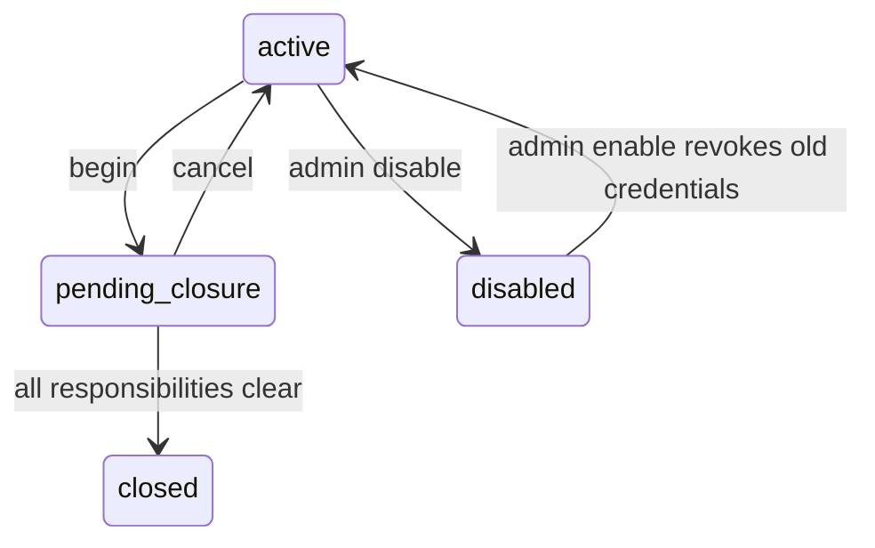

# M01 身份、会话与账号生命周期 — 当前实现规则稿

## 需求范围

本章覆盖下列完整业务组及公开入口变体。代码是当前行为证据，测试只标defined，所有验收计划not_run。没有业务批准或运行成功声明；全项目共享档案另行汇总。

## 来源与导航身份

项目=19Q4K7PDARXQ9JHW6R6F；仓库=P1KRPDABN4RD0YXMX64E；namespace=source-04d73353-be80-4433-8c5e-0b49a9c12c63；Skill=2.2.0。

run=NSG3TKRB16Y9F6Y203WB；kind=draft（显式工作区草稿，提交仅是基底）；snapshot=06376ab6287ee2d55caa79fc34257896e53ad0577a2b678947888024834468fa；commit=92728fbec04cfa34fee4421cb0a9319d1b755164。

源码manifest=0725fd3bb7867a6d7bba008b6af001c70f66b3c1dbf296b59ad95172eec6bdb9；企业包混合输入manifest=c832ac2345121f95b5f5d83da6275c79610bc4023b829568ee1ceeb2fadf307e；UA/CG artifact=691ab67f0c3a41a5bce1e59ca5ae83d99044ddfbfc5e026afb92183e681615c8。

ua engine=2.9.8, adapter=1.0.0, protocol=1, digest=d22a4a731809299030ee783710407af1e4ce37d5f1930345cb1d4b6a8cfb39a5。

codegraph engine=1.6.2, adapter=1.0.0, protocol=1, digest=c7ce675c6c763726449fccb22159735859ad17eccbce1475c9617287479bf8da。

knowledge handoff scope={"offset":0,"limit":100,"total_nodes":12043,"included_nodes":100,"truncated":true,"complete_repository_analysis":false}；裁剪结果不能建立缺失行为结论。

导航覆盖：codegraph analyzed_files=471/675；此数不是业务覆盖率。

导航覆盖：ua analyzed_files=675/675；此数不是业务覆盖率。

已实际查询固定run的UA overview/search(identity)/relations(requirements-specification)，以及native codegraph context/search。UA业务域/flow与codegraph边只作导航；BR源码证据的路径、SHA-256及真实1基行范围如下。

code callers首次使用native返回function:ID被CLI拒绝，后续以协议cg:前缀重试；查询结果保存在本地discovery记录。

context.bindings仅用于身份：权限Feature与首页Feature/REQ复用已有key及原父模块；既有目标正文不作为本次业务事实来源。

## 目的、角色与接口边界

- REQ-GOV-ACCOUNT-PROVISION 管理员开通账号、目录与凭证签发：有效平台管理员；目录读取也允许有效普通账号；触发=创建用户或签发初始密码、绑定令牌；平台模块=GOV-M01，Feature=GOV-M01-USERS，文档=GOV-M01-RULES。
- REQ-GOV-ACCOUNT-SUSPEND 账号禁用与安全恢复：有效平台管理员；触发=禁用或恢复普通账号；平台模块=GOV-M01，Feature=GOV-M01-USERS，文档=GOV-M01-RULES。
- REQ-GOV-PASSWORD-LOGIN 口令登录、初始密码门禁与锁定恢复：账号持有人；触发=提交密码登录请求；平台模块=GOV-M01，Feature=GOV-M01-LOGIN，文档=GOV-M01-RULES。
- REQ-GOV-PASSWORD-CHANGE 验证当前口令后修改并收缩凭证：有效登录用户；触发=请求修改密码；平台模块=GOV-M01，Feature=GOV-M01-LOGIN，文档=GOV-M01-RULES。
- REQ-GOV-INSTALLATION-SESSIONS 同安装重登保留设备身份并生成独立会话：有效用户及其Web/CLI安装；触发=登录、绑定安装身份或退出；平台模块=GOV-M01，Feature=GOV-M01-DEVICES，文档=GOV-M01-RULES。
- REQ-GOV-BIND-TOKEN 一次性绑定令牌兑换：持有管理员签发令牌的客户端；触发=提交/auth/login；平台模块=GOV-M01，Feature=GOV-M01-DEVICES，文档=GOV-M01-RULES。
- REQ-GOV-DEVICE-AUTHORIZATION 浏览器确认后向CLI一次性交换会话：CLI安装、已登录浏览器用户；触发=发起设备授权、批准/拒绝及轮询；平台模块=GOV-M01，Feature=GOV-M01-DEVICES，文档=GOV-M01-RULES。
- REQ-GOV-DEVICE-MANAGEMENT 设备列表、更名及会话或安装吊销：设备所属用户或有效平台管理员；触发=查看客户端、session、改名或吊销；平台模块=GOV-M01，Feature=GOV-M01-DEVICES，文档=GOV-M01-RULES。
- REQ-GOV-WEB-AUTH-BOUNDARY 浏览器会话、来源与CSRF边界：浏览器用户和API客户端；触发=Web登录、读取会话与受保护请求；平台模块=GOV-M01，Feature=GOV-M01-WEB，文档=GOV-M01-RULES。
- REQ-GOV-ACCOUNT-CLOSURE 注销前责任交接与保留历史：有效账号本人；触发=查看、开始、取消或完成账号注销；平台模块=GOV-M01，Feature=GOV-M01-CLOSURE，文档=GOV-M01-RULES。
- REQ-GOV-CLI-AUTH-LOCAL CLI认证本机状态、浏览器等待与退出恢复：使用CLI的账号持有人；触发=执行auth login/login-password/passwd/logout/whoami；平台模块=GOV-M01，Feature=GOV-M01-DEVICES，文档=GOV-M01-RULES。

## 实体、状态与流程

图只帮助阅读，不替代下文完整转换/分支。

## 业务规则

| BR ID | 条件 | 判定/结果及副作用或保持状态 | 例外/限制 | 来源 | 测试断言 |
| --- | --- | --- | --- | --- | --- |

| BR-GOV-ACCOUNT-PROVISION-CREATE | 有效平台管理员提交合法且未占用的账号 | 创建active用户并返回15分钟初始密码与expires_at，普通用户创建被user_forbidden拒绝。 | 开通与凭证签发的审计部分在事务外；审计写入失败后的部分成功需运行验证，不能承诺整体回滚。 | E1, E2 | AC-GOV-ACCOUNT-PROVISION-CREATE：创建active用户并返回15分钟初始密码与expires_at，普通用户创建被user_forbidden拒绝。 |

| BR-GOV-ACCOUNT-PROVISION-INVALID | 账号格式无效、重复或显示名空白 | 分别返回user_account_invalid/user_account_exists/user_display_name_required，不创建第二条账号。 | 开通与凭证签发的审计部分在事务外；审计写入失败后的部分成功需运行验证，不能承诺整体回滚。 | E3 | AC-GOV-ACCOUNT-PROVISION-INVALID：分别返回user_account_invalid/user_account_exists/user_display_name_required，不创建第二条账号。 |

| BR-GOV-ACCOUNT-PROVISION-ISSUE | 管理员对有效普通用户重新签发凭证 | 绑定令牌24小时到期且替换旧令牌；初始密码重置15分钟到期并吊销全部设备；不能重置其他平台管理员密码。 | 开通与凭证签发的审计部分在事务外；审计写入失败后的部分成功需运行验证，不能承诺整体回滚。 | E4 | AC-GOV-ACCOUNT-PROVISION-ISSUE：绑定令牌24小时到期且替换旧令牌；初始密码重置15分钟到期并吊销全部设备；不能重置其他平台管理员密码。 |

| BR-GOV-ACCOUNT-SUSPEND-DISABLE | 管理员禁用有效普通账号 | status变disabled，绑定令牌清空，旧登录令牌立即不可用；重复禁用返回disabled。 | 恢复不是恢复已注销账号；普通账号启用后口令保留，实际交付新凭证方式需另行决定。 | E5, E6 | AC-GOV-ACCOUNT-SUSPEND-DISABLE：status变disabled，绑定令牌清空，旧登录令牌立即不可用；重复禁用返回disabled。 |

| BR-GOV-ACCOUNT-SUSPEND-PROTECT | 操作者尝试禁用本人或平台管理员 | 本人返回user_self_disable，其他管理员返回user_system_admin_protected，账号状态保持active。 | 恢复不是恢复已注销账号；普通账号启用后口令保留，实际交付新凭证方式需另行决定。 | E7 | AC-GOV-ACCOUNT-SUSPEND-PROTECT：本人返回user_self_disable，其他管理员返回user_system_admin_protected，账号状态保持active。 |

| BR-GOV-ACCOUNT-SUSPEND-ENABLE | 被禁用普通账号无注销标志 | 恢复active并吊销历史设备/会话/租约；已注销或pending_deletion账号拒绝user_deleted。 | 恢复不是恢复已注销账号；普通账号启用后口令保留，实际交付新凭证方式需另行决定。 | E8, E9 | AC-GOV-ACCOUNT-SUSPEND-ENABLE：恢复active并吊销历史设备/会话/租约；已注销或pending_deletion账号拒绝user_deleted。 |

| BR-GOV-PASSWORD-LOGIN-SUCCESS | 用户active、密码正确且初始密码未过期 | 登录返回user/device/session编码和独立会话凭证；初始密码会话访问业务接口被password_change_required拒绝。 | 生产环境真实限流配置、代理IP可信性与时钟漂移未运行验证；安全事件聚合归管理模块。 | E10, E11 | AC-GOV-PASSWORD-LOGIN-SUCCESS：登录返回user/device/session编码和独立会话凭证；初始密码会话访问业务接口被password_change_required拒绝。 |

| BR-GOV-PASSWORD-LOGIN-LOCK | 默认配置下同一已存在账号连续5次错误口令 | 第5次返回凭证错误并落锁，锁内正确口令也被slow_down拒绝；到期后正确登录清零计数。 | 生产环境真实限流配置、代理IP可信性与时钟漂移未运行验证；安全事件聚合归管理模块。 | E12, E13 | AC-GOV-PASSWORD-LOGIN-LOCK：第5次返回凭证错误并落锁，锁内正确口令也被slow_down拒绝；到期后正确登录清零计数。 |

| BR-GOV-PASSWORD-LOGIN-EXPIRED | 初始口令expiry不晚于当前时间，且本场景用户没有任何有效旧会话 | 应用新登录返回auth_initial_password_expired，HTTP统一401且无新增设备会话；管理员重新签发未过期初始密码是一条恢复路径，使用新密码可重新登录，不声明这是所有场景唯一恢复方式。 | 生产环境真实限流配置、代理IP可信性与时钟漂移未运行验证；安全事件聚合归管理模块。 | E14, E15, E16 | AC-GOV-PASSWORD-LOGIN-EXPIRED：应用新登录返回auth_initial_password_expired，HTTP统一401且无新增设备会话；管理员重新签发未过期初始密码是一条恢复路径，使用新密码可重新登录，不声明这是所有场景唯一恢复方式。 |

| BR-GOV-PASSWORD-LOGIN-EXPIRED-SESSION | 初始密码到期前已登录，原session仍有效且用户未禁用/设备未吊销、当前口令hash未变 | 到期后用旧初始密码发起新登录仍401；使用原有效session和正确当前初始密码可自行改密，清除must_change_password/password_expires_at；新密码随后可登录，原证明改密的session保留。 | 生产环境真实限流配置、代理IP可信性与时钟漂移未运行验证；安全事件聚合归管理模块。 | E14, E17, E11 | AC-GOV-PASSWORD-LOGIN-EXPIRED-SESSION：到期后用旧初始密码发起新登录仍401；使用原有效session和正确当前初始密码可自行改密，清除must_change_password/password_expires_at；新密码随后可登录，原证明改密的session保留。 |

| BR-GOV-PASSWORD-LOGIN-QUOTA | 默认分钟配额：同password scope、IP及账号在同一分钟连续6次请求 | 前5次通过限流后因不存在账号而401 unauthorized；第6次429 slow_down且Retry-After=60；两个hash键的minute_count/hour_count均为6，说明拒绝也计数。t0+60秒的新请求通过分钟限流后401，计数为minute=1/hour=7。 | 生产环境真实限流配置、代理IP可信性与时钟漂移未运行验证；安全事件聚合归管理模块。 | E18, E15, E19 | AC-GOV-PASSWORD-LOGIN-QUOTA：前5次通过限流后因不存在账号而401 unauthorized；第6次429 slow_down且Retry-After=60；两个hash键的minute_count/hour_count均为6，说明拒绝也计数。t0+60秒的新请求通过分钟限流后401，计数为minute=1/hour=7。 |

| BR-GOV-PASSWORD-LOGIN-QUOTA-HOUR | 默认小时配额：每分钟恰5次、小时内累计20次后在新分钟第21次请求 | 前20次均通过限流后401；第21次在未超分钟配额时返回429 slow_down，Retry-After=3360秒，两hash键hour_count=21且当前minute_count=1；拒绝请求也递增小时计数。 | 生产环境真实限流配置、代理IP可信性与时钟漂移未运行验证；安全事件聚合归管理模块。 | E20, E15 | AC-GOV-PASSWORD-LOGIN-QUOTA-HOUR：前20次均通过限流后401；第21次在未超分钟配额时返回429 slow_down，Retry-After=3360秒，两hash键hour_count=21且当前minute_count=1；拒绝请求也递增小时计数。 |

| BR-GOV-PASSWORD-LOGIN-QUOTA-SCOPE | 同一IP及相同账号键文本，password配额已耗尽但bind scope尚未使用 | password第6次429；bind首次请求仍通过自身限流后因无效bind token返回401，password两个键计数保持6而bind独立键各计1，证明scope隔离。 | 生产环境真实限流配置、代理IP可信性与时钟漂移未运行验证；安全事件聚合归管理模块。 | E20, E21 | AC-GOV-PASSWORD-LOGIN-QUOTA-SCOPE：password第6次429；bind首次请求仍通过自身限流后因无效bind token返回401，password两个键计数保持6而bind独立键各计1，证明scope隔离。 |

| BR-GOV-PASSWORD-LOGIN-QUOTA-RETENTION | 一次限流事务开始时表内存在严格早于一小时前和恰好一小时前的非当前scope键 | 严格旧行被删除；恰好一小时前及较新行保留；本次新password键正常创建且计数1。清理按整张限流表的时间条件执行，不限于本次请求键。 | 生产环境真实限流配置、代理IP可信性与时钟漂移未运行验证；安全事件聚合归管理模块。 | E20, E19 | AC-GOV-PASSWORD-LOGIN-QUOTA-RETENTION：严格旧行被删除；恰好一小时前及较新行保留；本次新password键正常创建且计数1。清理按整张限流表的时间条件执行，不限于本次请求键。 |

| BR-GOV-PASSWORD-CHANGE-KEEP | 当前口令与有效会话匹配 | 仅当前会话继续有效，同安装第二会话和另一设备全部会话失效；新口令可登录且旧口令失效。 | 适用角色、初态与失败保持字段见本条AC计划；无跨用例隐式依赖。 | E22, E9 | AC-GOV-PASSWORD-CHANGE-KEEP：仅当前会话继续有效，同安装第二会话和另一设备全部会话失效；新口令可登录且旧口令失效。 |

| BR-GOV-PASSWORD-CHANGE-DENIED | 缺当前口令、口令错误、新密码长度7或129 | 分别auth_current_password_required/auth_credentials_invalid/auth_password_invalid；旧hash及设备会话不变。 | 适用角色、初态与失败保持字段见本条AC计划；无跨用例隐式依赖。 | E23 | AC-GOV-PASSWORD-CHANGE-DENIED：分别auth_current_password_required/auth_credentials_invalid/auth_password_invalid；旧hash及设备会话不变。 |

| BR-GOV-INSTALLATION-SESSIONS-RELOGIN | 相同用户、client_type、安装ID及秘密再次登录 | 两次device_code相同，session_code/token不同，稳定执行秘密不变；退出S1后S2仍可用。 | 安装身份丢失后的人工修复流程未定义；旧版无身份登录仍允许，不能声称所有会话都绑定安装。 | E24, E25 | AC-GOV-INSTALLATION-SESSIONS-RELOGIN：两次device_code相同，session_code/token不同，稳定执行秘密不变；退出S1后S2仍可用。 |

| BR-GOV-INSTALLATION-SESSIONS-LIMIT | 已有10个未吊销安装或同ID提交错误秘密 | 新安装返回auth_device_limit_reached；错误秘密返回auth_device_identity_mismatch，设备和session数不增加。 | 安装身份丢失后的人工修复流程未定义；旧版无身份登录仍允许，不能声称所有会话都绑定安装。 | E26 | AC-GOV-INSTALLATION-SESSIONS-LIMIT：新安装返回auth_device_limit_reached；错误秘密返回auth_device_identity_mismatch，设备和session数不增加。 |

| BR-GOV-INSTALLATION-SESSIONS-LEGACY | 未初始化的遗留凭证首次解析或绑定安装身份 | 一次登记保留旧执行秘密；不能把既有另一安装合并进本设备；退出后不能重新登记旧session。 | 安装身份丢失后的人工修复流程未定义；旧版无身份登录仍允许，不能声称所有会话都绑定安装。 | E27, E28 | AC-GOV-INSTALLATION-SESSIONS-LEGACY：一次登记保留旧执行秘密；不能把既有另一安装合并进本设备；退出后不能重新登记旧session。 |

| BR-GOV-BIND-TOKEN-ONCE | 有效用户的未过期令牌第一次兑换 | 生成设备会话并消耗令牌；同一令牌第二次兑换失败且不新增设备。 | 适用角色、初态与失败保持字段见本条AC计划；无跨用例隐式依赖。 | E29, E30 | AC-GOV-BIND-TOKEN-ONCE：生成设备会话并消耗令牌；同一令牌第二次兑换失败且不新增设备。 |

| BR-GOV-BIND-TOKEN-EXPIRED | 令牌已过期或设备已达上限 | 过期返回应用auth_bind_token_expired；设备上限拒绝时事务回滚，T仍未消耗，吊销闲置设备后可用同T重试。 | 适用角色、初态与失败保持字段见本条AC计划；无跨用例隐式依赖。 | E31, E32 | AC-GOV-BIND-TOKEN-EXPIRED：过期返回应用auth_bind_token_expired；设备上限拒绝时事务回滚，T仍未消耗，吊销闲置设备后可用同T重试。 |

| BR-GOV-DEVICE-AUTHORIZATION-APPROVE | 未过期pending请求经有资格用户批准 | 批准仅改变请求状态；等轮询间隔后首次兑换获得会话且置consumed，同device_code再次兑换expired_token。 | CLI打开浏览器与人工确认的环境交互未实际执行；不得把授权请求创建当作登录成功。 | E33, E34 | AC-GOV-DEVICE-AUTHORIZATION-APPROVE：批准仅改变请求状态；等轮询间隔后首次兑换获得会话且置consumed，同device_code再次兑换expired_token。 |

| BR-GOV-DEVICE-AUTHORIZATION-PENDING | pending请求未批准或过快轮询 | 首次authorization_pending且无会话；立即再轮询slow_down并增加间隔；等新间隔仍pending，不能声称登录完成。 | CLI打开浏览器与人工确认的环境交互未实际执行；不得把授权请求创建当作登录成功。 | E35 | AC-GOV-DEVICE-AUTHORIZATION-PENDING：首次authorization_pending且无会话；立即再轮询slow_down并增加间隔；等新间隔仍pending，不能声称登录完成。 |

| BR-GOV-DEVICE-AUTHORIZATION-DENY | 请求denied、过期或批准者仍必须改初始密码 | 分别access_denied/expired_token/password_change_required；无新增登录会话；已处理请求不能被第二人再次批准。 | CLI打开浏览器与人工确认的环境交互未实际执行；不得把授权请求创建当作登录成功。 | E36, E37 | AC-GOV-DEVICE-AUTHORIZATION-DENY：分别access_denied/expired_token/password_change_required；无新增登录会话；已处理请求不能被第二人再次批准。 |

| BR-GOV-DEVICE-MANAGEMENT-OWN | 用户管理本人客户端 | 列表和会话显示current，合法更名持久化；撤销S1只使S1失效，其同设备S2保持有效。 | 适用角色、初态与失败保持字段见本条AC计划；无跨用例隐式依赖。 | E38, E39 | AC-GOV-DEVICE-MANAGEMENT-OWN：列表和会话显示current，合法更名持久化；撤销S1只使S1失效，其同设备S2保持有效。 |

| BR-GOV-DEVICE-MANAGEMENT-INSTALL | 本人或平台管理员吊销整设备 | 该设备全部会话与未吊销运行租约失效；其他设备不变。 | 适用角色、初态与失败保持字段见本条AC计划；无跨用例隐式依赖。 | E40, E9 | AC-GOV-DEVICE-MANAGEMENT-INSTALL：该设备全部会话与未吊销运行租约失效；其他设备不变。 |

| BR-GOV-DEVICE-MANAGEMENT-DENIED | 普通用户管理另一用户设备或名称空白/超过200 | 跨用户操作device_forbidden，非法名称validation_failed；两者不改变目标设备和会话。 | 适用角色、初态与失败保持字段见本条AC计划；无跨用例隐式依赖。 | E41, E42, E43 | AC-GOV-DEVICE-MANAGEMENT-DENIED：跨用户操作device_forbidden，非法名称validation_failed；两者不改变目标设备和会话。 |

| BR-GOV-WEB-AUTH-BOUNDARY-WEB | 可信Origin和有效口令的浏览器登录 | 响应含user/csrf_token及受控cookie属性，GET /auth/web/session no-store；注销后该session失效而browser cookie保留。 | 真实TLS终止、代理协议、部署Origin配置及浏览器cookie策略未运行验证；开发legacy兼容是现状，不是生产政策批准。 | E44, E45 | AC-GOV-WEB-AUTH-BOUNDARY-WEB：响应含user/csrf_token及受控cookie属性，GET /auth/web/session no-store；注销后该session失效而browser cookie保留。 |

| BR-GOV-WEB-AUTH-BOUNDARY-CSRF | Cookie认证写请求缺少正确来源/CSRF或同时提供Bearer | 缺CSRF/错误Origin返回403 csrf_invalid；安全GET同时提供Cookie和Bearer返回401，不借Bearer绕过Cookie身份。 | 真实TLS终止、代理协议、部署Origin配置及浏览器cookie策略未运行验证；开发legacy兼容是现状，不是生产政策批准。 | E46, E47, E48 | AC-GOV-WEB-AUTH-BOUNDARY-CSRF：缺CSRF/错误Origin返回403 csrf_invalid；安全GET同时提供Cookie和Bearer返回401，不借Bearer绕过Cookie身份。 |

| BR-GOV-WEB-AUTH-BOUNDARY-ACTOR | 请求正文或查询声明另一个principal_code | 操作者始终来自中间件身份，不能靠正文提升权限；仅在允许legacy环境无凭证时才有过渡身份路径。 | 真实TLS终止、代理协议、部署Origin配置及浏览器cookie策略未运行验证；开发legacy兼容是现状，不是生产政策批准。 | E49, E50 | AC-GOV-WEB-AUTH-BOUNDARY-ACTOR：操作者始终来自中间件身份，不能靠正文提升权限；仅在允许legacy环境无凭证时才有过渡身份路径。 |

| BR-GOV-ACCOUNT-CLOSURE-BLOCK | 已开始注销但仍有团队/项目所有权或未结束任务/运行 | 完成返回account_closure_blocked及责任清单，pending_deletion仍true且账号凭证未被最终吊销。 | 注销为软删除，数据保留期限与法律要求未提供；账号再次开通不等于恢复注销账号。 | E51, E52 | AC-GOV-ACCOUNT-CLOSURE-BLOCK：完成返回account_closure_blocked及责任清单，pending_deletion仍true且账号凭证未被最终吊销。 |

| BR-GOV-ACCOUNT-CLOSURE-COMPLETE | begin后全部责任交接完成且非最后有效管理员 | 完成软注销、取消本人发起或作为收件人的pending转移，设备会话和相关租约失效，历史保留。 | 注销为软删除，数据保留期限与法律要求未提供；账号再次开通不等于恢复注销账号。 | E53 | AC-GOV-ACCOUNT-CLOSURE-COMPLETE：完成软注销、取消本人发起或作为收件人的pending转移，设备会话和相关租约失效，历史保留。 |

| BR-GOV-ACCOUNT-CLOSURE-CANCEL | 用户取消注销或尚未begin即complete | cancel恢复pending_deletion=false；未begin完成返回account_closure_not_started；最后管理员完成返回last_system_admin_protected。 | 注销为软删除，数据保留期限与法律要求未提供；账号再次开通不等于恢复注销账号。 | E54 | AC-GOV-ACCOUNT-CLOSURE-CANCEL：cancel恢复pending_deletion=false；未begin完成返回account_closure_not_started；最后管理员完成返回last_system_admin_protected。 |

| BR-GOV-CLI-AUTH-LOCAL-LOCAL | 相同规范化API反复登录或注销再登录 | 重用安装身份；成功只输出设备/用户/名称而不输出device_token；退出删当前auth配置，安装身份保留。 | 登录结果未知时没有自动查询原exchange结果的恢复协议；再次授权可能产生新session；不能宣称网络重试幂等。 | E55, E56, E57, E58 | AC-GOV-CLI-AUTH-LOCAL-LOCAL：重用安装身份；成功只输出设备/用户/名称而不输出device_token；退出删当前auth配置，安装身份保留。 |

| BR-GOV-CLI-AUTH-LOCAL-PARTIAL | 口令登录成功但--new-password改密被拒绝，或logout远端失败 | 改密失败退出码1但已保存会话可用于后续passwd；logout结构化失败或网络api_unreachable都删除本地配置，网络失败时远端会话是否吊销不能确定。 | 登录结果未知时没有自动查询原exchange结果的恢复协议；再次授权可能产生新session；不能宣称网络重试幂等。 | E59, E60, E61 | AC-GOV-CLI-AUTH-LOCAL-PARTIAL：改密失败退出码1但已保存会话可用于后续passwd；logout结构化失败或网络api_unreachable都删除本地配置，网络失败时远端会话是否吊销不能确定。 |

| BR-GOV-CLI-AUTH-LOCAL-BROWSER | 授权请求有效但浏览器打不开、用户尚未批准或最终过期 | 打开浏览器失败会提示人工地址并继续等待；pending继续轮询，slow_down本地间隔加5秒，截止时expired_token且不保存新auth配置。 | 登录结果未知时没有自动查询原exchange结果的恢复协议；再次授权可能产生新session；不能宣称网络重试幂等。 | E62, E63 | AC-GOV-CLI-AUTH-LOCAL-BROWSER：打开浏览器失败会提示人工地址并继续等待；pending继续轮询，slow_down本地间隔加5秒，截止时expired_token且不保存新auth配置。 |

| BR-GOV-CLI-AUTH-LOCAL-INVALID | API URL含凭证/query或本机身份文件损坏/是链接 | api_url_invalid或auth_identity_invalid，不覆盖身份文件、不开始新登录；保留原文件供排查。 | 登录结果未知时没有自动查询原exchange结果的恢复协议；再次授权可能产生新session；不能宣称网络重试幂等。 | E56 | AC-GOV-CLI-AUTH-LOCAL-INVALID：api_url_invalid或auth_identity_invalid，不覆盖身份文件、不开始新登录；保留原文件供排查。 |

## 功能需求

以下字段与结构化JSON同源生成，避免文档与需求对权限、拒绝/忽略、状态和数据变化表达相反结论。

### REQ-GOV-ACCOUNT-PROVISION 管理员开通账号、目录与凭证签发

主流程：

1. 从认证身份确定操作者，规范化账号并检查管理员权限。
2. 创建有效账号并返回短时初始密码；管理员配置列表与普通用户目录返回不同字段。
3. 按用户状态和管理员保护规则签发新凭证。

数据与配置：

- account去首尾空白并转小写，匹配^[a-z0-9][a-z0-9._@-]{2,63}$；display_name非空。
- 新账号初始密码8字符、有效期15分钟，必须修改；绑定令牌有效期24小时，只保存哈希。
- 用户目录仅返回active用户的user_code/account/display_name；管理员列表额外含status/is_system_admin/must_change_password/pending_deletion/deleted_at。

状态/一致性边界：

- 创建user和user.created审计；签发绑定令牌替换旧hash/expiry。
- 重置初始密码设置must_change_password并吊销该用户设备；审计在重置事务之后单独写入，不宣称整条操作原子。

### REQ-GOV-ACCOUNT-SUSPEND 账号禁用与安全恢复

主流程：

1. 检查操作者平台管理员身份，保护本人及管理员目标。
2. 禁用目标并清空绑定令牌；恢复时在事务中重新检查状态和注销标志。
3. 恢复普通账号前吊销旧设备，避免旧会话和租约复活。

数据与配置：

- status为active/disabled；deleted_at或pending_deletion阻止恢复。
- 重复禁用已禁用用户或恢复已有效用户返回当前状态。

状态/一致性边界：

- 禁用不在该方法逐个吊销设备，令牌解析因用户disabled立即拒绝。
- 恢复过程吊销设备及相应会话/租约，清除绑定令牌，保留业务历史。

### REQ-GOV-PASSWORD-LOGIN 口令登录、初始密码门禁与锁定恢复

主流程：

1. 规范化账号，拒绝空账号/空密码/超过128字符口令。
2. 校验密码并在用户行锁内重新核对hash和锁定状态；记录失败与锁定观察。
3. 初始口令有效才建立新设备会话；成功清零失败计数。

数据与配置：

- 默认连续失败阈值5，锁定900秒；TSP_AUTH_FAILURE_LIMIT/TSP_AUTH_LOCK_SECONDS仅接受正安全整数。
- HTTP口令/绑定失败统一401 unauthorized；锁定/频率限制为429 slow_down并带Retry-After；应用层保留细分原因。
- Bearer初始密码会话仅允许whoami/password-change/logout；Cookie另允许web/session和web/logout。
- 初始口令expiry检查在新口令登录中；已有有效会话的改密入口不检查该expiry，不能推导到期后只有管理员能恢复。
- 接口限流按scope/IP及可选账号hash键检查分钟/小时计数，拒绝请求也递增；hour_started_at严格早于当前一小时前的行在限流事务起始删除。

状态/一致性边界：

- 失败计数和锁定审计随拒绝结果提交；锁定到期在下一次尝试解锁。
- 成功建立session并清零计数；初始口令过期不建立新session，但不会仅因此吊销到期前已有的有效session。

### REQ-GOV-PASSWORD-CHANGE 验证当前口令后修改并收缩凭证

主流程：

1. 验证新口令长度8到128以及当前口令。
2. 用户锁内重新核对旧hash和当前会话归属。
3. 提交新hash、解除初始密码/锁定标志，吊销其他设备及当前安装的其他会话。

数据与配置：

- current_password必填且最多128字符；currentDeviceToken必须属于目标用户。
- 保留提交当前口令的那一会话，返回revoked_devices数量；同安装其他会话也吊销但不计入其他设备数。
- 改密入口不检查初始口令password_expires_at；在到期前取得且仍有效的session可于初始口令到期后证明当前密码并自行改密，见AC-GOV-PASSWORD-LOGIN-EXPIRED-SESSION。

状态/一致性边界：

- 新hash、must_change_password=false、password_expires_at=null、失败计数/锁定清空。
- 事务内凭证收缩与user.password_changed审计一起提交。

### REQ-GOV-INSTALLATION-SESSIONS 同安装重登保留设备身份并生成独立会话

主流程：

1. 按用户/client_type/installation_id定位设备，以安装秘密hash验证归属。
2. 同安装重用设备并更新成功登录时间，每次新增90天会话；无安装身份的兼容调用创建新设备。
3. 退出只吊销当前会话；整设备吊销另含全部会话和租约。

数据与配置：

- installation_id为UUID样式；installation_secret为43字符base64url；client_type web/cli；platform非空且不超过100字符；device_name去空白后1到200字符。
- 每用户未吊销设备上限10；恢复已吊销设备也检查上限。
- 遗留credential可一次性登记为session；legacy_session_initialized阻止重复登记。

状态/一致性边界：

- 稳定device.id/code/credential_hash及原device_name在同安装重登时保留；只有last_login_at/platform/revoked_at按路径更新。
- 注销单session不删安装身份；旧已吊销session不会因重登复活。

异常与边界处理（与结构化specification.exceptions一致，复用下方既有BR/AC/TC矩阵）：

- 条件：相同用户/client_type/installation_id已存在，但提交的installation_secret哈希不匹配。
  处理：返回auth_device_identity_mismatch，不新增设备或session，不覆盖稳定设备身份/执行秘密（BR-GOV-INSTALLATION-SESSIONS-LIMIT / AC-GOV-INSTALLATION-SESSIONS-LIMIT）。
- 条件：前序用户/安装秘密校验已通过，需要新建或重新激活设备，而用户已有10个未吊销设备。
  处理：返回auth_device_limit_reached；不新增session，也不把被吊销设备恢复有效；同安装有效设备重登不按新设备占位处理（BR-GOV-INSTALLATION-SESSIONS-LIMIT / AC-GOV-INSTALLATION-SESSIONS-LIMIT）。
- 条件：绑定安装身份时，该身份已属于本人另一设备，或当前设备已有不同安装身份。
  处理：分别返回auth_device_identity_conflict或auth_device_identity_mismatch；不合并设备身份、不覆盖原绑定（BR-GOV-INSTALLATION-SESSIONS-LEGACY / AC-GOV-INSTALLATION-SESSIONS-LEGACY）。
- 条件：旧凭证已经完成一次legacy登记，且其对应session已退出、吊销或不存在。
  处理：resolveSessionToken不重新登记该旧凭证，不因同安装再次登录而复活原session；仍有效的另一session继续按自身状态解析（BR-GOV-INSTALLATION-SESSIONS-LEGACY / AC-GOV-INSTALLATION-SESSIONS-LEGACY、RELOGIN）。

### REQ-GOV-BIND-TOKEN 一次性绑定令牌兑换

主流程：

1. 检查令牌hash与有效期并锁住用户。
2. 创建设备登录，在同事务清空绑定令牌。
3. 重复兑换或过期令牌拒绝。

数据与配置：

- 24小时是签发TTL；兑换按expires_at与当前时间比较。
- HTTP绑定失败统一401，应用层区分invalid/expired/device_limit等原因。

状态/一致性边界：

- 成功后bind_token_hash/expiry为空并新增会话；创建失败事务不消耗令牌。

### REQ-GOV-DEVICE-AUTHORIZATION 浏览器确认后向CLI一次性交换会话

主流程：

1. CLI提交合法cli安装和名称，获得10分钟设备码与人读码，初始间隔5秒。
2. 浏览器查询请求并由有效且已修改初始口令的用户决定approve/deny。
3. CLI按服务端间隔轮询；批准后在事务内建立会话并置consumed。

数据与配置：

- user_code去空白/连字符转大写后hash匹配；device_code最多256字符。
- 过快轮询interval每次增加5秒，上限60；返回retry_after，状态pending不等于登录完成。
- start每分钟12/小时120；token每分钟120/小时1200；request每分钟30/小时300，approve默认5/20。

状态/一致性边界：

- pending→approved或denied；approved→consumed；拒绝/过期/重复兑换不新增session。

### REQ-GOV-DEVICE-MANAGEMENT 设备列表、更名及会话或安装吊销

主流程：

1. 读取本人设备列表；平台管理员可指定其他用户。
2. 按同一所有权边界查询会话/改名/吊销；列出当前标记及active/expired/revoked状态。
3. 单会话撤销仅更新该session，整安装撤销同时处理sessions与执行租约并审计。

数据与配置：

- device_name去空白后非空且输入长度最多200；session按created_at降序。
- 设备列表包含current及session_count；不向客户端返回执行秘密或session token。

状态/一致性边界：

- 更名只改device_name并审计；session撤销写revoked_at；安装撤销写device/session/lease的revoked_at。

### REQ-GOV-WEB-AUTH-BOUNDARY 浏览器会话、来源与CSRF边界

主流程：

1. Web登录校验Origin并根据环境设置cookie安全属性；生成或重用HttpOnly安装证明。
2. 会话读取仅接受cookie身份并返回用户及CSRF；无效CSRF值可刷新。
3. 有Cookie时不回退Bearer/legacy；不安全方法必须Origin、CSRF cookie/header及签名同时成立。

数据与配置：

- 会话与browser cookie为HttpOnly，csrf cookie可读；Path=/，SameSite=Lax，90天Max-Age；生产使用__Host-前缀和Secure。
- 非生产loopback HTTP允许开发例外；正常源、配置TSP_WEB_ORIGIN源以及特定本地5173开发源按函数判定。
- 默认开发/测试可允许x-principal-code，生产默认禁止；hasAuthenticatedSession只认bearer/cookie，不能声称所有路由都关闭legacy。

状态/一致性边界：

- Web登录返回user和csrf_token，原始session token只通过cookie。
- Web注销仅清session/csrf cookie且吊销当前session，browser安装cookie保留。

### REQ-GOV-ACCOUNT-CLOSURE 注销前责任交接与保留历史

主流程：

1. 查询独占及未确认历史团队/项目所有权、未结束分派任务和活动运行。
2. 开始注销设置pending_deletion；取消清除；待注销账号仍可对外发起所有权转移。
3. 完成时串行检查全部交接和最后管理员保护，吊销凭证/租约、取消相关pending转移并软注销。

数据与配置：

- open_tasks排除closed/failed/cancelled；active_runs含active/preparing/suspended。
- 归档项目和历史owner记录同样阻塞；待注销不能接收所有权或创建新团队/项目。

状态/一致性边界：

- begin/cancel只改变pending_deletion并审计；complete设disabled、deleted_at、清password/bind token，pending_deletion=false。
- 保留用户和业务历史，不删除既有业务记录；最后有效平台管理员不能完成注销。

异常与边界处理（与结构化specification.exceptions一致，复用下方既有BR/AC/TC矩阵）：

- 条件：尚未begin，pending_deletion=false即请求complete。
  处理：返回account_closure_not_started，账号状态、凭证、租约及历史保持；必须先开始注销流程（BR-GOV-ACCOUNT-CLOSURE-CANCEL / AC-GOV-ACCOUNT-CLOSURE-CANCEL）。
- 条件：已begin但仍有独占或历史未确认团队/项目所有权、非closed/failed/cancelled分派任务，或active/preparing/suspended运行。
  处理：返回account_closure_blocked及责任清单，pending_deletion仍为true；不执行最终凭证/租约吊销或软注销；完成既有交接后可用新请求再次检查（BR-GOV-ACCOUNT-CLOSURE-BLOCK / AC-GOV-ACCOUNT-CLOSURE-BLOCK）。
- 条件：责任已清空，但当前用户是最后一个active且未deleted的平台管理员。
  处理：返回last_system_admin_protected，账号保持active与待注销状态，不清密码或注销历史；配置其他有效管理员后再请求完成（BR-GOV-ACCOUNT-CLOSURE-CANCEL / AC-GOV-ACCOUNT-CLOSURE-CANCEL）。

### REQ-GOV-CLI-AUTH-LOCAL CLI认证本机状态、浏览器等待与退出恢复

主流程：

1. 规范化API URL，按API地址加载或首次创建安装证明；现有身份损坏或链接路径拒绝覆盖。
2. auth login可选择一次性token或浏览器授权，成功才保存auth配置；login-password先保存会话再可选改密。
3. 浏览器授权显示地址/人读码并等待，pending继续，slow_down增加本地间隔；到截止时expired_token。
4. logout在API返回结果后删除auth配置并保留安装证明；网络失败由客户端转为api_unreachable，仍删除本地配置，不代表服务器会话已吊销。

数据与配置：

- API URL只允许无用户名/密码/query/fragment的HTTP(S)，规范化尾斜杠。
- 本机安装UUID v4、43字符秘密、cli类型；身份文件≤4096 bytes，逐级拒绝symlink/junction；实际Windows ACL效果未验证。
- browser grant expires_in须>0且≤1800、interval 1至60；--no-browser只输出地址，--web指定前端源。
- auth.json读取兼容user_id字段；写模式0600请求权限不代表跨平台已验证；本地fingerprint仅journal匹配，不授予远程认证。

状态/一致性边界：

- 成功写当前API/user/device/session配置；安装证明跨logout保留。
- --new-password失败时登录配置已保存，仍可passwd恢复；不宣称登录和改密是一个原子步骤。

## 权限边界

按每条规则的actor和前置数据建立当前有效权限。Owner与Admin的差别按源码条件保留；旧文案“只有Owner”不能覆盖isProjectManager实际允许Admin的路径。Viewer可读能力不自动获得write/manage。源自其他业务模块的流程只引用不重复执行。

## 异常与边界

成功、权限拒绝、输入错误、版本/状态门槛和恢复见下列独立计划。未实现的控制不补写为既定政策：

- REQ-GOV-ACCOUNT-PROVISION：开通与凭证签发的审计部分在事务外；审计写入失败后的部分成功需运行验证，不能承诺整体回滚。
- REQ-GOV-ACCOUNT-PROVISION：密码交付渠道、实际管理员任命及生产TTL配置未验证。
- REQ-GOV-ACCOUNT-SUSPEND：恢复不是恢复已注销账号；普通账号启用后口令保留，实际交付新凭证方式需另行决定。
- REQ-GOV-PASSWORD-LOGIN：生产环境真实限流配置、代理IP可信性与时钟漂移未运行验证；安全事件聚合归管理模块。
- REQ-GOV-PASSWORD-LOGIN：限流/到期计划需要可控服务器Date/Date.now、隔离PostgreSQL与只读计数查询夹具；本次未提供该夹具，必须先建设后才能执行计划，不将计划设计当作测试可直接运行或已通过。
- REQ-GOV-INSTALLATION-SESSIONS：安装身份丢失后的人工修复流程未定义；旧版无身份登录仍允许，不能声称所有会话都绑定安装。
- REQ-GOV-DEVICE-AUTHORIZATION：CLI打开浏览器与人工确认的环境交互未实际执行；不得把授权请求创建当作登录成功。
- REQ-GOV-WEB-AUTH-BOUNDARY：真实TLS终止、代理协议、部署Origin配置及浏览器cookie策略未运行验证；开发legacy兼容是现状，不是生产政策批准。
- REQ-GOV-ACCOUNT-CLOSURE：注销为软删除，数据保留期限与法律要求未提供；账号再次开通不等于恢复注销账号。
- REQ-GOV-CLI-AUTH-LOCAL：登录结果未知时没有自动查询原exchange结果的恢复协议；再次授权可能产生新session；不能宣称网络重试幂等。
- REQ-GOV-CLI-AUTH-LOCAL：CLI本地文件权限跨平台效果和交互浏览器行为未运行。

## 验收场景与可复现计划

每个用例使用独立隔离数据并在开始前恢复所述初始状态；账号有效且已完成初始密码修改，除非该用例明确测试初始密码。认证使用该角色自己的有效Bearer会话；浏览器用例使用自身Cookie/Origin/CSRF。保存创建操作真实返回的编码，不硬编码生产数据。时钟采用UTC并记录起始时间；仅在本章明确声明的有效期、锁定或配额时间窗口场景使用待建设的受控时钟。所有步骤为待执行计划。

### TC-GOV-ACCOUNT-PROVISION-CREATE → AC-GOV-ACCOUNT-PROVISION-CREATE

角色=有效平台管理员；目录读取也允许有效普通账号；独立初态=准备平台管理员A和普通用户B，确认mixed.user不存在。

1. A创建account=" Mixed.User "、display_name="新人"；读管理员列表及目录。
2. 恢复初始状态后以B提交相同创建。

可观察结果=创建active用户并返回15分钟初始密码与expires_at，普通用户创建被user_forbidden拒绝。

执行状态=not_run；优先级=P1（分析建议，未测量风险）。

### TC-GOV-ACCOUNT-PROVISION-INVALID → AC-GOV-ACCOUNT-PROVISION-INVALID

角色=有效平台管理员；目录读取也允许有效普通账号；独立初态=管理员A；已存在账号mixed.user。

1. 分别创建ab、mixed.user和合法新账号但空白display_name；每次后读取列表。

可观察结果=分别返回user_account_invalid/user_account_exists/user_display_name_required，不创建第二条账号。

执行状态=not_run；优先级=P1（分析建议，未测量风险）。

### TC-GOV-ACCOUNT-PROVISION-ISSUE → AC-GOV-ACCOUNT-PROVISION-ISSUE

角色=有效平台管理员；目录读取也允许有效普通账号；独立初态=管理员A、普通用户U有设备D；另一管理员Z；U已有绑定令牌T。

1. A为U签发新绑定令牌再尝试旧T登录。
2. 独立重置U初始密码，检查D会话不可解析及must_change_password。
3. 独立尝试重置Z密码。

可观察结果=绑定令牌24小时到期且替换旧令牌；初始密码重置15分钟到期并吊销全部设备；不能重置其他平台管理员密码。

执行状态=not_run；优先级=P1（分析建议，未测量风险）。

### TC-GOV-ACCOUNT-SUSPEND-DISABLE → AC-GOV-ACCOUNT-SUSPEND-DISABLE

角色=有效平台管理员；独立初态=管理员A和用户U；U有有效登录令牌和绑定令牌。

1. A禁用U，使用U旧会话whoami及绑定令牌登录；A再次禁用。

可观察结果=status变disabled，绑定令牌清空，旧登录令牌立即不可用；重复禁用返回disabled。

执行状态=not_run；优先级=P1（分析建议，未测量风险）。

### TC-GOV-ACCOUNT-SUSPEND-PROTECT → AC-GOV-ACCOUNT-SUSPEND-PROTECT

角色=有效平台管理员；独立初态=独立管理员A、Z有效。

1. A分别禁用A、Z；读取两者状态。

可观察结果=本人返回user_self_disable，其他管理员返回user_system_admin_protected，账号状态保持active。

执行状态=not_run；优先级=P1（分析建议，未测量风险）。

### TC-GOV-ACCOUNT-SUSPEND-ENABLE → AC-GOV-ACCOUNT-SUSPEND-ENABLE

角色=有效平台管理员；独立初态=管理员A；禁用U仍保存历史设备/租约；另独立设置已注销或待注销目标。

1. 恢复U，校验旧令牌不可用并重新登录可用。
2. 分别恢复已注销或待注销目标并读取状态。

可观察结果=恢复active并吊销历史设备/会话/租约；已注销或pending_deletion账号拒绝user_deleted。

执行状态=not_run；优先级=P1（分析建议，未测量风险）。

### TC-GOV-PASSWORD-LOGIN-SUCCESS → AC-GOV-PASSWORD-LOGIN-SUCCESS

角色=账号持有人；独立初态=有效初始密码用户U，锁定为空；独立客户端身份。

1. POST /auth/password-login；保存返回令牌。
2. 以令牌whoami再GET /projects。

可观察结果=登录返回user/device/session编码和独立会话凭证；初始密码会话访问业务接口被password_change_required拒绝。

执行状态=not_run；优先级=P1（分析建议，未测量风险）。

### TC-GOV-PASSWORD-LOGIN-LOCK → AC-GOV-PASSWORD-LOGIN-LOCK

角色=账号持有人；独立初态=新U无失败计数；受控应用时钟；HTTP测试需隔离配额或等其窗口恢复，避免与接口限流混淆。

1. 直接调用应用用例提交5次错误口令，检查login_failure_count/locked_until。
2. 锁内提交正确密码；推进超过900秒后再提交正确密码。

可观察结果=第5次返回凭证错误并落锁，锁内正确口令也被slow_down拒绝；到期后正确登录清零计数。

执行状态=not_run；优先级=P1（分析建议，未测量风险）。

### TC-GOV-PASSWORD-LOGIN-EXPIRED → AC-GOV-PASSWORD-LOGIN-EXPIRED

角色=账号持有人；独立初态=隔离U must_change_password=true、口令已过期且无有效session；管理员A可重置；记录U设备/session基数。

1. POST /auth/password-login提交正确但过期初始密码；核对401且设备/session数不增。
2. A POST /users/U/initial-password；使用返回的新初始密码再次POST /auth/password-login，核对登录成功和新的expiry。

可观察结果=应用新登录返回auth_initial_password_expired，HTTP统一401且无新增设备会话；管理员重新签发未过期初始密码是一条恢复路径，使用新密码可重新登录，不声明这是所有场景唯一恢复方式。

执行状态=not_run；优先级=P1（分析建议，未测量风险）。

### TC-GOV-PASSWORD-LOGIN-EXPIRED-SESSION → AC-GOV-PASSWORD-LOGIN-EXPIRED-SESSION

角色=账号持有人；独立初态=独立U初始口令P0在t0有效、expiry=t0+15分钟；先于expiry获得session S，S有效期在t0+16分钟之后；控制服务器Date/Date.now，限流干净且不触发失败锁。时钟夹具尚需建设，未提供或运行。

1. 在t0 POST /auth/password-login使用P0取得S；记录device/session及expiry。
2. 推进服务器时钟至t0+16分钟；重新用P0登录，核对401且无新增session。
3. 用Bearer S POST /auth/password-change，current_password=P0,new_password=长度8至128的新P1；核对成功并GET /auth/whoami显示must_change_password=false。
4. 读取隔离库确认password_expires_at=null；用P1新登录成功，再以S调用whoami确认S未被本次改密吊销。

可观察结果=到期后用旧初始密码发起新登录仍401；使用原有效session和正确当前初始密码可自行改密，清除must_change_password/password_expires_at；新密码随后可登录，原证明改密的session保留。

执行状态=not_run；优先级=P1（分析建议，未测量风险）。

### TC-GOV-PASSWORD-LOGIN-QUOTA → AC-GOV-PASSWORD-LOGIN-QUOTA

角色=账号持有人；独立初态=建设前提（尚未提供/运行）：隔离HTTP夹具须运行固定Core API+一次性PostgreSQL，能控制服务器new Date/Date.now为t0=2026-11-10T00:00:00Z、固定request.ip=192.0.2.10、清空authRateLimits并只读查询其行；用捕获hashToken读取password:ip:192.0.2.10与password:account:quota-nobody的hash键。账号quota-nobody确认不存在，避免用户口令锁定混淆。

1. 在固定t0连续6次POST /auth/password-login，body={account:"quota-nobody",password:"wrong",device_name:"quota-client"}；逐次记录状态与Retry-After。
2. 只读查询两hash键，核对第6次虽拒绝仍把minute/hour计数写成6。
3. 把服务器时钟推进到t0+60秒，发送同一请求；核对401而非429，并读取minute_count=1/hour_count=7。

可观察结果=前5次通过限流后因不存在账号而401 unauthorized；第6次429 slow_down且Retry-After=60；两个hash键的minute_count/hour_count均为6，说明拒绝也计数。t0+60秒的新请求通过分钟限流后401，计数为minute=1/hour=7。

执行状态=not_run；优先级=P1（分析建议，未测量风险）。

### TC-GOV-PASSWORD-LOGIN-QUOTA-HOUR → AC-GOV-PASSWORD-LOGIN-QUOTA-HOUR

角色=账号持有人；独立初态=建设前提（尚未提供/运行）：隔离HTTP/可控服务器时钟/可读限流表夹具；该用例独立清空限流表，t0=2026-11-10T00:00:00Z、IP=192.0.2.10、quota-nobody不存在，两个password hash键初始不存在。使用hashToken(password:ip:IP)及hashToken(password:account:quota-nobody)定位行。

1. 分别固定服务器时钟在t0、t0+60秒、t0+120秒、t0+180秒，每个时刻发送5次POST /auth/password-login body={account:"quota-nobody",password:"wrong",device_name:"quota-client"}，共20次；记录第20次401。
2. 推进至t0+240秒，发送第21次相同请求；读取429/Retry-After=3360。
3. 只读两password键，核对hour_started_at=t0、hour_count=21、minute_started_at=t0+240秒、minute_count=1，确保拒绝来自小时门槛。

可观察结果=前20次均通过限流后401；第21次在未超分钟配额时返回429 slow_down，Retry-After=3360秒，两hash键hour_count=21且当前minute_count=1；拒绝请求也递增小时计数。

执行状态=not_run；优先级=P1（分析建议，未测量风险）。

### TC-GOV-PASSWORD-LOGIN-QUOTA-SCOPE → AC-GOV-PASSWORD-LOGIN-QUOTA-SCOPE

角色=账号持有人；独立初态=建设前提（尚未提供/运行）：隔离HTTP+数据库+可控服务器Date夹具及hash键只读查询；独立清空限流表，在固定t0=2026-11-10T00:00:00Z/IP=192.0.2.10使用不存在账号和无效绑定令牌文本quota-nobody；查询password/bind各自ip/account四个hash键。

1. 同t0发送6次POST /auth/password-login body={account:"quota-nobody",password:"wrong",device_name:"quota-client"}，记录第6次429。
2. 保持t0/IP不变，首次POST /auth/login body={bind_token:"quota-nobody",device_name:"quota-client"}；核对401而不是429。
3. 按hashToken(scope+":ip:"+IP)及hashToken(scope+":account:quota-nobody")读取四键，核对password为6、bind为1。

可观察结果=password第6次429；bind首次请求仍通过自身限流后因无效bind token返回401，password两个键计数保持6而bind独立键各计1，证明scope隔离。

执行状态=not_run；优先级=P1（分析建议，未测量风险）。

### TC-GOV-PASSWORD-LOGIN-QUOTA-RETENTION → AC-GOV-PASSWORD-LOGIN-QUOTA-RETENTION

角色=账号持有人；独立初态=建设前提（尚未提供/运行）：隔离可控new Date/Date.now与PostgreSQL夹具，能在用例开始前插入并在调用后只读查询authRateLimits；全表独立复位。t0=2026-11-10T00:00:00Z；以hashToken("fixture:old"/"fixture:boundary"/"fixture:new")作为三个无碰撞键，分别hour_started_at=t0-3600001毫秒、t0-3600000毫秒、t0-3599999毫秒，minute_started_at同各hour、计数均为1。当前password/IP/account键不存在；quota-nobody账号不存在。

1. 固定服务器时钟t0，先读取确认三个fixture行和准确毫秒时间；POST一次/auth/password-login body={account:"quota-nobody",password:"wrong",device_name:"quota-client"}，IP=192.0.2.10。
2. 捕获401响应；查询三个fixture键，核对仅old不存在、boundary/new仍在。
3. 查询本次新password的ip/account键，核对minute_count/hour_count各1；本用例不把恰好一小时行保留解释为重置配额。

可观察结果=严格旧行被删除；恰好一小时前及较新行保留；本次新password键正常创建且计数1。清理按整张限流表的时间条件执行，不限于本次请求键。

执行状态=not_run；优先级=P1（分析建议，未测量风险）。

### TC-GOV-PASSWORD-CHANGE-KEEP → AC-GOV-PASSWORD-CHANGE-KEEP

角色=有效登录用户；独立初态=U拥有安装D1会话S1/S2和D2会话S3；旧口令已知；使用S1。

1. POST /auth/password-change提交旧口令和新8字符以上口令。
2. 以S1/S2/S3各whoami；独立尝试旧、新口令登录。

可观察结果=仅当前会话继续有效，同安装第二会话和另一设备全部会话失效；新口令可登录且旧口令失效。

执行状态=not_run；优先级=P1（分析建议，未测量风险）。

### TC-GOV-PASSWORD-CHANGE-DENIED → AC-GOV-PASSWORD-CHANGE-DENIED

角色=有效登录用户；独立初态=U有效且保存修改前hash/会话列表；每个变体恢复初始数据。

1. 分别提交缺失、错误当前口令及长度边界新口令；读用户和会话记录。

可观察结果=分别auth_current_password_required/auth_credentials_invalid/auth_password_invalid；旧hash及设备会话不变。

执行状态=not_run；优先级=P1（分析建议，未测量风险）。

### TC-GOV-INSTALLATION-SESSIONS-RELOGIN → AC-GOV-INSTALLATION-SESSIONS-RELOGIN

角色=有效用户及其Web/CLI安装；独立初态=U与单独合法CLI安装I；无既有设备。

1. 用I登录两次获得S1/S2，比较设备标识与存储hash。
2. 以S1退出，再分别解析S1/S2。

可观察结果=两次device_code相同，session_code/token不同，稳定执行秘密不变；退出S1后S2仍可用。

执行状态=not_run；优先级=P1（分析建议，未测量风险）。

### TC-GOV-INSTALLATION-SESSIONS-LIMIT → AC-GOV-INSTALLATION-SESSIONS-LIMIT

角色=有效用户及其Web/CLI安装；独立初态=U已有10个有效安装；另独立准备1个设备对应I。

1. 尝试第11个安装登录。
2. 恢复独立单设备状态后，用相同I安装ID及不同秘密登录。

可观察结果=新安装返回auth_device_limit_reached；错误秘密返回auth_device_identity_mismatch，设备和session数不增加。

执行状态=not_run；优先级=P1（分析建议，未测量风险）。

### TC-GOV-INSTALLATION-SESSIONS-LEGACY → AC-GOV-INSTALLATION-SESSIONS-LEGACY

角色=有效用户及其Web/CLI安装；独立初态=仅隔离升级测试库含未初始化遗留设备L，保存其token和hash；另有已绑定安装D。

1. 解析L并POST /auth/device-identity绑定新I；检查device.id/hash。
2. 尝试在D绑定I；退出L后再次解析L。

可观察结果=一次登记保留旧执行秘密；不能把既有另一安装合并进本设备；退出后不能重新登记旧session。

执行状态=not_run；优先级=P1（分析建议，未测量风险）。

### TC-GOV-BIND-TOKEN-ONCE → AC-GOV-BIND-TOKEN-ONCE

角色=持有管理员签发令牌的客户端；独立初态=U有效、T新签发；合法独立安装I，记录设备数。

1. POST /auth/login提交T/device_name/device_identity；同T再次提交。
2. 读取用户令牌hash和设备/session数量。

可观察结果=生成设备会话并消耗令牌；同一令牌第二次兑换失败且不新增设备。

执行状态=not_run；优先级=P1（分析建议，未测量风险）。

### TC-GOV-BIND-TOKEN-EXPIRED → AC-GOV-BIND-TOKEN-EXPIRED

角色=持有管理员签发令牌的客户端；独立初态=两个独立用例：已过期T；有效T但U有10有效设备。

1. 兑换过期T并检查无设备增加。
2. 在有效T用例先失败，再以U其他会话吊销一设备，使用同T重试。

可观察结果=过期返回应用auth_bind_token_expired；设备上限拒绝时事务回滚，T仍未消耗，吊销闲置设备后可用同T重试。

执行状态=not_run；优先级=P1（分析建议，未测量风险）。

### TC-GOV-DEVICE-AUTHORIZATION-APPROVE → AC-GOV-DEVICE-AUTHORIZATION-APPROVE

角色=CLI安装、已登录浏览器用户；独立初态=U已改密码且有效浏览器会话，CLI合法I；干净授权记录和限流表。

1. POST /auth/device/start，GET /auth/device/request?user_code=返回人读码。
2. U POST /auth/device/approve decision=approve；等待返回轮询间隔后POST /auth/device/token。
3. 同设备码再次兑换并查看session数量。

可观察结果=批准仅改变请求状态；等轮询间隔后首次兑换获得会话且置consumed，同device_code再次兑换expired_token。

执行状态=not_run；优先级=P1（分析建议，未测量风险）。

### TC-GOV-DEVICE-AUTHORIZATION-PENDING → AC-GOV-DEVICE-AUTHORIZATION-PENDING

角色=CLI安装、已登录浏览器用户；独立初态=独立未批准请求，有效期剩余足够；受控UTC时钟。

1. 轮询一次后立即再轮询；按retry_after推进时钟，第三次轮询。

可观察结果=首次authorization_pending且无会话；立即再轮询slow_down并增加间隔；等新间隔仍pending，不能声称登录完成。

执行状态=not_run；优先级=P1（分析建议，未测量风险）。

### TC-GOV-DEVICE-AUTHORIZATION-DENY → AC-GOV-DEVICE-AUTHORIZATION-DENY

角色=CLI安装、已登录浏览器用户；独立初态=分别新建三个独立请求；U普通，V初始密码未改；过期场景控制时钟超过10分钟。

1. 批准deny请求后兑换；过期后查询/批准/兑换；V批准第三请求。
2. 对已处理请求用另一有效用户再次approve。

可观察结果=分别access_denied/expired_token/password_change_required；无新增登录会话；已处理请求不能被第二人再次批准。

执行状态=not_run；优先级=P1（分析建议，未测量风险）。

### TC-GOV-DEVICE-MANAGEMENT-OWN → AC-GOV-DEVICE-MANAGEMENT-OWN

角色=设备所属用户或有效平台管理员；独立初态=U有同安装两会话S1/S2；以S2操作，另用户V有自己的设备。

1. GET /devices及/devices/D/sessions，PATCH D device_name="新名称"。
2. POST /sessions/S1/revoke，分别测试S1/S2身份。

可观察结果=列表和会话显示current，合法更名持久化；撤销S1只使S1失效，其同设备S2保持有效。

执行状态=not_run；优先级=P1（分析建议，未测量风险）。

### TC-GOV-DEVICE-MANAGEMENT-INSTALL → AC-GOV-DEVICE-MANAGEMENT-INSTALL

角色=设备所属用户或有效平台管理员；独立初态=U有D1/D2；D1两会话和未吊销租约，D2有效；由D2或管理员操作。

1. POST /devices/D1/revoke；解析D1/D2会话并查看D1租约revoked_at。

可观察结果=该设备全部会话与未吊销运行租约失效；其他设备不变。

执行状态=not_run；优先级=P1（分析建议，未测量风险）。

### TC-GOV-DEVICE-MANAGEMENT-DENIED → AC-GOV-DEVICE-MANAGEMENT-DENIED

角色=设备所属用户或有效平台管理员；独立初态=U与V独立设备；记录V初始状态。

1. U尝试列V设备/列会话/改名/撤销。
2. 以V提交空白或201字符名称。

可观察结果=跨用户操作device_forbidden，非法名称validation_failed；两者不改变目标设备和会话。

执行状态=not_run；优先级=P1（分析建议，未测量风险）。

### TC-GOV-WEB-AUTH-BOUNDARY-WEB → AC-GOV-WEB-AUTH-BOUNDARY-WEB

角色=浏览器用户和API客户端；独立初态=新浏览器profile，可信HTTPS测试源；U有效；隔离cookie jar。

1. POST /auth/web/login，检查Set-Cookie和响应JSON。
2. 带cookie读session，再带正确Origin及CSRF header调用web/logout，检查cookie与旧会话。

可观察结果=响应含user/csrf_token及受控cookie属性，GET /auth/web/session no-store；注销后该session失效而browser cookie保留。

执行状态=not_run；优先级=P1（分析建议，未测量风险）。

### TC-GOV-WEB-AUTH-BOUNDARY-CSRF → AC-GOV-WEB-AUTH-BOUNDARY-CSRF

角色=浏览器用户和API客户端；独立初态=U已登录cookie C，另有合法Bearer B；记录项目名称。

1. 带C但不带CSRF修改项目；错误Origin重试。
2. GET /auth/whoami同时提供C和B。

可观察结果=缺CSRF/错误Origin返回403 csrf_invalid；安全GET同时提供Cookie和Bearer返回401，不借Bearer绕过Cookie身份。

执行状态=not_run；优先级=P1（分析建议，未测量风险）。

### TC-GOV-WEB-AUTH-BOUNDARY-ACTOR → AC-GOV-WEB-AUTH-BOUNDARY-ACTOR

角色=浏览器用户和API客户端；独立初态=Bearer普通成员U与owner O；生产环境legacy未显式启用。

1. 以U令牌提交只有管理者可做的修改，正文填principal_code=O。
2. 无Bearer仅用x-principal-code=O重试。

可观察结果=操作者始终来自中间件身份，不能靠正文提升权限；仅在允许legacy环境无凭证时才有过渡身份路径。

执行状态=not_run；优先级=P1（分析建议，未测量风险）。

### TC-GOV-ACCOUNT-CLOSURE-BLOCK → AC-GOV-ACCOUNT-CLOSURE-BLOCK

角色=有效账号本人；独立初态=U有归档自有项目和一个open任务；无其他阻塞；保存状态。

1. GET /account/closure并begin；POST complete；比对清单和账号记录。
2. 按既有交接流程转移项目并结束/交接任务，重新查询清单。

可观察结果=完成返回account_closure_blocked及责任清单，pending_deletion仍true且账号凭证未被最终吊销。

执行状态=not_run；优先级=P1（分析建议，未测量风险）。

### TC-GOV-ACCOUNT-CLOSURE-COMPLETE → AC-GOV-ACCOUNT-CLOSURE-COMPLETE

角色=有效账号本人；独立初态=独立普通U，已begin、无owned/legacy责任、无open_tasks/active_runs；保留历史已结束任务、设备和相关租约。

1. POST complete；以旧会话请求whoami；检查user/device/session/lease/transfer和历史记录。

可观察结果=完成软注销、取消本人发起或作为收件人的pending转移，设备会话和相关租约失效，历史保留。

执行状态=not_run；优先级=P1（分析建议，未测量风险）。

### TC-GOV-ACCOUNT-CLOSURE-CANCEL → AC-GOV-ACCOUNT-CLOSURE-CANCEL

角色=有效账号本人；独立初态=每个分支独立状态；普通U、唯一有效管理员A均无业务责任。

1. U begin后cancel，查询状态。
2. 独立U未begin调用complete。
3. A begin后complete，检查仍active。

可观察结果=cancel恢复pending_deletion=false；未begin完成返回account_closure_not_started；最后管理员完成返回last_system_admin_protected。

执行状态=not_run；优先级=P1（分析建议，未测量风险）。

### TC-GOV-CLI-AUTH-LOCAL-LOCAL → AC-GOV-CLI-AUTH-LOCAL-LOCAL

角色=使用CLI的账号持有人；独立初态=隔离AGENTCTL_HOME临时目录和受控API服务器；U有效，已知本地安装文件列表；不用真实用户配置。

1. 用auth login --api或login-password成功登录，记录输出与本地配置。
2. auth logout后检查auth文件消失但devices文件保留；相同API再登录比较installation_id。

可观察结果=重用安装身份；成功只输出设备/用户/名称而不输出device_token；退出删当前auth配置，安装身份保留。

执行状态=not_run；优先级=P1（分析建议，未测量风险）。

### TC-GOV-CLI-AUTH-LOCAL-PARTIAL → AC-GOV-CLI-AUTH-LOCAL-PARTIAL

角色=使用CLI的账号持有人；独立初态=每分支独立临时AGENTCTL_HOME；受控API分别返回登录成功/改密拒绝、logout结构化错误或连接异常。

1. 执行login-password --new-password为无效值；检查auth存在并用passwd修复。
2. 独立模拟logout失败响应与网络异常，核对本地配置均已删除且安装证明保留；服务端会话状态另外读取。

可观察结果=改密失败退出码1但已保存会话可用于后续passwd；logout结构化失败或网络api_unreachable都删除本地配置，网络失败时远端会话是否吊销不能确定。

执行状态=not_run；优先级=P1（分析建议，未测量风险）。

### TC-GOV-CLI-AUTH-LOCAL-BROWSER → AC-GOV-CLI-AUTH-LOCAL-BROWSER

角色=使用CLI的账号持有人；独立初态=独立临时目录、受控API grant间隔/有效期；替代浏览器启动为失败；控制UTC时钟与响应序列。

1. auth login --no-browser验证只输出地址；另模拟启动失败。
2. 返回pending、slow_down后始终pending至deadline，记录请求间隔和最终退出。

可观察结果=打开浏览器失败会提示人工地址并继续等待；pending继续轮询，slow_down本地间隔加5秒，截止时expired_token且不保存新auth配置。

执行状态=not_run；优先级=P1（分析建议，未测量风险）。

### TC-GOV-CLI-AUTH-LOCAL-INVALID → AC-GOV-CLI-AUTH-LOCAL-INVALID

角色=使用CLI的账号持有人；独立初态=独立临时AGENTCTL_HOME，包含损坏JSON/非v4 UUID/链接祖先的不同副本；API请求计数为0。

1. 分别用含userinfo URL、查询URL登录；读取各损坏身份并尝试登录；比较原文件字节及远端计数。

可观察结果=api_url_invalid或auth_identity_invalid，不覆盖身份文件、不开始新登录；保留原文件供排查。

执行状态=not_run；优先级=P1（分析建议，未测量风险）。

## 追溯：BR → REQ / AC / 测试矩阵

| BR | REQ | AC | Case | 执行 |
| --- | --- | --- | --- | --- |

| BR-GOV-ACCOUNT-PROVISION-CREATE | REQ-GOV-ACCOUNT-PROVISION | AC-GOV-ACCOUNT-PROVISION-CREATE | TC-GOV-ACCOUNT-PROVISION-CREATE | not_run |

| BR-GOV-ACCOUNT-PROVISION-INVALID | REQ-GOV-ACCOUNT-PROVISION | AC-GOV-ACCOUNT-PROVISION-INVALID | TC-GOV-ACCOUNT-PROVISION-INVALID | not_run |

| BR-GOV-ACCOUNT-PROVISION-ISSUE | REQ-GOV-ACCOUNT-PROVISION | AC-GOV-ACCOUNT-PROVISION-ISSUE | TC-GOV-ACCOUNT-PROVISION-ISSUE | not_run |

| BR-GOV-ACCOUNT-SUSPEND-DISABLE | REQ-GOV-ACCOUNT-SUSPEND | AC-GOV-ACCOUNT-SUSPEND-DISABLE | TC-GOV-ACCOUNT-SUSPEND-DISABLE | not_run |

| BR-GOV-ACCOUNT-SUSPEND-PROTECT | REQ-GOV-ACCOUNT-SUSPEND | AC-GOV-ACCOUNT-SUSPEND-PROTECT | TC-GOV-ACCOUNT-SUSPEND-PROTECT | not_run |

| BR-GOV-ACCOUNT-SUSPEND-ENABLE | REQ-GOV-ACCOUNT-SUSPEND | AC-GOV-ACCOUNT-SUSPEND-ENABLE | TC-GOV-ACCOUNT-SUSPEND-ENABLE | not_run |

| BR-GOV-PASSWORD-LOGIN-SUCCESS | REQ-GOV-PASSWORD-LOGIN | AC-GOV-PASSWORD-LOGIN-SUCCESS | TC-GOV-PASSWORD-LOGIN-SUCCESS | not_run |

| BR-GOV-PASSWORD-LOGIN-LOCK | REQ-GOV-PASSWORD-LOGIN | AC-GOV-PASSWORD-LOGIN-LOCK | TC-GOV-PASSWORD-LOGIN-LOCK | not_run |

| BR-GOV-PASSWORD-LOGIN-EXPIRED | REQ-GOV-PASSWORD-LOGIN | AC-GOV-PASSWORD-LOGIN-EXPIRED | TC-GOV-PASSWORD-LOGIN-EXPIRED | not_run |

| BR-GOV-PASSWORD-LOGIN-EXPIRED-SESSION | REQ-GOV-PASSWORD-LOGIN | AC-GOV-PASSWORD-LOGIN-EXPIRED-SESSION | TC-GOV-PASSWORD-LOGIN-EXPIRED-SESSION | not_run |

| BR-GOV-PASSWORD-LOGIN-QUOTA | REQ-GOV-PASSWORD-LOGIN | AC-GOV-PASSWORD-LOGIN-QUOTA | TC-GOV-PASSWORD-LOGIN-QUOTA | not_run |

| BR-GOV-PASSWORD-LOGIN-QUOTA-HOUR | REQ-GOV-PASSWORD-LOGIN | AC-GOV-PASSWORD-LOGIN-QUOTA-HOUR | TC-GOV-PASSWORD-LOGIN-QUOTA-HOUR | not_run |

| BR-GOV-PASSWORD-LOGIN-QUOTA-SCOPE | REQ-GOV-PASSWORD-LOGIN | AC-GOV-PASSWORD-LOGIN-QUOTA-SCOPE | TC-GOV-PASSWORD-LOGIN-QUOTA-SCOPE | not_run |

| BR-GOV-PASSWORD-LOGIN-QUOTA-RETENTION | REQ-GOV-PASSWORD-LOGIN | AC-GOV-PASSWORD-LOGIN-QUOTA-RETENTION | TC-GOV-PASSWORD-LOGIN-QUOTA-RETENTION | not_run |

| BR-GOV-PASSWORD-CHANGE-KEEP | REQ-GOV-PASSWORD-CHANGE | AC-GOV-PASSWORD-CHANGE-KEEP | TC-GOV-PASSWORD-CHANGE-KEEP | not_run |

| BR-GOV-PASSWORD-CHANGE-DENIED | REQ-GOV-PASSWORD-CHANGE | AC-GOV-PASSWORD-CHANGE-DENIED | TC-GOV-PASSWORD-CHANGE-DENIED | not_run |

| BR-GOV-INSTALLATION-SESSIONS-RELOGIN | REQ-GOV-INSTALLATION-SESSIONS | AC-GOV-INSTALLATION-SESSIONS-RELOGIN | TC-GOV-INSTALLATION-SESSIONS-RELOGIN | not_run |

| BR-GOV-INSTALLATION-SESSIONS-LIMIT | REQ-GOV-INSTALLATION-SESSIONS | AC-GOV-INSTALLATION-SESSIONS-LIMIT | TC-GOV-INSTALLATION-SESSIONS-LIMIT | not_run |

| BR-GOV-INSTALLATION-SESSIONS-LEGACY | REQ-GOV-INSTALLATION-SESSIONS | AC-GOV-INSTALLATION-SESSIONS-LEGACY | TC-GOV-INSTALLATION-SESSIONS-LEGACY | not_run |

| BR-GOV-BIND-TOKEN-ONCE | REQ-GOV-BIND-TOKEN | AC-GOV-BIND-TOKEN-ONCE | TC-GOV-BIND-TOKEN-ONCE | not_run |

| BR-GOV-BIND-TOKEN-EXPIRED | REQ-GOV-BIND-TOKEN | AC-GOV-BIND-TOKEN-EXPIRED | TC-GOV-BIND-TOKEN-EXPIRED | not_run |

| BR-GOV-DEVICE-AUTHORIZATION-APPROVE | REQ-GOV-DEVICE-AUTHORIZATION | AC-GOV-DEVICE-AUTHORIZATION-APPROVE | TC-GOV-DEVICE-AUTHORIZATION-APPROVE | not_run |

| BR-GOV-DEVICE-AUTHORIZATION-PENDING | REQ-GOV-DEVICE-AUTHORIZATION | AC-GOV-DEVICE-AUTHORIZATION-PENDING | TC-GOV-DEVICE-AUTHORIZATION-PENDING | not_run |

| BR-GOV-DEVICE-AUTHORIZATION-DENY | REQ-GOV-DEVICE-AUTHORIZATION | AC-GOV-DEVICE-AUTHORIZATION-DENY | TC-GOV-DEVICE-AUTHORIZATION-DENY | not_run |

| BR-GOV-DEVICE-MANAGEMENT-OWN | REQ-GOV-DEVICE-MANAGEMENT | AC-GOV-DEVICE-MANAGEMENT-OWN | TC-GOV-DEVICE-MANAGEMENT-OWN | not_run |

| BR-GOV-DEVICE-MANAGEMENT-INSTALL | REQ-GOV-DEVICE-MANAGEMENT | AC-GOV-DEVICE-MANAGEMENT-INSTALL | TC-GOV-DEVICE-MANAGEMENT-INSTALL | not_run |

| BR-GOV-DEVICE-MANAGEMENT-DENIED | REQ-GOV-DEVICE-MANAGEMENT | AC-GOV-DEVICE-MANAGEMENT-DENIED | TC-GOV-DEVICE-MANAGEMENT-DENIED | not_run |

| BR-GOV-WEB-AUTH-BOUNDARY-WEB | REQ-GOV-WEB-AUTH-BOUNDARY | AC-GOV-WEB-AUTH-BOUNDARY-WEB | TC-GOV-WEB-AUTH-BOUNDARY-WEB | not_run |

| BR-GOV-WEB-AUTH-BOUNDARY-CSRF | REQ-GOV-WEB-AUTH-BOUNDARY | AC-GOV-WEB-AUTH-BOUNDARY-CSRF | TC-GOV-WEB-AUTH-BOUNDARY-CSRF | not_run |

| BR-GOV-WEB-AUTH-BOUNDARY-ACTOR | REQ-GOV-WEB-AUTH-BOUNDARY | AC-GOV-WEB-AUTH-BOUNDARY-ACTOR | TC-GOV-WEB-AUTH-BOUNDARY-ACTOR | not_run |

| BR-GOV-ACCOUNT-CLOSURE-BLOCK | REQ-GOV-ACCOUNT-CLOSURE | AC-GOV-ACCOUNT-CLOSURE-BLOCK | TC-GOV-ACCOUNT-CLOSURE-BLOCK | not_run |

| BR-GOV-ACCOUNT-CLOSURE-COMPLETE | REQ-GOV-ACCOUNT-CLOSURE | AC-GOV-ACCOUNT-CLOSURE-COMPLETE | TC-GOV-ACCOUNT-CLOSURE-COMPLETE | not_run |

| BR-GOV-ACCOUNT-CLOSURE-CANCEL | REQ-GOV-ACCOUNT-CLOSURE | AC-GOV-ACCOUNT-CLOSURE-CANCEL | TC-GOV-ACCOUNT-CLOSURE-CANCEL | not_run |

| BR-GOV-CLI-AUTH-LOCAL-LOCAL | REQ-GOV-CLI-AUTH-LOCAL | AC-GOV-CLI-AUTH-LOCAL-LOCAL | TC-GOV-CLI-AUTH-LOCAL-LOCAL | not_run |

| BR-GOV-CLI-AUTH-LOCAL-PARTIAL | REQ-GOV-CLI-AUTH-LOCAL | AC-GOV-CLI-AUTH-LOCAL-PARTIAL | TC-GOV-CLI-AUTH-LOCAL-PARTIAL | not_run |

| BR-GOV-CLI-AUTH-LOCAL-BROWSER | REQ-GOV-CLI-AUTH-LOCAL | AC-GOV-CLI-AUTH-LOCAL-BROWSER | TC-GOV-CLI-AUTH-LOCAL-BROWSER | not_run |

| BR-GOV-CLI-AUTH-LOCAL-INVALID | REQ-GOV-CLI-AUTH-LOCAL | AC-GOV-CLI-AUTH-LOCAL-INVALID | TC-GOV-CLI-AUTH-LOCAL-INVALID | not_run |

## 捕获源码证据

| 证据 | 文件及行 | SHA-256 |
| --- | --- | --- |

| E1 | packages/application/src/user-use-cases.ts L80-119 | 98ed8fc245a2b42a08f4eecaaac1d8481c2415861d3575587b6d3fb84fb20d45 |

| E2 | packages/application/src/user-use-cases.ts L125-154 | 98ed8fc245a2b42a08f4eecaaac1d8481c2415861d3575587b6d3fb84fb20d45 |

| E3 | packages/application/src/user-use-cases.ts L86-107 | 98ed8fc245a2b42a08f4eecaaac1d8481c2415861d3575587b6d3fb84fb20d45 |

| E4 | packages/application/src/user-use-cases.ts L156-225 | 98ed8fc245a2b42a08f4eecaaac1d8481c2415861d3575587b6d3fb84fb20d45 |

| E5 | packages/application/src/user-use-cases.ts L231-259 | 98ed8fc245a2b42a08f4eecaaac1d8481c2415861d3575587b6d3fb84fb20d45 |

| E6 | packages/application/src/auth-device.ts L75-80 | 3b97614bf8c9eebc06dc23e4e7b540e773a328cada4fcad95a78a221a36874c9 |

| E7 | packages/application/src/user-use-cases.ts L233-241 | 98ed8fc245a2b42a08f4eecaaac1d8481c2415861d3575587b6d3fb84fb20d45 |

| E8 | packages/application/src/user-use-cases.ts L265-286 | 98ed8fc245a2b42a08f4eecaaac1d8481c2415861d3575587b6d3fb84fb20d45 |

| E9 | packages/application/src/auth-device.ts L83-87 | 3b97614bf8c9eebc06dc23e4e7b540e773a328cada4fcad95a78a221a36874c9 |

| E10 | packages/application/src/auth-use-cases.ts L44-85 | e67b301854954e91957907bfa7959e8d138a9b8a7843502e2b1df99b074a06ab |

| E11 | apps/core-api/src/auth.ts L76-95 | 2d8853681318747f759f32a19c961bd7fe260e9ae9dc6a587221e68b01de5bd8 |

| E12 | packages/application/src/auth-use-cases.ts L19-24 | e67b301854954e91957907bfa7959e8d138a9b8a7843502e2b1df99b074a06ab |

| E13 | packages/application/src/auth-use-cases.ts L58-85 | e67b301854954e91957907bfa7959e8d138a9b8a7843502e2b1df99b074a06ab |

| E14 | packages/application/src/auth-use-cases.ts L79-85 | e67b301854954e91957907bfa7959e8d138a9b8a7843502e2b1df99b074a06ab |

| E15 | apps/core-api/src/routes/auth.ts L98-112 | 16c61a32fca5ef23060e494b18affc5996eb4f35a1783d22d72b4932da07c5f8 |

| E16 | packages/application/src/user-use-cases.ts L189-225 | 98ed8fc245a2b42a08f4eecaaac1d8481c2415861d3575587b6d3fb84fb20d45 |

| E17 | packages/application/src/auth-use-cases.ts L90-110 | e67b301854954e91957907bfa7959e8d138a9b8a7843502e2b1df99b074a06ab |

| E18 | packages/application/src/auth-rate-limit.ts L5-24 | 5cb59034dd5df29f8e37fdc2de4ebfb960e82cdfdad67aa195cca9d36aebb634 |

| E19 | packages/application/src/user-use-cases.ts L16-18 | 98ed8fc245a2b42a08f4eecaaac1d8481c2415861d3575587b6d3fb84fb20d45 |

| E20 | packages/application/src/auth-rate-limit.ts L7-24 | 5cb59034dd5df29f8e37fdc2de4ebfb960e82cdfdad67aa195cca9d36aebb634 |

| E21 | apps/core-api/src/routes/auth.ts L84-112 | 16c61a32fca5ef23060e494b18affc5996eb4f35a1783d22d72b4932da07c5f8 |

| E22 | packages/application/src/auth-use-cases.ts L90-115 | e67b301854954e91957907bfa7959e8d138a9b8a7843502e2b1df99b074a06ab |

| E23 | packages/application/src/auth-use-cases.ts L92-110 | e67b301854954e91957907bfa7959e8d138a9b8a7843502e2b1df99b074a06ab |

| E24 | packages/application/src/auth-device.ts L30-58 | 3b97614bf8c9eebc06dc23e4e7b540e773a328cada4fcad95a78a221a36874c9 |

| E25 | packages/application/src/auth-use-cases.ts L139-145 | e67b301854954e91957907bfa7959e8d138a9b8a7843502e2b1df99b074a06ab |

| E26 | packages/application/src/auth-device.ts L35-42 | 3b97614bf8c9eebc06dc23e4e7b540e773a328cada4fcad95a78a221a36874c9 |

| E27 | packages/application/src/auth-device.ts L61-80 | 3b97614bf8c9eebc06dc23e4e7b540e773a328cada4fcad95a78a221a36874c9 |

| E28 | packages/application/src/auth-use-cases.ts L148-168 | e67b301854954e91957907bfa7959e8d138a9b8a7843502e2b1df99b074a06ab |

| E29 | packages/application/src/auth-use-cases.ts L25-40 | e67b301854954e91957907bfa7959e8d138a9b8a7843502e2b1df99b074a06ab |

| E30 | apps/core-api/src/routes/auth.ts L84-95 | 16c61a32fca5ef23060e494b18affc5996eb4f35a1783d22d72b4932da07c5f8 |

| E31 | packages/application/src/auth-use-cases.ts L31-38 | e67b301854954e91957907bfa7959e8d138a9b8a7843502e2b1df99b074a06ab |

| E32 | packages/application/src/auth-device.ts L39-57 | 3b97614bf8c9eebc06dc23e4e7b540e773a328cada4fcad95a78a221a36874c9 |

| E33 | packages/application/src/device-authorization-use-cases.ts L10-49 | 977e98f37982a1114a01ffe2382c64ef67af047052e622d6c63a8ab0d7b6b5ba |

| E34 | packages/application/src/device-authorization-use-cases.ts L54-72 | 977e98f37982a1114a01ffe2382c64ef67af047052e622d6c63a8ab0d7b6b5ba |

| E35 | packages/application/src/device-authorization-use-cases.ts L54-71 | 977e98f37982a1114a01ffe2382c64ef67af047052e622d6c63a8ab0d7b6b5ba |

| E36 | packages/application/src/device-authorization-use-cases.ts L29-49 | 977e98f37982a1114a01ffe2382c64ef67af047052e622d6c63a8ab0d7b6b5ba |

| E37 | packages/application/src/device-authorization-use-cases.ts L58-71 | 977e98f37982a1114a01ffe2382c64ef67af047052e622d6c63a8ab0d7b6b5ba |

| E38 | apps/core-api/src/routes/devices.ts L10-65 | 7475e026742ab1b096803acb5332b44aa809e28d0d03df977ecacf9d69a671c1 |

| E39 | packages/application/src/device-reads.ts L6-26 | b3bcd58b35ae9851eedb3cf683ad0b3a22dd0a68a7b975fcbfc7158856ba0607 |

| E40 | apps/core-api/src/routes/devices.ts L68-78 | 7475e026742ab1b096803acb5332b44aa809e28d0d03df977ecacf9d69a671c1 |

| E41 | apps/core-api/src/routes/devices.ts L10-16 | 7475e026742ab1b096803acb5332b44aa809e28d0d03df977ecacf9d69a671c1 |

| E42 | apps/core-api/src/routes/devices.ts L53-66 | 7475e026742ab1b096803acb5332b44aa809e28d0d03df977ecacf9d69a671c1 |

| E43 | packages/application/src/device-reads.ts L6-11 | b3bcd58b35ae9851eedb3cf683ad0b3a22dd0a68a7b975fcbfc7158856ba0607 |

| E44 | apps/core-api/src/routes/auth.ts L14-45 | 16c61a32fca5ef23060e494b18affc5996eb4f35a1783d22d72b4932da07c5f8 |

| E45 | apps/core-api/src/web-session.ts L74-87 | 6c7ab0c9d2b130a9b62a8359cfcdb92b9a7b4cbe2979ba56640ae6894a6d854e |

| E46 | apps/core-api/src/auth.ts L46-73 | 2d8853681318747f759f32a19c961bd7fe260e9ae9dc6a587221e68b01de5bd8 |

| E47 | apps/core-api/src/web-session.ts L17-28 | 6c7ab0c9d2b130a9b62a8359cfcdb92b9a7b4cbe2979ba56640ae6894a6d854e |

| E48 | apps/core-api/src/web-session.ts L65-72 | 6c7ab0c9d2b130a9b62a8359cfcdb92b9a7b4cbe2979ba56640ae6894a6d854e |

| E49 | apps/core-api/src/auth.ts L98-115 | 2d8853681318747f759f32a19c961bd7fe260e9ae9dc6a587221e68b01de5bd8 |

| E50 | apps/core-api/src/auth.ts L125-139 | 2d8853681318747f759f32a19c961bd7fe260e9ae9dc6a587221e68b01de5bd8 |

| E51 | packages/application/src/ownership-use-cases.ts L226-240 | e39597572af718f66c188655803e1721d4fade73444e2c2ab00f5745b3221393 |

| E52 | packages/application/src/ownership-use-cases.ts L249-268 | e39597572af718f66c188655803e1721d4fade73444e2c2ab00f5745b3221393 |

| E53 | packages/application/src/ownership-use-cases.ts L266-286 | e39597572af718f66c188655803e1721d4fade73444e2c2ab00f5745b3221393 |

| E54 | packages/application/src/ownership-use-cases.ts L260-272 | e39597572af718f66c188655803e1721d4fade73444e2c2ab00f5745b3221393 |

| E55 | apps/cli/src/index.ts L190-243 | ad4efa3eb1e4ac9c9c1158232d069ce721acce671359aa98e4c2354ef182268b |

| E56 | apps/cli/src/device-identity.ts L16-60 | cb8113e79887d7590655adb2409f68e3392ff0a514a51d949d989476a780da9c |

| E57 | apps/cli/src/auth-store.ts L50-54 | 08fbc4396ea9be53871252f69910fae686fa93dcc8daf3f23605c6728ecf571d |

| E58 | apps/cli/src/auth-store.ts L99-101 | 08fbc4396ea9be53871252f69910fae686fa93dcc8daf3f23605c6728ecf571d |

| E59 | apps/cli/src/index.ts L228-243 | ad4efa3eb1e4ac9c9c1158232d069ce721acce671359aa98e4c2354ef182268b |

| E60 | apps/cli/src/index.ts L247-305 | ad4efa3eb1e4ac9c9c1158232d069ce721acce671359aa98e4c2354ef182268b |

| E61 | apps/cli/src/api-client.ts L46-88 | 043e0796c15ca7150906d4fb38ad7e3e31d1ecf8e8070cc62a47345d62dceefc |

| E62 | apps/cli/src/browser-auth.ts L10-58 | ea184090be63d237cce9893f768746102cf380fb990f3b5a73af1aef06465171 |

| E63 | apps/cli/src/index.ts L202-220 | ad4efa3eb1e4ac9c9c1158232d069ce721acce671359aa98e4c2354ef182268b |

## 已有测试定义与未验证项

- packages/application/tests/user-use-cases.test.mjs：createUser：只有系统管理员可创建，user_id 自动编码并返回初始密码；defined，未执行。
- packages/application/tests/auth-use-cases.test.mjs：proactive password change requires the current password and revokes other devices；defined，未执行。
- packages/application/tests/device-sessions.test.mjs：the same verified installation receives separate sessions, preserves identity and updates only successful login timestamps；defined，未执行。
- packages/application/tests/device-sessions.test.mjs：device authorization needs explicit approval, throttles polling and consumes the secret atomically once；defined，未执行。

基于固定源码的现状观察，未执行业务/验收测试、未验证部署配置或外部系统、未取得业务批准；verification_plan全部待执行。
