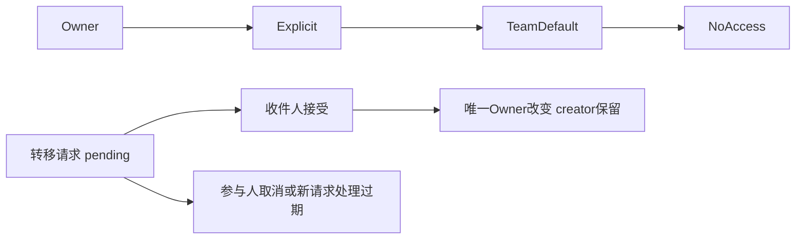

# M02 团队、项目与权限治理 — 当前实现规则稿

## 需求范围

本章覆盖下列完整业务组及公开入口变体。代码是当前行为证据，测试只标defined，所有验收计划not_run。没有业务批准或运行成功声明；全项目共享档案另行汇总。

## 来源与导航身份

项目=19Q4K7PDARXQ9JHW6R6F；仓库=P1KRPDABN4RD0YXMX64E；namespace=source-04d73353-be80-4433-8c5e-0b49a9c12c63；Skill=2.2.0。

run=NSG3TKRB16Y9F6Y203WB；kind=draft（显式工作区草稿，提交仅是基底）；snapshot=06376ab6287ee2d55caa79fc34257896e53ad0577a2b678947888024834468fa；commit=92728fbec04cfa34fee4421cb0a9319d1b755164。

源码manifest=0725fd3bb7867a6d7bba008b6af001c70f66b3c1dbf296b59ad95172eec6bdb9；企业包混合输入manifest=c832ac2345121f95b5f5d83da6275c79610bc4023b829568ee1ceeb2fadf307e；UA/CG artifact=691ab67f0c3a41a5bce1e59ca5ae83d99044ddfbfc5e026afb92183e681615c8。

ua engine=2.9.8, adapter=1.0.0, protocol=1, digest=d22a4a731809299030ee783710407af1e4ce37d5f1930345cb1d4b6a8cfb39a5。

codegraph engine=1.6.2, adapter=1.0.0, protocol=1, digest=c7ce675c6c763726449fccb22159735859ad17eccbce1475c9617287479bf8da。

knowledge handoff scope={"offset":0,"limit":100,"total_nodes":12043,"included_nodes":100,"truncated":true,"complete_repository_analysis":false}；裁剪结果不能建立缺失行为结论。

导航覆盖：codegraph analyzed_files=471/675；此数不是业务覆盖率。

导航覆盖：ua analyzed_files=675/675；此数不是业务覆盖率。

已实际查询固定run的UA overview/search(identity)/relations(requirements-specification)，以及native codegraph context/search。UA业务域/flow与codegraph边只作导航；BR源码证据的路径、SHA-256及真实1基行范围如下。

code callers首次使用native返回function:ID被CLI拒绝，后续以协议cg:前缀重试；查询结果保存在本地discovery记录。

context.bindings仅用于身份：权限Feature与首页Feature/REQ复用已有key及原父模块；既有目标正文不作为本次业务事实来源。

## 目的、角色与接口边界

- REQ-GOV-TEAM-DIRECTORY 团队建立、查看、重命名与个人排序：有效用户；重命名需团队Owner/Admin；触发=创建团队、查看目录或改变名称/顺序；平台模块=tsp-module-collaboration，Feature=GOV-M02-TEAMS，文档=GOV-M02-RULES。
- REQ-GOV-TEAM-MEMBERS 团队角色管理、移除预览和项目访问撤销：团队Owner/Admin；触发=增删成员、改角色或查看移除影响/项目治理；平台模块=tsp-module-collaboration，Feature=GOV-M02-TEAMS，文档=GOV-M02-RULES。
- REQ-GOV-PROJECT-CREATE-DIRECTORY 创建项目并按有效访问展示与个人排序：团队Owner/Admin或已有项目访问者；触发=新建项目、列出/读取项目与排序；平台模块=tsp-module-collaboration，Feature=GOV-M02-PROJECTS，文档=GOV-M02-RULES。
- REQ-GOV-PROJECT-EDIT-ARCHIVE 项目资料修订、归档与恢复：项目Owner/Admin修改资料；仅Owner归档恢复；触发=编辑基本信息或设置active/archived；平台模块=tsp-module-collaboration，Feature=GOV-M02-PROJECTS，文档=GOV-M02-RULES。
- REQ-GOV-PROJECT-EFFECTIVE-MEMBERS 有效权限优先级与单独项目授权：有效项目成员；授权变更需Owner/Admin；触发=解析成员能力、列名册或维护explicit grant；平台模块=tsp-module-collaboration，Feature=tsp-feature-access-roles，文档=GOV-M02-RULES。
- REQ-GOV-PROJECT-POLICY 项目访问策略预览及安全降权：唯一项目Owner；触发=预览或变更private/team_read/team_write；平台模块=tsp-module-collaboration，Feature=tsp-feature-access-roles，文档=GOV-M02-RULES。
- REQ-GOV-OWNERSHIP-TRANSFER 有时限的所有权转移与接收：当前Owner、目标正式团队成员及转移参与人；触发=发起、列出、接收或取消团队/项目转移；平台模块=tsp-module-collaboration，Feature=GOV-M02-OWNERSHIP，文档=GOV-M02-RULES。
- REQ-GOV-OWNERSHIP-RECOVERY 失效负责人恢复与历史多Owner归一：平台管理员恢复团队；团队Owner恢复项目；历史Owner或平台管理员确认遗留责任；触发=发起recover或resolve；平台模块=tsp-module-collaboration，Feature=GOV-M02-OWNERSHIP，文档=GOV-M02-RULES。

## 实体、状态与流程

图只帮助阅读，不替代下文完整转换/分支。

## 业务规则

| BR ID | 条件 | 判定/结果及副作用或保持状态 | 例外/限制 | 来源 | 测试断言 |
| --- | --- | --- | --- | --- | --- |

| BR-GOV-TEAM-DIRECTORY-CREATE | 有效非待注销账号提交非空团队名 | 创建team、admin成员行，返回role=owner且owner_code/created_by均为本人；空白名拒绝。 | 适用角色、初态与失败保持字段见本条AC计划；无跨用例隐式依赖。 | E1 | AC-GOV-TEAM-DIRECTORY-CREATE：创建team、admin成员行，返回role=owner且owner_code/created_by均为本人；空白名拒绝。 |

| BR-GOV-TEAM-DIRECTORY-NAME | Owner或Admin重命名；普通Member尝试相同操作 | 管理者非空新名成功；Member team_forbidden；同名请求保留名称且不新增rename审计。 | 适用角色、初态与失败保持字段见本条AC计划；无跨用例隐式依赖。 | E2, E3 | AC-GOV-TEAM-DIRECTORY-NAME：管理者非空新名成功；Member team_forbidden；同名请求保留名称且不新增rename审计。 |

| BR-GOV-TEAM-DIRECTORY-ORDER | 用户对自己全部团队提交无重复完整编码集合 | 按指定个人顺序返回；遗漏/重复/不属于本人的编码team_order_invalid；其他成员顺序保持。 | 适用角色、初态与失败保持字段见本条AC计划；无跨用例隐式依赖。 | E4 | AC-GOV-TEAM-DIRECTORY-ORDER：按指定个人顺序返回；遗漏/重复/不属于本人的编码team_order_invalid；其他成员顺序保持。 |

| BR-GOV-TEAM-MEMBERS-ROLE | Owner为有效用户授予Admin或Member；Admin管理普通Member | 合法变更成功；Owner自身受team_owner_protected保护，Admin任免Admin被team_forbidden拒绝；重复添加team_member_exists。 | 预览与删除之间状态可能改变，删除重新检查才是决定；重试耗尽为运行故障，未虚构自动补偿。 | E2, E5 | AC-GOV-TEAM-MEMBERS-ROLE：合法变更成功；Owner自身受team_owner_protected保护，Admin任免Admin被team_forbidden拒绝；重复添加team_member_exists。 |

| BR-GOV-TEAM-MEMBERS-REMOVE | 待移除成员不再持有团队项目所有权且无未交接工作 | 移除该团队成员及团队内全部显式项目授权，继承访问一并消失；其他团队私有项目外部授权不变。 | 预览与删除之间状态可能改变，删除重新检查才是决定；重试耗尽为运行故障，未虚构自动补偿。 | E6, E7 | AC-GOV-TEAM-MEMBERS-REMOVE：移除该团队成员及团队内全部显式项目授权，继承访问一并消失；其他团队私有项目外部授权不变。 |

| BR-GOV-TEAM-MEMBERS-BLOCK | 目标仍拥有任一团队项目，或有非终态任务/active、preparing、suspended运行 | 分别project_owner_protected或team_member_has_open_tasks，清单标识阻塞项；全部授权和成员行不变。 | 预览与删除之间状态可能改变，删除重新检查才是决定；重试耗尽为运行故障，未虚构自动补偿。 | E8, E9 | AC-GOV-TEAM-MEMBERS-BLOCK：分别project_owner_protected或team_member_has_open_tasks，清单标识阻塞项；全部授权和成员行不变。 |

| BR-GOV-TEAM-MEMBERS-GOVERNANCE | 团队管理者查看项目治理 | 看到全部团队项目的负责人/状态/ownership_pending/can_access；can_access=false的私有项目仍不可读取正文。 | 预览与删除之间状态可能改变，删除重新检查才是决定；重试耗尽为运行故障，未虚构自动补偿。 | E10, E11 | AC-GOV-TEAM-MEMBERS-GOVERNANCE：看到全部团队项目的负责人/状态/ownership_pending/can_access；can_access=false的私有项目仍不可读取正文。 |

| BR-GOV-PROJECT-CREATE-DIRECTORY-CREATE | 有效团队Owner或Admin且非待注销创建项目 | 默认team_read并返回owner，建立唯一owner与created_by；普通团队成员被project_create_forbidden拒绝。 | 一些错误文案写“只有Owner”，实际isProjectManager允许Admin；以实现条件为当前观察，文案冲突单列。 | E12, E13 | AC-GOV-PROJECT-CREATE-DIRECTORY-CREATE：默认team_read并返回owner，建立唯一owner与created_by；普通团队成员被project_create_forbidden拒绝。 |

| BR-GOV-PROJECT-CREATE-DIRECTORY-VISIBLE | 用户对部分项目为团队继承/explicit/外部协作者 | 仅有效可见项目返回，附role/access_source/is_external/member_policy；私有未授权项目不返回。 | 一些错误文案写“只有Owner”，实际isProjectManager允许Admin；以实现条件为当前观察，文案冲突单列。 | E14, E11 | AC-GOV-PROJECT-CREATE-DIRECTORY-VISIBLE：仅有效可见项目返回，附role/access_source/is_external/member_policy；私有未授权项目不返回。 |

| BR-GOV-PROJECT-CREATE-DIRECTORY-ORDER | 用户按团队提交全部可见项目完整集合 | 个人顺序持久化且不新增explicit grant；遗漏/重复/越权项目project_order_invalid。 | 一些错误文案写“只有Owner”，实际isProjectManager允许Admin；以实现条件为当前观察，文案冲突单列。 | E15 | AC-GOV-PROJECT-CREATE-DIRECTORY-ORDER：个人顺序持久化且不新增explicit grant；遗漏/重复/越权项目project_order_invalid。 |

| BR-GOV-PROJECT-EDIT-ARCHIVE-EDIT | 项目Owner/Admin提交不同名称或说明 | 修改内容且current_snapshot加1；再次完全相同请求snapshot保持，普通成员拒绝。 | 归档限制以各实际入口的检查为准，不能推导所有内部函数都统一具备状态机或事务。 | E16 | AC-GOV-PROJECT-EDIT-ARCHIVE-EDIT：修改内容且current_snapshot加1；再次完全相同请求snapshot保持，普通成员拒绝。 |

| BR-GOV-PROJECT-EDIT-ARCHIVE-ARCHIVE | Owner归档active项目再恢复 | archived且snapshot加1，仍能读取历史；write/manage入口拒绝，恢复active再加1；Admin不能归档。 | 归档限制以各实际入口的检查为准，不能推导所有内部函数都统一具备状态机或事务。 | E17, E18 | AC-GOV-PROJECT-EDIT-ARCHIVE-ARCHIVE：archived且snapshot加1，仍能读取历史；write/manage入口拒绝，恢复active再加1；Admin不能归档。 |

| BR-GOV-PROJECT-EFFECTIVE-MEMBERS-PRECEDENCE | team_write用户有显式viewer授权 | 有效角色viewer/source=explicit且write=false；移除grant后恢复member/source=team，若仍有工作但写权限不丢失可成功。 | 适用角色、初态与失败保持字段见本条AC计划；无跨用例隐式依赖。 | E13, E11, E19 | AC-GOV-PROJECT-EFFECTIVE-MEMBERS-PRECEDENCE：有效角色viewer/source=explicit且write=false；移除grant后恢复member/source=team，若仍有工作但写权限不丢失可成功。 |

| BR-GOV-PROJECT-EFFECTIVE-MEMBERS-ROLE | Owner维护admin/member/viewer授权，Admin只管理非Admin | 成功返回effective_role/access_source；任免owner或Admin越界、重复add、移除无explicit grant分别拒绝且原授权不变。 | 适用角色、初态与失败保持字段见本条AC计划；无跨用例隐式依赖。 | E20, E21 | AC-GOV-PROJECT-EFFECTIVE-MEMBERS-ROLE：成功返回effective_role/access_source；任免owner或Admin越界、重复add、移除无explicit grant分别拒绝且原授权不变。 |

| BR-GOV-PROJECT-EFFECTIVE-MEMBERS-HANDOFF | 变更导致目标无写权限且其仍有开放任务或活动运行 | member_has_open_tasks携带task/run编码，授权不变；交接结束后新请求可成功。 | 适用角色、初态与失败保持字段见本条AC计划；无跨用例隐式依赖。 | E22, E19 | AC-GOV-PROJECT-EFFECTIVE-MEMBERS-HANDOFF：member_has_open_tasks携带task/run编码，授权不变；交接结束后新请求可成功。 |

| BR-GOV-PROJECT-EFFECTIVE-MEMBERS-ROSTER | 用户通过HTTP GET /projects/P/members读取名册，可为内部或外部协作者 | 有访问权者获得Owner、explicit及策略继承的有效成员名册，按display_name/code排序；外部explicit用户is_external=true。无项目访问权的有效用户在HTTP路由前置getProject检查返回ok=false/project_forbidden且不返回名册正文；内部listMembers无访问时返回[]不等于该HTTP响应。 | 适用角色、初态与失败保持字段见本条AC计划；无跨用例隐式依赖。 | E23, E24, E25 | AC-GOV-PROJECT-EFFECTIVE-MEMBERS-ROSTER：有访问权者获得Owner、explicit及策略继承的有效成员名册，按display_name/code排序；外部explicit用户is_external=true。无项目访问权的有效用户在HTTP路由前置getProject检查返回ok=false/project_forbidden且不返回名册正文；内部listMembers无访问时返回[]不等于该HTTP响应。 |

| BR-GOV-PROJECT-POLICY-PREVIEW | Owner预览team_read→team_write | 仅继承viewer变member计gained_write；explicit viewer仍viewer；Admin预览被project_forbidden拒绝。 | 适用角色、初态与失败保持字段见本条AC计划；无跨用例隐式依赖。 | E26, E27 | AC-GOV-PROJECT-POLICY-PREVIEW：仅继承viewer变member计gained_write；explicit viewer仍viewer；Admin预览被project_forbidden拒绝。 |

| BR-GOV-PROJECT-POLICY-DOWNGRADE | team_write→team_read/private且继承member仍有开放工作 | member_has_open_tasks拒绝并保持team_write；仅explicit写者有工作不阻止默认策略下降。 | 适用角色、初态与失败保持字段见本条AC计划；无跨用例隐式依赖。 | E27, E22 | AC-GOV-PROJECT-POLICY-DOWNGRADE：member_has_open_tasks拒绝并保持team_write；仅explicit写者有工作不阻止默认策略下降。 |

| BR-GOV-OWNERSHIP-TRANSFER-ACCEPT | O向正式团队成员N发起scope转移且N仍有效 | 创建时owner仍O；N接受后owner=N、旧O有效角色admin、created_by不变；第二次接受ownership_transfer_not_pending。 | 适用角色、初态与失败保持字段见本条AC计划；无跨用例隐式依赖。 | E28, E29 | AC-GOV-OWNERSHIP-TRANSFER-ACCEPT：创建时owner仍O；N接受后owner=N、旧O有效角色admin、created_by不变；第二次接受ownership_transfer_not_pending。 |

| BR-GOV-OWNERSHIP-TRANSFER-RECIPIENT | 目标不是正式团队成员、已待注销或接受前失去资格 | 分别ownership_recipient_not_team_member/account_pending_deletion/用户无效错误，owner不变；仅收件人可接受。 | 适用角色、初态与失败保持字段见本条AC计划；无跨用例隐式依赖。 | E30, E31 | AC-GOV-OWNERSHIP-TRANSFER-RECIPIENT：分别ownership_recipient_not_team_member/account_pending_deletion/用户无效错误，owner不变；仅收件人可接受。 |

| BR-GOV-OWNERSHIP-TRANSFER-CANCEL-EXPIRE | 有效pending已存在、参与人取消或7天过期 | 有效pending阻止重复发起；参与人取消后可新发；过期请求不能接受，新发会取消旧pending并创建新7天请求。 | 适用角色、初态与失败保持字段见本条AC计划；无跨用例隐式依赖。 | E32, E33 | AC-GOV-OWNERSHIP-TRANSFER-CANCEL-EXPIRE：有效pending阻止重复发起；参与人取消后可新发；过期请求不能接受，新发会取消旧pending并创建新7天请求。 |

| BR-GOV-OWNERSHIP-RECOVERY-RECOVERY | 原负责人disabled/已注销，正确恢复者提供原因且目标有资格 | 恢复请求创建但不即时改owner，目标接受后变更；原owner恢复有效或发起者失去恢复权后接受失败。 | legacy确认所需升级fixture不由普通新建流程产生；迁移归属不清仍需人工处理，未虚构fixture已经存在或已运行。 | E34, E35, E36 | AC-GOV-OWNERSHIP-RECOVERY-RECOVERY：恢复请求创建但不即时改owner，目标接受后变更；原owner恢复有效或发起者失去恢复权后接受失败。 |

| BR-GOV-OWNERSHIP-RECOVERY-DENIED | 原owner仍有效、原因空白或actor不具恢复权 | 分别ownership_recovery_not_required/ownership_recovery_reason_required/ownership_recovery_forbidden；无新请求或owner变化。 | legacy确认所需升级fixture不由普通新建流程产生；迁移归属不清仍需人工处理，未虚构fixture已经存在或已运行。 | E34, E37 | AC-GOV-OWNERSHIP-RECOVERY-DENIED：分别ownership_recovery_not_required/ownership_recovery_reason_required/ownership_recovery_forbidden；无新请求或owner变化。 |

| BR-GOV-OWNERSHIP-RECOVERY-LEGACY | 历史scope owner_principal_id=null且已有多个role=owner行 | 历史Owner或平台管理员仅可选择其中既有Owner；其他owner成员降admin，creator不变；陌生目标ownership_resolution_target_invalid。 | legacy确认所需升级fixture不由普通新建流程产生；迁移归属不清仍需人工处理，未虚构fixture已经存在或已运行。 | E38 | AC-GOV-OWNERSHIP-RECOVERY-LEGACY：历史Owner或平台管理员仅可选择其中既有Owner；其他owner成员降admin，creator不变；陌生目标ownership_resolution_target_invalid。 |

## 功能需求

以下字段与结构化JSON同源生成，避免文档与需求对权限、拒绝/忽略、状态和数据变化表达相反结论。

### REQ-GOV-TEAM-DIRECTORY 团队建立、查看、重命名与个人排序

主流程：

1. 有效非待注销用户以非空名称创建团队并成为唯一Owner；底层普通成员行存admin。
2. 仅列出本人正式成员团队，计算有效角色与可见项目数。
3. Owner/Admin改名，个人排序须提交全部团队且不重复。

数据与配置：

- 列表按个人sort_order、created_at、team.code升序；一般成员projects_count仅计可访问项目，管理者计团队全部项目。
- 同名改名不写更新审计；排序只改变当前用户teamMembers.sort_order。

状态/一致性边界：

- 创建team及成员行和审计同事务；created_by与owner分开保留。
- 排序/改名不改变其他人的排序或所有权。

### REQ-GOV-TEAM-MEMBERS 团队角色管理、移除预览和项目访问撤销

主流程：

1. 查看团队正式成员及治理元数据；治理列表不自动授予私有项目内容访问。
2. 仅授予Admin/Member，Owner独占管理员任免且本人Owner不可直接修改/删除。
3. 移除前预览并检查其项目所有权/open工作，完成交接后同事务撤销团队内所有单独项目授权与团队成员行。

数据与配置：

- 普通团队成员仅可查看成员；管理入口Owner/Admin；Admin不可管理现有Admin或授予Admin。
- 移除影响返回projects、blocked_owned_projects、open_tasks、active_runs；其他团队外部授权保留。
- 涉及团队项目的变更持有项目fence；并发项目集合变化重试，最多5次尝试。

状态/一致性边界：

- add/update写成员与审计；remove同时撤销所在团队全部项目explicit grants，不动其他团队授权。
- 所有权或未结束工作阻塞时事务保持团队/项目授权不变。

### REQ-GOV-PROJECT-CREATE-DIRECTORY 创建项目并按有效访问展示与个人排序

主流程：

1. 团队管理者新建项目，默认team_read，创建者成为唯一Owner并初始化系统目录。
2. 按Owner→explicit→团队策略解析项目可见性，展示权限来源/外部协作标记。
3. 用户只对该团队全部可访问项目保存个人顺序。

数据与配置：

- member_policy为private/team_read/team_write，默认team_read；name非空，description空值规范为null。
- 未自定义顺序时created_at和code升序；projectOrders只保存个人排序，不产生授权。

状态/一致性边界：

- 创建project/admin成员行/目录及审计同事务；保留created_by。
- 个人项目排序不改变members或继承关系。

### REQ-GOV-PROJECT-EDIT-ARCHIVE 项目资料修订、归档与恢复

主流程：

1. 管理者更新非空项目名及可选说明，事务内重新检查权限。
2. 内容相同直接返回原snapshot，不产生修改。
3. 仅Owner改变归档状态；归档保留读取与历史并拒绝受manage/write检查的内容操作。

数据与配置：

- description未给出则保留，显式null或空白清空。
- 资料或状态真实改变current_snapshot加1；重复相同状态不加版本。

状态/一致性边界：

- project.updated/archived/restored审计与项目变更同事务。
- archived不删除模块/任务/需求，restore恢复active。

### REQ-GOV-PROJECT-EFFECTIVE-MEMBERS 有效权限优先级与单独项目授权

主流程：

1. 按唯一Owner、单独grant、team默认、无访问四层顺序解析。
2. 名册展示继承及单独成员、权限来源、外部标记与能力。
3. 移除单独授权可能恢复团队继承；失去写权限之前必须交接工作，Owner受保护。

数据与配置：

- team_read→viewer，team_write→member，private不继承；显式viewer覆盖team_write。
- 可授admin/member/viewer；Admin不能任免Admin；归档项目不能改权限。
- Owner/Admin管理；read允许四角色；write排除viewer；manage_admins/manage_policy/transfer/archive只有Owner。

状态/一致性边界：

- 删除grant只删除members，不删除teamMembers；结果role按恢复的继承权限返回。
- 降至viewer/无访问时存在非closed/failed/cancelled分派任务或active/preparing/suspended run则拒绝。

### REQ-GOV-PROJECT-POLICY 项目访问策略预览及安全降权

主流程：

1. Owner选择策略，预览未被explicit覆盖的有效团队用户变化。
2. 事务内重查Owner和active状态；team_write降为其他策略前检查继承写者的未交接任务/运行。
3. 仅更改默认策略，保留explicit例外、Owner与业务历史。

数据与配置：

- 预览含gained_read/gained_write/lost_write/lost_access及explicit_exceptions，排除owner、deleted用户和explicit行。
- owner尚未确认时ownership_pending；归档不可更新策略。

状态/一致性边界：

- member_policy即时改变继承访问，project.access_policy_changed审计同事务；未交接阻塞时策略不变。

### REQ-GOV-OWNERSHIP-TRANSFER 有时限的所有权转移与接收

主流程：

1. Owner发起给有效且非待注销的正式团队成员，7天内一个scope仅一个有效pending请求。
2. 请求不立即改owner；仅收件人接受，事务内再次检查owner和收件资格。
3. 接受后设置新owner并将新旧负责人底层成员角色保存admin；参与人可取消pending请求。

数据与配置：

- scope team/project；已是owner拒绝；owner=null须先legacy resolve。
- 只有from/to/initiated_by可列到或取消请求；列表created_at降序无最终tie-break。
- 过期pending在新发起时改cancelled并记录expired审计；过期接受被拒绝，不宣称后台自动到期。

状态/一致性边界：

- pending→accepted/cancelled；接受改变owner_principal_id但created_by不变。
- 参与状态/owner改变或资格失效时拒绝，原所有权不变。

异常与边界处理（与结构化specification.exceptions一致，复用下方既有BR/AC/TC矩阵）：

- 条件：接收人不是所属团队正式成员，或处于pending_deletion；发起与接受阶段都检查资格。
  处理：分别返回ownership_recipient_not_team_member或account_pending_deletion，原owner不变；接受失败不把pending请求标为accepted（BR-GOV-OWNERSHIP-TRANSFER-RECIPIENT / AC-GOV-OWNERSHIP-TRANSFER-RECIPIENT）。
- 条件：同scope已有未过期pending请求时再次发起转移。
  处理：返回ownership_transfer_pending，不创建第二个有效pending，也不改变owner；参与人取消或旧请求到期后再发新请求（BR-GOV-OWNERSHIP-TRANSFER-CANCEL-EXPIRE / AC-GOV-OWNERSHIP-TRANSFER-CANCEL-EXPIRE）。
- 条件：对非pending请求再次接受，或不是收件人本人接受pending请求。
  处理：分别返回ownership_transfer_not_pending或ownership_recipient_required，请求状态和owner保持（BR-GOV-OWNERSHIP-TRANSFER-ACCEPT / AC-GOV-OWNERSHIP-TRANSFER-ACCEPT、RECIPIENT）。
- 条件：接受时请求已过期或当前owner已不是请求记录中的from_principal_id。
  处理：分别返回ownership_transfer_expired或ownership_changed，不改变owner或请求状态；后续新发请求会在其事务内把旧过期pending置cancelled；有效from/to/initiated_by参与人也可显式取消仍pending的请求，包括已过期请求。账号完成注销还会取消收件人或发起人为该账号的pending请求，见BR-GOV-ACCOUNT-CLOSURE-COMPLETE；不宣称存在后台自动过期处理（BR-GOV-OWNERSHIP-TRANSFER-CANCEL-EXPIRE / AC-GOV-OWNERSHIP-TRANSFER-CANCEL-EXPIRE）。

### REQ-GOV-OWNERSHIP-RECOVERY 失效负责人恢复与历史多Owner归一

主流程：

1. 当前负责人失效时有权者提供原因发起恢复，仍由收件人接受。
2. 接受恢复时再次检查原Owner仍失效、发起者仍有恢复权。
3. owner=null仅允许在已有legacy owner成员中选一个，其他历史owner改admin，不给新用户迁移授予权限。

数据与配置：

- 团队恢复需有效平台管理员；项目恢复需该团队Owner；原owner有效则ownership_recovery_not_required。
- legacy resolve不补写creator；管理员可确认失效legacy owner以建立历史责任，再走恢复，不重新启用该账号。

状态/一致性边界：

- 恢复请求pending→accepted后改变唯一owner；旧owner底层admin保留。
- legacy resolve仅从null设置owner并改历史owner成员角色；重复resolve拒绝。

## 权限边界

按每条规则的actor和前置数据建立当前有效权限。Owner与Admin的差别按源码条件保留；旧文案“只有Owner”不能覆盖isProjectManager实际允许Admin的路径。Viewer可读能力不自动获得write/manage。源自其他业务模块的流程只引用不重复执行。

## 异常与边界

成功、权限拒绝、输入错误、版本/状态门槛和恢复见下列独立计划。未实现的控制不补写为既定政策：

- REQ-GOV-TEAM-MEMBERS：预览与删除之间状态可能改变，删除重新检查才是决定；重试耗尽为运行故障，未虚构自动补偿。
- REQ-GOV-PROJECT-CREATE-DIRECTORY：一些错误文案写“只有Owner”，实际isProjectManager允许Admin；以实现条件为当前观察，文案冲突单列。
- REQ-GOV-PROJECT-EDIT-ARCHIVE：归档限制以各实际入口的检查为准，不能推导所有内部函数都统一具备状态机或事务。
- REQ-GOV-OWNERSHIP-RECOVERY：legacy确认所需升级fixture不由普通新建流程产生；迁移归属不清仍需人工处理，未虚构fixture已经存在或已运行。

## 验收场景与可复现计划

每个用例使用独立隔离数据并在开始前恢复所述初始状态；账号有效且已完成初始密码修改，除非该用例明确测试初始密码。认证使用该角色自己的有效Bearer会话；浏览器用例使用自身Cookie/Origin/CSRF。保存创建操作真实返回的编码，不硬编码生产数据。时钟采用UTC并记录起始时间；仅在有效期/锁定场景控制时钟。所有步骤为待执行计划。

### TC-GOV-TEAM-DIRECTORY-CREATE → AC-GOV-TEAM-DIRECTORY-CREATE

角色=有效用户；重命名需团队Owner/Admin；独立初态=U有效，无团队；另用独立pending_deletion U分支。

1. U POST /teams name="研发"并GET /teams。
2. 独立空白名、待注销用户分别创建。

可观察结果=创建team、admin成员行，返回role=owner且owner_code/created_by均为本人；空白名拒绝。

执行状态=not_run；优先级=P1（分析建议，未测量风险）。

### TC-GOV-TEAM-DIRECTORY-NAME → AC-GOV-TEAM-DIRECTORY-NAME

角色=有效用户；重命名需团队Owner/Admin；独立初态=团队T中O owner、A admin、M member；保存审计数。

1. A PATCH /teams/T为新名，再重复新名；M改名。

可观察结果=管理者非空新名成功；Member team_forbidden；同名请求保留名称且不新增rename审计。

执行状态=not_run；优先级=P1（分析建议，未测量风险）。

### TC-GOV-TEAM-DIRECTORY-ORDER → AC-GOV-TEAM-DIRECTORY-ORDER

角色=有效用户；重命名需团队Owner/Admin；独立初态=U正式属于T1/T2；V同时属于这两团队；U另不可见T3。

1. U PUT /teams/order [T2,T1]，读取U和V列表。
2. 独立恢复后提交[T1]、[T1,T1]、[T1,T3]。

可观察结果=按指定个人顺序返回；遗漏/重复/不属于本人的编码team_order_invalid；其他成员顺序保持。

执行状态=not_run；优先级=P1（分析建议，未测量风险）。

### TC-GOV-TEAM-MEMBERS-ROLE → AC-GOV-TEAM-MEMBERS-ROLE

角色=团队Owner/Admin；独立初态=T中O owner、A admin、M member、有效N尚未加入。

1. O添加N member，A改N member；O改N admin。
2. A尝试改/移除N admin；O尝试修改O；重复添加M。

可观察结果=合法变更成功；Owner自身受team_owner_protected保护，Admin任免Admin被team_forbidden拒绝；重复添加team_member_exists。

执行状态=not_run；优先级=P1（分析建议，未测量风险）。

### TC-GOV-TEAM-MEMBERS-REMOVE → AC-GOV-TEAM-MEMBERS-REMOVE

角色=团队Owner/Admin；独立初态=T1成员U在T1项目P1有explicit grant，在T2的P2有外部grant；无所有权/未结束工作。

1. 管理者先GET removal-impact再DELETE团队成员。
2. 用U分别访问P1/P2并读成员列表。

可观察结果=移除该团队成员及团队内全部显式项目授权，继承访问一并消失；其他团队私有项目外部授权不变。

执行状态=not_run；优先级=P1（分析建议，未测量风险）。

### TC-GOV-TEAM-MEMBERS-BLOCK → AC-GOV-TEAM-MEMBERS-BLOCK

角色=团队Owner/Admin；独立初态=每次独立T/U；分别准备owned P、分派未关闭任务、非分派但由U执行的活动run。

1. 预览影响，尝试移除；读取teamMembers/members及阻塞清单。
2. 完成已知交接后用新移除请求重试。

可观察结果=分别project_owner_protected或team_member_has_open_tasks，清单标识阻塞项；全部授权和成员行不变。

执行状态=not_run；优先级=P1（分析建议，未测量风险）。

### TC-GOV-TEAM-MEMBERS-GOVERNANCE → AC-GOV-TEAM-MEMBERS-GOVERNANCE

角色=团队Owner/Admin；独立初态=T owner O但私有项目P未给O项目grant；另普通T成员M。

1. O GET projects-governance；访问P内容，检查拒绝。
2. M请求治理列表。

可观察结果=看到全部团队项目的负责人/状态/ownership_pending/can_access；can_access=false的私有项目仍不可读取正文。

执行状态=not_run；优先级=P1（分析建议，未测量风险）。

### TC-GOV-PROJECT-CREATE-DIRECTORY-CREATE → AC-GOV-PROJECT-CREATE-DIRECTORY-CREATE

角色=团队Owner/Admin或已有项目访问者；独立初态=T中O owner、A admin、M member；三者有效。

1. A POST /projects team_code=T,name="项目"；GET新项目并查看策略/角色/目录。
2. 独立M尝试创建。

可观察结果=默认team_read并返回owner，建立唯一owner与created_by；普通团队成员被project_create_forbidden拒绝。

执行状态=not_run；优先级=P1（分析建议，未测量风险）。

### TC-GOV-PROJECT-CREATE-DIRECTORY-VISIBLE → AC-GOV-PROJECT-CREATE-DIRECTORY-VISIBLE

角色=团队Owner/Admin或已有项目访问者；独立初态=U属于T1；T1含team_read P1、private P2无U授权；T2 private P3给U member。

1. U GET /projects及按T1过滤；GET P2；比较P1/P3外部标记。

可观察结果=仅有效可见项目返回，附role/access_source/is_external/member_policy；私有未授权项目不返回。

执行状态=not_run；优先级=P1（分析建议，未测量风险）。

### TC-GOV-PROJECT-CREATE-DIRECTORY-ORDER → AC-GOV-PROJECT-CREATE-DIRECTORY-ORDER

角色=团队Owner/Admin或已有项目访问者；独立初态=U通过团队继承可见P1/P2，未显式授权；另私有P3不可见。

1. PUT /projects/order team_code=T,project_codes=[P2,P1]；GET并查看members未增加。
2. 独立遗漏或夹带P3排序。

可观察结果=个人顺序持久化且不新增explicit grant；遗漏/重复/越权项目project_order_invalid。

执行状态=not_run；优先级=P1（分析建议，未测量风险）。

### TC-GOV-PROJECT-EDIT-ARCHIVE-EDIT → AC-GOV-PROJECT-EDIT-ARCHIVE-EDIT

角色=项目Owner/Admin修改资料；仅Owner归档恢复；独立初态=active P，O owner、A admin、M member；记录snapshot N。

1. A PATCH /projects/P新name，省略description检查保留；再次同请求。
2. 独立恢复后M修改。

可观察结果=修改内容且current_snapshot加1；再次完全相同请求snapshot保持，普通成员拒绝。

执行状态=not_run；优先级=P1（分析建议，未测量风险）。

### TC-GOV-PROJECT-EDIT-ARCHIVE-ARCHIVE → AC-GOV-PROJECT-EDIT-ARCHIVE-ARCHIVE

角色=项目Owner/Admin修改资料；仅Owner归档恢复；独立初态=active P，Owner O、Admin A和已有需求R。

1. A先请求归档；O归档，读取P/R并尝试更新R。
2. O重复归档检查不加snapshot，再恢复。

可观察结果=archived且snapshot加1，仍能读取历史；write/manage入口拒绝，恢复active再加1；Admin不能归档。

执行状态=not_run；优先级=P1（分析建议，未测量风险）。

### TC-GOV-PROJECT-EFFECTIVE-MEMBERS-PRECEDENCE → AC-GOV-PROJECT-EFFECTIVE-MEMBERS-PRECEDENCE

角色=有效项目成员；授权变更需Owner/Admin；独立初态=T成员U；active P为team_write，U显式viewer；O owner；独立恢复测试数据。

1. GET名册和P能力，O DELETE U的项目grant；再查有效角色。

可观察结果=有效角色viewer/source=explicit且write=false；移除grant后恢复member/source=team，若仍有工作但写权限不丢失可成功。

执行状态=not_run；优先级=P1（分析建议，未测量风险）。

### TC-GOV-PROJECT-EFFECTIVE-MEMBERS-ROLE → AC-GOV-PROJECT-EFFECTIVE-MEMBERS-ROLE

角色=有效项目成员；授权变更需Owner/Admin；独立初态=P中O owner、A admin、M member，另有效N；各变体独立复位。

1. O授N admin；A尝试改N和O，重复add M。
2. 尝试移除只有继承访问且无explicit行的用户。

可观察结果=成功返回effective_role/access_source；任免owner或Admin越界、重复add、移除无explicit grant分别拒绝且原授权不变。

执行状态=not_run；优先级=P1（分析建议，未测量风险）。

### TC-GOV-PROJECT-EFFECTIVE-MEMBERS-HANDOFF → AC-GOV-PROJECT-EFFECTIVE-MEMBERS-HANDOFF

角色=有效项目成员；授权变更需Owner/Admin；独立初态=private P的explicit member U，任务未终结；另独立分支任务已终结但U仍有suspended run。

1. Owner改U viewer或删除grant，观察失败和原grant。
2. 按既有交接结束工作后再次发起变更。

可观察结果=member_has_open_tasks携带task/run编码，授权不变；交接结束后新请求可成功。

执行状态=not_run；优先级=P1（分析建议，未测量风险）。

### TC-GOV-PROJECT-EFFECTIVE-MEMBERS-ROSTER → AC-GOV-PROJECT-EFFECTIVE-MEMBERS-ROSTER

角色=有效项目成员；授权变更需Owner/Admin；独立初态=active P为team_read，Owner O，团队成员U，非团队用户X有P的explicit member授权，Y有效且无P团队/explicit/owner访问。记录原成员行；使用U/Y各自有效Bearer会话；其他条件相同。

1. 以U GET /projects/P/members，核对名册角色、access_source、外部X标记与display_name/code顺序。
2. 以Y GET同一URL，核对ok=false、error.code=project_forbidden且无成员data；再读取隔离库确认成员行未变化。

可观察结果=有访问权者获得Owner、explicit及策略继承的有效成员名册，按display_name/code排序；外部explicit用户is_external=true。无项目访问权的有效用户在HTTP路由前置getProject检查返回ok=false/project_forbidden且不返回名册正文；内部listMembers无访问时返回[]不等于该HTTP响应。

执行状态=not_run；优先级=P1（分析建议，未测量风险）。

### TC-GOV-PROJECT-POLICY-PREVIEW → AC-GOV-PROJECT-POLICY-PREVIEW

角色=唯一项目Owner；独立初态=P team_read，O owner、A admin、U继承、V显式viewer。

1. O GET access-policy?member_policy=team_write，核对逐人changes/count。
2. A同请求；O PUT策略后核对U/V权限。

可观察结果=仅继承viewer变member计gained_write；explicit viewer仍viewer；Admin预览被project_forbidden拒绝。

执行状态=not_run；优先级=P1（分析建议，未测量风险）。

### TC-GOV-PROJECT-POLICY-DOWNGRADE → AC-GOV-PROJECT-POLICY-DOWNGRADE

角色=唯一项目Owner；独立初态=独立P1有继承writer U开放任务/active run；独立P2只有explicit writer V开放任务。

1. Owner分别PUT P1/P2目标策略，读取策略及用户权限。
2. P1交接后重新提交。

可观察结果=member_has_open_tasks拒绝并保持team_write；仅explicit写者有工作不阻止默认策略下降。

执行状态=not_run；优先级=P1（分析建议，未测量风险）。

### TC-GOV-OWNERSHIP-TRANSFER-ACCEPT → AC-GOV-OWNERSHIP-TRANSFER-ACCEPT

角色=当前Owner、目标正式团队成员及转移参与人；独立初态=每个scope独立：T和P Owner O，N是所属T正式成员且非pending_deletion。

1. O POST ownership-transfers，检查scope owner未变；N POST返回code/accept。
2. 查询新旧角色及created_by；重试同accept。

可观察结果=创建时owner仍O；N接受后owner=N、旧O有效角色admin、created_by不变；第二次接受ownership_transfer_not_pending。

执行状态=not_run；优先级=P1（分析建议，未测量风险）。

### TC-GOV-OWNERSHIP-TRANSFER-RECIPIENT → AC-GOV-OWNERSHIP-TRANSFER-RECIPIENT

角色=当前Owner、目标正式团队成员及转移参与人；独立初态=独立T/P及O；X仅external项目grant，N正式团队成员；对接受前资格变化做独立数据快照。

1. O向X发起；另向N发起后使N待注销，再由N接受。
2. 其他用户尝试接受N请求。

可观察结果=分别ownership_recipient_not_team_member/account_pending_deletion/用户无效错误，owner不变；仅收件人可接受。

执行状态=not_run；优先级=P1（分析建议，未测量风险）。

### TC-GOV-OWNERSHIP-TRANSFER-CANCEL-EXPIRE → AC-GOV-OWNERSHIP-TRANSFER-CANCEL-EXPIRE

角色=当前Owner、目标正式团队成员及转移参与人；独立初态=独立O/N和scope，固定起始UTC时间t0；无其他pending。

1. O发起后再发；N取消，O新发。
2. 独立复位后发起并推进超过7天，N接受失败，O再发，核对旧/新状态。

可观察结果=有效pending阻止重复发起；参与人取消后可新发；过期请求不能接受，新发会取消旧pending并创建新7天请求。

执行状态=not_run；优先级=P1（分析建议，未测量风险）。

### TC-GOV-OWNERSHIP-RECOVERY-RECOVERY → AC-GOV-OWNERSHIP-RECOVERY-RECOVERY

角色=平台管理员恢复团队；团队Owner恢复项目；历史Owner或平台管理员确认遗留责任；独立初态=独立团队T owner O失效且有平台管理员A、正式成员N；项目P owner失效且T Owner TO有效。

1. 分别由A恢复T、TO恢复P并N接受；比较owner。
2. 独立复位后恢复请求发起，再启用旧Owner或移除恢复者资格，然后N接受。

可观察结果=恢复请求创建但不即时改owner，目标接受后变更；原owner恢复有效或发起者失去恢复权后接受失败。

执行状态=not_run；优先级=P1（分析建议，未测量风险）。

### TC-GOV-OWNERSHIP-RECOVERY-DENIED → AC-GOV-OWNERSHIP-RECOVERY-DENIED

角色=平台管理员恢复团队；团队Owner恢复项目；历史Owner或平台管理员确认遗留责任；独立初态=每个变体独立scope与有效目标N。

1. 向recover提交各错误条件；查pending请求及owner。

可观察结果=分别ownership_recovery_not_required/ownership_recovery_reason_required/ownership_recovery_forbidden；无新请求或owner变化。

执行状态=not_run；优先级=P1（分析建议，未测量风险）。

### TC-GOV-OWNERSHIP-RECOVERY-LEGACY → AC-GOV-OWNERSHIP-RECOVERY-LEGACY

角色=平台管理员恢复团队；团队Owner恢复项目；历史Owner或平台管理员确认遗留责任；独立初态=仅隔离升级测试数据库：T或P有两个legacy owner行及原creator；N不在legacy owners。

1. POST /ownership/resolve选择既有owner，读唯一owner/底层成员/creator。
2. 独立复位后选择N，再重复已resolved场景。

可观察结果=历史Owner或平台管理员仅可选择其中既有Owner；其他owner成员降admin，creator不变；陌生目标ownership_resolution_target_invalid。

执行状态=not_run；优先级=P1（分析建议，未测量风险）。

## 追溯：BR → REQ / AC / 测试矩阵

| BR | REQ | AC | Case | 执行 |
| --- | --- | --- | --- | --- |

| BR-GOV-TEAM-DIRECTORY-CREATE | REQ-GOV-TEAM-DIRECTORY | AC-GOV-TEAM-DIRECTORY-CREATE | TC-GOV-TEAM-DIRECTORY-CREATE | not_run |

| BR-GOV-TEAM-DIRECTORY-NAME | REQ-GOV-TEAM-DIRECTORY | AC-GOV-TEAM-DIRECTORY-NAME | TC-GOV-TEAM-DIRECTORY-NAME | not_run |

| BR-GOV-TEAM-DIRECTORY-ORDER | REQ-GOV-TEAM-DIRECTORY | AC-GOV-TEAM-DIRECTORY-ORDER | TC-GOV-TEAM-DIRECTORY-ORDER | not_run |

| BR-GOV-TEAM-MEMBERS-ROLE | REQ-GOV-TEAM-MEMBERS | AC-GOV-TEAM-MEMBERS-ROLE | TC-GOV-TEAM-MEMBERS-ROLE | not_run |

| BR-GOV-TEAM-MEMBERS-REMOVE | REQ-GOV-TEAM-MEMBERS | AC-GOV-TEAM-MEMBERS-REMOVE | TC-GOV-TEAM-MEMBERS-REMOVE | not_run |

| BR-GOV-TEAM-MEMBERS-BLOCK | REQ-GOV-TEAM-MEMBERS | AC-GOV-TEAM-MEMBERS-BLOCK | TC-GOV-TEAM-MEMBERS-BLOCK | not_run |

| BR-GOV-TEAM-MEMBERS-GOVERNANCE | REQ-GOV-TEAM-MEMBERS | AC-GOV-TEAM-MEMBERS-GOVERNANCE | TC-GOV-TEAM-MEMBERS-GOVERNANCE | not_run |

| BR-GOV-PROJECT-CREATE-DIRECTORY-CREATE | REQ-GOV-PROJECT-CREATE-DIRECTORY | AC-GOV-PROJECT-CREATE-DIRECTORY-CREATE | TC-GOV-PROJECT-CREATE-DIRECTORY-CREATE | not_run |

| BR-GOV-PROJECT-CREATE-DIRECTORY-VISIBLE | REQ-GOV-PROJECT-CREATE-DIRECTORY | AC-GOV-PROJECT-CREATE-DIRECTORY-VISIBLE | TC-GOV-PROJECT-CREATE-DIRECTORY-VISIBLE | not_run |

| BR-GOV-PROJECT-CREATE-DIRECTORY-ORDER | REQ-GOV-PROJECT-CREATE-DIRECTORY | AC-GOV-PROJECT-CREATE-DIRECTORY-ORDER | TC-GOV-PROJECT-CREATE-DIRECTORY-ORDER | not_run |

| BR-GOV-PROJECT-EDIT-ARCHIVE-EDIT | REQ-GOV-PROJECT-EDIT-ARCHIVE | AC-GOV-PROJECT-EDIT-ARCHIVE-EDIT | TC-GOV-PROJECT-EDIT-ARCHIVE-EDIT | not_run |

| BR-GOV-PROJECT-EDIT-ARCHIVE-ARCHIVE | REQ-GOV-PROJECT-EDIT-ARCHIVE | AC-GOV-PROJECT-EDIT-ARCHIVE-ARCHIVE | TC-GOV-PROJECT-EDIT-ARCHIVE-ARCHIVE | not_run |

| BR-GOV-PROJECT-EFFECTIVE-MEMBERS-PRECEDENCE | REQ-GOV-PROJECT-EFFECTIVE-MEMBERS | AC-GOV-PROJECT-EFFECTIVE-MEMBERS-PRECEDENCE | TC-GOV-PROJECT-EFFECTIVE-MEMBERS-PRECEDENCE | not_run |

| BR-GOV-PROJECT-EFFECTIVE-MEMBERS-ROLE | REQ-GOV-PROJECT-EFFECTIVE-MEMBERS | AC-GOV-PROJECT-EFFECTIVE-MEMBERS-ROLE | TC-GOV-PROJECT-EFFECTIVE-MEMBERS-ROLE | not_run |

| BR-GOV-PROJECT-EFFECTIVE-MEMBERS-HANDOFF | REQ-GOV-PROJECT-EFFECTIVE-MEMBERS | AC-GOV-PROJECT-EFFECTIVE-MEMBERS-HANDOFF | TC-GOV-PROJECT-EFFECTIVE-MEMBERS-HANDOFF | not_run |

| BR-GOV-PROJECT-EFFECTIVE-MEMBERS-ROSTER | REQ-GOV-PROJECT-EFFECTIVE-MEMBERS | AC-GOV-PROJECT-EFFECTIVE-MEMBERS-ROSTER | TC-GOV-PROJECT-EFFECTIVE-MEMBERS-ROSTER | not_run |

| BR-GOV-PROJECT-POLICY-PREVIEW | REQ-GOV-PROJECT-POLICY | AC-GOV-PROJECT-POLICY-PREVIEW | TC-GOV-PROJECT-POLICY-PREVIEW | not_run |

| BR-GOV-PROJECT-POLICY-DOWNGRADE | REQ-GOV-PROJECT-POLICY | AC-GOV-PROJECT-POLICY-DOWNGRADE | TC-GOV-PROJECT-POLICY-DOWNGRADE | not_run |

| BR-GOV-OWNERSHIP-TRANSFER-ACCEPT | REQ-GOV-OWNERSHIP-TRANSFER | AC-GOV-OWNERSHIP-TRANSFER-ACCEPT | TC-GOV-OWNERSHIP-TRANSFER-ACCEPT | not_run |

| BR-GOV-OWNERSHIP-TRANSFER-RECIPIENT | REQ-GOV-OWNERSHIP-TRANSFER | AC-GOV-OWNERSHIP-TRANSFER-RECIPIENT | TC-GOV-OWNERSHIP-TRANSFER-RECIPIENT | not_run |

| BR-GOV-OWNERSHIP-TRANSFER-CANCEL-EXPIRE | REQ-GOV-OWNERSHIP-TRANSFER | AC-GOV-OWNERSHIP-TRANSFER-CANCEL-EXPIRE | TC-GOV-OWNERSHIP-TRANSFER-CANCEL-EXPIRE | not_run |

| BR-GOV-OWNERSHIP-RECOVERY-RECOVERY | REQ-GOV-OWNERSHIP-RECOVERY | AC-GOV-OWNERSHIP-RECOVERY-RECOVERY | TC-GOV-OWNERSHIP-RECOVERY-RECOVERY | not_run |

| BR-GOV-OWNERSHIP-RECOVERY-DENIED | REQ-GOV-OWNERSHIP-RECOVERY | AC-GOV-OWNERSHIP-RECOVERY-DENIED | TC-GOV-OWNERSHIP-RECOVERY-DENIED | not_run |

| BR-GOV-OWNERSHIP-RECOVERY-LEGACY | REQ-GOV-OWNERSHIP-RECOVERY | AC-GOV-OWNERSHIP-RECOVERY-LEGACY | TC-GOV-OWNERSHIP-RECOVERY-LEGACY | not_run |

## 捕获源码证据

| 证据 | 文件及行 | SHA-256 |
| --- | --- | --- |

| E1 | packages/application/src/team-use-cases.ts L48-64 | ea975641b905b8d6f5d47af4d46e635fec4f44e8f43d6295518b67c220d126f2 |

| E2 | packages/application/src/team-use-cases.ts L35-38 | ea975641b905b8d6f5d47af4d46e635fec4f44e8f43d6295518b67c220d126f2 |

| E3 | packages/application/src/team-use-cases.ts L70-87 | ea975641b905b8d6f5d47af4d46e635fec4f44e8f43d6295518b67c220d126f2 |

| E4 | packages/application/src/team-use-cases.ts L93-130 | ea975641b905b8d6f5d47af4d46e635fec4f44e8f43d6295518b67c220d126f2 |

| E5 | packages/application/src/team-use-cases.ts L148-187 | ea975641b905b8d6f5d47af4d46e635fec4f44e8f43d6295518b67c220d126f2 |

| E6 | packages/application/src/team-use-cases.ts L193-245 | ea975641b905b8d6f5d47af4d46e635fec4f44e8f43d6295518b67c220d126f2 |

| E7 | packages/application/src/team-use-cases.ts L174-178 | ea975641b905b8d6f5d47af4d46e635fec4f44e8f43d6295518b67c220d126f2 |

| E8 | packages/application/src/team-use-cases.ts L193-213 | ea975641b905b8d6f5d47af4d46e635fec4f44e8f43d6295518b67c220d126f2 |

| E9 | packages/application/src/team-use-cases.ts L216-245 | ea975641b905b8d6f5d47af4d46e635fec4f44e8f43d6295518b67c220d126f2 |

| E10 | packages/application/src/team-use-cases.ts L250-267 | ea975641b905b8d6f5d47af4d46e635fec4f44e8f43d6295518b67c220d126f2 |

| E11 | packages/application/src/project-access.ts L41-55 | 4501fc66a37efa3cf06a22428ca1ec3cfbcd54a1a0e269bdaffdaa170ffdc43c |

| E12 | packages/application/src/project-use-cases-project.ts L41-118 | 141196e18895a6d875d31579423b90310558577ea9d18a9ed871e68b22df0c44 |

| E13 | packages/application/src/project-access.ts L22-26 | 4501fc66a37efa3cf06a22428ca1ec3cfbcd54a1a0e269bdaffdaa170ffdc43c |

| E14 | packages/application/src/project-use-cases-project.ts L125-158 | 141196e18895a6d875d31579423b90310558577ea9d18a9ed871e68b22df0c44 |

| E15 | packages/application/src/project-use-cases-project.ts L161-178 | 141196e18895a6d875d31579423b90310558577ea9d18a9ed871e68b22df0c44 |

| E16 | packages/application/src/project-use-cases-project.ts L181-240 | 141196e18895a6d875d31579423b90310558577ea9d18a9ed871e68b22df0c44 |

| E17 | packages/application/src/project-use-cases-project.ts L248-303 | 141196e18895a6d875d31579423b90310558577ea9d18a9ed871e68b22df0c44 |

| E18 | packages/application/src/project-access.ts L65-73 | 4501fc66a37efa3cf06a22428ca1ec3cfbcd54a1a0e269bdaffdaa170ffdc43c |

| E19 | packages/application/src/member-use-cases.ts L73-97 | 37757662125624c660c1bbad6bace32471f143dd6b9306912e1061dbe9bc6d28 |

| E20 | packages/application/src/member-use-cases.ts L14-25 | 37757662125624c660c1bbad6bace32471f143dd6b9306912e1061dbe9bc6d28 |

| E21 | packages/application/src/member-use-cases.ts L43-97 | 37757662125624c660c1bbad6bace32471f143dd6b9306912e1061dbe9bc6d28 |

| E22 | packages/application/src/member-use-cases.ts L28-39 | 37757662125624c660c1bbad6bace32471f143dd6b9306912e1061dbe9bc6d28 |

| E23 | apps/core-api/src/routes/projects.ts L167-171 | 4f016bc1bf57e3a429142799654121e533907397263aae7cf82bf47c857c75eb |

| E24 | packages/application/src/project-use-cases-project.ts L310-315 | 141196e18895a6d875d31579423b90310558577ea9d18a9ed871e68b22df0c44 |

| E25 | packages/application/src/member-use-cases.ts L103-124 | 37757662125624c660c1bbad6bace32471f143dd6b9306912e1061dbe9bc6d28 |

| E26 | packages/application/src/project-policy-use-cases.ts L12-41 | dc59aa0d234804565b23b7dc104578377fb39e43a9ab9c5c12d59f32865a2fcf |

| E27 | packages/application/src/project-policy-use-cases.ts L45-74 | dc59aa0d234804565b23b7dc104578377fb39e43a9ab9c5c12d59f32865a2fcf |

| E28 | packages/application/src/ownership-use-cases.ts L108-139 | e39597572af718f66c188655803e1721d4fade73444e2c2ab00f5745b3221393 |

| E29 | packages/application/src/ownership-use-cases.ts L143-180 | e39597572af718f66c188655803e1721d4fade73444e2c2ab00f5745b3221393 |

| E30 | packages/application/src/ownership-use-cases.ts L49-53 | e39597572af718f66c188655803e1721d4fade73444e2c2ab00f5745b3221393 |

| E31 | packages/application/src/ownership-use-cases.ts L159-168 | e39597572af718f66c188655803e1721d4fade73444e2c2ab00f5745b3221393 |

| E32 | packages/application/src/ownership-use-cases.ts L127-136 | e39597572af718f66c188655803e1721d4fade73444e2c2ab00f5745b3221393 |

| E33 | packages/application/src/ownership-use-cases.ts L159-175 | e39597572af718f66c188655803e1721d4fade73444e2c2ab00f5745b3221393 |

| E34 | packages/application/src/ownership-use-cases.ts L56-60 | e39597572af718f66c188655803e1721d4fade73444e2c2ab00f5745b3221393 |

| E35 | packages/application/src/ownership-use-cases.ts L108-136 | e39597572af718f66c188655803e1721d4fade73444e2c2ab00f5745b3221393 |

| E36 | packages/application/src/ownership-use-cases.ts L163-178 | e39597572af718f66c188655803e1721d4fade73444e2c2ab00f5745b3221393 |

| E37 | packages/application/src/ownership-use-cases.ts L113-126 | e39597572af718f66c188655803e1721d4fade73444e2c2ab00f5745b3221393 |

| E38 | packages/application/src/ownership-use-cases.ts L186-220 | e39597572af718f66c188655803e1721d4fade73444e2c2ab00f5745b3221393 |

## 已有测试定义与未验证项

- packages/application/tests/permissions-ownership.test.mjs：ownership changes only after recipient acceptance, retains creator and makes previous owner admin；defined，未执行。

基于固定源码的现状观察，未执行业务/验收测试、未验证部署配置或外部系统、未取得业务批准；verification_plan全部待执行。
