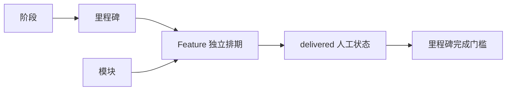

# M03 项目结构与首页 — 当前实现规则稿

## 需求范围

本章覆盖下列完整业务组及公开入口变体。代码是当前行为证据，测试只标defined，所有验收计划not_run。没有业务批准或运行成功声明；全项目共享档案另行汇总。

## 来源与导航身份

项目=19Q4K7PDARXQ9JHW6R6F；仓库=P1KRPDABN4RD0YXMX64E；namespace=source-04d73353-be80-4433-8c5e-0b49a9c12c63；Skill=2.2.0。

run=NSG3TKRB16Y9F6Y203WB；kind=draft（显式工作区草稿，提交仅是基底）；snapshot=06376ab6287ee2d55caa79fc34257896e53ad0577a2b678947888024834468fa；commit=92728fbec04cfa34fee4421cb0a9319d1b755164。

源码manifest=0725fd3bb7867a6d7bba008b6af001c70f66b3c1dbf296b59ad95172eec6bdb9；企业包混合输入manifest=c832ac2345121f95b5f5d83da6275c79610bc4023b829568ee1ceeb2fadf307e；UA/CG artifact=691ab67f0c3a41a5bce1e59ca5ae83d99044ddfbfc5e026afb92183e681615c8。

ua engine=2.9.8, adapter=1.0.0, protocol=1, digest=d22a4a731809299030ee783710407af1e4ce37d5f1930345cb1d4b6a8cfb39a5。

codegraph engine=1.6.2, adapter=1.0.0, protocol=1, digest=c7ce675c6c763726449fccb22159735859ad17eccbce1475c9617287479bf8da。

knowledge handoff scope={"offset":0,"limit":100,"total_nodes":12043,"included_nodes":100,"truncated":true,"complete_repository_analysis":false}；裁剪结果不能建立缺失行为结论。

导航覆盖：codegraph analyzed_files=471/675；此数不是业务覆盖率。

导航覆盖：ua analyzed_files=675/675；此数不是业务覆盖率。

已实际查询固定run的UA overview/search(identity)/relations(requirements-specification)，以及native codegraph context/search。UA业务域/flow与codegraph边只作导航；BR源码证据的路径、SHA-256及真实1基行范围如下。

code callers首次使用native返回function:ID被CLI拒绝，后续以协议cg:前缀重试；查询结果保存在本地discovery记录。

context.bindings仅用于身份：权限Feature与首页Feature/REQ复用已有key及原父模块；既有目标正文不作为本次业务事实来源。

## 目的、角色与接口边界

- REQ-GOV-MODULE-CATALOG 功能模块目录、归档门槛与排序：项目成员可读；Owner/Admin管理；触发=列出、新建、更新或重排模块；平台模块=tsp-module-collaboration，Feature=GOV-M03-MODULES，文档=GOV-M03-RULES。
- REQ-GOV-FEATURE-ORGANIZATION Feature归属、交付标记与完整排序：项目成员读取；Owner/Admin创建或更新；触发=列出、读取、创建、更新及重排Feature；平台模块=tsp-module-collaboration，Feature=GOV-M03-FEATURES，文档=GOV-M03-RULES。
- REQ-GOV-FEATURE-SCHEDULE Feature排期必须完整落在里程碑窗口：项目Owner/Admin；触发=创建或更新带日期Feature；平台模块=tsp-module-collaboration，Feature=GOV-M03-FEATURES，文档=GOV-M03-RULES。
- REQ-GOV-PHASE-SCHEDULE 阶段创建、日期与维护：项目成员读取；Owner/Admin维护；触发=列出、新建或更新阶段；平台模块=tsp-module-collaboration，Feature=GOV-M03-SCHEDULE，文档=GOV-M03-RULES。
- REQ-GOV-MILESTONE-DELIVERY 里程碑负责人、交付门槛、窗口与汇总：项目成员读取；Owner/Admin管理；触发=创建、更新或读取里程碑；平台模块=tsp-module-collaboration，Feature=GOV-M03-SCHEDULE，文档=GOV-M03-RULES。
- tsp-req-home-binding 首页说明/参与指引与规范汇总：项目成员读取；Owner/Admin配置首页；触发=读取或更新项目首页文档关联；平台模块=tsp-module-documents，Feature=tsp-feature-project-home，文档=tsp-doc-documents。

## 实体、状态与流程

图只帮助阅读，不替代下文完整转换/分支。

## 业务规则

| BR ID | 条件 | 判定/结果及副作用或保持状态 | 例外/限制 | 来源 | 测试断言 |
| --- | --- | --- | --- | --- | --- |

| BR-GOV-MODULE-CATALOG-CATALOG | 项目Owner/Admin创建或修改模块，成员读取 | 合法模块按sort_order/id出现，未提供顺序追加；普通Member/Viewer写入project_forbidden。 | 模块创建可直接给archived；检查归档Feature门槛在update路径，不推广为所有创建均受同门槛。 | E1, E2 | AC-GOV-MODULE-CATALOG-CATALOG：合法模块按sort_order/id出现，未提供顺序追加；普通Member/Viewer写入project_forbidden。 |

| BR-GOV-MODULE-CATALOG-ARCHIVE | 目标模块仍关联非archived Feature | module_has_active_features，模块保持原状态；所有关联Feature归档或移出后新请求可归档。 | 模块创建可直接给archived；检查归档Feature门槛在update路径，不推广为所有创建均受同门槛。 | E3 | AC-GOV-MODULE-CATALOG-ARCHIVE：module_has_active_features，模块保持原状态；所有关联Feature归档或移出后新请求可归档。 |

| BR-GOV-MODULE-CATALOG-ORDER | 管理者提交模块完整无重复集合 | 顺序持久化；重复/遗漏/外项目编码module_order_invalid，原顺序保持。 | 模块创建可直接给archived；检查归档Feature门槛在update路径，不推广为所有创建均受同门槛。 | E4 | AC-GOV-MODULE-CATALOG-ORDER：顺序持久化；重复/遗漏/外项目编码module_order_invalid，原顺序保持。 |

| BR-GOV-FEATURE-ORGANIZATION-CREATE | 管理者提交有效标题及同项目模块/里程碑 | Feature以给定状态或默认active建立；Member不可创建；不存在或外项目关联分别module_not_found/milestone_not_found。 | Feature delivered是人工状态标记，里程碑完成仅消费此状态；未证实代表实际交付完成。 | E5, E6 | AC-GOV-FEATURE-ORGANIZATION-CREATE：Feature以给定状态或默认active建立；Member不可创建；不存在或外项目关联分别module_not_found/milestone_not_found。 |

| BR-GOV-FEATURE-ORGANIZATION-UPDATE | 管理者更新或解除归属并标记delivered/archived | 指定字段更新，未给字段保留；null解除归属；当前实现可直接标记delivered，不附加任务完成证明。 | Feature delivered是人工状态标记，里程碑完成仅消费此状态；未证实代表实际交付完成。 | E7 | AC-GOV-FEATURE-ORGANIZATION-UPDATE：指定字段更新，未给字段保留；null解除归属；当前实现可直接标记delivered，不附加任务完成证明。 |

| BR-GOV-FEATURE-ORGANIZATION-ORDER | 项目全部Feature编码无重复重排 | 按指定顺序返回；遗漏/重复/外项目编码feature_order_invalid，拒绝时顺序保持。 | Feature delivered是人工状态标记，里程碑完成仅消费此状态；未证实代表实际交付完成。 | E8 | AC-GOV-FEATURE-ORGANIZATION-ORDER：按指定顺序返回；遗漏/重复/外项目编码feature_order_invalid，拒绝时顺序保持。 |

| BR-GOV-FEATURE-SCHEDULE-IN | Feature完整起止日期位于完整里程碑窗口内 | 成功保存；等于窗口两端和同日范围允许。 | 适用角色、初态与失败保持字段见本条AC计划；无跨用例隐式依赖。 | E9, E10 | AC-GOV-FEATURE-SCHEDULE-IN：成功保存；等于窗口两端和同日范围允许。 |

| BR-GOV-FEATURE-SCHEDULE-DENIED | 日期非法/单边、无里程碑、里程碑窗口不全或越界 | 分别schedule_date_invalid/feature_schedule_incomplete/feature_schedule_requires_milestone/feature_milestone_schedule_required/feature_schedule_outside_milestone，原Feature不变。 | 适用角色、初态与失败保持字段见本条AC计划；无跨用例隐式依赖。 | E9, E11 | AC-GOV-FEATURE-SCHEDULE-DENIED：分别schedule_date_invalid/feature_schedule_incomplete/feature_schedule_requires_milestone/feature_milestone_schedule_required/feature_schedule_outside_milestone，原Feature不变。 |

| BR-GOV-PHASE-SCHEDULE-CREATE-EDIT | 管理者维护合法阶段信息 | 阶段默认planned，可保存单边日期；成员读到持久化信息，普通Member不可修改。 | 阶段与里程碑日期包含关系没有本模块实现检查；不声称全项目进度层级自动同步。 | E12 | AC-GOV-PHASE-SCHEDULE-CREATE-EDIT：阶段默认planned，可保存单边日期；成员读到持久化信息，普通Member不可修改。 |

| BR-GOV-PHASE-SCHEDULE-DATE | 非空非法日期或双日期逆序 | schedule_date_invalid或phase_date_range_invalid，阶段原值不变；合法null清空允许。 | 阶段与里程碑日期包含关系没有本模块实现检查；不声称全项目进度层级自动同步。 | E13, E14 | AC-GOV-PHASE-SCHEDULE-DATE：schedule_date_invalid或phase_date_range_invalid，阶段原值不变；合法null清空允许。 |

| BR-GOV-MILESTONE-DELIVERY-CREATE | 管理者以同项目阶段创建非completed里程碑 | 保存planned默认与窗口；viewer负责人被milestone_owner_invalid拒绝；直接completed被milestone_completion_blocked拒绝。 | 未知编码的宽松fallback可能是缺陷，本文记录当前实现，不视作已批准业务政策。 | E15 | AC-GOV-MILESTONE-DELIVERY-CREATE：保存planned默认与窗口；viewer负责人被milestone_owner_invalid拒绝；直接completed被milestone_completion_blocked拒绝。 |

| BR-GOV-MILESTONE-DELIVERY-COMPLETE | 从planned/active转completed | 没有非archived Feature或存在active Feature时拒绝；至少一个非archived且全部delivered时成功，archived Feature不阻塞该门槛。 | 未知编码的宽松fallback可能是缺陷，本文记录当前实现，不视作已批准业务政策。 | E16 | AC-GOV-MILESTONE-DELIVERY-COMPLETE：没有非archived Feature或存在active Feature时拒绝；至少一个非archived且全部delivered时成功，archived Feature不阻塞该门槛。 |

| BR-GOV-MILESTONE-DELIVERY-WINDOW | 缩窄或清空里程碑窗口会排除已排期Feature | milestone_feature_schedule_conflict并返回冲突Feature/窗口；里程碑未改变。 | 未知编码的宽松fallback可能是缺陷，本文记录当前实现，不视作已批准业务政策。 | E17 | AC-GOV-MILESTONE-DELIVERY-WINDOW：milestone_feature_schedule_conflict并返回冲突Feature/窗口；里程碑未改变。 |

| BR-GOV-MILESTONE-DELIVERY-COUNTS | 读取里程碑含active/delivered/archived Feature及不同任务状态 | feature_count含全部，delivered_feature_count仅delivered；task_total含全部任务，closed_task_count仅closed。 | 未知编码的宽松fallback可能是缺陷，本文记录当前实现，不视作已批准业务政策。 | E18 | AC-GOV-MILESTONE-DELIVERY-COUNTS：feature_count含全部，delivered_feature_count仅delivered；task_total含全部任务，closed_task_count仅closed。 |

| BR-GOV-MILESTONE-DELIVERY-LOOKUP | 提交未知负责人或update未知阶段编码 | create未知负责人变null；update未知负责人清空，未知阶段回退原阶段；与找到的跨项目阶段拒绝相区分。 | 未知编码的宽松fallback可能是缺陷，本文记录当前实现，不视作已批准业务政策。 | E19, E20, E21 | AC-GOV-MILESTONE-DELIVERY-LOOKUP：create未知负责人变null；update未知负责人清空，未知阶段回退原阶段；与找到的跨项目阶段拒绝相区分。 |

| BR-GOV-PROJECT-HOME-BIND | 管理者绑定同项目overview系统目录中的active文档 | 首页返回其完整content/revision；null解除overview但guide及文档记录保留。 | 规范排序和目录递归细节由文档模块定义；这里只引用collectProjectStandardsDocuments，不重复承诺其规则。 | E22, E23 | AC-GOV-PROJECT-HOME-BIND：首页返回其完整content/revision；null解除overview但guide及文档记录保留。 |

| BR-GOV-PROJECT-HOME-DENIED | 非管理者、archived项目、外项目/archived/错误目录文档或standards_document_code | 分别权限/归档/文档范围或目录错误/规范受管理错误；原home关联不变。 | 规范排序和目录递归细节由文档模块定义；这里只引用collectProjectStandardsDocuments，不重复承诺其规则。 | E24, E25 | AC-GOV-PROJECT-HOME-DENIED：分别权限/归档/文档范围或目录错误/规范受管理错误；原home关联不变。 |

## 功能需求

以下字段与结构化JSON同源生成，避免文档与需求对权限、拒绝/忽略、状态和数据变化表达相反结论。

### REQ-GOV-MODULE-CATALOG 功能模块目录、归档门槛与排序

主流程：

1. 成员按sort_order/id升序读取模块。
2. 管理者以非空名建立active/archived模块，未给sortOrder时追加到最大顺序之后。
3. 管理者修改或归档模块；归档前排除未归档Feature；重排必须提交全部编码。

数据与配置：

- 模块code稳定；name非空，description空白/null归一null；status active/archived。
- 模块完整排序更新sort_order及updated_at；归档不删除模块或已归档Feature。

状态/一致性边界：

- create写模块与审计同事务；update先更新再在事务外写审计，不能把所有变更描述为原子。
- 归档被active/delivered Feature阻塞时模块status不变。

### REQ-GOV-FEATURE-ORGANIZATION Feature归属、交付标记与完整排序

主流程：

1. 管理者创建非空标题Feature，可选同项目module/milestone，默认active。
2. 成员读取编码、模块/里程碑名称与目标、排期、状态。
3. 更新可用null解除module/milestone；重排提交项目全部Feature。

数据与配置：

- name优先于title兼容字段；goal空白/null归一null；status active/delivered/archived。
- Feature创建默认追加sort_order；list按sort_order/id升序；没有在此函数检查delivered必须任务全关闭。

状态/一致性边界：

- Feature创建及审计同事务；update直接更新后审计，保留code。
- 完整排序事务更新sort_order；关系越项目拒绝不写入。

### REQ-GOV-FEATURE-SCHEDULE Feature排期必须完整落在里程碑窗口

主流程：

1. 规范化YYYY-MM-DD日期并排除非法日历日期。
2. 任一日期存在时必须start/end齐全、start≤end且绑定日期完整的里程碑。
3. 检查Feature区间包含在里程碑[start,target]，失败保持原排期。

数据与配置：

- 无日期时允许不绑定milestone；有任一日期时不能只清空里程碑。
- 相同起止日与正好等于里程碑边界允许；日历日期按UTC校验，不推导时区时刻。

状态/一致性边界：

- 成功写start_date/end_date及milestone_id；失败不更新Feature。

### REQ-GOV-PHASE-SCHEDULE 阶段创建、日期与维护

主流程：

1. 成员按sort_order/id读取阶段。
2. 管理者创建非空阶段名及可选goal/start/end，默认planned和sort_order=0。
3. 更新未给字段保留，给null日期清空；若双日期存在要求end≥start。

数据与配置：

- phase status planned/active/completed/archived按HTTP入口允许值；单边日期在阶段允许，不能套用Feature双日期门槛。
- 阶段goal空值归一null；阶段日期变化未检查其下里程碑是否仍在区间。

状态/一致性边界：

- 直接插入/更新阶段后单独写审计，不能承诺审计失败整体回滚。

### REQ-GOV-MILESTONE-DELIVERY 里程碑负责人、交付门槛、窗口与汇总

主流程：

1. 选择同项目阶段、非空名、可选可写项目成员负责人和合法窗口。
2. 创建不能直接completed；更新进入completed要求至少一个非archived Feature且全部delivered。
3. 调整窗口不能排除任何已排期Feature；读取统计Feature数/delivered数/任务总数/closed数。

数据与配置：

- status planned/active/at_risk/completed/cancelled；创建缺负责人/未知负责人编码目前落为null，已找到的viewer负责人拒绝。
- update中未知phaseCode会回退existingPhase；未知ownerCode会清空owner；这些是观察到的宽松分支，需要保留为缺口。
- 汇总feature_count计全部（包括archived），delivered_feature_count只status=delivered；任务closed只计closed。

状态/一致性边界：

- update里程碑与审计同事务；create插入后审计在事务外。
- 完成门槛只在从非completed转completed检查，不保证后续Feature改动自动重开。

### tsp-req-home-binding 首页说明/参与指引与规范汇总

主流程：

1. 读取时确保固定说明/规范目录，返回overview/guide及规范集合。
2. 管理者只绑定当前项目active且位于overview系统目录的说明/指引文档。
3. null解除一个角色关联，未给字段保持；规范从固定规范目录汇总，不接受单一standards_document_code绑定。

数据与配置：

- bindings必须非空对象，仅overview_document_code/guide_document_code；值为20位public code或null。
- 首页can_edit仅active项目管理者；文档can_edit还允许非viewer创建人，按当前project文档规则。

状态/一致性边界：

- 首页更新关联与审计同事务；GET可能初始化缺失系统目录。
- 归档文档不出现在active首页文档查询中；解除关联不删除文档。

异常与边界处理（与结构化specification.exceptions一致，复用下方既有BR/AC/TC矩阵）：

- 条件：bindings含standards_document_code，或为空对象、含未知字段、值不是有效public code/null。
  处理：分别返回project_home_standards_managed或project_home_invalid，不写首页关联；规范仍由固定规范目录汇总（BR-GOV-PROJECT-HOME-DENIED / AC-GOV-PROJECT-HOME-DENIED及bindings数据合同）。
- 条件：有效项目普通成员配置首页，或Owner/Admin在archived项目配置首页。
  处理：分别返回project_home_forbidden或project_archived，原overview/guide关联及文档保持（BR-GOV-PROJECT-HOME-DENIED / AC-GOV-PROJECT-HOME-DENIED）。
- 条件：所选文档不属于当前项目或不存在、文档已archived，或不在overview系统目录。
  处理：分别返回project_home_document_invalid、project_home_document_archived或project_home_document_folder_invalid；整个关联事务回滚，保留原有首页绑定（BR-GOV-PROJECT-HOME-DENIED / AC-GOV-PROJECT-HOME-DENIED）。

## 权限边界

按每条规则的actor和前置数据建立当前有效权限。Owner与Admin的差别按源码条件保留；旧文案“只有Owner”不能覆盖isProjectManager实际允许Admin的路径。Viewer可读能力不自动获得write/manage。源自其他业务模块的流程只引用不重复执行。

## 异常与边界

成功、权限拒绝、输入错误、版本/状态门槛和恢复见下列独立计划。未实现的控制不补写为既定政策：

- REQ-GOV-MODULE-CATALOG：模块创建可直接给archived；检查归档Feature门槛在update路径，不推广为所有创建均受同门槛。
- REQ-GOV-FEATURE-ORGANIZATION：Feature delivered是人工状态标记，里程碑完成仅消费此状态；未证实代表实际交付完成。
- REQ-GOV-FEATURE-ORGANIZATION：Feature HTTP入口与CLI别名在surface清单补充定位，核心规则以应用层检查为准。
- REQ-GOV-PHASE-SCHEDULE：阶段与里程碑日期包含关系没有本模块实现检查；不声称全项目进度层级自动同步。
- REQ-GOV-MILESTONE-DELIVERY：未知编码的宽松fallback可能是缺陷，本文记录当前实现，不视作已批准业务政策。
- REQ-GOV-MILESTONE-DELIVERY：完成后的Feature再改active是否应自动重开里程碑无代码机制/决策；未提出为既定规则。
- tsp-req-home-binding：规范排序和目录递归细节由文档模块定义；这里只引用collectProjectStandardsDocuments，不重复承诺其规则。

## 验收场景与可复现计划

每个用例使用独立隔离数据并在开始前恢复所述初始状态；账号有效且已完成初始密码修改，除非该用例明确测试初始密码。认证使用该角色自己的有效Bearer会话；浏览器用例使用自身Cookie/Origin/CSRF。保存创建操作真实返回的编码，不硬编码生产数据。时钟采用UTC并记录起始时间；仅在有效期/锁定场景控制时钟。所有步骤为待执行计划。

### TC-GOV-MODULE-CATALOG-CATALOG → AC-GOV-MODULE-CATALOG-CATALOG

角色=项目成员可读；Owner/Admin管理；独立初态=active P含Owner O、Admin A、Member M、Viewer V和模块X sort_order=3。

1. A POST modules name="新模块"；GET modules核对追加。
2. M/V分别创建和更新模块；读取原记录。

可观察结果=合法模块按sort_order/id出现，未提供顺序追加；普通Member/Viewer写入project_forbidden。

执行状态=not_run；优先级=P1（分析建议，未测量风险）。

### TC-GOV-MODULE-CATALOG-ARCHIVE → AC-GOV-MODULE-CATALOG-ARCHIVE

角色=项目成员可读；Owner/Admin管理；独立初态=active P模块X含active F及archived F2；Owner O。

1. O PATCH /modules/X status=archived；记录拒绝。
2. O将F移出X或归档，再请求归档X并GET目录。

可观察结果=module_has_active_features，模块保持原状态；所有关联Feature归档或移出后新请求可归档。

执行状态=not_run；优先级=P1（分析建议，未测量风险）。

### TC-GOV-MODULE-CATALOG-ORDER → AC-GOV-MODULE-CATALOG-ORDER

角色=项目成员可读；Owner/Admin管理；独立初态=P恰有X/Y；另一P2有Z；每个非法分支独立复位。

1. PUT modules/order [Y,X]后GET。
2. 分别提交[X]、[X,X]、[X,Z]后GET。

可观察结果=顺序持久化；重复/遗漏/外项目编码module_order_invalid，原顺序保持。

执行状态=not_run；优先级=P1（分析建议，未测量风险）。

### TC-GOV-FEATURE-ORGANIZATION-CREATE → AC-GOV-FEATURE-ORGANIZATION-CREATE

角色=项目成员读取；Owner/Admin创建或更新；独立初态=active P有O/A/M及模块X、里程碑K；另一项目有X2/K2。

1. A POST Feature使用name及title不同值，核对name优先。
2. 独立M创建；O用X2或K2创建。

可观察结果=Feature以给定状态或默认active建立；Member不可创建；不存在或外项目关联分别module_not_found/milestone_not_found。

执行状态=not_run；优先级=P1（分析建议，未测量风险）。

### TC-GOV-FEATURE-ORGANIZATION-UPDATE → AC-GOV-FEATURE-ORGANIZATION-UPDATE

角色=项目成员读取；Owner/Admin创建或更新；独立初态=P的F无排期，关联X/K且有未关闭任务；O管理者。

1. O PATCH F module_code=null,milestone_code=null,status=delivered；GET F核对字段与关联任务。
2. Member尝试同样修改。

可观察结果=指定字段更新，未给字段保留；null解除归属；当前实现可直接标记delivered，不附加任务完成证明。

执行状态=not_run；优先级=P1（分析建议，未测量风险）。

### TC-GOV-FEATURE-ORGANIZATION-ORDER → AC-GOV-FEATURE-ORGANIZATION-ORDER

角色=项目成员读取；Owner/Admin创建或更新；独立初态=P恰有F1/F2；P2有F3；O有效。

1. PUT Feature排序[F2,F1]；GET。
2. 逐一独立复位提交[F1]、[F1,F1]、[F1,F3]。

可观察结果=按指定顺序返回；遗漏/重复/外项目编码feature_order_invalid，拒绝时顺序保持。

执行状态=not_run；优先级=P1（分析建议，未测量风险）。

### TC-GOV-FEATURE-SCHEDULE-IN → AC-GOV-FEATURE-SCHEDULE-IN

角色=项目Owner/Admin；独立初态=active P/K start=2026-11-01,target=2026-11-30；O；F无排期。

1. PATCH F milestone_code=K,start_date=2026-11-01,end_date=2026-11-30；GET确认。
2. 独立复位测试start=end=2026-11-10。

可观察结果=成功保存；等于窗口两端和同日范围允许。

执行状态=not_run；优先级=P1（分析建议，未测量风险）。

### TC-GOV-FEATURE-SCHEDULE-DENIED → AC-GOV-FEATURE-SCHEDULE-DENIED

角色=项目Owner/Admin；独立初态=每个变体独立恢复F初态；完整K、缺日期K2各属于P；O。

1. 依次独立提交2026-02-30、仅start、带完整日期但无K、用K2、超出K target。
2. 另测end早于start返回feature_date_range_invalid。

可观察结果=分别schedule_date_invalid/feature_schedule_incomplete/feature_schedule_requires_milestone/feature_milestone_schedule_required/feature_schedule_outside_milestone，原Feature不变。

执行状态=not_run；优先级=P1（分析建议，未测量风险）。

### TC-GOV-PHASE-SCHEDULE-CREATE-EDIT → AC-GOV-PHASE-SCHEDULE-CREATE-EDIT

角色=项目成员读取；Owner/Admin维护；独立初态=active P；O/A管理者、M member；无同名假设。

1. A POST phases name="交付阶段",start_date=2026-11-01；GET。
2. A PATCH阶段增加end_date=2026-11-30；M尝试修改。

可观察结果=阶段默认planned，可保存单边日期；成员读到持久化信息，普通Member不可修改。

执行状态=not_run；优先级=P1（分析建议，未测量风险）。

### TC-GOV-PHASE-SCHEDULE-DATE → AC-GOV-PHASE-SCHEDULE-DATE

角色=项目成员读取；Owner/Admin维护；独立初态=P阶段Q start=2026-11-01,end=2026-11-30；O；每个变体复位。

1. PATCH Q end_date=2026-02-30；另测end_date=2026-10-01。
2. 独立PATCH Q start_date=null并核对end保留。

可观察结果=schedule_date_invalid或phase_date_range_invalid，阶段原值不变；合法null清空允许。

执行状态=not_run；优先级=P1（分析建议，未测量风险）。

### TC-GOV-MILESTONE-DELIVERY-CREATE → AC-GOV-MILESTONE-DELIVERY-CREATE

角色=项目成员读取；Owner/Admin管理；独立初态=active P含Q阶段、writer U、viewer V；O。

1. POST milestones phase_code=Q,name="版本",owner_principal_code=U；读取。
2. 独立使用V或status=completed创建。

可观察结果=保存planned默认与窗口；viewer负责人被milestone_owner_invalid拒绝；直接completed被milestone_completion_blocked拒绝。

执行状态=not_run；优先级=P1（分析建议，未测量风险）。

### TC-GOV-MILESTONE-DELIVERY-COMPLETE → AC-GOV-MILESTONE-DELIVERY-COMPLETE

角色=项目成员读取；Owner/Admin管理；独立初态=三个独立K：空、含active F、含delivered F与archived F2；O。

1. 分别PATCH各K status=completed；GET里程碑与Feature状态。

可观察结果=没有非archived Feature或存在active Feature时拒绝；至少一个非archived且全部delivered时成功，archived Feature不阻塞该门槛。

执行状态=not_run；优先级=P1（分析建议，未测量风险）。

### TC-GOV-MILESTONE-DELIVERY-WINDOW → AC-GOV-MILESTONE-DELIVERY-WINDOW

角色=项目成员读取；Owner/Admin管理；独立初态=K窗口11月1至30，F已安排11月10至20；O。

1. 独立PATCH K target_date=2026-11-15；另测清start_date；每次GET验证原窗口。

可观察结果=milestone_feature_schedule_conflict并返回冲突Feature/窗口；里程碑未改变。

执行状态=not_run；优先级=P1（分析建议，未测量风险）。

### TC-GOV-MILESTONE-DELIVERY-COUNTS → AC-GOV-MILESTONE-DELIVERY-COUNTS

角色=项目成员读取；Owner/Admin管理；独立初态=隔离K有三类Feature各1，分别关联closed/failed/cancelled任务各1；项目成员M。

1. GET milestones，核对feature_count=3、delivered_feature_count=1、task_total=3、closed_task_count=1。

可观察结果=feature_count含全部，delivered_feature_count仅delivered；task_total含全部任务，closed_task_count仅closed。

执行状态=not_run；优先级=P1（分析建议，未测量风险）。

### TC-GOV-MILESTONE-DELIVERY-LOOKUP → AC-GOV-MILESTONE-DELIVERY-LOOKUP

角色=项目成员读取；Owner/Admin管理；独立初态=K已有phase Q与owner U；未知编码Z无对应记录；另项目Q2；O。

1. 独立PATCH K phase_code=Z并读取阶段仍Q。
2. 复位PATCH owner_principal_code=Z并读取owner=null；另用Q2验证拒绝。

可观察结果=create未知负责人变null；update未知负责人清空，未知阶段回退原阶段；与找到的跨项目阶段拒绝相区分。

执行状态=not_run；优先级=P1（分析建议，未测量风险）。

### TC-GOV-PROJECT-HOME-BIND → AC-GOV-PROJECT-HOME-BIND

角色=项目成员读取；Owner/Admin配置首页；独立初态=active P，O管理者、M成员；overview目录有active D/G。

1. O PUT home overview_document_code=D,guide_document_code=G；M GET。
2. O PUT overview_document_code=null，再GET及读取D。

可观察结果=首页返回其完整content/revision；null解除overview但guide及文档记录保留。

执行状态=not_run；优先级=P1（分析建议，未测量风险）。

### TC-GOV-PROJECT-HOME-DENIED → AC-GOV-PROJECT-HOME-DENIED

角色=项目成员读取；Owner/Admin配置首页；独立初态=每次独立复位P home=D；准备外项目D2、归档D3、普通目录D4及M member。

1. M更新home；O分别绑定D2/D3/D4或传standards_document_code；读取home仍D。
2. 独立归档P后O更新。

可观察结果=分别权限/归档/文档范围或目录错误/规范受管理错误；原home关联不变。

执行状态=not_run；优先级=P1（分析建议，未测量风险）。

## 追溯：BR → REQ / AC / 测试矩阵

| BR | REQ | AC | Case | 执行 |
| --- | --- | --- | --- | --- |

| BR-GOV-MODULE-CATALOG-CATALOG | REQ-GOV-MODULE-CATALOG | AC-GOV-MODULE-CATALOG-CATALOG | TC-GOV-MODULE-CATALOG-CATALOG | not_run |

| BR-GOV-MODULE-CATALOG-ARCHIVE | REQ-GOV-MODULE-CATALOG | AC-GOV-MODULE-CATALOG-ARCHIVE | TC-GOV-MODULE-CATALOG-ARCHIVE | not_run |

| BR-GOV-MODULE-CATALOG-ORDER | REQ-GOV-MODULE-CATALOG | AC-GOV-MODULE-CATALOG-ORDER | TC-GOV-MODULE-CATALOG-ORDER | not_run |

| BR-GOV-FEATURE-ORGANIZATION-CREATE | REQ-GOV-FEATURE-ORGANIZATION | AC-GOV-FEATURE-ORGANIZATION-CREATE | TC-GOV-FEATURE-ORGANIZATION-CREATE | not_run |

| BR-GOV-FEATURE-ORGANIZATION-UPDATE | REQ-GOV-FEATURE-ORGANIZATION | AC-GOV-FEATURE-ORGANIZATION-UPDATE | TC-GOV-FEATURE-ORGANIZATION-UPDATE | not_run |

| BR-GOV-FEATURE-ORGANIZATION-ORDER | REQ-GOV-FEATURE-ORGANIZATION | AC-GOV-FEATURE-ORGANIZATION-ORDER | TC-GOV-FEATURE-ORGANIZATION-ORDER | not_run |

| BR-GOV-FEATURE-SCHEDULE-IN | REQ-GOV-FEATURE-SCHEDULE | AC-GOV-FEATURE-SCHEDULE-IN | TC-GOV-FEATURE-SCHEDULE-IN | not_run |

| BR-GOV-FEATURE-SCHEDULE-DENIED | REQ-GOV-FEATURE-SCHEDULE | AC-GOV-FEATURE-SCHEDULE-DENIED | TC-GOV-FEATURE-SCHEDULE-DENIED | not_run |

| BR-GOV-PHASE-SCHEDULE-CREATE-EDIT | REQ-GOV-PHASE-SCHEDULE | AC-GOV-PHASE-SCHEDULE-CREATE-EDIT | TC-GOV-PHASE-SCHEDULE-CREATE-EDIT | not_run |

| BR-GOV-PHASE-SCHEDULE-DATE | REQ-GOV-PHASE-SCHEDULE | AC-GOV-PHASE-SCHEDULE-DATE | TC-GOV-PHASE-SCHEDULE-DATE | not_run |

| BR-GOV-MILESTONE-DELIVERY-CREATE | REQ-GOV-MILESTONE-DELIVERY | AC-GOV-MILESTONE-DELIVERY-CREATE | TC-GOV-MILESTONE-DELIVERY-CREATE | not_run |

| BR-GOV-MILESTONE-DELIVERY-COMPLETE | REQ-GOV-MILESTONE-DELIVERY | AC-GOV-MILESTONE-DELIVERY-COMPLETE | TC-GOV-MILESTONE-DELIVERY-COMPLETE | not_run |

| BR-GOV-MILESTONE-DELIVERY-WINDOW | REQ-GOV-MILESTONE-DELIVERY | AC-GOV-MILESTONE-DELIVERY-WINDOW | TC-GOV-MILESTONE-DELIVERY-WINDOW | not_run |

| BR-GOV-MILESTONE-DELIVERY-COUNTS | REQ-GOV-MILESTONE-DELIVERY | AC-GOV-MILESTONE-DELIVERY-COUNTS | TC-GOV-MILESTONE-DELIVERY-COUNTS | not_run |

| BR-GOV-MILESTONE-DELIVERY-LOOKUP | REQ-GOV-MILESTONE-DELIVERY | AC-GOV-MILESTONE-DELIVERY-LOOKUP | TC-GOV-MILESTONE-DELIVERY-LOOKUP | not_run |

| BR-GOV-PROJECT-HOME-BIND | tsp-req-home-binding | AC-GOV-PROJECT-HOME-BIND | TC-GOV-PROJECT-HOME-BIND | not_run |

| BR-GOV-PROJECT-HOME-DENIED | tsp-req-home-binding | AC-GOV-PROJECT-HOME-DENIED | TC-GOV-PROJECT-HOME-DENIED | not_run |

## 捕获源码证据

| 证据 | 文件及行 | SHA-256 |
| --- | --- | --- |

| E1 | packages/application/src/project-structure-use-cases.ts L146-177 | 040c7dd7545c9f17a8fabfb1dc7b0f7fd2faa843a1f38ff4496f3175f54ffd13 |

| E2 | packages/application/src/intake-entity-writers.ts L23-33 | bd7a3c4d153178187225424bb36431d1ecdfea83b39dd7574d8191719bfca696 |

| E3 | packages/application/src/project-structure-use-cases.ts L214-255 | 040c7dd7545c9f17a8fabfb1dc7b0f7fd2faa843a1f38ff4496f3175f54ffd13 |

| E4 | packages/application/src/project-structure-use-cases.ts L183-208 | 040c7dd7545c9f17a8fabfb1dc7b0f7fd2faa843a1f38ff4496f3175f54ffd13 |

| E5 | packages/application/src/project-use-cases.ts L90-138 | e4f37f3c9959b89aeb81640add6a7d576625c143acb140022c6d7447534386a6 |

| E6 | packages/application/src/intake-entity-writers.ts L35-47 | bd7a3c4d153178187225424bb36431d1ecdfea83b39dd7574d8191719bfca696 |

| E7 | packages/application/src/project-use-cases.ts L248-345 | e4f37f3c9959b89aeb81640add6a7d576625c143acb140022c6d7447534386a6 |

| E8 | packages/application/src/project-use-cases.ts L144-208 | e4f37f3c9959b89aeb81640add6a7d576625c143acb140022c6d7447534386a6 |

| E9 | packages/application/src/schedule.ts L5-53 | d912cc968b02cf3e40836d0286cca858aba342d7cc266a74211237d945b7de8e |

| E10 | packages/application/src/project-use-cases.ts L307-325 | e4f37f3c9959b89aeb81640add6a7d576625c143acb140022c6d7447534386a6 |

| E11 | packages/application/src/project-use-cases.ts L313-325 | e4f37f3c9959b89aeb81640add6a7d576625c143acb140022c6d7447534386a6 |

| E12 | packages/application/src/project-structure-use-cases.ts L262-365 | 040c7dd7545c9f17a8fabfb1dc7b0f7fd2faa843a1f38ff4496f3175f54ffd13 |

| E13 | packages/application/src/schedule.ts L5-21 | d912cc968b02cf3e40836d0286cca858aba342d7cc266a74211237d945b7de8e |

| E14 | packages/application/src/project-structure-use-cases.ts L325-365 | 040c7dd7545c9f17a8fabfb1dc7b0f7fd2faa843a1f38ff4496f3175f54ffd13 |

| E15 | packages/application/src/project-structure-use-cases.ts L426-501 | 040c7dd7545c9f17a8fabfb1dc7b0f7fd2faa843a1f38ff4496f3175f54ffd13 |

| E16 | packages/application/src/project-structure-use-cases.ts L546-557 | 040c7dd7545c9f17a8fabfb1dc7b0f7fd2faa843a1f38ff4496f3175f54ffd13 |

| E17 | packages/application/src/project-structure-use-cases.ts L543-576 | 040c7dd7545c9f17a8fabfb1dc7b0f7fd2faa843a1f38ff4496f3175f54ffd13 |

| E18 | packages/application/src/project-structure-use-cases.ts L371-419 | 040c7dd7545c9f17a8fabfb1dc7b0f7fd2faa843a1f38ff4496f3175f54ffd13 |

| E19 | packages/application/src/project-structure-use-cases.ts L444-478 | 040c7dd7545c9f17a8fabfb1dc7b0f7fd2faa843a1f38ff4496f3175f54ffd13 |

| E20 | packages/application/src/project-structure-use-cases.ts L524-539 | 040c7dd7545c9f17a8fabfb1dc7b0f7fd2faa843a1f38ff4496f3175f54ffd13 |

| E21 | packages/application/src/project-structure-use-cases.ts L588-590 | 040c7dd7545c9f17a8fabfb1dc7b0f7fd2faa843a1f38ff4496f3175f54ffd13 |

| E22 | packages/application/src/project-home-use-cases.ts L40-68 | 115a7340fb479c30adf8714f8361c35e7ca21ca7d42329a85e727afdb6a41836 |

| E23 | packages/application/src/project-home-use-cases.ts L87-126 | 115a7340fb479c30adf8714f8361c35e7ca21ca7d42329a85e727afdb6a41836 |

| E24 | packages/application/src/project-home-use-cases.ts L40-48 | 115a7340fb479c30adf8714f8361c35e7ca21ca7d42329a85e727afdb6a41836 |

| E25 | packages/application/src/project-home-use-cases.ts L93-124 | 115a7340fb479c30adf8714f8361c35e7ca21ca7d42329a85e727afdb6a41836 |

## 已有测试定义与未验证项

本章保留未来验证计划；没有把不存在的测试路径或运行结果写入候选。

基于固定源码的现状观察，未执行业务/验收测试、未验证部署配置或外部系统、未取得业务批准；verification_plan全部待执行。
