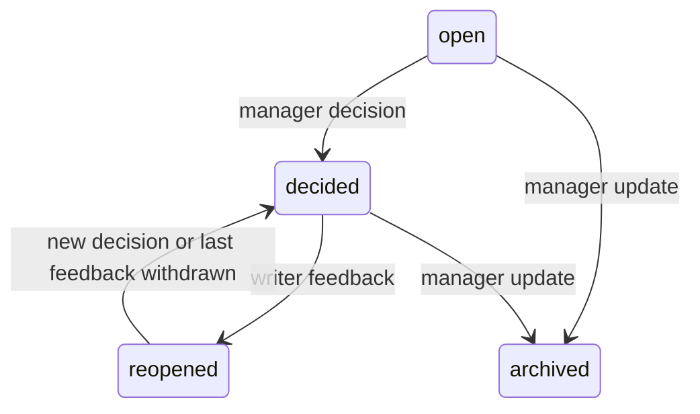

# M04 需求发现、决策与评审 — 当前实现规则稿

## 需求范围

本章覆盖下列完整业务组及公开入口变体。代码是当前行为证据，测试只标defined，所有验收计划not_run。没有业务批准或运行成功声明；全项目共享档案另行汇总。

## 来源与导航身份

项目=19Q4K7PDARXQ9JHW6R6F；仓库=P1KRPDABN4RD0YXMX64E；namespace=source-04d73353-be80-4433-8c5e-0b49a9c12c63；Skill=2.2.0。

run=NSG3TKRB16Y9F6Y203WB；kind=draft（显式工作区草稿，提交仅是基底）；snapshot=06376ab6287ee2d55caa79fc34257896e53ad0577a2b678947888024834468fa；commit=92728fbec04cfa34fee4421cb0a9319d1b755164。

源码manifest=0725fd3bb7867a6d7bba008b6af001c70f66b3c1dbf296b59ad95172eec6bdb9；企业包混合输入manifest=c832ac2345121f95b5f5d83da6275c79610bc4023b829568ee1ceeb2fadf307e；UA/CG artifact=691ab67f0c3a41a5bce1e59ca5ae83d99044ddfbfc5e026afb92183e681615c8。

ua engine=2.9.8, adapter=1.0.0, protocol=1, digest=d22a4a731809299030ee783710407af1e4ce37d5f1930345cb1d4b6a8cfb39a5。

codegraph engine=1.6.2, adapter=1.0.0, protocol=1, digest=c7ce675c6c763726449fccb22159735859ad17eccbce1475c9617287479bf8da。

knowledge handoff scope={"offset":0,"limit":100,"total_nodes":12043,"included_nodes":100,"truncated":true,"complete_repository_analysis":false}；裁剪结果不能建立缺失行为结论。

导航覆盖：codegraph analyzed_files=471/675；此数不是业务覆盖率。

导航覆盖：ua analyzed_files=675/675；此数不是业务覆盖率。

已实际查询固定run的UA overview/search(identity)/relations(requirements-specification)，以及native codegraph context/search。UA业务域/flow与codegraph边只作导航；BR源码证据的路径、SHA-256及真实1基行范围如下。

code callers首次使用native返回function:ID被CLI拒绝，后续以协议cg:前缀重试；查询结果保存在本地discovery记录。

context.bindings仅用于身份：权限Feature与首页Feature/REQ复用已有key及原父模块；既有目标正文不作为本次业务事实来源。

## 目的、角色与接口边界

- REQ-GOV-IDEA-COLLECTION 想法录入、检索与作者管理：可写项目成员录入；作者或Owner/Admin修改；成员读取；触发=列表、创建或更新想法；平台模块=tsp-module-collaboration，Feature=GOV-M04-IDEAS，文档=GOV-M04-RULES。
- REQ-GOV-TOPIC-AGGREGATION 议题聚合、关系与维护权限：可写项目成员；作者或管理者改文本；管理者改状态；触发=新建议题、关联想法/文档或更新议题；平台模块=tsp-module-collaboration，Feature=GOV-M04-TOPICS，文档=GOV-M04-RULES。
- REQ-GOV-TOPIC-DECISIONS 讨论记录、反馈重开、决策替代与图片边界：项目可写成员讨论；Owner/Admin决策；触发=向非归档议题添加comment/alternative/feedback/decision；平台模块=tsp-module-collaboration，Feature=GOV-M04-TOPICS，文档=GOV-M04-RULES。
- REQ-GOV-TOPIC-WITHDRAWAL 非决策记录软撤回与议题状态重算：记录作者或Owner/Admin；触发=撤回非归档议题中的未撤回非decision记录；平台模块=tsp-module-collaboration，Feature=GOV-M04-TOPICS，文档=GOV-M04-RULES。
- REQ-GOV-DOCUMENT-REVIEW 文档固定Revision评审、意见更新及人工结论：文档维护人或Owner/Admin发起；可写成员投票；Owner/Admin结束；触发=发起/读取评审、投票或关闭；平台模块=tsp-module-collaboration，Feature=GOV-M04-REVIEWS，文档=GOV-M04-RULES。

## 实体、状态与流程

图只帮助阅读，不替代下文完整转换/分支。管理者仍可直接把议题设为枚举状态，图未枚举所有管理跳转。

## 业务规则

| BR ID | 条件 | 判定/结果及副作用或保持状态 | 例外/限制 | 来源 | 测试断言 |
| --- | --- | --- | --- | --- | --- |

| BR-GOV-IDEA-COLLECTION-COLLECT | 有效可写成员创建并检索想法 | 默认active、返回作者和topic_count；q匹配title/detail，status过滤；viewer可读不可创建。 | 作者显示名在update返回中使用操作者对象，非作者管理者更新后的created_by展示可能失真；列表重新读取才从真实created_by关联。 | E1 | AC-GOV-IDEA-COLLECTION-COLLECT：默认active、返回作者和topic_count；q匹配title/detail，status过滤；viewer可读不可创建。 |

| BR-GOV-IDEA-COLLECTION-MANAGE | 作者或管理者修改想法，其他普通成员尝试修改 | 授权者可改title/detail/source/status；非作者普通成员requirement_idea_forbidden；空title或非法status拒绝，原内容不变。 | 作者显示名在update返回中使用操作者对象，非作者管理者更新后的created_by展示可能失真；列表重新读取才从真实created_by关联。 | E2 | AC-GOV-IDEA-COLLECTION-MANAGE：授权者可改title/detail/source/status；非作者普通成员requirement_idea_forbidden；空title或非法status拒绝，原内容不变。 |

| BR-GOV-TOPIC-AGGREGATION-CREATE-LINK | 可写成员提交同项目想法及需求文档关联 | 议题open，重复code只保留一个链接；再次关联或空数组不取消已有链接。 | linkIdeas/linkDocuments不检查topic archived状态，只有项目write检查；不得声称归档议题所有关系都不可变。 | E3, E4 | AC-GOV-TOPIC-AGGREGATION-CREATE-LINK：议题open，重复code只保留一个链接；再次关联或空数组不取消已有链接。 |

| BR-GOV-TOPIC-AGGREGATION-MISMATCH | 想法/文档不存在或属于其他项目 | requirement_topic_idea_invalid或requirement_topic_document_invalid，已有关系不变；新建若初始想法无效不建topic。 | linkIdeas/linkDocuments不检查topic archived状态，只有项目write检查；不得声称归档议题所有关系都不可变。 | E5, E6 | AC-GOV-TOPIC-AGGREGATION-MISMATCH：requirement_topic_idea_invalid或requirement_topic_document_invalid，已有关系不变；新建若初始想法无效不建topic。 |

| BR-GOV-TOPIC-AGGREGATION-STATE-AUTH | 普通作者更新文本或尝试改变议题状态 | 作者文本更新成功，真实状态变化需manage故普通作者被拒绝；Owner/Admin可改变枚举状态，非法状态拒绝。 | linkIdeas/linkDocuments不检查topic archived状态，只有项目write检查；不得声称归档议题所有关系都不可变。 | E7 | AC-GOV-TOPIC-AGGREGATION-STATE-AUTH：作者文本更新成功，真实状态变化需manage故普通作者被拒绝；Owner/Admin可改变枚举状态，非法状态拒绝。 |

| BR-GOV-TOPIC-DECISIONS-CYCLE | 管理者决策后成员提交feedback，再由管理者新决策 | 状态依次decided→reopened→decided，第二决策保存supersedes关系且历史决策仍在。 | 图片校验按data URL声明与base64长度估算，不校验图片魔数或实际解码内容；安全性上不宣称真实图片有效。 | E8, E9, E10 | AC-GOV-TOPIC-DECISIONS-CYCLE：状态依次decided→reopened→decided，第二决策保存supersedes关系且历史决策仍在。 |

| BR-GOV-TOPIC-DECISIONS-PERMISSION | 普通writer新增decision或向archived议题新增记录 | decision被project_forbidden拒绝；archived为requirement_topic_archived，entries/topic不变。 | 图片校验按data URL声明与base64长度估算，不校验图片魔数或实际解码内容；安全性上不宣称真实图片有效。 | E11 | AC-GOV-TOPIC-DECISIONS-PERMISSION：decision被project_forbidden拒绝；archived为requirement_topic_archived，entries/topic不变。 |

| BR-GOV-TOPIC-DECISIONS-IMAGES | 在尚需建设的隔离测试夹具中直接调用addTopicEntry（不经过HTTP解析），图片满足应用用例的声明格式/推算字节限制 | 应用层1字节及单张2MiB、合计恰5MiB的合法声明data URL可保存且顺序保留；5张、空名/256字符名、不允许MIME、单张2MiB+1或合计5MiB+1分别报images_too_many/image_name_invalid/image_type_invalid/image_too_large/images_too_large（完整前缀requirement_topic_），相应失败不新增entry/images。此结论不表示这些大负载可经公开HTTP提交。 | 图片校验按data URL声明与base64长度估算，不校验图片魔数或实际解码内容；安全性上不宣称真实图片有效。 | E12, E10 | AC-GOV-TOPIC-DECISIONS-IMAGES：应用层1字节及单张2MiB、合计恰5MiB的合法声明data URL可保存且顺序保留；5张、空名/256字符名、不允许MIME、单张2MiB+1或合计5MiB+1分别报images_too_many/image_name_invalid/image_type_invalid/image_too_large/images_too_large（完整前缀requirement_topic_），相应失败不新增entry/images。此结论不表示这些大负载可经公开HTTP提交。 |

| BR-GOV-TOPIC-DECISIONS-IMAGES-HTTP | 实际议题HTTP路由的JSON序列化请求体超过默认1048576字节，即使图片decoded大小低于应用2MiB门槛 | 大于1MiB的整体JSON在用例前返回HTTP 413、ok=false/error.code=request_body_too_large，entry/images/topic状态不变；小于或恰1MiB且其他条件合法的对照请求可进入用例保存。应用层2MiB/5MiB允许值不构成HTTP可达性承诺。 | 图片校验按data URL声明与base64长度估算，不校验图片魔数或实际解码内容；安全性上不宣称真实图片有效。 | E13, E14, E15 | AC-GOV-TOPIC-DECISIONS-IMAGES-HTTP：大于1MiB的整体JSON在用例前返回HTTP 413、ok=false/error.code=request_body_too_large，entry/images/topic状态不变；小于或恰1MiB且其他条件合法的对照请求可进入用例保存。应用层2MiB/5MiB允许值不构成HTTP可达性承诺。 |

| BR-GOV-TOPIC-DECISIONS-SUPERSEDES | supersedes指向另一议题/非decision或不存在 | 找到但不合格的记录requirement_topic_supersedes_invalid；不存在的编码保存supersedes=null。 | 图片校验按data URL声明与base64长度估算，不校验图片魔数或实际解码内容；安全性上不宣称真实图片有效。 | E16 | AC-GOV-TOPIC-DECISIONS-SUPERSEDES：找到但不合格的记录requirement_topic_supersedes_invalid；不存在的编码保存supersedes=null。 |

| BR-GOV-TOPIC-WITHDRAWAL-RECALCULATE | 最新decision之后只有一条feedback且该feedback被授权者撤回 | reopened回到decided；详情屏蔽feedback正文/图片/来源但显示撤回者/原因，底层历史仍保留。 | 适用角色、初态与失败保持字段见本条AC计划；无跨用例隐式依赖。 | E17, E18 | AC-GOV-TOPIC-WITHDRAWAL-RECALCULATE：reopened回到decided；详情屏蔽feedback正文/图片/来源但显示撤回者/原因，底层历史仍保留。 |

| BR-GOV-TOPIC-WITHDRAWAL-DENIED | decision、已撤回记录、非作者普通writer、archived topic或reason超过500 | 分别相应withdraw_forbidden/already_withdrawn/topic_archived/reason_too_long错误，记录与topic状态不变。 | 适用角色、初态与失败保持字段见本条AC计划；无跨用例隐式依赖。 | E19 | AC-GOV-TOPIC-WITHDRAWAL-DENIED：分别相应withdraw_forbidden/already_withdrawn/topic_archived/reason_too_long错误，记录与topic状态不变。 |

| BR-GOV-DOCUMENT-REVIEW-FIXED | 作者对R1发起评审后把文档修订至R2 | 旧评审仍revision=1且文档可修订；R2新评审为不同review；重复start R1在未修订分支返回原review。 | 发起/投票部分权限检查与写入未统一在锁内，未运行并发变权/重复发起竞争；不承诺严格全路径线性一致。 | E20, E21 | AC-GOV-DOCUMENT-REVIEW-FIXED：旧评审仍revision=1且文档可修订；R2新评审为不同review；重复start R1在未修订分支返回原review。 |

| BR-GOV-DOCUMENT-REVIEW-VOTE | 可写成员在open评审投票或改票 | 同principal一条vote被更新，其他人的vote保留；viewer写入project_forbidden，closed后requirement_review_closed。 | 发起/投票部分权限检查与写入未统一在锁内，未运行并发变权/重复发起竞争；不承诺严格全路径线性一致。 | E22 | AC-GOV-DOCUMENT-REVIEW-VOTE：同principal一条vote被更新，其他人的vote保留；viewer写入project_forbidden，closed后requirement_review_closed。 |

| BR-GOV-DOCUMENT-REVIEW-CONCLUSION | 管理者关闭open评审并指定合法结论 | 保存指定结论即使票未达多数或无票，不改变文档/REQ状态；普通writer关闭拒绝，重复关闭requirement_review_closed。 | 发起/投票部分权限检查与写入未统一在锁内，未运行并发变权/重复发起竞争；不承诺严格全路径线性一致。 | E23 | AC-GOV-DOCUMENT-REVIEW-CONCLUSION：保存指定结论即使票未达多数或无票，不改变文档/REQ状态；普通writer关闭拒绝，重复关闭requirement_review_closed。 |

## 功能需求

以下字段与结构化JSON同源生成，避免文档与需求对权限、拒绝/忽略、状态和数据变化表达相反结论。

### REQ-GOV-IDEA-COLLECTION 想法录入、检索与作者管理

主流程：

1. 成员按标题/详情大小写不敏感搜索、可选status过滤，updated_at降序列出。
2. 可写成员创建非空title想法，保存detail/source并默认active。
3. 非viewer作者或管理者修改内容及active/archived状态。

数据与配置：

- source空白/null归一null；title非空；detail可空；topic_count由关联表计数。
- 排序updated_at无最终tie-break；不推导唯一全序；归档想法仍可按筛选读取。

状态/一致性边界：

- create写想法后单独审计；update更新内容与时间，不在该函数写审计。

### REQ-GOV-TOPIC-AGGREGATION 议题聚合、关系与维护权限

主流程：

1. 创建非空title议题，以同项目想法初始关联，默认open。
2. 成员读取议题及记录，按title/problem_statement/goal搜索和status筛选。
3. 增量关联想法/需求文档时去重并保留已有关系；作者修改文本，真实状态变化必须manage。

数据与配置：

- 状态open/decided/reopened/archived；关联code去空白去重复；不存在/越项目关联整体拒绝。
- 关联操作是追加去重，空数组不删除旧关系；接口未提供unlink。
- can_decide为active项目管理者且议题未归档；can_manage为作者或管理者且可写。

状态/一致性边界：

- create议题/初始想法链接及审计同事务；后续link更新updated_at。
- 一般文本更新不删除历史entries、ideas或documents。

### REQ-GOV-TOPIC-DECISIONS 讨论记录、反馈重开、决策替代与图片边界

主流程：

1. 公开HTTP入口先受整体JSON请求体1MiB限制，超出在到达议题用例前返回413/request_body_too_large；该路由未覆盖服务器默认bodyLimit。
2. 通过HTTP解析后或测试直接调用应用用例时，校验内容、记录类型、图片名称/type/大小和替代关系。
3. 一般记录需write，decision需manage；历史决策不删除。
4. decision令议题decided；decided后feedback令reopened，其他记录保持状态。

数据与配置：

- entry_type为comment/alternative/feedback/decision；正文非空，rationale/source字段去空白空值归null。
- 应用用例图片门槛：最多4张；file_name非空≤255；仅png/jpeg/webp/gif的base64 data URL；每张按base64长度推算decoded bytes 1至2MiB，总计≤5MiB。该门槛不是公开HTTP可提交大小承诺。
- 当前HTTP整体bodyLimit=1048576字节（1MiB），以UTF-8 JSON序列化总字节计，含base64、文件名、正文及字段开销；1MiB解码图片的base64 JSON已超限，虽低于应用单图2MiB也会先返回413。未提出或批准扩容HTTP限制。
- 找到supersedes时必须同topic且decision；不存在的supersedes编码目前被当成无替代，不拒绝。
- summary current_decision按created_at降序首个decision，没有最终tie-break；详情entries按created_at/id降序。

状态/一致性边界：

- entry/images/topic状态及审计同事务；request成功代表记录已保存，不含外部处理。

### REQ-GOV-TOPIC-WITHDRAWAL 非决策记录软撤回与议题状态重算

主流程：

1. 检查项目write、作者或管理者、议题非归档、记录未撤回且不是decision。
2. 记录withdrawn_at/withdrawn_by/reason并保留存储历史。
3. 从剩余未撤回记录按时间/id重算最新决策及其后的feedback，返回open/decided/reopened。

数据与配置：

- reason可空、非空最长500字符；重复撤回报already_withdrawn。
- 详情中撤回记录content=""，rationale/source为空、images=[]，仍保留作者和撤回元数据；不是物理删除。

状态/一致性边界：

- 撤回、重算topic状态及审计同事务。
- 决策只能通过新决策替代，不能撤回；其原记录保留。

### REQ-GOV-DOCUMENT-REVIEW 文档固定Revision评审、意见更新及人工结论

主流程：

1. 发起时绑定当前document_revision_id；已有同revision评审则直接返回，含已closed评审。
2. 评审固定版本但不锁定文档修订；新revision可另开评审。
3. 成员可更新自己的support/changes_requested/abstain意见；管理者给出passed/changes_requested/no_consensus人工结论。

数据与配置：

- 投票要求project write，故viewer只读；每review/principal一条意见upsert；closed后不允许投票/再次关闭。
- 关闭不按多数票/全票自动计算，不自动改变requirementDocument state或结构化需求状态。
- 列表按opened_at降序，votes按responded_at升序，无最终tie-break。

状态/一致性边界：

- review open→closed保存结论、closed_by/time；文档current_revision独立演进。
- 再次start同版本返回原review而不是重开。

## 权限边界

按每条规则的actor和前置数据建立当前有效权限。Owner与Admin的差别按源码条件保留；旧文案“只有Owner”不能覆盖isProjectManager实际允许Admin的路径。Viewer可读能力不自动获得write/manage。源自其他业务模块的流程只引用不重复执行。

## 异常与边界

成功、权限拒绝、输入错误、版本/状态门槛和恢复见下列独立计划。未实现的控制不补写为既定政策：

- REQ-GOV-IDEA-COLLECTION：作者显示名在update返回中使用操作者对象，非作者管理者更新后的created_by展示可能失真；列表重新读取才从真实created_by关联。
- REQ-GOV-TOPIC-AGGREGATION：linkIdeas/linkDocuments不检查topic archived状态，只有项目write检查；不得声称归档议题所有关系都不可变。
- REQ-GOV-TOPIC-AGGREGATION：状态可由管理者直接修改，无通用业务转换表；不可套用结构化需求生命周期。
- REQ-GOV-TOPIC-DECISIONS：图片校验按data URL声明与base64长度估算，不校验图片魔数或实际解码内容；安全性上不宣称真实图片有效。
- REQ-GOV-TOPIC-DECISIONS：应用2MiB单图/5MiB合计门槛与HTTP整体1MiB是不同层级；直接用例边界与默认HTTP边界计划所需隔离夹具本次未提供/运行。未把提高HTTP bodyLimit当作当前实现或已批准建议。
- REQ-GOV-TOPIC-DECISIONS：supersedes不存在的宽松处理是实现观察，是否应拒绝待业务/工程确认。
- REQ-GOV-DOCUMENT-REVIEW：发起/投票部分权限检查与写入未统一在锁内，未运行并发变权/重复发起竞争；不承诺严格全路径线性一致。

## 验收场景与可复现计划

每个用例使用独立隔离数据并在开始前恢复所述初始状态；账号有效且已完成初始密码修改，除非该用例明确测试初始密码。认证使用该角色自己的有效Bearer会话；浏览器用例使用自身Cookie/Origin/CSRF。保存创建操作真实返回的编码，不硬编码生产数据。时钟采用UTC并记录起始时间；仅在有效期/锁定场景控制时钟。所有步骤为待执行计划。

### TC-GOV-IDEA-COLLECTION-COLLECT → AC-GOV-IDEA-COLLECTION-COLLECT

角色=可写项目成员录入；作者或Owner/Admin修改；成员读取；独立初态=active P中作者U、viewer V；创建两个标题/详情可区分的想法。

1. U POST ideas title=" 搜索建议 ",detail="Index"；GET ideas?q=index&status=active。
2. V读取再尝试创建。

可观察结果=默认active、返回作者和topic_count；q匹配title/detail，status过滤；viewer可读不可创建。

执行状态=not_run；优先级=P1（分析建议，未测量风险）。

### TC-GOV-IDEA-COLLECTION-MANAGE → AC-GOV-IDEA-COLLECTION-MANAGE

角色=可写项目成员录入；作者或Owner/Admin修改；成员读取；独立初态=active P想法I作者U，另一writer V及Admin A；各分支复位。

1. U PATCH I source=null,status=archived；A修改title。
2. V修改I；独立U提交空白title/非法status。

可观察结果=授权者可改title/detail/source/status；非作者普通成员requirement_idea_forbidden；空title或非法status拒绝，原内容不变。

执行状态=not_run；优先级=P1（分析建议，未测量风险）。

### TC-GOV-TOPIC-AGGREGATION-CREATE-LINK → AC-GOV-TOPIC-AGGREGATION-CREATE-LINK

角色=可写项目成员；作者或管理者改文本；管理者改状态；独立初态=P中writer U、ideas I1/I2、需求文档D；另一项目I3/D3。

1. POST topic idea_codes=[I1,I1]；再POST topic/ideas [I2]及topic/documents [D,D]；空数组再关联。
2. GET topic核对数量及原链接保留。

可观察结果=议题open，重复code只保留一个链接；再次关联或空数组不取消已有链接。

执行状态=not_run；优先级=P1（分析建议，未测量风险）。

### TC-GOV-TOPIC-AGGREGATION-MISMATCH → AC-GOV-TOPIC-AGGREGATION-MISMATCH

角色=可写项目成员；作者或管理者改文本；管理者改状态；独立初态=P中topic T、已有I1/D1；另项目I3/D3；U writer。

1. 独立向T关联[I1,I3]、[D1,D3]和未知编码；GET比对。
2. 新建带I3的议题。

可观察结果=requirement_topic_idea_invalid或requirement_topic_document_invalid，已有关系不变；新建若初始想法无效不建topic。

执行状态=not_run；优先级=P1（分析建议，未测量风险）。

### TC-GOV-TOPIC-AGGREGATION-STATE-AUTH → AC-GOV-TOPIC-AGGREGATION-STATE-AUTH

角色=可写项目成员；作者或管理者改文本；管理者改状态；独立初态=active P，T作者U member，另一writer V，Admin A；T初态open。

1. U改goal；U改status=archived；V改title；A改status=archived；GET核对。

可观察结果=作者文本更新成功，真实状态变化需manage故普通作者被拒绝；Owner/Admin可改变枚举状态，非法状态拒绝。

执行状态=not_run；优先级=P1（分析建议，未测量风险）。

### TC-GOV-TOPIC-DECISIONS-CYCLE → AC-GOV-TOPIC-DECISIONS-CYCLE

角色=项目可写成员讨论；Owner/Admin决策；独立初态=active P；非归档open topic T；Admin A和writer U；无已有entries。

1. A新增decision D1；U新增feedback；A新增decision D2 supersedes_entry_code=D1。
2. GET topic核对状态、历史及current_decision。

可观察结果=状态依次decided→reopened→decided，第二决策保存supersedes关系且历史决策仍在。

执行状态=not_run；优先级=P1（分析建议，未测量风险）。

### TC-GOV-TOPIC-DECISIONS-PERMISSION → AC-GOV-TOPIC-DECISIONS-PERMISSION

角色=项目可写成员讨论；Owner/Admin决策；独立初态=独立T open，writer U；独立T2 archived。

1. U向T新增decision；向T2新增comment；GET比对entry_count/status。

可观察结果=decision被project_forbidden拒绝；archived为requirement_topic_archived，entries/topic不变。

执行状态=not_run；优先级=P1（分析建议，未测量风险）。

### TC-GOV-TOPIC-DECISIONS-IMAGES → AC-GOV-TOPIC-DECISIONS-IMAGES

角色=项目可写成员讨论；Owner/Admin决策；独立初态=建设前提（尚未提供/运行）：可直接调用固定createRequirementCollaborationUseCases(db).addTopicEntry的隔离应用夹具、一次性PostgreSQL、有效active项目P/open议题T及writer U，并能复位和只读查询entries/images。令MiB=1048576；b64(n)=Buffer.alloc(n,0x41).toString("base64")，长度4*ceil(n/3)，image(n)={fileName:"a.png",dataUrl:"data:image/png;base64,"+b64(n)}；这是合成字节声明，不冒称有效图片文件；应用仅按声明/长度校验。各分支独立还原T无记录的基线。

1. 直接应用调用addTopicEntry({topicCode:T,principalCode:U,entryType:"comment",content:"x",images:[image(1)]})，再独立测试[image(2*MiB)]及[image(2*MiB),image(2*MiB),image(MiB)]；核对1、2MiB、5MiB边界成功、byte_size及sort_order。
2. 各自独立复位后测试：5张image(1)→requirement_topic_images_too_many；fileName为空或256个a→requirement_topic_image_name_invalid；dataUrl声明image/svg+xml→requirement_topic_image_type_invalid。
3. 独立复位测试[image(2*MiB+1)]→requirement_topic_image_too_large；[image(2*MiB),image(2*MiB),image(MiB+1)]→requirement_topic_images_too_large；每个失败后读取entry/image数仍为0。

可观察结果=应用层1字节及单张2MiB、合计恰5MiB的合法声明data URL可保存且顺序保留；5张、空名/256字符名、不允许MIME、单张2MiB+1或合计5MiB+1分别报images_too_many/image_name_invalid/image_type_invalid/image_too_large/images_too_large（完整前缀requirement_topic_），相应失败不新增entry/images。此结论不表示这些大负载可经公开HTTP提交。

执行状态=not_run；优先级=P1（分析建议，未测量风险）。

### TC-GOV-TOPIC-DECISIONS-IMAGES-HTTP → AC-GOV-TOPIC-DECISIONS-IMAGES-HTTP

角色=项目可写成员讨论；Owner/Admin决策；独立初态=建设前提（尚未提供/运行）：使用固定server.ts配置的隔离HTTP实例、一次性数据库和可读entry/images/topic状态；P active/T open/U writer且使用有效Bearer以排除鉴权失败。不得提高bodyLimit。令L=1048576；tiny={file_name:"a.png",data_url:"data:image/png;base64,"+Buffer.alloc(1,0x41).toString("base64")}; B0={entry_type:"comment",content:"",images:[tiny]}；bytes(B)=Buffer.byteLength(JSON.stringify(B),"utf8")；pad(N)为B0但content="x".repeat(N-bytes(B0))，使完整ASCII JSON恰N字节。各请求前复位T初态。

1. 以Content-Type:application/json向POST /requirement-topics/T/entries提交pad(L-1)、pad(L)，提交前各自断言bytes正好为L-1/L；其他条件合法时核对成功且各自只新增一条entry/图片。
2. 独立复位后提交pad(L+1)，断言bytes=L+1；核对413/request_body_too_large且entry/images数和topic状态保持。
3. 独立复位构造单张image/png data_url，其base64为Buffer.alloc(L,0x41).toString("base64")，放入正常entry JSON；断言base64长度=1398104、整体bytes>L且decoded=L<2*L；提交HTTP仍应413且数据库不变。

可观察结果=大于1MiB的整体JSON在用例前返回HTTP 413、ok=false/error.code=request_body_too_large，entry/images/topic状态不变；小于或恰1MiB且其他条件合法的对照请求可进入用例保存。应用层2MiB/5MiB允许值不构成HTTP可达性承诺。

执行状态=not_run；优先级=P1（分析建议，未测量风险）。

### TC-GOV-TOPIC-DECISIONS-SUPERSEDES → AC-GOV-TOPIC-DECISIONS-SUPERSEDES

角色=项目可写成员讨论；Owner/Admin决策；独立初态=T有comment C；另topic有decision D2；未知Z；Admin A。

1. 分别独立新增decision替代C、D2、Z并读取关系。

可观察结果=找到但不合格的记录requirement_topic_supersedes_invalid；不存在的编码保存supersedes=null。

执行状态=not_run；优先级=P1（分析建议，未测量风险）。

### TC-GOV-TOPIC-WITHDRAWAL-RECALCULATE → AC-GOV-TOPIC-WITHDRAWAL-RECALCULATE

角色=记录作者或Owner/Admin；独立初态=T先D1 decision再U的feedback F，含一张图片；T reopened；U作者、A管理者。

1. A POST /requirement-topic-entries/F/withdraw reason="误发"；GET T并检查F fields。
2. 检查底层F content及image记录仍存在，未删除。

可观察结果=reopened回到decided；详情屏蔽feedback正文/图片/来源但显示撤回者/原因，底层历史仍保留。

执行状态=not_run；优先级=P1（分析建议，未测量风险）。

### TC-GOV-TOPIC-WITHDRAWAL-DENIED → AC-GOV-TOPIC-WITHDRAWAL-DENIED

角色=记录作者或Owner/Admin；独立初态=每个变体独立复位T与entry；U作者、V普通writer、A管理者。

1. 分别撤回decision、二次撤回F、由V撤回F、归档T后撤回、501字符reason；逐次读取状态。

可观察结果=分别相应withdraw_forbidden/already_withdrawn/topic_archived/reason_too_long错误，记录与topic状态不变。

执行状态=not_run；优先级=P1（分析建议，未测量风险）。

### TC-GOV-DOCUMENT-REVIEW-FIXED → AC-GOV-DOCUMENT-REVIEW-FIXED

角色=文档维护人或Owner/Admin发起；可写成员投票；Owner/Admin结束；独立初态=active P及U自有active文档D R1；U writer，A管理者。

1. U POST D/reviews；重复start核对同code。
2. PATCH D到R2再GET旧review和POST D/reviews，核对版本和code。

可观察结果=旧评审仍revision=1且文档可修订；R2新评审为不同review；重复start R1在未修订分支返回原review。

执行状态=not_run；优先级=P1（分析建议，未测量风险）。

### TC-GOV-DOCUMENT-REVIEW-VOTE → AC-GOV-DOCUMENT-REVIEW-VOTE

角色=文档维护人或Owner/Admin发起；可写成员投票；Owner/Admin结束；独立初态=open review R，writer U/V、viewer X；R尚无票。

1. U support后changes_requested，V abstain；GET核对2票及U最终意见。
2. X投票；A关闭后U再投票。

可观察结果=同principal一条vote被更新，其他人的vote保留；viewer写入project_forbidden，closed后requirement_review_closed。

执行状态=not_run；优先级=P1（分析建议，未测量风险）。

### TC-GOV-DOCUMENT-REVIEW-CONCLUSION → AC-GOV-DOCUMENT-REVIEW-CONCLUSION

角色=文档维护人或Owner/Admin发起；可写成员投票；Owner/Admin结束；独立初态=独立open review R无票；A Admin、U普通writer；记录D和关联REQ状态。

1. U尝试close；A结论passed关闭；GET R/D/REQ核对；再次close。

可观察结果=保存指定结论即使票未达多数或无票，不改变文档/REQ状态；普通writer关闭拒绝，重复关闭requirement_review_closed。

执行状态=not_run；优先级=P1（分析建议，未测量风险）。

## 追溯：BR → REQ / AC / 测试矩阵

| BR | REQ | AC | Case | 执行 |
| --- | --- | --- | --- | --- |

| BR-GOV-IDEA-COLLECTION-COLLECT | REQ-GOV-IDEA-COLLECTION | AC-GOV-IDEA-COLLECTION-COLLECT | TC-GOV-IDEA-COLLECTION-COLLECT | not_run |

| BR-GOV-IDEA-COLLECTION-MANAGE | REQ-GOV-IDEA-COLLECTION | AC-GOV-IDEA-COLLECTION-MANAGE | TC-GOV-IDEA-COLLECTION-MANAGE | not_run |

| BR-GOV-TOPIC-AGGREGATION-CREATE-LINK | REQ-GOV-TOPIC-AGGREGATION | AC-GOV-TOPIC-AGGREGATION-CREATE-LINK | TC-GOV-TOPIC-AGGREGATION-CREATE-LINK | not_run |

| BR-GOV-TOPIC-AGGREGATION-MISMATCH | REQ-GOV-TOPIC-AGGREGATION | AC-GOV-TOPIC-AGGREGATION-MISMATCH | TC-GOV-TOPIC-AGGREGATION-MISMATCH | not_run |

| BR-GOV-TOPIC-AGGREGATION-STATE-AUTH | REQ-GOV-TOPIC-AGGREGATION | AC-GOV-TOPIC-AGGREGATION-STATE-AUTH | TC-GOV-TOPIC-AGGREGATION-STATE-AUTH | not_run |

| BR-GOV-TOPIC-DECISIONS-CYCLE | REQ-GOV-TOPIC-DECISIONS | AC-GOV-TOPIC-DECISIONS-CYCLE | TC-GOV-TOPIC-DECISIONS-CYCLE | not_run |

| BR-GOV-TOPIC-DECISIONS-PERMISSION | REQ-GOV-TOPIC-DECISIONS | AC-GOV-TOPIC-DECISIONS-PERMISSION | TC-GOV-TOPIC-DECISIONS-PERMISSION | not_run |

| BR-GOV-TOPIC-DECISIONS-IMAGES | REQ-GOV-TOPIC-DECISIONS | AC-GOV-TOPIC-DECISIONS-IMAGES | TC-GOV-TOPIC-DECISIONS-IMAGES | not_run |

| BR-GOV-TOPIC-DECISIONS-IMAGES-HTTP | REQ-GOV-TOPIC-DECISIONS | AC-GOV-TOPIC-DECISIONS-IMAGES-HTTP | TC-GOV-TOPIC-DECISIONS-IMAGES-HTTP | not_run |

| BR-GOV-TOPIC-DECISIONS-SUPERSEDES | REQ-GOV-TOPIC-DECISIONS | AC-GOV-TOPIC-DECISIONS-SUPERSEDES | TC-GOV-TOPIC-DECISIONS-SUPERSEDES | not_run |

| BR-GOV-TOPIC-WITHDRAWAL-RECALCULATE | REQ-GOV-TOPIC-WITHDRAWAL | AC-GOV-TOPIC-WITHDRAWAL-RECALCULATE | TC-GOV-TOPIC-WITHDRAWAL-RECALCULATE | not_run |

| BR-GOV-TOPIC-WITHDRAWAL-DENIED | REQ-GOV-TOPIC-WITHDRAWAL | AC-GOV-TOPIC-WITHDRAWAL-DENIED | TC-GOV-TOPIC-WITHDRAWAL-DENIED | not_run |

| BR-GOV-DOCUMENT-REVIEW-FIXED | REQ-GOV-DOCUMENT-REVIEW | AC-GOV-DOCUMENT-REVIEW-FIXED | TC-GOV-DOCUMENT-REVIEW-FIXED | not_run |

| BR-GOV-DOCUMENT-REVIEW-VOTE | REQ-GOV-DOCUMENT-REVIEW | AC-GOV-DOCUMENT-REVIEW-VOTE | TC-GOV-DOCUMENT-REVIEW-VOTE | not_run |

| BR-GOV-DOCUMENT-REVIEW-CONCLUSION | REQ-GOV-DOCUMENT-REVIEW | AC-GOV-DOCUMENT-REVIEW-CONCLUSION | TC-GOV-DOCUMENT-REVIEW-CONCLUSION | not_run |

## 捕获源码证据

| 证据 | 文件及行 | SHA-256 |
| --- | --- | --- |

| E1 | packages/application/src/requirement-collaboration-use-cases.ts L164-200 | e656b3ee417e53e0b9450af6503a981bc6a4bb35c8ac99358fba712548307710 |

| E2 | packages/application/src/requirement-collaboration-use-cases.ts L204-221 | e656b3ee417e53e0b9450af6503a981bc6a4bb35c8ac99358fba712548307710 |

| E3 | packages/application/src/requirement-collaboration-use-cases.ts L240-263 | e656b3ee417e53e0b9450af6503a981bc6a4bb35c8ac99358fba712548307710 |

| E4 | packages/application/src/requirement-collaboration-use-cases.ts L382-406 | e656b3ee417e53e0b9450af6503a981bc6a4bb35c8ac99358fba712548307710 |

| E5 | packages/application/src/requirement-collaboration-use-cases.ts L247-249 | e656b3ee417e53e0b9450af6503a981bc6a4bb35c8ac99358fba712548307710 |

| E6 | packages/application/src/requirement-collaboration-use-cases.ts L382-405 | e656b3ee417e53e0b9450af6503a981bc6a4bb35c8ac99358fba712548307710 |

| E7 | packages/application/src/requirement-collaboration-use-cases.ts L299-313 | e656b3ee417e53e0b9450af6503a981bc6a4bb35c8ac99358fba712548307710 |

| E8 | packages/application/src/requirement-collaboration-use-cases.ts L106-125 | e656b3ee417e53e0b9450af6503a981bc6a4bb35c8ac99358fba712548307710 |

| E9 | packages/application/src/requirement-collaboration-use-cases.ts L267-294 | e656b3ee417e53e0b9450af6503a981bc6a4bb35c8ac99358fba712548307710 |

| E10 | packages/application/src/requirement-collaboration-use-cases.ts L317-348 | e656b3ee417e53e0b9450af6503a981bc6a4bb35c8ac99358fba712548307710 |

| E11 | packages/application/src/requirement-collaboration-use-cases.ts L317-343 | e656b3ee417e53e0b9450af6503a981bc6a4bb35c8ac99358fba712548307710 |

| E12 | packages/application/src/requirement-collaboration-use-cases.ts L27-51 | e656b3ee417e53e0b9450af6503a981bc6a4bb35c8ac99358fba712548307710 |

| E13 | apps/core-api/src/server.ts L67-74 | 3fbcd5a893c1cb70e93bc36ade9ad6b36b6d280abab823fc941386527ee19ada |

| E14 | apps/core-api/src/routes/requirement-collaboration.ts L50-53 | cbd63cdecc412dc8121925a1df0dc70f7054d8ccbfa4bd3c1fc598d8601cf406 |

| E15 | packages/application/src/requirement-collaboration-use-cases.ts L27-50 | e656b3ee417e53e0b9450af6503a981bc6a4bb35c8ac99358fba712548307710 |

| E16 | packages/application/src/requirement-collaboration-use-cases.ts L327-335 | e656b3ee417e53e0b9450af6503a981bc6a4bb35c8ac99358fba712548307710 |

| E17 | packages/application/src/requirement-collaboration-use-cases.ts L288-294 | e656b3ee417e53e0b9450af6503a981bc6a4bb35c8ac99358fba712548307710 |

| E18 | packages/application/src/requirement-collaboration-use-cases.ts L352-378 | e656b3ee417e53e0b9450af6503a981bc6a4bb35c8ac99358fba712548307710 |

| E19 | packages/application/src/requirement-collaboration-use-cases.ts L352-376 | e656b3ee417e53e0b9450af6503a981bc6a4bb35c8ac99358fba712548307710 |

| E20 | packages/application/src/requirement-collaboration-use-cases.ts L410-437 | e656b3ee417e53e0b9450af6503a981bc6a4bb35c8ac99358fba712548307710 |

| E21 | packages/application/src/requirement-document-use-cases.ts L395-451 | 075866d541311da9453b5f54540ec89e3302867a05fb426806a0d7a9dcef56ac |

| E22 | packages/application/src/requirement-collaboration-use-cases.ts L453-465 | e656b3ee417e53e0b9450af6503a981bc6a4bb35c8ac99358fba712548307710 |

| E23 | packages/application/src/requirement-collaboration-use-cases.ts L469-486 | e656b3ee417e53e0b9450af6503a981bc6a4bb35c8ac99358fba712548307710 |

## 已有测试定义与未验证项

- packages/application/tests/requirement-collaboration-use-cases.test.mjs：非决策记录由作者或 Owner 软撤回，正文与图片脱敏且决策不可撤回；defined，未执行。
- packages/application/tests/requirement-collaboration-use-cases.test.mjs：文档评审固定当前 Revision 且不限制新 Revision，项目成员可投票；defined，未执行。

基于固定源码的现状观察，未执行业务/验收测试、未验证部署配置或外部系统、未取得业务批准；verification_plan全部待执行。
