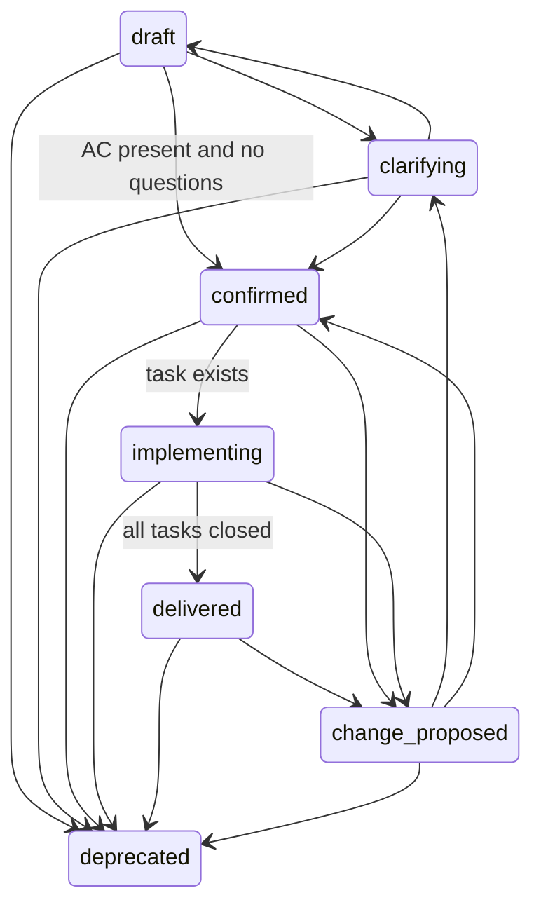

# M05 需求文档、结构化需求与基线 — 当前实现规则稿

## 需求范围

本章覆盖下列完整业务组及公开入口变体。代码是当前行为证据，测试只标defined，所有验收计划not_run。没有业务批准或运行成功声明；全项目共享档案另行汇总。

## 来源与导航身份

项目=19Q4K7PDARXQ9JHW6R6F；仓库=P1KRPDABN4RD0YXMX64E；namespace=source-04d73353-be80-4433-8c5e-0b49a9c12c63；Skill=2.2.0。

run=NSG3TKRB16Y9F6Y203WB；kind=draft（显式工作区草稿，提交仅是基底）；snapshot=06376ab6287ee2d55caa79fc34257896e53ad0577a2b678947888024834468fa；commit=92728fbec04cfa34fee4421cb0a9319d1b755164。

源码manifest=0725fd3bb7867a6d7bba008b6af001c70f66b3c1dbf296b59ad95172eec6bdb9；企业包混合输入manifest=c832ac2345121f95b5f5d83da6275c79610bc4023b829568ee1ceeb2fadf307e；UA/CG artifact=691ab67f0c3a41a5bce1e59ca5ae83d99044ddfbfc5e026afb92183e681615c8。

ua engine=2.9.8, adapter=1.0.0, protocol=1, digest=d22a4a731809299030ee783710407af1e4ce37d5f1930345cb1d4b6a8cfb39a5。

codegraph engine=1.6.2, adapter=1.0.0, protocol=1, digest=c7ce675c6c763726449fccb22159735859ad17eccbce1475c9617287479bf8da。

knowledge handoff scope={"offset":0,"limit":100,"total_nodes":12043,"included_nodes":100,"truncated":true,"complete_repository_analysis":false}；裁剪结果不能建立缺失行为结论。

导航覆盖：codegraph analyzed_files=471/675；此数不是业务覆盖率。

导航覆盖：ua analyzed_files=675/675；此数不是业务覆盖率。

已实际查询固定run的UA overview/search(identity)/relations(requirements-specification)，以及native codegraph context/search。UA业务域/flow与codegraph边只作导航；BR源码证据的路径、SHA-256及真实1基行范围如下。

code callers首次使用native返回function:ID被CLI拒绝，后续以协议cg:前缀重试；查询结果保存在本地discovery记录。

context.bindings仅用于身份：权限Feature与首页Feature/REQ复用已有key及原父模块；既有目标正文不作为本次业务事实来源。

## 目的、角色与接口边界

- REQ-GOV-REQUIREMENT-DOCUMENT-CREATE-READ 按模块发布可协作查阅的需求文档：可写项目成员创建；有效成员读取；触发=获取模板、创建、筛选或读取需求文档；平台模块=tsp-module-collaboration，Feature=GOV-M05-DOCUMENTS，文档=GOV-M05-RULES。
- REQ-GOV-REQUIREMENT-DOCUMENT-REVISION 需求文档负责人修订并保留历史：文档维护人或项目Owner/Admin且非viewer；触发=提交完整新版本与变更说明；平台模块=tsp-module-collaboration，Feature=GOV-M05-DOCUMENTS，文档=GOV-M05-RULES。
- REQ-GOV-REQUIREMENT-CREATE-READ 模块、来源文档或Feature中的结构化需求录入与检索：可写项目成员录入；有效成员读取；触发=创建、搜索或读取结构化需求；平台模块=tsp-module-collaboration，Feature=GOV-M05-STRUCTURED，文档=GOV-M05-RULES。
- REQ-GOV-REQUIREMENT-REVISION-BINDING 需求内容版本与关系重绑分开处理：项目Owner/Admin；触发=修改title/body/AC/问题或重新关联Feature、module、document；平台模块=tsp-module-collaboration，Feature=GOV-M05-STRUCTURED，文档=GOV-M05-RULES。
- REQ-GOV-REQUIREMENT-LIFECYCLE 需求确认、实施、交付与变更提议守卫：项目Owner/Admin；触发=请求显式状态转换；平台模块=tsp-module-collaboration，Feature=GOV-M05-STRUCTURED，文档=GOV-M05-RULES。
- REQ-GOV-BASELINE-FREEZE 显式版本选择形成不可变需求基线：active项目Owner/Admin；触发=提交需求选择、元数据及可选父基线；平台模块=tsp-module-collaboration，Feature=GOV-M05-BASELINES，文档=GOV-M05-RULES。
- REQ-GOV-BASELINE-READ-COMPARE 基线历史、完整性、差异与任务交接绑定：有效项目成员含Viewer；触发=读取基线、差异或绑定轨迹；平台模块=tsp-module-collaboration，Feature=GOV-M05-BASELINES，文档=GOV-M05-RULES。

## 实体、状态与流程

图只帮助阅读，不替代下文完整转换/分支。

## 业务规则

| BR ID | 条件 | 判定/结果及副作用或保持状态 | 例外/限制 | 来源 | 测试断言 |
| --- | --- | --- | --- | --- | --- |

| BR-GOV-REQUIREMENT-DOCUMENT-CREATE-READ-CREATE | writer指定已存在同项目模块、非空标题/正文 | 建立active R1并立即允许其他成员读；自动摘要/关键词规范化、标题目录与关联REQ均在详情可见，viewer不可创建。 | 文档archive入口不在该需求文档用例中；原生文档库代理操作由文档模块覆盖。 | E1, E2, E3, E4 | AC-GOV-REQUIREMENT-DOCUMENT-CREATE-READ-CREATE：建立active R1并立即允许其他成员读；自动摘要/关键词规范化、标题目录与关联REQ均在详情可见，viewer不可创建。 |

| BR-GOV-REQUIREMENT-DOCUMENT-CREATE-READ-COMPAT | moduleKey未知且未提供moduleCode | 管理者自动创建大写模块再建立文档；普通writer尝试未知moduleKey被manage检查拒绝；显式未知moduleCode不自动新建。 | 文档archive入口不在该需求文档用例中；原生文档库代理操作由文档模块覆盖。 | E5, E6 | AC-GOV-REQUIREMENT-DOCUMENT-CREATE-READ-COMPAT：管理者自动创建大写模块再建立文档；普通writer尝试未知moduleKey被manage检查拒绝；显式未知moduleCode不自动新建。 |

| BR-GOV-REQUIREMENT-DOCUMENT-CREATE-READ-READ | 有效项目成员包括viewer读取归档项目需求文档 | 可读取已有文档与历史，can_edit=false；非成员不能list/get，非成员读取返回forbidden而不泄露正文。 | 文档archive入口不在该需求文档用例中；原生文档库代理操作由文档模块覆盖。 | E7, E8 | AC-GOV-REQUIREMENT-DOCUMENT-CREATE-READ-READ：可读取已有文档与历史，can_edit=false；非成员不能list/get，非成员读取返回forbidden而不泄露正文。 |

| BR-GOV-REQUIREMENT-DOCUMENT-REVISION-REVISE | 负责人或管理者提交完整合法修订 | current_revision从N变N+1且旧正文保留，change_summary记录；即使内容相同的合法新请求也产生新版本。 | 并发修订从事务前head计算nextRevision，缺expected_revision/CAS协议；唯一版本索引可能造成冲突，未知响应重试可能多出版本，需运行验证。 | E9 | AC-GOV-REQUIREMENT-DOCUMENT-REVISION-REVISE：current_revision从N变N+1且旧正文保留，change_summary记录；即使内容相同的合法新请求也产生新版本。 |

| BR-GOV-REQUIREMENT-DOCUMENT-REVISION-DENIED | 非维护普通writer、viewer、archived文档/项目或缺变更说明 | 分别requirement_document_forbidden/权限拒绝/requirement_document_archived/project_archived/change_summary_required；head和历史数量不变。 | 并发修订从事务前head计算nextRevision，缺expected_revision/CAS协议；唯一版本索引可能造成冲突，未知响应重试可能多出版本，需运行验证。 | E10 | AC-GOV-REQUIREMENT-DOCUMENT-REVISION-DENIED：分别requirement_document_forbidden/权限拒绝/requirement_document_archived/project_archived/change_summary_required；head和历史数量不变。 |

| BR-GOV-REQUIREMENT-CREATE-READ-CREATE | writer以module或document创建需求而暂不绑定Feature | 成功draft R1，保存规范化AC/问题，允许后补Feature；非draft初态被requirement_initial_status_invalid拒绝。 | 适用角色、初态与失败保持字段见本条AC计划；无跨用例隐式依赖。 | E11, E12, E13 | AC-GOV-REQUIREMENT-CREATE-READ-CREATE：成功draft R1，保存规范化AC/问题，允许后补Feature；非draft初态被requirement_initial_status_invalid拒绝。 |

| BR-GOV-REQUIREMENT-CREATE-READ-SCOPE | 无有效范围、越项目关系、显式模块不一致或规范后AC ID重复 | 分别scope_required/project_mismatch/模块不一致/acceptance_id_duplicate拒绝；无新head/revision。 | 适用角色、初态与失败保持字段见本条AC计划；无跨用例隐式依赖。 | E14, E15, E16, E17 | AC-GOV-REQUIREMENT-CREATE-READ-SCOPE：分别scope_required/project_mismatch/模块不一致/acceptance_id_duplicate拒绝；无新head/revision。 |

| BR-GOV-REQUIREMENT-CREATE-READ-READ | 成员搜索已授权项目需求并读取任务/版本详情 | 仅有效可见范围返回；q匹配代码/标题/关系/正文，task_count真实关联数；非成员详情requirement_forbidden且列表无该项。 | 适用角色、初态与失败保持字段见本条AC计划；无跨用例隐式依赖。 | E18, E19 | AC-GOV-REQUIREMENT-CREATE-READ-READ：仅有效可见范围返回；q匹配代码/标题/关系/正文，task_count真实关联数；非成员详情requirement_forbidden且列表无该项。 |

| BR-GOV-REQUIREMENT-REVISION-BINDING-CONTENT | 管理者编辑draft/clarifying/change_proposed需求内容 | 新增revision且旧正文/AC/问题保留；其他普通writer拒绝，即使其是原创建者；无变化保持版本。 | updateBindingContext没有统一检查document推导module与Feature推导module在未显式传module时的所有组合；不承诺所有遗留绑定都已一致。 | E20, E21 | AC-GOV-REQUIREMENT-REVISION-BINDING-CONTENT：新增revision且旧正文/AC/问题保留；其他普通writer拒绝，即使其是原创建者；无变化保持版本。 |

| BR-GOV-REQUIREMENT-REVISION-BINDING-LOCK | confirmed/implementing/delivered/deprecated状态的内容修改 | requirement_revision_locked，head/revision不变；允许的change_proposed转换后可新增内容revision。 | updateBindingContext没有统一检查document推导module与Feature推导module在未显式传module时的所有组合；不承诺所有遗留绑定都已一致。 | E22, E23, E24 | AC-GOV-REQUIREMENT-REVISION-BINDING-LOCK：requirement_revision_locked，head/revision不变；允许的change_proposed转换后可新增内容revision。 |

| BR-GOV-REQUIREMENT-REVISION-BINDING-BIND | 只重绑同项目Feature/document/module且至少保留一个上下文 | 成功保留revision并改变关系，含confirmed状态；所有关系清空/跨项目重绑拒绝；显式module冲突拒绝。 | updateBindingContext没有统一检查document推导module与Feature推导module在未显式传module时的所有组合；不承诺所有遗留绑定都已一致。 | E25, E24 | AC-GOV-REQUIREMENT-REVISION-BINDING-BIND：成功保留revision并改变关系，含confirmed状态；所有关系清空/跨项目重绑拒绝；显式module冲突拒绝。 |

| BR-GOV-REQUIREMENT-LIFECYCLE-CONFIRM | draft/clarifying/change_proposed向confirmed且有AC、无问题 | 确认成功且revision不变；无AC或仍有问题分别acceptance_required/questions_unresolved，状态不变。 | 适用角色、初态与失败保持字段见本条AC计划；无跨用例隐式依赖。 | E22, E26 | AC-GOV-REQUIREMENT-LIFECYCLE-CONFIRM：确认成功且revision不变；无AC或仍有问题分别acceptance_required/questions_unresolved，状态不变。 |

| BR-GOV-REQUIREMENT-LIFECYCLE-DELIVERY | confirmed进入implementing、implementing进入delivered | 实施需至少关联一个任务；交付需非空且所有任务closed；存在failed/cancelled/其他状态均拒绝交付。 | 适用角色、初态与失败保持字段见本条AC计划；无跨用例隐式依赖。 | E27 | AC-GOV-REQUIREMENT-LIFECYCLE-DELIVERY：实施需至少关联一个任务；交付需非空且所有任务closed；存在failed/cancelled/其他状态均拒绝交付。 |

| BR-GOV-REQUIREMENT-LIFECYCLE-EDGES | 非法目标、非法边、普通writer推进或deprecated尝试恢复 | 分别requirement_status_invalid/requirement_transition_invalid/requirement_forbidden；状态/revision保持，deprecated无允许转换。 | 适用角色、初态与失败保持字段见本条AC计划；无跨用例隐式依赖。 | E22, E28, E29 | AC-GOV-REQUIREMENT-LIFECYCLE-EDGES：分别requirement_status_invalid/requirement_transition_invalid/requirement_forbidden；状态/revision保持，deprecated无允许转换。 |

| BR-GOV-BASELINE-FREEZE-FREEZE | 管理者选择同项目已确认需求的存在revision和合法元数据 | 建立V1父null或最新V+1，排序内容hash可复算；后续修改原需求不改变旧基线。 | 旧revision并不冻结当时title/state/binding，需按当前实现理解；基线业务批准权仍需Owner确认，未从快照导出批准结论。 | E30, E31, E32 | AC-GOV-BASELINE-FREEZE-FREEZE：建立V1父null或最新V+1，排序内容hash可复算；后续修改原需求不改变旧基线。 |

| BR-GOV-BASELINE-FREEZE-PARENT | 两个创建请求都声明同一旧父级或首次显式null | 项目fence序列化，先成功者推进版本，后者baseline_parent_conflict且不留下header/items；省略父级的新请求采用最新。 | 旧revision并不冻结当时title/state/binding，需按当前实现理解；基线业务批准权仍需Owner确认，未从快照导出批准结论。 | E33 | AC-GOV-BASELINE-FREEZE-PARENT：项目fence序列化，先成功者推进版本，后者baseline_parent_conflict且不留下header/items；省略父级的新请求采用最新。 |

| BR-GOV-BASELINE-FREEZE-INVALID | 合法基准HTTP基线请求仅将requirements改为空数组 | HTTP边界返回ok=false/error.code=validation_failed，不进入基线创建用例；P不新增header/items。此保留ID仅表示空选择，不作为所有拒绝分支的通用断言。 | 旧revision并不冻结当时title/state/binding，需按当前实现理解；基线业务批准权仍需Owner确认，未从快照导出批准结论。 | E34 | AC-GOV-BASELINE-FREEZE-INVALID：HTTP边界返回ok=false/error.code=validation_failed，不进入基线创建用例；P不新增header/items。此保留ID仅表示空选择，不作为所有拒绝分支的通用断言。 |

| BR-GOV-BASELINE-FREEZE-SELECTION-DUPLICATE | 基准请求仅把同一合法R/revision=1重复选择两次 | HTTP字段形状合法进入应用后返回baseline_invalid_selection；P的header/items不增加。 | 旧revision并不冻结当时title/state/binding，需按当前实现理解；基线业务批准权仍需Owner确认，未从快照导出批准结论。 | E34, E35 | AC-GOV-BASELINE-FREEZE-SELECTION-DUPLICATE：HTTP字段形状合法进入应用后返回baseline_invalid_selection；P的header/items不增加。 |

| BR-GOV-BASELINE-FREEZE-UNKNOWN-REQUIREMENT | 基准请求仅把requirement_code替换为格式合法但不存在的20位编码Z | 返回baseline_invalid_selection（所选需求不存在），不是未知revision/状态错误；创建事务不留header/items。 | 旧revision并不冻结当时title/state/binding，需按当前实现理解；基线业务批准权仍需Owner确认，未从快照导出批准结论。 | E36, E37 | AC-GOV-BASELINE-FREEZE-UNKNOWN-REQUIREMENT：返回baseline_invalid_selection（所选需求不存在），不是未知revision/状态错误；创建事务不留header/items。 |

| BR-GOV-BASELINE-FREEZE-UNKNOWN-REVISION | 合法基准R仍confirmed且属于P，仅所选revision从1改为不存在的2 | 返回baseline_revision_not_found，创建事务不留header/items；R的current_revision与内容保留。 | 旧revision并不冻结当时title/state/binding，需按当前实现理解；基线业务批准权仍需Owner确认，未从快照导出批准结论。 | E31, E36 | AC-GOV-BASELINE-FREEZE-UNKNOWN-REVISION：返回baseline_revision_not_found，创建事务不留header/items；R的current_revision与内容保留。 |

| BR-GOV-BASELINE-FREEZE-CROSS-PROJECT | 基准请求仅选择P2中confirmed且revision=1确实存在的R2 | 返回baseline_requirement_project_mismatch，P/P2均无本次新增header/items，R2内容和状态保持。 | 旧revision并不冻结当时title/state/binding，需按当前实现理解；基线业务批准权仍需Owner确认，未从快照导出批准结论。 | E31, E36 | AC-GOV-BASELINE-FREEZE-CROSS-PROJECT：返回baseline_requirement_project_mismatch，P/P2均无本次新增header/items，R2内容和状态保持。 |

| BR-GOV-BASELINE-FREEZE-STATE-DRAFT | 基准请求仅选择P内revision=1存在但state=draft的Rd | 返回baseline_requirement_not_approved；此错误码不是名为approved的需求状态。P不新增header/items，Rd仍draft。 | 旧revision并不冻结当时title/state/binding，需按当前实现理解；基线业务批准权仍需Owner确认，未从快照导出批准结论。 | E38, E36 | AC-GOV-BASELINE-FREEZE-STATE-DRAFT：返回baseline_requirement_not_approved；此错误码不是名为approved的需求状态。P不新增header/items，Rd仍draft。 |

| BR-GOV-BASELINE-FREEZE-ROLE-MEMBER | 请求及数据完全等于合法基准，仅操作者由Owner O改为P的有效普通member U | 返回baseline_owner_required，P不新增header/items；不把普通member等同未授权用户或归档项目。 | 旧revision并不冻结当时title/state/binding，需按当前实现理解；基线业务批准权仍需Owner确认，未从快照导出批准结论。 | E39 | AC-GOV-BASELINE-FREEZE-ROLE-MEMBER：返回baseline_owner_required，P不新增header/items；不把普通member等同未授权用户或归档项目。 |

| BR-GOV-BASELINE-FREEZE-PROJECT-ARCHIVED | 在合法基准上仅将P先由O归档，仍由O创建基线 | 返回project_archived，P仍archived且不新增header/items；R confirmed R1不变。 | 旧revision并不冻结当时title/state/binding，需按当前实现理解；基线业务批准权仍需Owner确认，未从快照导出批准结论。 | E39 | AC-GOV-BASELINE-FREEZE-PROJECT-ARCHIVED：返回project_archived，P仍archived且不新增header/items；R confirmed R1不变。 |

| BR-GOV-BASELINE-FREEZE-UNKNOWN-FIELD | 合法基准HTTP body仅额外加入unexpected:true | HTTP形状检查返回validation_failed，P不新增header/items；不会由应用层忽略该字段继续创建。 | 旧revision并不冻结当时title/state/binding，需按当前实现理解；基线业务批准权仍需Owner确认，未从快照导出批准结论。 | E34 | AC-GOV-BASELINE-FREEZE-UNKNOWN-FIELD：HTTP形状检查返回validation_failed，P不新增header/items；不会由应用层忽略该字段继续创建。 |

| BR-GOV-BASELINE-FREEZE-FIELD-SIZE | HTTP基准仅一个元数据字段超过其当前字符上限 | name=201字符、scope=2001字符或reason=4001字符的三个独立请求均返回validation_failed，P不新增header/items；不是HTTP体积413，也不夹带其他错误。 | 旧revision并不冻结当时title/state/binding，需按当前实现理解；基线业务批准权仍需Owner确认，未从快照导出批准结论。 | E34 | AC-GOV-BASELINE-FREEZE-FIELD-SIZE：name=201字符、scope=2001字符或reason=4001字符的三个独立请求均返回validation_failed，P不新增header/items；不是HTTP体积413，也不夹带其他错误。 |

| BR-GOV-BASELINE-FREEZE-SELECTION-SIZE | HTTP其他字段合法且选择的1001个不同同项目confirmed需求均有revision=1，唯一超限因素是集合数量 | requirements长度1001返回validation_failed，创建用例不写header/items；对照1000个合法选择允许创建且项目基线包含1000项。 | 旧revision并不冻结当时title/state/binding，需按当前实现理解；基线业务批准权仍需Owner确认，未从快照导出批准结论。 | E34, E32 | AC-GOV-BASELINE-FREEZE-SELECTION-SIZE：requirements长度1001返回validation_failed，创建用例不写header/items；对照1000个合法选择允许创建且项目基线包含1000项。 |

| BR-GOV-BASELINE-FREEZE-METADATA-EMPTY | HTTP合法基准仅将name/scope/reason之一改为空白 | 每个独立空白字段请求均validation_failed且不新增header/items；其他元数据字段/选择/权限/state保持有效。 | 旧revision并不冻结当时title/state/binding，需按当前实现理解；基线业务批准权仍需Owner确认，未从快照导出批准结论。 | E34, E35 | AC-GOV-BASELINE-FREEZE-METADATA-EMPTY：每个独立空白字段请求均validation_failed且不新增header/items；其他元数据字段/选择/权限/state保持有效。 |

| BR-GOV-BASELINE-FREEZE-IMMUTABLE | 冻结header/items被直接修改、删除或后续追加 | 数据库拒绝写入，原基线snapshot/hash保持；这只是计划的隔离数据库检查，不代表已执行。 | 旧revision并不冻结当时title/state/binding，需按当前实现理解；基线业务批准权仍需Owner确认，未从快照导出批准结论。 | E40 | AC-GOV-BASELINE-FREEZE-IMMUTABLE：数据库拒绝写入，原基线snapshot/hash保持；这只是计划的隔离数据库检查，不代表已执行。 |

| BR-GOV-BASELINE-READ-COMPARE-HISTORY | 有效成员读取本项目基线/归档项目历史 | 列表version降序，get返回原冻结内容；Viewer可读，归档can_create=false；其他项目基线code baseline_not_found。 | hash故障注入仅为未来测试设计，未关闭任何真实触发器或改动业务数据库；交接生命周期由交付模块覆盖。 | E41, E42, E43 | AC-GOV-BASELINE-READ-COMPARE-HISTORY：列表version降序，get返回原冻结内容；Viewer可读，归档can_create=false；其他项目基线code baseline_not_found。 |

| BR-GOV-BASELINE-READ-COMPARE-DIFF | B1到B2或current发生新增、修改、移除 | 返回准确counts和before/after/changed_fields，按requirement_code升序；B2对自身变化为空；current包含当前草稿新需求。 | hash故障注入仅为未来测试设计，未关闭任何真实触发器或改动业务数据库；交接生命周期由交付模块覆盖。 | E44, E45 | AC-GOV-BASELINE-READ-COMPARE-DIFF：返回准确counts和before/after/changed_fields，按requirement_code升序；B2对自身变化为空；current包含当前草稿新需求。 |

| BR-GOV-BASELINE-READ-COMPARE-INTEGRITY | 隔离库内snapshot与保存hash不一致 | get/list/compare读取损坏基线返回baseline_integrity_error，不把损坏内容当有效历史。 | hash故障注入仅为未来测试设计，未关闭任何真实触发器或改动业务数据库；交接生命周期由交付模块覆盖。 | E46 | AC-GOV-BASELINE-READ-COMPARE-INTEGRITY：get/list/compare读取损坏基线返回baseline_integrity_error，不把损坏内容当有效历史。 |

| BR-GOV-BASELINE-READ-COMPARE-BINDINGS | 项目任务及交接有/无基线且交接未发布 | 任务总保留未绑定项；草稿交接仅Owner/Admin或源run用户可见；有效冻结基线返回其code/version，失配为null。 | hash故障注入仅为未来测试设计，未关闭任何真实触发器或改动业务数据库；交接生命周期由交付模块覆盖。 | E47 | AC-GOV-BASELINE-READ-COMPARE-BINDINGS：任务总保留未绑定项；草稿交接仅Owner/Admin或源run用户可见；有效冻结基线返回其code/version，失配为null。 |

## 功能需求

以下字段与结构化JSON同源生成，避免文档与需求对权限、拒绝/忽略、状态和数据变化表达相反结论。

### REQ-GOV-REQUIREMENT-DOCUMENT-CREATE-READ 按模块发布可协作查阅的需求文档

主流程：

1. 提供Markdown模板；创建时指定模块编码或兼容module_key。
2. 规范化正文/摘要/关键词，创建active文档与R1，创建后即能被项目成员读取。
3. 列表按模块/状态/查询筛选；详情含目录、历史版本、关联结构化需求及can_edit。

数据与配置：

- title/content必填，summary缺省从首个非标题段提取最多240字符或用title；CRLF转LF并trim。
- keyword trim后按不区分大小写键去重、保留首次写法，忽略空白；module_key可按当前项目模块名称不区分大小写匹配。
- 仅未提供moduleCode的未知moduleKey可由manage者自动建大写模块；普通writer无manage不能自动建模块。
- 列表搜索title/module_key/current revision summary/content/keywords，按module_key/title升序；目录只取Markdown 1至4级标题。

状态/一致性边界：

- 文档与R1及审计同事务；module_key兼容自动模块创建在该事务前，不能承诺失败无任何副作用。
- 状态active与文档评审分离；读取不等于批准。

### REQ-GOV-REQUIREMENT-DOCUMENT-REVISION 需求文档负责人修订并保留历史

主流程：

1. 检查active文档/active项目及文档作者或管理者权限。
2. 要求标题、摘要、正文、change_summary非空，校验/解析模块。
3. 新增R(current+1)并更新文档head；旧revision继续可读。

数据与配置：

- 修订每次递增版本，没有内容相同免增或客户端expected_revision参数。
- module重绑以当前项目兼容解析；结构化REQ不会自动跟随文档模块变化，需另行对齐。

状态/一致性边界：

- 新增revision、更新head/title/module及审计同事务；不可从此推导数据库层revision内容绝对不可改。
- 旧版本正文、关键词、change_summary和创建者在历史列表保留。

### REQ-GOV-REQUIREMENT-CREATE-READ 模块、来源文档或Feature中的结构化需求录入与检索

主流程：

1. 至少给出module、document、Feature中的一个有效同项目上下文。
2. 规范化title/body/AC/open_questions，强制从draft和R1建立。
3. 列表限制有效可见项目并搜索标识/关系/title/body；详情展示历史、关联任务、可编辑标志和可转换状态。

数据与配置：

- AC去空白text、空text丢弃；空ID生成为AC-N，规范后重复ID拒绝；open_questions去空白及空条目。
- 显式module与document/Feature模块一致；创建共享writer还校验推导module与其他关系一致。
- 列表不声明稳定排序；搜索不含AC text/open_questions，大小写不敏感。
- 普通writer可创建但修改/生命周期推进需Owner/Admin；can_edit仅active项目且draft/clarifying/change_proposed管理者。

状态/一致性边界：

- 事务内创建head(state=draft,current_revision=1,owner本人)、revision及审计。
- 读取不改变状态，不把关联任务完成等同于需求自动推进。

### REQ-GOV-REQUIREMENT-REVISION-BINDING 需求内容版本与关系重绑分开处理

主流程：

1. 管理者检查当前revision与项目并解析给定字段；未给保持，null解除关联。
2. 内容真正变化仅在draft/clarifying/change_proposed允许，并新增revision。
3. 仅关联变化不增加revision，可在其他状态处理，但必须保留至少一个同项目上下文；无变化直接返回。

数据与配置：

- 内容变化以title、body、规范化AC和问题JSON比较；title变化也新增revision。
- 显式module与document/Feature已有module必须一致，跨项目重绑禁止。
- 绑定更新与审计同事务；内容锁不禁止所有binding-only更新。

状态/一致性边界：

- contentChanged→R+1且head关系更新；binding-only保留R并记requirement.bound。
- 无变化保持head/revision；原owner_principal_id不因管理者编辑改变。

### REQ-GOV-REQUIREMENT-LIFECYCLE 需求确认、实施、交付与变更提议守卫

主流程：

1. 验证目标枚举及当前状态允许边；要求active项目管理者。
2. confirmed要求至少一条AC且零开放问题；implementing要求关联任务；delivered要求至少一任务且全部closed。
3. 写新state和审计；状态变更不新增内容revision。

数据与配置：

- draft→clarifying/confirmed/deprecated；clarifying→draft/confirmed/deprecated；confirmed→implementing/change_proposed/deprecated。
- implementing→delivered/change_proposed/deprecated；delivered→change_proposed/deprecated；change_proposed→clarifying/confirmed/deprecated；deprecated无出口。
- failed/cancelled任务不满足delivered，虽然它们在成员交接规则中是终态。

状态/一致性边界：

- 成功只改变requirement.state，current_revision不变；此路径state写和audit不是同事务，不能承诺审计失败全回滚。

### REQ-GOV-BASELINE-FREEZE 显式版本选择形成不可变需求基线

主流程：

1. 验证name/scope/reason非空及选择非空无重复正整数revision。
2. 项目fence内检查当前最新父级和用户资格，确认每需求唯一属于当前项目且当前state为confirmed/implementing/delivered。
3. 按requirement_code排序，保存指定revision正文/AC/问题和当前head标题/状态/绑定，计算canonical JSON SHA-256并冻结。

数据与配置：

- HTTP限制name≤200、scope≤2000、reason≤4000、requirements≤1000，拒绝未知字段及非法public code。
- parent_baseline_code省略时采用锁内最新；显式null仅允许第一版；显式旧父级baseline_parent_conflict。
- 选择旧revision允许，但状态/标题/feature/module/document使用捕获时head，不是该旧revision的历史元数据。
- 数据库trigger拒绝基线header/items更新/删除及创建事务外追加。

状态/一致性边界：

- 基线version=latest+1、parent指向latest；header/items/audit同事务。
- 原需求后续修改不回写基线；baseline是冻结快照，不等于审批流程执行。

### REQ-GOV-BASELINE-READ-COMPARE 基线历史、完整性、差异与任务交接绑定

主流程：

1. 读取项目基线按version降序，先验SHA-256内容完整性；归档仍可读但can_create=false。
2. 比较同项目基线或current需求，按需求code排序计算added/modified/removed及changed_fields。
3. 展示任务所选基线与交接冻结manifest内基线；未发布交接限管理者或源run执行者。

数据与配置：

- current比较遍历当前同项目需求，包含当前draft/change_proposed等状态，不复用基线准入过滤。
- 同一基线比较changes为空；跨项目基线code不可访问；完整性错误baseline_integrity_error。
- 绑定包含未绑定任务/交接，以null表示；交接仅接受manifest基线project_code/version与本项目基线匹配。

状态/一致性边界：

- 读取/比较不改基线或需求；compare持共享项目fence；轨迹权限不授予其他交接草稿内容。

异常与边界处理（与结构化specification.exceptions一致，复用下方既有BR/AC/TC矩阵）：

- 条件：目标项目存在，当前存在的有效用户没有该项目成员访问权。
  处理：返回baseline_access_denied，不返回该项目基线或交接绑定内容，不改基线/需求（BR-GOV-BASELINE-READ-COMPARE-HISTORY / AC-GOV-BASELINE-READ-COMPARE-HISTORY）。
- 条件：读取或比较指定基线在当前项目不存在，包括持有另一项目的有效baseline code。
  处理：返回baseline_not_found，不跨项目返回冻结内容；所有已有基线保持（BR-GOV-BASELINE-READ-COMPARE-HISTORY / AC-GOV-BASELINE-READ-COMPARE-HISTORY）。
- 条件：装载冻结items后重算内容哈希与header.content_hash不一致。
  处理：get/list/compare在装载该基线时返回baseline_integrity_error，不把损坏snapshot当成有效历史；本读取不修写数据（BR-GOV-BASELINE-READ-COMPARE-INTEGRITY / AC-GOV-BASELINE-READ-COMPARE-INTEGRITY）。
- 条件：绑定轨迹中的交接未发布，而当前成员既非Owner/Admin也不是源run执行者。
  处理：从绑定结果省略该交接行，仍按各自规则保留可见任务和其他交接；不会授予草稿访问权（BR-GOV-BASELINE-READ-COMPARE-BINDINGS / AC-GOV-BASELINE-READ-COMPARE-BINDINGS）。
- 条件：可见交接manifest没有冻结基线，或冻结基线project_code/version与当前项目基线不匹配。
  处理：该可见交接仍保留，但baseline_code/baseline_version为null；不借外项目或失配manifest绑定真实基线（BR-GOV-BASELINE-READ-COMPARE-BINDINGS / AC-GOV-BASELINE-READ-COMPARE-BINDINGS）。

## 权限边界

按每条规则的actor和前置数据建立当前有效权限。Owner与Admin的差别按源码条件保留；旧文案“只有Owner”不能覆盖isProjectManager实际允许Admin的路径。Viewer可读能力不自动获得write/manage。源自其他业务模块的流程只引用不重复执行。

## 异常与边界

成功、权限拒绝、输入错误、版本/状态门槛和恢复见下列独立计划。未实现的控制不补写为既定政策：

- REQ-GOV-REQUIREMENT-DOCUMENT-CREATE-READ：文档archive入口不在该需求文档用例中；原生文档库代理操作由文档模块覆盖。
- REQ-GOV-REQUIREMENT-DOCUMENT-REVISION：并发修订从事务前head计算nextRevision，缺expected_revision/CAS协议；唯一版本索引可能造成冲突，未知响应重试可能多出版本，需运行验证。
- REQ-GOV-REQUIREMENT-REVISION-BINDING：updateBindingContext没有统一检查document推导module与Feature推导module在未显式传module时的所有组合；不承诺所有遗留绑定都已一致。
- REQ-GOV-REQUIREMENT-REVISION-BINDING：并发内容编辑缺expected_revision协议，事务外读取版本后写入存在竞争；测试未执行。
- REQ-GOV-BASELINE-FREEZE：旧revision并不冻结当时title/state/binding，需按当前实现理解；基线业务批准权仍需Owner确认，未从快照导出批准结论。
- REQ-GOV-BASELINE-READ-COMPARE：hash故障注入仅为未来测试设计，未关闭任何真实触发器或改动业务数据库；交接生命周期由交付模块覆盖。

## 验收场景与可复现计划

每个用例使用独立隔离数据并在开始前恢复所述初始状态；账号有效且已完成初始密码修改，除非该用例明确测试初始密码。认证使用该角色自己的有效Bearer会话；浏览器用例使用自身Cookie/Origin/CSRF。保存创建操作真实返回的编码，不硬编码生产数据。时钟采用UTC并记录起始时间；仅在有效期/锁定场景控制时钟。所有步骤为待执行计划。

### TC-GOV-REQUIREMENT-DOCUMENT-CREATE-READ-CREATE → AC-GOV-REQUIREMENT-DOCUMENT-CREATE-READ-CREATE

角色=可写项目成员创建；有效成员读取；独立初态=active P有模块X，writer U/V、viewer W；无同编码文档。

1. GET template；U POST requirement-documents module_code=X,title="设计",content="# 设计

目标正文",keywords=[" API ","API",""]。
2. V GET新文档/list；W尝试创建。

可观察结果=建立active R1并立即允许其他成员读；自动摘要/关键词规范化、标题目录与关联REQ均在详情可见，viewer不可创建。

执行状态=not_run；优先级=P1（分析建议，未测量风险）。

### TC-GOV-REQUIREMENT-DOCUMENT-CREATE-READ-COMPAT → AC-GOV-REQUIREMENT-DOCUMENT-CREATE-READ-COMPAT

角色=可写项目成员创建；有效成员读取；独立初态=P已有模块X；O管理者、U普通writer；未知KEY_NEW无匹配模块；各分支独立复位。

1. O用module_key=key_new创建；检查模块名KEY_NEW。
2. U用另一未知module_key；O提交未知module_code；检查各结果和模块列表。

可观察结果=管理者自动创建大写模块再建立文档；普通writer尝试未知moduleKey被manage检查拒绝；显式未知moduleCode不自动新建。

执行状态=not_run；优先级=P1（分析建议，未测量风险）。

### TC-GOV-REQUIREMENT-DOCUMENT-CREATE-READ-READ → AC-GOV-REQUIREMENT-DOCUMENT-CREATE-READ-READ

角色=可写项目成员创建；有效成员读取；独立初态=P归档，D有R1/R2；成员V viewer，外部X无访问。

1. V GET列表与D详情，核对R2与历史。
2. X读取同列表/D。

可观察结果=可读取已有文档与历史，can_edit=false；非成员不能list/get，非成员读取返回forbidden而不泄露正文。

执行状态=not_run；优先级=P1（分析建议，未测量风险）。

### TC-GOV-REQUIREMENT-DOCUMENT-REVISION-REVISE → AC-GOV-REQUIREMENT-DOCUMENT-REVISION-REVISE

角色=文档维护人或项目Owner/Admin且非viewer；独立初态=active P中D R1归U，U writer、A Admin；记录R1。

1. U PATCH D完整字段和change_summary；读取D/R1/R2。
2. A重复相同合法内容但提交新请求，读取R3。

可观察结果=current_revision从N变N+1且旧正文保留，change_summary记录；即使内容相同的合法新请求也产生新版本。

执行状态=not_run；优先级=P1（分析建议，未测量风险）。

### TC-GOV-REQUIREMENT-DOCUMENT-REVISION-DENIED → AC-GOV-REQUIREMENT-DOCUMENT-REVISION-DENIED

角色=文档维护人或项目Owner/Admin且非viewer；独立初态=每个分支独立D R1、U维护、V其他writer、W viewer；归档fixture限定隔离库。

1. 各角色/状态提交完整修订，另用U提交空change_summary；每次读取D head及revision数。

可观察结果=分别requirement_document_forbidden/权限拒绝/requirement_document_archived/project_archived/change_summary_required；head和历史数量不变。

执行状态=not_run；优先级=P1（分析建议，未测量风险）。

### TC-GOV-REQUIREMENT-CREATE-READ-CREATE → AC-GOV-REQUIREMENT-CREATE-READ-CREATE

角色=可写项目成员录入；有效成员读取；独立初态=active P有模块X、其文档D；U writer；有效title/body；各初态变体独立。

1. POST /requirements module_code=X,document_code=D,title="检索",body="检索目标",AC含空ID和空text。
2. GET新需求；独立提交status=confirmed。

可观察结果=成功draft R1，保存规范化AC/问题，允许后补Feature；非draft初态被requirement_initial_status_invalid拒绝。

执行状态=not_run；优先级=P1（分析建议，未测量风险）。

### TC-GOV-REQUIREMENT-CREATE-READ-SCOPE → AC-GOV-REQUIREMENT-CREATE-READ-SCOPE

角色=可写项目成员录入；有效成员读取；独立初态=P/P2各有模块/文档/Feature；每个错误输入独立复位；U有P写权限。

1. 独立提交无scope、P模块配P2文档、错模块Feature和AC=[{id:" A ",text:"一"},{id:"A",text:"二"}]。
2. 查询创建数保持。

可观察结果=分别scope_required/project_mismatch/模块不一致/acceptance_id_duplicate拒绝；无新head/revision。

执行状态=not_run；优先级=P1（分析建议，未测量风险）。

### TC-GOV-REQUIREMENT-CREATE-READ-READ → AC-GOV-REQUIREMENT-CREATE-READ-READ

角色=可写项目成员录入；有效成员读取；独立初态=P中R带任务T及R1/R2，U viewer有read；X无P访问但有另一项目P2。

1. U GET /requirements?q=正文子串及详情，核对task_count/history。
2. X列表和GET R；另用只出现在AC的独特词查询不应因AC命中。

可观察结果=仅有效可见范围返回；q匹配代码/标题/关系/正文，task_count真实关联数；非成员详情requirement_forbidden且列表无该项。

执行状态=not_run；优先级=P1（分析建议，未测量风险）。

### TC-GOV-REQUIREMENT-REVISION-BINDING-CONTENT → AC-GOV-REQUIREMENT-REVISION-BINDING-CONTENT

角色=项目Owner/Admin；独立初态=active P中R draft R1由普通U创建，O/A管理者；M普通writer；记录owner和R1。

1. A PATCH R body新值，GET核对R2和owner未变；同内容再PATCH，核对仍R2。
2. 独立U/M修改正文。

可观察结果=新增revision且旧正文/AC/问题保留；其他普通writer拒绝，即使其是原创建者；无变化保持版本。

执行状态=not_run；优先级=P1（分析建议，未测量风险）。

### TC-GOV-REQUIREMENT-REVISION-BINDING-LOCK → AC-GOV-REQUIREMENT-REVISION-BINDING-LOCK

角色=项目Owner/Admin；独立初态=独立R confirmed且有AC无问题；O；保存R1。

1. PATCH改body被拒绝；POST transition change_proposed；再PATCH body成功R2。

可观察结果=requirement_revision_locked，head/revision不变；允许的change_proposed转换后可新增内容revision。

执行状态=not_run；优先级=P1（分析建议，未测量风险）。

### TC-GOV-REQUIREMENT-REVISION-BINDING-BIND → AC-GOV-REQUIREMENT-REVISION-BINDING-BIND

角色=项目Owner/Admin；独立初态=R confirmed R1在P模块X、文档D，另有同X FeatureF；P2有F2；O。

1. PATCH仅feature_code=F并读取R1不增加；独立清空全部关系、绑定F2、显式错误module。

可观察结果=成功保留revision并改变关系，含confirmed状态；所有关系清空/跨项目重绑拒绝；显式module冲突拒绝。

执行状态=not_run；优先级=P1（分析建议，未测量风险）。

### TC-GOV-REQUIREMENT-LIFECYCLE-CONFIRM → AC-GOV-REQUIREMENT-LIFECYCLE-CONFIRM

角色=项目Owner/Admin；独立初态=三个独立draft需求R：有AC无问题、空AC、AC加开放问题；O管理者。

1. 逐一POST transition confirmed并读取state/revision。

可观察结果=确认成功且revision不变；无AC或仍有问题分别acceptance_required/questions_unresolved，状态不变。

执行状态=not_run；优先级=P1（分析建议，未测量风险）。

### TC-GOV-REQUIREMENT-LIFECYCLE-DELIVERY → AC-GOV-REQUIREMENT-LIFECYCLE-DELIVERY

角色=项目Owner/Admin；独立初态=独立confirmed R0无任务；R1有任务；独立implementing R2的所有任务closed、R3含failed或cancelled。

1. R0/R1请求implementing；R2/R3请求delivered；检查state与revision。

可观察结果=实施需至少关联一个任务；交付需非空且所有任务closed；存在failed/cancelled/其他状态均拒绝交付。

执行状态=not_run；优先级=P1（分析建议，未测量风险）。

### TC-GOV-REQUIREMENT-LIFECYCLE-EDGES → AC-GOV-REQUIREMENT-LIFECYCLE-EDGES

角色=项目Owner/Admin；独立初态=每分支独立R与状态；O管理者、U writer；包含deprecated R。

1. 提交非法状态、draft→delivered、U draft→clarifying和deprecated→draft；GET详情核对available_transitions。

可观察结果=分别requirement_status_invalid/requirement_transition_invalid/requirement_forbidden；状态/revision保持，deprecated无允许转换。

执行状态=not_run；优先级=P1（分析建议，未测量风险）。

### TC-GOV-BASELINE-FREEZE-FREEZE → AC-GOV-BASELINE-FREEZE-FREEZE

角色=active项目Owner/Admin；独立初态=隔离active P，R当前confirmed R2且保留R1；O/Admin A；无基线。

1. A POST baseline选择R revision=1，记录返回snapshot/hash。
2. 按需求变更流程更新原需求；GET旧基线与初值比较。

可观察结果=建立V1父null或最新V+1，排序内容hash可复算；后续修改原需求不改变旧基线。

执行状态=not_run；优先级=P1（分析建议，未测量风险）。

### TC-GOV-BASELINE-FREEZE-PARENT → AC-GOV-BASELINE-FREEZE-PARENT

角色=active项目Owner/Admin；独立初态=独立P已有B1；两请求均parent=B1、选择同一已确认R。另独立P0无基线。

1. 并发提交两个父B1请求并读基线列表；P0并发显式null创建。
2. 以省略parent的新请求确认下一版。

可观察结果=项目fence序列化，先成功者推进版本，后者baseline_parent_conflict且不留下header/items；省略父级的新请求采用最新。

执行状态=not_run；优先级=P1（分析建议，未测量风险）。

### TC-GOV-BASELINE-FREEZE-INVALID → AC-GOV-BASELINE-FREEZE-INVALID

角色=active项目Owner/Admin；独立初态=每个分支从独立隔离快照重新开始：P为active、O为Owner、U为有效member，P无基线，header/items计数均0；用当前正常流程先创建R draft R1，body/title非空，AC=[{id:"AC-1",text:"可观察结果"}]且open_questions=[]，再转换到confirmed，R仅存在revision=1；Rd按相同内容创建但保持draft R1；P2亦无基线，P2内R2为confirmed且存在R1。保存真实返回的20位编码。基准请求POST /projects/P/requirement-baselines使用O自己的Bearer，body={name:"B1",scope:"单项R",reason:"确认范围",parent_baseline_code:null,requirements:[{requirement_code:R,revision:1}]}。其他因素始终保持此基准；各失败后只读确认P的header/items仍各0，R/关系/状态未变。本段仅为待建设/准备的隔离数据，不声称这些fixture已存在或执行。

1. 仅将基准body.requirements改成[]，保持O、P active、元数据与parent=null均合法；向基准URL POST。
2. 核对error.code=validation_failed，并只读核对P的header/items均0；保留R confirmed R1不变。

可观察结果=HTTP边界返回ok=false/error.code=validation_failed，不进入基线创建用例；P不新增header/items。此保留ID仅表示空选择，不作为所有拒绝分支的通用断言。

执行状态=not_run；优先级=P1（分析建议，未测量风险）。

### TC-GOV-BASELINE-FREEZE-SELECTION-DUPLICATE → AC-GOV-BASELINE-FREEZE-SELECTION-DUPLICATE

角色=active项目Owner/Admin；独立初态=每个分支从独立隔离快照重新开始：P为active、O为Owner、U为有效member，P无基线，header/items计数均0；用当前正常流程先创建R draft R1，body/title非空，AC=[{id:"AC-1",text:"可观察结果"}]且open_questions=[]，再转换到confirmed，R仅存在revision=1；Rd按相同内容创建但保持draft R1；P2亦无基线，P2内R2为confirmed且存在R1。保存真实返回的20位编码。基准请求POST /projects/P/requirement-baselines使用O自己的Bearer，body={name:"B1",scope:"单项R",reason:"确认范围",parent_baseline_code:null,requirements:[{requirement_code:R,revision:1}]}。其他因素始终保持此基准；各失败后只读确认P的header/items仍各0，R/关系/状态未变。本段仅为待建设/准备的隔离数据，不声称这些fixture已存在或执行。

1. 仅改requirements为[{requirement_code:R,revision:1},{requirement_code:R,revision:1}]；POST基准URL。
2. 核对error.code=baseline_invalid_selection，并读取P的header/items各0。

可观察结果=HTTP字段形状合法进入应用后返回baseline_invalid_selection；P的header/items不增加。

执行状态=not_run；优先级=P1（分析建议，未测量风险）。

### TC-GOV-BASELINE-FREEZE-UNKNOWN-REQUIREMENT → AC-GOV-BASELINE-FREEZE-UNKNOWN-REQUIREMENT

角色=active项目Owner/Admin；独立初态=每个分支从独立隔离快照重新开始：P为active、O为Owner、U为有效member，P无基线，header/items计数均0；用当前正常流程先创建R draft R1，body/title非空，AC=[{id:"AC-1",text:"可观察结果"}]且open_questions=[]，再转换到confirmed，R仅存在revision=1；Rd按相同内容创建但保持draft R1；P2亦无基线，P2内R2为confirmed且存在R1。保存真实返回的20位编码。基准请求POST /projects/P/requirement-baselines使用O自己的Bearer，body={name:"B1",scope:"单项R",reason:"确认范围",parent_baseline_code:null,requirements:[{requirement_code:R,revision:1}]}。其他因素始终保持此基准；各失败后只读确认P的header/items仍各0，R/关系/状态未变。本段仅为待建设/准备的隔离数据，不声称这些fixture已存在或执行。 Z用20位合法public code并在隔离库确认没有该需求；不使用格式非法字符串。

1. 仅将requirements改成[{requirement_code:Z,revision:1}]；POST，核对error.code=baseline_invalid_selection。
2. 读取P的header/items均0及R原状态；不把Z错误混为跨项目。

可观察结果=返回baseline_invalid_selection（所选需求不存在），不是未知revision/状态错误；创建事务不留header/items。

执行状态=not_run；优先级=P1（分析建议，未测量风险）。

### TC-GOV-BASELINE-FREEZE-UNKNOWN-REVISION → AC-GOV-BASELINE-FREEZE-UNKNOWN-REVISION

角色=active项目Owner/Admin；独立初态=每个分支从独立隔离快照重新开始：P为active、O为Owner、U为有效member，P无基线，header/items计数均0；用当前正常流程先创建R draft R1，body/title非空，AC=[{id:"AC-1",text:"可观察结果"}]且open_questions=[]，再转换到confirmed，R仅存在revision=1；Rd按相同内容创建但保持draft R1；P2亦无基线，P2内R2为confirmed且存在R1。保存真实返回的20位编码。基准请求POST /projects/P/requirement-baselines使用O自己的Bearer，body={name:"B1",scope:"单项R",reason:"确认范围",parent_baseline_code:null,requirements:[{requirement_code:R,revision:1}]}。其他因素始终保持此基准；各失败后只读确认P的header/items仍各0，R/关系/状态未变。本段仅为待建设/准备的隔离数据，不声称这些fixture已存在或执行。

1. 先只读确认R存在且仅有R1，然后只改requirements[0].revision=2；POST基准URL。
2. 核对error.code=baseline_revision_not_found；P的header/items均0且R仍confirmed R1。

可观察结果=返回baseline_revision_not_found，创建事务不留header/items；R的current_revision与内容保留。

执行状态=not_run；优先级=P1（分析建议，未测量风险）。

### TC-GOV-BASELINE-FREEZE-CROSS-PROJECT → AC-GOV-BASELINE-FREEZE-CROSS-PROJECT

角色=active项目Owner/Admin；独立初态=每个分支从独立隔离快照重新开始：P为active、O为Owner、U为有效member，P无基线，header/items计数均0；用当前正常流程先创建R draft R1，body/title非空，AC=[{id:"AC-1",text:"可观察结果"}]且open_questions=[]，再转换到confirmed，R仅存在revision=1；Rd按相同内容创建但保持draft R1；P2亦无基线，P2内R2为confirmed且存在R1。保存真实返回的20位编码。基准请求POST /projects/P/requirement-baselines使用O自己的Bearer，body={name:"B1",scope:"单项R",reason:"确认范围",parent_baseline_code:null,requirements:[{requirement_code:R,revision:1}]}。其他因素始终保持此基准；各失败后只读确认P的header/items仍各0，R/关系/状态未变。本段仅为待建设/准备的隔离数据，不声称这些fixture已存在或执行。

1. 仅改requirements为[{requirement_code:R2,revision:1}]；O仍对P发起，其他字段不变。
2. 核对error.code=baseline_requirement_project_mismatch；读取P/P2的基线数与原需求，均无本次变化。

可观察结果=返回baseline_requirement_project_mismatch，P/P2均无本次新增header/items，R2内容和状态保持。

执行状态=not_run；优先级=P1（分析建议，未测量风险）。

### TC-GOV-BASELINE-FREEZE-STATE-DRAFT → AC-GOV-BASELINE-FREEZE-STATE-DRAFT

角色=active项目Owner/Admin；独立初态=每个分支从独立隔离快照重新开始：P为active、O为Owner、U为有效member，P无基线，header/items计数均0；用当前正常流程先创建R draft R1，body/title非空，AC=[{id:"AC-1",text:"可观察结果"}]且open_questions=[]，再转换到confirmed，R仅存在revision=1；Rd按相同内容创建但保持draft R1；P2亦无基线，P2内R2为confirmed且存在R1。保存真实返回的20位编码。基准请求POST /projects/P/requirement-baselines使用O自己的Bearer，body={name:"B1",scope:"单项R",reason:"确认范围",parent_baseline_code:null,requirements:[{requirement_code:R,revision:1}]}。其他因素始终保持此基准；各失败后只读确认P的header/items仍各0，R/关系/状态未变。本段仅为待建设/准备的隔离数据，不声称这些fixture已存在或执行。

1. 仅改requirements为[{requirement_code:Rd,revision:1}]；保持active P和O及全部元数据合法。
2. POST后核对error.code=baseline_requirement_not_approved；读取Rd状态和P header/items=0。

可观察结果=返回baseline_requirement_not_approved；此错误码不是名为approved的需求状态。P不新增header/items，Rd仍draft。

执行状态=not_run；优先级=P1（分析建议，未测量风险）。

### TC-GOV-BASELINE-FREEZE-ROLE-MEMBER → AC-GOV-BASELINE-FREEZE-ROLE-MEMBER

角色=active项目Owner/Admin；独立初态=每个分支从独立隔离快照重新开始：P为active、O为Owner、U为有效member，P无基线，header/items计数均0；用当前正常流程先创建R draft R1，body/title非空，AC=[{id:"AC-1",text:"可观察结果"}]且open_questions=[]，再转换到confirmed，R仅存在revision=1；Rd按相同内容创建但保持draft R1；P2亦无基线，P2内R2为confirmed且存在R1。保存真实返回的20位编码。基准请求POST /projects/P/requirement-baselines使用O自己的Bearer，body={name:"B1",scope:"单项R",reason:"确认范围",parent_baseline_code:null,requirements:[{requirement_code:R,revision:1}]}。其他因素始终保持此基准；各失败后只读确认P的header/items仍各0，R/关系/状态未变。本段仅为待建设/准备的隔离数据，不声称这些fixture已存在或执行。

1. 使用U自己的有效Bearer提交未改动的基准请求；P保持active，R confirmed且R1存在。
2. 核对error.code=baseline_owner_required；只读P header/items仍各0，原用户角色和R状态保持。

可观察结果=返回baseline_owner_required，P不新增header/items；不把普通member等同未授权用户或归档项目。

执行状态=not_run；优先级=P1（分析建议，未测量风险）。

### TC-GOV-BASELINE-FREEZE-PROJECT-ARCHIVED → AC-GOV-BASELINE-FREEZE-PROJECT-ARCHIVED

角色=active项目Owner/Admin；独立初态=每个分支从独立隔离快照重新开始：P为active、O为Owner、U为有效member，P无基线，header/items计数均0；用当前正常流程先创建R draft R1，body/title非空，AC=[{id:"AC-1",text:"可观察结果"}]且open_questions=[]，再转换到confirmed，R仅存在revision=1；Rd按相同内容创建但保持draft R1；P2亦无基线，P2内R2为confirmed且存在R1。保存真实返回的20位编码。基准请求POST /projects/P/requirement-baselines使用O自己的Bearer，body={name:"B1",scope:"单项R",reason:"确认范围",parent_baseline_code:null,requirements:[{requirement_code:R,revision:1}]}。其他因素始终保持此基准；各失败后只读确认P的header/items仍各0，R/关系/状态未变。本段仅为待建设/准备的隔离数据，不声称这些fixture已存在或执行。

1. O通过现有status入口将P归档，保存归档后的初始状态；用O提交未改变的基准body。
2. 核对error.code=project_archived；只读header/items为0，P保持archived、R保持confirmed。

可观察结果=返回project_archived，P仍archived且不新增header/items；R confirmed R1不变。

执行状态=not_run；优先级=P1（分析建议，未测量风险）。

### TC-GOV-BASELINE-FREEZE-UNKNOWN-FIELD → AC-GOV-BASELINE-FREEZE-UNKNOWN-FIELD

角色=active项目Owner/Admin；独立初态=每个分支从独立隔离快照重新开始：P为active、O为Owner、U为有效member，P无基线，header/items计数均0；用当前正常流程先创建R draft R1，body/title非空，AC=[{id:"AC-1",text:"可观察结果"}]且open_questions=[]，再转换到confirmed，R仅存在revision=1；Rd按相同内容创建但保持draft R1；P2亦无基线，P2内R2为confirmed且存在R1。保存真实返回的20位编码。基准请求POST /projects/P/requirement-baselines使用O自己的Bearer，body={name:"B1",scope:"单项R",reason:"确认范围",parent_baseline_code:null,requirements:[{requirement_code:R,revision:1}]}。其他因素始终保持此基准；各失败后只读确认P的header/items仍各0，R/关系/状态未变。本段仅为待建设/准备的隔离数据，不声称这些fixture已存在或执行。

1. 仅给基准body增加unexpected:true后POST；其他字段/角色/状态均合法。
2. 核对error.code=validation_failed且header/items为0。独立复位后仅给requirements[0]增加unexpected:true再提交，预期同错误与保持状态。

可观察结果=HTTP形状检查返回validation_failed，P不新增header/items；不会由应用层忽略该字段继续创建。

执行状态=not_run；优先级=P1（分析建议，未测量风险）。

### TC-GOV-BASELINE-FREEZE-FIELD-SIZE → AC-GOV-BASELINE-FREEZE-FIELD-SIZE

角色=active项目Owner/Admin；独立初态=每个分支从独立隔离快照重新开始：P为active、O为Owner、U为有效member，P无基线，header/items计数均0；用当前正常流程先创建R draft R1，body/title非空，AC=[{id:"AC-1",text:"可观察结果"}]且open_questions=[]，再转换到confirmed，R仅存在revision=1；Rd按相同内容创建但保持draft R1；P2亦无基线，P2内R2为confirmed且存在R1。保存真实返回的20位编码。基准请求POST /projects/P/requirement-baselines使用O自己的Bearer，body={name:"B1",scope:"单项R",reason:"确认范围",parent_baseline_code:null,requirements:[{requirement_code:R,revision:1}]}。其他因素始终保持此基准；各失败后只读确认P的header/items仍各0，R/关系/状态未变。本段仅为待建设/准备的隔离数据，不声称这些fixture已存在或执行。 三个分支各自复位；请求以ASCII字符构造并先核对UTF-8 JSON总字节远小于1MiB。

1. 独立A仅name="a".repeat(201)；独立B仅scope="a".repeat(2001)；独立C仅reason="a".repeat(4001)；每次其余body与O/active P/R confirmed R1完全保持基准。
2. 分别POST并核对error.code=validation_failed；每次只读P header/items各0。

可观察结果=name=201字符、scope=2001字符或reason=4001字符的三个独立请求均返回validation_failed，P不新增header/items；不是HTTP体积413，也不夹带其他错误。

执行状态=not_run；优先级=P1（分析建议，未测量风险）。

### TC-GOV-BASELINE-FREEZE-SELECTION-SIZE → AC-GOV-BASELINE-FREEZE-SELECTION-SIZE

角色=active项目Owner/Admin；独立初态=建设前提（尚未提供/运行）：隔离P/O可用正常需求create+transition流程准备1001个不同confirmed R_i，各有真实20位code、R1、非空title/body/AC且无开放问题；P无基线且header/items=0。构造与基准相同name/scope/reason及parent=null，requirements按真实返回code排序。每个分支独立恢复无基线快照，1000/1001输入JSON总字节先算出小于1MiB，避免请求体限制混淆。

1. 分支A以全部1001个不同R_i/revision=1提交，核对validation_failed及P header/items各0。
2. 独立恢复无基线快照，分支B只去掉最后一项，保留其余1000个选择及其他因素；提交并核对成功、header=1、items=1000和冻结选项一致。
3. 本计划未执行；大集合数据准备夹具必须先建设或按正常流程逐条准备，不假定存在批量seed命令。

可观察结果=requirements长度1001返回validation_failed，创建用例不写header/items；对照1000个合法选择允许创建且项目基线包含1000项。

执行状态=not_run；优先级=P1（分析建议，未测量风险）。

### TC-GOV-BASELINE-FREEZE-METADATA-EMPTY → AC-GOV-BASELINE-FREEZE-METADATA-EMPTY

角色=active项目Owner/Admin；独立初态=每个分支从独立隔离快照重新开始：P为active、O为Owner、U为有效member，P无基线，header/items计数均0；用当前正常流程先创建R draft R1，body/title非空，AC=[{id:"AC-1",text:"可观察结果"}]且open_questions=[]，再转换到confirmed，R仅存在revision=1；Rd按相同内容创建但保持draft R1；P2亦无基线，P2内R2为confirmed且存在R1。保存真实返回的20位编码。基准请求POST /projects/P/requirement-baselines使用O自己的Bearer，body={name:"B1",scope:"单项R",reason:"确认范围",parent_baseline_code:null,requirements:[{requirement_code:R,revision:1}]}。其他因素始终保持此基准；各失败后只读确认P的header/items仍各0，R/关系/状态未变。本段仅为待建设/准备的隔离数据，不声称这些fixture已存在或执行。

1. 三个独立复位分支仅改name=" "、scope=" "、reason=" "并POST基准URL。
2. 各自核对error.code=validation_failed以及header/items各0。

可观察结果=每个独立空白字段请求均validation_failed且不新增header/items；其他元数据字段/选择/权限/state保持有效。

执行状态=not_run；优先级=P1（分析建议，未测量风险）。

### TC-GOV-BASELINE-FREEZE-IMMUTABLE → AC-GOV-BASELINE-FREEZE-IMMUTABLE

角色=active项目Owner/Admin；独立初态=仅隔离测试数据库已提交B1；保存原header/items；连接使用正常迁移角色，勿对生产操作。

1. 独立事务分别尝试UPDATE/DELETE header/items、在新事务INSERT item，捕获数据库拒绝并回滚。
2. API GET B1验证完整hash和内容。

可观察结果=数据库拒绝写入，原基线snapshot/hash保持；这只是计划的隔离数据库检查，不代表已执行。

执行状态=not_run；优先级=P1（分析建议，未测量风险）。

### TC-GOV-BASELINE-READ-COMPARE-HISTORY → AC-GOV-BASELINE-READ-COMPARE-HISTORY

角色=有效项目成员含Viewer；独立初态=P含B1/B2，U viewer；P2含B3；P已归档；X非P成员。

1. U列表/get B1及跨项目B3，X请求P列表；记录响应是否泄露。

可观察结果=列表version降序，get返回原冻结内容；Viewer可读，归档can_create=false；其他项目基线code baseline_not_found。

执行状态=not_run；优先级=P1（分析建议，未测量风险）。

### TC-GOV-BASELINE-READ-COMPARE-DIFF → AC-GOV-BASELINE-READ-COMPARE-DIFF

角色=有效项目成员含Viewer；独立初态=P中B1含R1/R2，B2含修改后R1与新增R3；current额外有draft R4。

1. GET B1/diff?compare_to=B2
2. B2/diff?compare_to=B2
3. B2/diff?compare_to=current。

可观察结果=返回准确counts和before/after/changed_fields，按requirement_code升序；B2对自身变化为空；current包含当前草稿新需求。

执行状态=not_run；优先级=P1（分析建议，未测量风险）。

### TC-GOV-BASELINE-READ-COMPARE-INTEGRITY → AC-GOV-BASELINE-READ-COMPARE-INTEGRITY

角色=有效项目成员含Viewer；独立初态=仅独立故障注入测试库B1副本；通过测试专用机制构造存储损坏，正常数据库trigger不得在生产绕过。

1. 在隔离副本构造snapshot/hash不匹配；调用get/list/diff，捕获错误。
2. 恢复原数据库快照后读取成功。

可观察结果=get/list/compare读取损坏基线返回baseline_integrity_error，不把损坏内容当有效历史。

执行状态=not_run；优先级=P1（分析建议，未测量风险）。

### TC-GOV-BASELINE-READ-COMPARE-BINDINGS → AC-GOV-BASELINE-READ-COMPARE-BINDINGS

角色=有效项目成员含Viewer；独立初态=P有任务T1绑定B1、T2未绑定；交接H1未发布由U的run产生，H2已发布；U/V普通成员，O管理者。

1. 分别用U/V/O GET requirement-baselines/bindings，比较任务清单、草稿H1可见性和基线版本。

可观察结果=任务总保留未绑定项；草稿交接仅Owner/Admin或源run用户可见；有效冻结基线返回其code/version，失配为null。

执行状态=not_run；优先级=P1（分析建议，未测量风险）。

## 追溯：BR → REQ / AC / 测试矩阵

| BR | REQ | AC | Case | 执行 |
| --- | --- | --- | --- | --- |

| BR-GOV-REQUIREMENT-DOCUMENT-CREATE-READ-CREATE | REQ-GOV-REQUIREMENT-DOCUMENT-CREATE-READ | AC-GOV-REQUIREMENT-DOCUMENT-CREATE-READ-CREATE | TC-GOV-REQUIREMENT-DOCUMENT-CREATE-READ-CREATE | not_run |

| BR-GOV-REQUIREMENT-DOCUMENT-CREATE-READ-COMPAT | REQ-GOV-REQUIREMENT-DOCUMENT-CREATE-READ | AC-GOV-REQUIREMENT-DOCUMENT-CREATE-READ-COMPAT | TC-GOV-REQUIREMENT-DOCUMENT-CREATE-READ-COMPAT | not_run |

| BR-GOV-REQUIREMENT-DOCUMENT-CREATE-READ-READ | REQ-GOV-REQUIREMENT-DOCUMENT-CREATE-READ | AC-GOV-REQUIREMENT-DOCUMENT-CREATE-READ-READ | TC-GOV-REQUIREMENT-DOCUMENT-CREATE-READ-READ | not_run |

| BR-GOV-REQUIREMENT-DOCUMENT-REVISION-REVISE | REQ-GOV-REQUIREMENT-DOCUMENT-REVISION | AC-GOV-REQUIREMENT-DOCUMENT-REVISION-REVISE | TC-GOV-REQUIREMENT-DOCUMENT-REVISION-REVISE | not_run |

| BR-GOV-REQUIREMENT-DOCUMENT-REVISION-DENIED | REQ-GOV-REQUIREMENT-DOCUMENT-REVISION | AC-GOV-REQUIREMENT-DOCUMENT-REVISION-DENIED | TC-GOV-REQUIREMENT-DOCUMENT-REVISION-DENIED | not_run |

| BR-GOV-REQUIREMENT-CREATE-READ-CREATE | REQ-GOV-REQUIREMENT-CREATE-READ | AC-GOV-REQUIREMENT-CREATE-READ-CREATE | TC-GOV-REQUIREMENT-CREATE-READ-CREATE | not_run |

| BR-GOV-REQUIREMENT-CREATE-READ-SCOPE | REQ-GOV-REQUIREMENT-CREATE-READ | AC-GOV-REQUIREMENT-CREATE-READ-SCOPE | TC-GOV-REQUIREMENT-CREATE-READ-SCOPE | not_run |

| BR-GOV-REQUIREMENT-CREATE-READ-READ | REQ-GOV-REQUIREMENT-CREATE-READ | AC-GOV-REQUIREMENT-CREATE-READ-READ | TC-GOV-REQUIREMENT-CREATE-READ-READ | not_run |

| BR-GOV-REQUIREMENT-REVISION-BINDING-CONTENT | REQ-GOV-REQUIREMENT-REVISION-BINDING | AC-GOV-REQUIREMENT-REVISION-BINDING-CONTENT | TC-GOV-REQUIREMENT-REVISION-BINDING-CONTENT | not_run |

| BR-GOV-REQUIREMENT-REVISION-BINDING-LOCK | REQ-GOV-REQUIREMENT-REVISION-BINDING | AC-GOV-REQUIREMENT-REVISION-BINDING-LOCK | TC-GOV-REQUIREMENT-REVISION-BINDING-LOCK | not_run |

| BR-GOV-REQUIREMENT-REVISION-BINDING-BIND | REQ-GOV-REQUIREMENT-REVISION-BINDING | AC-GOV-REQUIREMENT-REVISION-BINDING-BIND | TC-GOV-REQUIREMENT-REVISION-BINDING-BIND | not_run |

| BR-GOV-REQUIREMENT-LIFECYCLE-CONFIRM | REQ-GOV-REQUIREMENT-LIFECYCLE | AC-GOV-REQUIREMENT-LIFECYCLE-CONFIRM | TC-GOV-REQUIREMENT-LIFECYCLE-CONFIRM | not_run |

| BR-GOV-REQUIREMENT-LIFECYCLE-DELIVERY | REQ-GOV-REQUIREMENT-LIFECYCLE | AC-GOV-REQUIREMENT-LIFECYCLE-DELIVERY | TC-GOV-REQUIREMENT-LIFECYCLE-DELIVERY | not_run |

| BR-GOV-REQUIREMENT-LIFECYCLE-EDGES | REQ-GOV-REQUIREMENT-LIFECYCLE | AC-GOV-REQUIREMENT-LIFECYCLE-EDGES | TC-GOV-REQUIREMENT-LIFECYCLE-EDGES | not_run |

| BR-GOV-BASELINE-FREEZE-FREEZE | REQ-GOV-BASELINE-FREEZE | AC-GOV-BASELINE-FREEZE-FREEZE | TC-GOV-BASELINE-FREEZE-FREEZE | not_run |

| BR-GOV-BASELINE-FREEZE-PARENT | REQ-GOV-BASELINE-FREEZE | AC-GOV-BASELINE-FREEZE-PARENT | TC-GOV-BASELINE-FREEZE-PARENT | not_run |

| BR-GOV-BASELINE-FREEZE-INVALID | REQ-GOV-BASELINE-FREEZE | AC-GOV-BASELINE-FREEZE-INVALID | TC-GOV-BASELINE-FREEZE-INVALID | not_run |

| BR-GOV-BASELINE-FREEZE-SELECTION-DUPLICATE | REQ-GOV-BASELINE-FREEZE | AC-GOV-BASELINE-FREEZE-SELECTION-DUPLICATE | TC-GOV-BASELINE-FREEZE-SELECTION-DUPLICATE | not_run |

| BR-GOV-BASELINE-FREEZE-UNKNOWN-REQUIREMENT | REQ-GOV-BASELINE-FREEZE | AC-GOV-BASELINE-FREEZE-UNKNOWN-REQUIREMENT | TC-GOV-BASELINE-FREEZE-UNKNOWN-REQUIREMENT | not_run |

| BR-GOV-BASELINE-FREEZE-UNKNOWN-REVISION | REQ-GOV-BASELINE-FREEZE | AC-GOV-BASELINE-FREEZE-UNKNOWN-REVISION | TC-GOV-BASELINE-FREEZE-UNKNOWN-REVISION | not_run |

| BR-GOV-BASELINE-FREEZE-CROSS-PROJECT | REQ-GOV-BASELINE-FREEZE | AC-GOV-BASELINE-FREEZE-CROSS-PROJECT | TC-GOV-BASELINE-FREEZE-CROSS-PROJECT | not_run |

| BR-GOV-BASELINE-FREEZE-STATE-DRAFT | REQ-GOV-BASELINE-FREEZE | AC-GOV-BASELINE-FREEZE-STATE-DRAFT | TC-GOV-BASELINE-FREEZE-STATE-DRAFT | not_run |

| BR-GOV-BASELINE-FREEZE-ROLE-MEMBER | REQ-GOV-BASELINE-FREEZE | AC-GOV-BASELINE-FREEZE-ROLE-MEMBER | TC-GOV-BASELINE-FREEZE-ROLE-MEMBER | not_run |

| BR-GOV-BASELINE-FREEZE-PROJECT-ARCHIVED | REQ-GOV-BASELINE-FREEZE | AC-GOV-BASELINE-FREEZE-PROJECT-ARCHIVED | TC-GOV-BASELINE-FREEZE-PROJECT-ARCHIVED | not_run |

| BR-GOV-BASELINE-FREEZE-UNKNOWN-FIELD | REQ-GOV-BASELINE-FREEZE | AC-GOV-BASELINE-FREEZE-UNKNOWN-FIELD | TC-GOV-BASELINE-FREEZE-UNKNOWN-FIELD | not_run |

| BR-GOV-BASELINE-FREEZE-FIELD-SIZE | REQ-GOV-BASELINE-FREEZE | AC-GOV-BASELINE-FREEZE-FIELD-SIZE | TC-GOV-BASELINE-FREEZE-FIELD-SIZE | not_run |

| BR-GOV-BASELINE-FREEZE-SELECTION-SIZE | REQ-GOV-BASELINE-FREEZE | AC-GOV-BASELINE-FREEZE-SELECTION-SIZE | TC-GOV-BASELINE-FREEZE-SELECTION-SIZE | not_run |

| BR-GOV-BASELINE-FREEZE-METADATA-EMPTY | REQ-GOV-BASELINE-FREEZE | AC-GOV-BASELINE-FREEZE-METADATA-EMPTY | TC-GOV-BASELINE-FREEZE-METADATA-EMPTY | not_run |

| BR-GOV-BASELINE-FREEZE-IMMUTABLE | REQ-GOV-BASELINE-FREEZE | AC-GOV-BASELINE-FREEZE-IMMUTABLE | TC-GOV-BASELINE-FREEZE-IMMUTABLE | not_run |

| BR-GOV-BASELINE-READ-COMPARE-HISTORY | REQ-GOV-BASELINE-READ-COMPARE | AC-GOV-BASELINE-READ-COMPARE-HISTORY | TC-GOV-BASELINE-READ-COMPARE-HISTORY | not_run |

| BR-GOV-BASELINE-READ-COMPARE-DIFF | REQ-GOV-BASELINE-READ-COMPARE | AC-GOV-BASELINE-READ-COMPARE-DIFF | TC-GOV-BASELINE-READ-COMPARE-DIFF | not_run |

| BR-GOV-BASELINE-READ-COMPARE-INTEGRITY | REQ-GOV-BASELINE-READ-COMPARE | AC-GOV-BASELINE-READ-COMPARE-INTEGRITY | TC-GOV-BASELINE-READ-COMPARE-INTEGRITY | not_run |

| BR-GOV-BASELINE-READ-COMPARE-BINDINGS | REQ-GOV-BASELINE-READ-COMPARE | AC-GOV-BASELINE-READ-COMPARE-BINDINGS | TC-GOV-BASELINE-READ-COMPARE-BINDINGS | not_run |

## 捕获源码证据

| 证据 | 文件及行 | SHA-256 |
| --- | --- | --- |

| E1 | packages/application/src/requirement-document-use-cases.ts L75-112 | 075866d541311da9453b5f54540ec89e3302867a05fb426806a0d7a9dcef56ac |

| E2 | packages/application/src/requirement-document-use-cases.ts L206-245 | 075866d541311da9453b5f54540ec89e3302867a05fb426806a0d7a9dcef56ac |

| E3 | packages/application/src/requirement-document-use-cases.ts L252-360 | 075866d541311da9453b5f54540ec89e3302867a05fb426806a0d7a9dcef56ac |

| E4 | packages/application/src/intake-entity-writers.ts L49-65 | bd7a3c4d153178187225424bb36431d1ecdfea83b39dd7574d8191719bfca696 |

| E5 | packages/application/src/requirement-document-use-cases.ts L130-162 | 075866d541311da9453b5f54540ec89e3302867a05fb426806a0d7a9dcef56ac |

| E6 | packages/application/src/requirement-document-use-cases.ts L228-245 | 075866d541311da9453b5f54540ec89e3302867a05fb426806a0d7a9dcef56ac |

| E7 | packages/application/src/requirement-document-use-cases.ts L252-267 | 075866d541311da9453b5f54540ec89e3302867a05fb426806a0d7a9dcef56ac |

| E8 | packages/application/src/requirement-document-use-cases.ts L313-361 | 075866d541311da9453b5f54540ec89e3302867a05fb426806a0d7a9dcef56ac |

| E9 | packages/application/src/requirement-document-use-cases.ts L368-451 | 075866d541311da9453b5f54540ec89e3302867a05fb426806a0d7a9dcef56ac |

| E10 | packages/application/src/requirement-document-use-cases.ts L384-413 | 075866d541311da9453b5f54540ec89e3302867a05fb426806a0d7a9dcef56ac |

| E11 | packages/application/src/requirement-use-cases.ts L127-145 | 403ec4dd77b673fc3a065561c31b5aec98e4fc0dd1d60a32bbeef11f384e9612 |

| E12 | packages/application/src/requirement-use-cases.ts L297-369 | 403ec4dd77b673fc3a065561c31b5aec98e4fc0dd1d60a32bbeef11f384e9612 |

| E13 | packages/application/src/intake-entity-writers.ts L67-86 | bd7a3c4d153178187225424bb36431d1ecdfea83b39dd7574d8191719bfca696 |

| E14 | packages/application/src/requirement-use-cases.ts L127-140 | 403ec4dd77b673fc3a065561c31b5aec98e4fc0dd1d60a32bbeef11f384e9612 |

| E15 | packages/application/src/requirement-use-cases.ts L263-293 | 403ec4dd77b673fc3a065561c31b5aec98e4fc0dd1d60a32bbeef11f384e9612 |

| E16 | packages/application/src/requirement-use-cases.ts L309-357 | 403ec4dd77b673fc3a065561c31b5aec98e4fc0dd1d60a32bbeef11f384e9612 |

| E17 | packages/application/src/intake-entity-writers.ts L73-76 | bd7a3c4d153178187225424bb36431d1ecdfea83b39dd7574d8191719bfca696 |

| E18 | packages/application/src/requirement-use-cases.ts L376-429 | 403ec4dd77b673fc3a065561c31b5aec98e4fc0dd1d60a32bbeef11f384e9612 |

| E19 | packages/application/src/requirement-use-cases.ts L437-511 | 403ec4dd77b673fc3a065561c31b5aec98e4fc0dd1d60a32bbeef11f384e9612 |

| E20 | packages/application/src/requirement-use-cases.ts L535-593 | 403ec4dd77b673fc3a065561c31b5aec98e4fc0dd1d60a32bbeef11f384e9612 |

| E21 | packages/application/src/requirement-use-cases.ts L615-670 | 403ec4dd77b673fc3a065561c31b5aec98e4fc0dd1d60a32bbeef11f384e9612 |

| E22 | packages/application/src/requirement-use-cases.ts L30-40 | 403ec4dd77b673fc3a065561c31b5aec98e4fc0dd1d60a32bbeef11f384e9612 |

| E23 | packages/application/src/requirement-use-cases.ts L585-593 | 403ec4dd77b673fc3a065561c31b5aec98e4fc0dd1d60a32bbeef11f384e9612 |

| E24 | packages/application/src/requirement-use-cases.ts L628-670 | 403ec4dd77b673fc3a065561c31b5aec98e4fc0dd1d60a32bbeef11f384e9612 |

| E25 | packages/application/src/requirement-use-cases.ts L559-625 | 403ec4dd77b673fc3a065561c31b5aec98e4fc0dd1d60a32bbeef11f384e9612 |

| E26 | packages/application/src/requirement-use-cases.ts L696-754 | 403ec4dd77b673fc3a065561c31b5aec98e4fc0dd1d60a32bbeef11f384e9612 |

| E27 | packages/application/src/requirement-use-cases.ts L740-776 | 403ec4dd77b673fc3a065561c31b5aec98e4fc0dd1d60a32bbeef11f384e9612 |

| E28 | packages/application/src/requirement-use-cases.ts L428-429 | 403ec4dd77b673fc3a065561c31b5aec98e4fc0dd1d60a32bbeef11f384e9612 |

| E29 | packages/application/src/requirement-use-cases.ts L696-738 | 403ec4dd77b673fc3a065561c31b5aec98e4fc0dd1d60a32bbeef11f384e9612 |

| E30 | packages/application/src/baseline-use-cases.ts L17-25 | b1428e588369c71d9df4b405aff3dc87e24d1fb60ec55e5d0c527ea1b5ca7193 |

| E31 | packages/application/src/baseline-use-cases.ts L68-83 | b1428e588369c71d9df4b405aff3dc87e24d1fb60ec55e5d0c527ea1b5ca7193 |

| E32 | packages/application/src/baseline-use-cases.ts L169-198 | b1428e588369c71d9df4b405aff3dc87e24d1fb60ec55e5d0c527ea1b5ca7193 |

| E33 | packages/application/src/baseline-use-cases.ts L173-198 | b1428e588369c71d9df4b405aff3dc87e24d1fb60ec55e5d0c527ea1b5ca7193 |

| E34 | apps/core-api/src/routes/baselines.ts L24-38 | 8f7b71495d6f52cee8a6c54eeb54a738d53a82f118f1a124a87929a916b9ed70 |

| E35 | packages/application/src/baseline-use-cases.ts L169-172 | b1428e588369c71d9df4b405aff3dc87e24d1fb60ec55e5d0c527ea1b5ca7193 |

| E36 | packages/application/src/baseline-use-cases.ts L180-185 | b1428e588369c71d9df4b405aff3dc87e24d1fb60ec55e5d0c527ea1b5ca7193 |

| E37 | apps/core-api/src/routes/baselines.ts L31-34 | 8f7b71495d6f52cee8a6c54eeb54a738d53a82f118f1a124a87929a916b9ed70 |

| E38 | packages/application/src/requirement-use-cases.ts L18-37 | 403ec4dd77b673fc3a065561c31b5aec98e4fc0dd1d60a32bbeef11f384e9612 |

| E39 | packages/application/src/baseline-use-cases.ts L36-45 | b1428e588369c71d9df4b405aff3dc87e24d1fb60ec55e5d0c527ea1b5ca7193 |

| E40 | packages/persistence/drizzle/0027_requirement_baselines.sql L32-56 | 458fe4ef8477f3346637d32b95ff9aa658b96b2fcd7b0ca2ed2bf64f5d2b5b82 |

| E41 | packages/application/src/baseline-use-cases.ts L36-64 | b1428e588369c71d9df4b405aff3dc87e24d1fb60ec55e5d0c527ea1b5ca7193 |

| E42 | packages/application/src/baseline-use-cases.ts L142-165 | b1428e588369c71d9df4b405aff3dc87e24d1fb60ec55e5d0c527ea1b5ca7193 |

| E43 | apps/core-api/src/routes/baselines.ts L14-22 | 8f7b71495d6f52cee8a6c54eeb54a738d53a82f118f1a124a87929a916b9ed70 |

| E44 | packages/application/src/baseline-use-cases.ts L86-101 | b1428e588369c71d9df4b405aff3dc87e24d1fb60ec55e5d0c527ea1b5ca7193 |

| E45 | packages/application/src/baseline-use-cases.ts L203-225 | b1428e588369c71d9df4b405aff3dc87e24d1fb60ec55e5d0c527ea1b5ca7193 |

| E46 | packages/application/src/baseline-use-cases.ts L49-64 | b1428e588369c71d9df4b405aff3dc87e24d1fb60ec55e5d0c527ea1b5ca7193 |

| E47 | packages/application/src/baseline-use-cases.ts L106-137 | b1428e588369c71d9df4b405aff3dc87e24d1fb60ec55e5d0c527ea1b5ca7193 |

## 已有测试定义与未验证项

- packages/application/tests/baseline-use-cases.test.mjs：基线固定正文和元数据；后续需求修改不改变历史；不可追加、更新或删除；defined，未执行。
- packages/application/tests/baseline-use-cases.test.mjs：基线轨迹与差异包含新增、移除、正文、验收、标题和状态的变化；defined，未执行。

基于固定源码的现状观察，未执行业务/验收测试、未验证部署配置或外部系统、未取得业务批准；verification_plan全部待执行。
