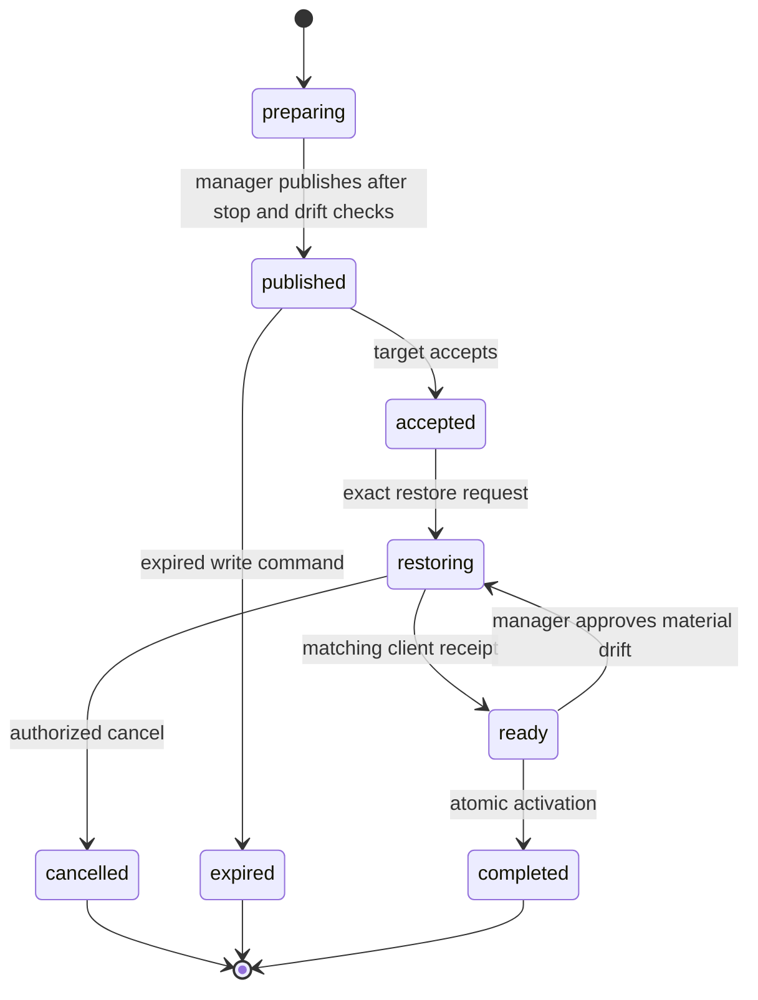

# M07 交接恢复与本机工作空间：业务规则与需求

## 来源与解释边界

固定run `NSG3TKRB16Y9F6Y203WB` revision4，project `19Q4K7PDARXQ9JHW6R6F`，repository `P1KRPDABN4RD0YXMX64E`，namespace `source-04d73353-be80-4433-8c5e-0b49a9c12c63`，snapshot `06376ab6287ee2d55caa79fc34257896e53ad0577a2b678947888024834468fa`，DRAFT commit `92728fbec04cfa34fee4421cb0a9319d1b755164`，源码manifest `0725fd3bb7867a6d7bba008b6af001c70f66b3c1dbf296b59ad95172eec6bdb9`，混合接入manifest `c832ac2345121f95b5f5d83da6275c79610bc4023b829568ee1ceeb2fadf307e`。分支名称不作版本证明。UA供业务导航，codegraph供符号导航，以下判断均回到固定原始源码。

发布知识artifact SHA256 `691ab67f0c3a41a5bce1e59ca5ae83d99044ddfbfc5e026afb92183e681615c8`；UA 2.9.8 adapter1.0.0 digest `d22a4a731809299030ee783710407af1e4ce37d5f1930345cb1d4b6a8cfb39a5`；codegraph 1.6.2 adapter1.0.0 digest `c7ce675c6c763726449fccb22159735859ad17eccbce1475c9617287479bf8da`；protocol1。发布交接仅包含12043节点中的前100且truncated=true、complete_repository_analysis=false，不能将未返回节点解释为不存在。

实际查询：UA overview及“任务执行/交接/测试/技能”search；relations来自返回节点 `ua:flow:cross-person-handover`、`ua:flow:test-execution-defect`、`ua:flow:skill-publish-share-install`，图边与evidence_ids保存在本次query-delivery-ua-*.json导航记录；native CG context从相同run返回claim/verify/submit、Git交接、testing与Run skills符号。图推断不代替下表原始证据。

assessment=observed_in_code仅描述实现；不代表产品预期、业务批准、运行期验收通过。现有测试标为defined，以下验证全部未执行。每个测试场景从独立种子/身份/权限开始，跨步骤继承只在该场景内明确列出。

## 角色、入口、实体与范围

项目工作空间初始化、绑定与识别；项目仓库附着、克隆与本机状态诊断；独立Run工作区创建、识别与可恢复清理；准备交接、源停止确认与冻结草稿；交接发布、固定上下文读取与差异检查；目标接收、恢复尝试与客户端就绪回执；交接激活与原请求重试；取消、到期、漂移批准与显式源恢复；安全Git交接快照、本机恢复及续接材料；本机规范指引生成、范围差异与过期检查。

## 规则及双向追溯

|稳定业务规则|资格/选择/运行控制与结果|异常或保留状态|来源|REQ / AC / 计划用例|
|---|---|---|---|---|
|BR-DEL-M07-01-01|资格：工作空间初始化拒绝另一个Git根内部的嵌套目标；已有同根Git可复用。|嵌套Git根或git init失败→返回明确错误，未形成成功绑定；无有效绑定/缺项目或API→project_binding_not_found或required/invalid|`apps/cli/src/project-workspace.ts:23-85` (sha256 `aa21097fb30ecfec14a3e77e229735664b7a15a335cd0abe39916303e95e0143`) `apps/cli/src/project-binding.ts:37-95` (sha256 `355a4849a0840b43c797ba0466f462a4a67a14ff55a0c089d505fd1f5ae71871`) `apps/cli/src/index.ts:1603-1664` (sha256 `ad4efa3eb1e4ac9c9c1158232d069ce721acce671359aa98e4c2354ef182268b`)|REQ-DEL-M07-01 / AC-M07-01-01, AC-M07-01-02 / TC-M07-01-*|
|BR-DEL-M07-01-02|本机身份：新绑定写project_code；读取兼容旧project_id；去掉API地址尾斜杠；向上查找最近.agent/bound-project.yaml。|嵌套Git根或git init失败→返回明确错误，未形成成功绑定；无有效绑定/缺项目或API→project_binding_not_found或required/invalid|`apps/cli/src/project-workspace.ts:23-85` (sha256 `aa21097fb30ecfec14a3e77e229735664b7a15a335cd0abe39916303e95e0143`) `apps/cli/src/project-binding.ts:37-95` (sha256 `355a4849a0840b43c797ba0466f462a4a67a14ff55a0c089d505fd1f5ae71871`) `apps/cli/src/index.ts:1603-1664` (sha256 `ad4efa3eb1e4ac9c9c1158232d069ce721acce671359aa98e4c2354ef182268b`)|REQ-DEL-M07-01 / AC-M07-01-01, AC-M07-01-02 / TC-M07-01-*|
|BR-DEL-M07-01-03|边界：代码目录、本机绑定/仓库注册、Run状态与技能包忽略提交；绑定文件不含设备token。|嵌套Git根或git init失败→返回明确错误，未形成成功绑定；无有效绑定/缺项目或API→project_binding_not_found或required/invalid|`apps/cli/src/project-workspace.ts:23-85` (sha256 `aa21097fb30ecfec14a3e77e229735664b7a15a335cd0abe39916303e95e0143`) `apps/cli/src/project-binding.ts:37-95` (sha256 `355a4849a0840b43c797ba0466f462a4a67a14ff55a0c089d505fd1f5ae71871`) `apps/cli/src/index.ts:1603-1664` (sha256 `ad4efa3eb1e4ac9c9c1158232d069ce721acce671359aa98e4c2354ef182268b`)|REQ-DEL-M07-01 / AC-M07-01-01, AC-M07-01-02 / TC-M07-01-*|
|BR-DEL-M07-02-01|附着：允许外部独立仓库，内部路径写相对路径，外部写绝对本机路径；仅本机注册表替换该repository_code绑定。|归档仓库/非Git根/remote不符→拒绝附着，不更新绑定；若在clone后附着才失败，不能推断此前Git写入已撤销；词法目标越界或已存在→在mkdir/Git clone前拒绝；链接祖先、clone失败或clone后的附着失败→链接祖先不在此前字符串边界校验范围；可能先写其他物理树，后置附着校验不能撤回已写内容；保留现场检查|`apps/cli/src/project-workspace.ts:98-151` (sha256 `aa21097fb30ecfec14a3e77e229735664b7a15a335cd0abe39916303e95e0143`) `apps/cli/src/project-workspace.ts:155-244` (sha256 `aa21097fb30ecfec14a3e77e229735664b7a15a335cd0abe39916303e95e0143`) `apps/cli/src/index.ts:2626-2707` (sha256 `ad4efa3eb1e4ac9c9c1158232d069ce721acce671359aa98e4c2354ef182268b`)|REQ-DEL-M07-02 / AC-M07-02-01, AC-M07-02-02, AC-M07-02-03 / TC-M07-02-*|
|BR-DEL-M07-02-02|克隆：仅以path.resolve/path.relative检查目标字符串在code的非根子路径，已存在目标拒绝；没有realpath或祖先symlink/junction检查，不能承诺物理树限制在code内。Git clone或后置attach失败无统一清理/回滚保证。|归档仓库/非Git根/remote不符→拒绝附着，不更新绑定；若在clone后附着才失败，不能推断此前Git写入已撤销；词法目标越界或已存在→在mkdir/Git clone前拒绝；链接祖先、clone失败或clone后的附着失败→链接祖先不在此前字符串边界校验范围；可能先写其他物理树，后置附着校验不能撤回已写内容；保留现场检查|`apps/cli/src/project-workspace.ts:98-151` (sha256 `aa21097fb30ecfec14a3e77e229735664b7a15a335cd0abe39916303e95e0143`) `apps/cli/src/project-workspace.ts:155-244` (sha256 `aa21097fb30ecfec14a3e77e229735664b7a15a335cd0abe39916303e95e0143`) `apps/cli/src/index.ts:2626-2707` (sha256 `ad4efa3eb1e4ac9c9c1158232d069ce721acce671359aa98e4c2354ef182268b`)|REQ-DEL-M07-02 / AC-M07-02-01, AC-M07-02-02, AC-M07-02-03 / TC-M07-02-*|
|BR-DEL-M07-02-03|诊断：status按远端仓库列表逐项比较本机绑定、根及远端；ready返回HEAD与dirty，缺失信息为null。|归档仓库/非Git根/remote不符→拒绝附着，不更新绑定；若在clone后附着才失败，不能推断此前Git写入已撤销；词法目标越界或已存在→在mkdir/Git clone前拒绝；链接祖先、clone失败或clone后的附着失败→链接祖先不在此前字符串边界校验范围；可能先写其他物理树，后置附着校验不能撤回已写内容；保留现场检查|`apps/cli/src/project-workspace.ts:98-151` (sha256 `aa21097fb30ecfec14a3e77e229735664b7a15a335cd0abe39916303e95e0143`) `apps/cli/src/project-workspace.ts:155-244` (sha256 `aa21097fb30ecfec14a3e77e229735664b7a15a335cd0abe39916303e95e0143`) `apps/cli/src/index.ts:2626-2707` (sha256 `ad4efa3eb1e4ac9c9c1158232d069ce721acce671359aa98e4c2354ef182268b`)|REQ-DEL-M07-02 / AC-M07-02-01, AC-M07-02-02, AC-M07-02-03 / TC-M07-02-*|
|BR-DEL-M07-03-01|创建：存在目录拒绝覆盖；基线commit不存在拒绝；worktree add失败删除新建半成品根。|有效引用或查询失败→不移动工作区；非法marker或回收目标内部→拒绝清理；跨卷rename/磁盘故障→错误上抛，保留现场核查|`packages/integrations/src/git-workspace.ts:44-175` (sha256 `326367f85ec4ad647453703b4df18b6137646555fd007da343e2e85efd6ea265`) `packages/domain/src/workspace-cleanup.ts:7-34` (sha256 `5797b8b1bca2dba5bab1143d7e97309fc809704fe64565fff86561b57c87c81b`) `apps/cli/src/index.ts:1667-1760` (sha256 `ad4efa3eb1e4ac9c9c1158232d069ce721acce671359aa98e4c2354ef182268b`)|REQ-DEL-M07-03 / AC-M07-03-01, AC-M07-03-02 / TC-M07-03-*|
|BR-DEL-M07-03-02|清理资格：必须有合法marker；回收区不得为工作区内部子目录；默认远端引用检查失败闭合拒绝，显式force才跳过引用检查。|有效引用或查询失败→不移动工作区；非法marker或回收目标内部→拒绝清理；跨卷rename/磁盘故障→错误上抛，保留现场核查|`packages/integrations/src/git-workspace.ts:44-175` (sha256 `326367f85ec4ad647453703b4df18b6137646555fd007da343e2e85efd6ea265`) `packages/domain/src/workspace-cleanup.ts:7-34` (sha256 `5797b8b1bca2dba5bab1143d7e97309fc809704fe64565fff86561b57c87c81b`) `apps/cli/src/index.ts:1667-1760` (sha256 `ad4efa3eb1e4ac9c9c1158232d069ce721acce671359aa98e4c2354ef182268b`)|REQ-DEL-M07-03 / AC-M07-03-01, AC-M07-03-02 / TC-M07-03-*|
|BR-DEL-M07-03-03|保留：dirty按git status判断；写git diff --binary不包含全部untracked，但整体rename保留全部原目录；不承诺Patch单独即可恢复所有内容。|有效引用或查询失败→不移动工作区；非法marker或回收目标内部→拒绝清理；跨卷rename/磁盘故障→错误上抛，保留现场核查|`packages/integrations/src/git-workspace.ts:44-175` (sha256 `326367f85ec4ad647453703b4df18b6137646555fd007da343e2e85efd6ea265`) `packages/domain/src/workspace-cleanup.ts:7-34` (sha256 `5797b8b1bca2dba5bab1143d7e97309fc809704fe64565fff86561b57c87c81b`) `apps/cli/src/index.ts:1667-1760` (sha256 `ad4efa3eb1e4ac9c9c1158232d069ce721acce671359aa98e4c2354ef182268b`)|REQ-DEL-M07-03 / AC-M07-03-01, AC-M07-03-02 / TC-M07-03-*|
|BR-DEL-M07-03-04|运行控制：dry-run只报告动作；真实回收使用时间戳目标路径，同卷rename；prune失败没有额外回滚实现保证。|有效引用或查询失败→不移动工作区；非法marker或回收目标内部→拒绝清理；跨卷rename/磁盘故障→错误上抛，保留现场核查|`packages/integrations/src/git-workspace.ts:44-175` (sha256 `326367f85ec4ad647453703b4df18b6137646555fd007da343e2e85efd6ea265`) `packages/domain/src/workspace-cleanup.ts:7-34` (sha256 `5797b8b1bca2dba5bab1143d7e97309fc809704fe64565fff86561b57c87c81b`) `apps/cli/src/index.ts:1667-1760` (sha256 `ad4efa3eb1e4ac9c9c1158232d069ce721acce671359aa98e4c2354ef182268b`)|REQ-DEL-M07-03 / AC-M07-03-01, AC-M07-03-02 / TC-M07-03-*|
|BR-DEL-M07-04-01|资格：仅源执行者+准备设备能更新草稿/停止确认；目标必须另一位active非viewer项目成员。|非builder状态/目标无资格/已有交接→拒绝prepare且不暂停Run；准备grant过期/撤销或设备不符→停止确认/草稿拒绝，保持源暂停；Git或草稿后续失败→保留preparing交接，取消后再显式resume|`packages/application/src/handover-use-cases.ts:52-72` (sha256 `a26521201ca0cc8e84f21fad39285c262f22e06645f844ed14f3da3d8d1b1f2e`) `packages/application/src/handover-use-cases.ts:198-237` (sha256 `a26521201ca0cc8e84f21fad39285c262f22e06645f844ed14f3da3d8d1b1f2e`) `packages/application/src/handover-use-cases.ts:300-365` (sha256 `a26521201ca0cc8e84f21fad39285c262f22e06645f844ed14f3da3d8d1b1f2e`) `apps/core-api/src/routes/handovers.ts:30-50` (sha256 `58e9cbb44cea92eb6974c445dbc9f7a884563fe85ef84174a313882f02f9addb`) `packages/persistence/drizzle/0024_shared_context_handovers.sql:1-16` (sha256 `d9120734eca469b51c35b65a6c0ab497c28b5ea472247d33d78da80cf41021dd`)|REQ-DEL-M07-04 / AC-M07-04-01, AC-M07-04-02 / TC-M07-04-*|
|BR-DEL-M07-04-02|栅栏：prepare事务立即暂停源Run、撤销租约并推进epoch；不等Git发布才停止服务写。|非builder状态/目标无资格/已有交接→拒绝prepare且不暂停Run；准备grant过期/撤销或设备不符→停止确认/草稿拒绝，保持源暂停；Git或草稿后续失败→保留preparing交接，取消后再显式resume|`packages/application/src/handover-use-cases.ts:52-72` (sha256 `a26521201ca0cc8e84f21fad39285c262f22e06645f844ed14f3da3d8d1b1f2e`) `packages/application/src/handover-use-cases.ts:198-237` (sha256 `a26521201ca0cc8e84f21fad39285c262f22e06645f844ed14f3da3d8d1b1f2e`) `packages/application/src/handover-use-cases.ts:300-365` (sha256 `a26521201ca0cc8e84f21fad39285c262f22e06645f844ed14f3da3d8d1b1f2e`) `apps/core-api/src/routes/handovers.ts:30-50` (sha256 `58e9cbb44cea92eb6974c445dbc9f7a884563fe85ef84174a313882f02f9addb`) `packages/persistence/drizzle/0024_shared_context_handovers.sql:1-16` (sha256 `d9120734eca469b51c35b65a6c0ab497c28b5ea472247d33d78da80cf41021dd`)|REQ-DEL-M07-04 / AC-M07-04-01, AC-M07-04-02 / TC-M07-04-*|
|BR-DEL-M07-04-03|冻结：draft保存摘要/workspace_manifest时复用prepare时已冻结sources，不跟随新材料；workspace仓库为当前项目active且remote匹配。|非builder状态/目标无资格/已有交接→拒绝prepare且不暂停Run；准备grant过期/撤销或设备不符→停止确认/草稿拒绝，保持源暂停；Git或草稿后续失败→保留preparing交接，取消后再显式resume|`packages/application/src/handover-use-cases.ts:52-72` (sha256 `a26521201ca0cc8e84f21fad39285c262f22e06645f844ed14f3da3d8d1b1f2e`) `packages/application/src/handover-use-cases.ts:198-237` (sha256 `a26521201ca0cc8e84f21fad39285c262f22e06645f844ed14f3da3d8d1b1f2e`) `packages/application/src/handover-use-cases.ts:300-365` (sha256 `a26521201ca0cc8e84f21fad39285c262f22e06645f844ed14f3da3d8d1b1f2e`) `apps/core-api/src/routes/handovers.ts:30-50` (sha256 `58e9cbb44cea92eb6974c445dbc9f7a884563fe85ef84174a313882f02f9addb`) `packages/persistence/drizzle/0024_shared_context_handovers.sql:1-16` (sha256 `d9120734eca469b51c35b65a6c0ab497c28b5ea472247d33d78da80cf41021dd`)|REQ-DEL-M07-04 / AC-M07-04-01, AC-M07-04-02 / TC-M07-04-*|
|BR-DEL-M07-04-04|停止：明确stopped=true及允许的assurance才写stop_ack，并将源活跃Session标cancelled；客户端停止声明不等于服务已观察全部外部进程停止。|非builder状态/目标无资格/已有交接→拒绝prepare且不暂停Run；准备grant过期/撤销或设备不符→停止确认/草稿拒绝，保持源暂停；Git或草稿后续失败→保留preparing交接，取消后再显式resume|`packages/application/src/handover-use-cases.ts:52-72` (sha256 `a26521201ca0cc8e84f21fad39285c262f22e06645f844ed14f3da3d8d1b1f2e`) `packages/application/src/handover-use-cases.ts:198-237` (sha256 `a26521201ca0cc8e84f21fad39285c262f22e06645f844ed14f3da3d8d1b1f2e`) `packages/application/src/handover-use-cases.ts:300-365` (sha256 `a26521201ca0cc8e84f21fad39285c262f22e06645f844ed14f3da3d8d1b1f2e`) `apps/core-api/src/routes/handovers.ts:30-50` (sha256 `58e9cbb44cea92eb6974c445dbc9f7a884563fe85ef84174a313882f02f9addb`) `packages/persistence/drizzle/0024_shared_context_handovers.sql:1-16` (sha256 `d9120734eca469b51c35b65a6c0ab497c28b5ea472247d33d78da80cf41021dd`)|REQ-DEL-M07-04 / AC-M07-04-01, AC-M07-04-02 / TC-M07-04-*|
|BR-DEL-M07-04-05|重试：同key、同actor/设备/负载的prepare重放在preparing状态刷新30分钟grant；同key不同请求或设备拒绝。|非builder状态/目标无资格/已有交接→拒绝prepare且不暂停Run；准备grant过期/撤销或设备不符→停止确认/草稿拒绝，保持源暂停；Git或草稿后续失败→保留preparing交接，取消后再显式resume|`packages/application/src/handover-use-cases.ts:52-72` (sha256 `a26521201ca0cc8e84f21fad39285c262f22e06645f844ed14f3da3d8d1b1f2e`) `packages/application/src/handover-use-cases.ts:198-237` (sha256 `a26521201ca0cc8e84f21fad39285c262f22e06645f844ed14f3da3d8d1b1f2e`) `packages/application/src/handover-use-cases.ts:300-365` (sha256 `a26521201ca0cc8e84f21fad39285c262f22e06645f844ed14f3da3d8d1b1f2e`) `apps/core-api/src/routes/handovers.ts:30-50` (sha256 `58e9cbb44cea92eb6974c445dbc9f7a884563fe85ef84174a313882f02f9addb`) `packages/persistence/drizzle/0024_shared_context_handovers.sql:1-16` (sha256 `d9120734eca469b51c35b65a6c0ab497c28b5ea472247d33d78da80cf41021dd`)|REQ-DEL-M07-04 / AC-M07-04-01, AC-M07-04-02 / TC-M07-04-*|
|BR-DEL-M07-05-01|发布：管理者才可发布，缺停止确认/代码快照或发生来源漂移拒绝；不是再次采集今日材料。|上下文hash不匹配→context_hash_mismatch，不返回未验证内容；未发布被目标/其他普通成员查询→拒绝/过滤该记录；publish发现源漂移→context_source_changed，保持preparing|`packages/application/src/handover-use-cases.ts:87-181` (sha256 `a26521201ca0cc8e84f21fad39285c262f22e06645f844ed14f3da3d8d1b1f2e`) `packages/application/src/handover-use-cases.ts:207-214` (sha256 `a26521201ca0cc8e84f21fad39285c262f22e06645f844ed14f3da3d8d1b1f2e`) `packages/application/src/handover-use-cases.ts:239-263` (sha256 `a26521201ca0cc8e84f21fad39285c262f22e06645f844ed14f3da3d8d1b1f2e`) `packages/application/src/handover-use-cases.ts:367-377` (sha256 `a26521201ca0cc8e84f21fad39285c262f22e06645f844ed14f3da3d8d1b1f2e`) `packages/application/src/handover-use-cases.ts:472-538` (sha256 `a26521201ca0cc8e84f21fad39285c262f22e06645f844ed14f3da3d8d1b1f2e`)|REQ-DEL-M07-05 / AC-M07-05-01, AC-M07-05-02 / TC-M07-05-*|
|BR-DEL-M07-05-02|可见：未发布仅源执行者和管理者可读；已发布对有当前项目访问权的设备用户可读，非只限目标；legacy身份声明不能读取共享上下文。|上下文hash不匹配→context_hash_mismatch，不返回未验证内容；未发布被目标/其他普通成员查询→拒绝/过滤该记录；publish发现源漂移→context_source_changed，保持preparing|`packages/application/src/handover-use-cases.ts:87-181` (sha256 `a26521201ca0cc8e84f21fad39285c262f22e06645f844ed14f3da3d8d1b1f2e`) `packages/application/src/handover-use-cases.ts:207-214` (sha256 `a26521201ca0cc8e84f21fad39285c262f22e06645f844ed14f3da3d8d1b1f2e`) `packages/application/src/handover-use-cases.ts:239-263` (sha256 `a26521201ca0cc8e84f21fad39285c262f22e06645f844ed14f3da3d8d1b1f2e`) `packages/application/src/handover-use-cases.ts:367-377` (sha256 `a26521201ca0cc8e84f21fad39285c262f22e06645f844ed14f3da3d8d1b1f2e`) `packages/application/src/handover-use-cases.ts:472-538` (sha256 `a26521201ca0cc8e84f21fad39285c262f22e06645f844ed14f3da3d8d1b1f2e`)|REQ-DEL-M07-05 / AC-M07-05-01, AC-M07-05-02 / TC-M07-05-*|
|BR-DEL-M07-05-03|固定与顺序：上下文包含任务合同、固定需求/基线、活动文档/原型/有效决策及来源向量，canonical载荷最大4MiB；项目列表updated_at DESC、id DESC，任务列表id ASC。|上下文hash不匹配→context_hash_mismatch，不返回未验证内容；未发布被目标/其他普通成员查询→拒绝/过滤该记录；publish发现源漂移→context_source_changed，保持preparing|`packages/application/src/handover-use-cases.ts:87-181` (sha256 `a26521201ca0cc8e84f21fad39285c262f22e06645f844ed14f3da3d8d1b1f2e`) `packages/application/src/handover-use-cases.ts:207-214` (sha256 `a26521201ca0cc8e84f21fad39285c262f22e06645f844ed14f3da3d8d1b1f2e`) `packages/application/src/handover-use-cases.ts:239-263` (sha256 `a26521201ca0cc8e84f21fad39285c262f22e06645f844ed14f3da3d8d1b1f2e`) `packages/application/src/handover-use-cases.ts:367-377` (sha256 `a26521201ca0cc8e84f21fad39285c262f22e06645f844ed14f3da3d8d1b1f2e`) `packages/application/src/handover-use-cases.ts:472-538` (sha256 `a26521201ca0cc8e84f21fad39285c262f22e06645f844ed14f3da3d8d1b1f2e`)|REQ-DEL-M07-05 / AC-M07-05-01, AC-M07-05-02 / TC-M07-05-*|
|BR-DEL-M07-05-04|只读：读取不执行过期流转；到期标记在后续命令惰性处理；diff提示source_changed且不改旧快照。|上下文hash不匹配→context_hash_mismatch，不返回未验证内容；未发布被目标/其他普通成员查询→拒绝/过滤该记录；publish发现源漂移→context_source_changed，保持preparing|`packages/application/src/handover-use-cases.ts:87-181` (sha256 `a26521201ca0cc8e84f21fad39285c262f22e06645f844ed14f3da3d8d1b1f2e`) `packages/application/src/handover-use-cases.ts:207-214` (sha256 `a26521201ca0cc8e84f21fad39285c262f22e06645f844ed14f3da3d8d1b1f2e`) `packages/application/src/handover-use-cases.ts:239-263` (sha256 `a26521201ca0cc8e84f21fad39285c262f22e06645f844ed14f3da3d8d1b1f2e`) `packages/application/src/handover-use-cases.ts:367-377` (sha256 `a26521201ca0cc8e84f21fad39285c262f22e06645f844ed14f3da3d8d1b1f2e`) `packages/application/src/handover-use-cases.ts:472-538` (sha256 `a26521201ca0cc8e84f21fad39285c262f22e06645f844ed14f3da3d8d1b1f2e`)|REQ-DEL-M07-05 / AC-M07-05-01, AC-M07-05-02 / TC-M07-05-*|
|BR-DEL-M07-06-01|资格：仅目标成员接收/恢复/ready，restore不能换设备或覆写已有尝试；已有target_run需原key继续。|另一设备/不同尝试/错误hash或commit→handover_device_conflict/receipt_invalid，保留原Run；材料漂移、技能被撤销→拒绝restore/ready；已有恢复记录不被自动删掉|`packages/application/src/handover-use-cases.ts:378-419` (sha256 `a26521201ca0cc8e84f21fad39285c262f22e06645f844ed14f3da3d8d1b1f2e`) `packages/application/src/skills-run.ts:75-83` (sha256 `7f99d850404df4adab97e9944ba79c5182492daa2a7e3f527707d84f421a96c9`)|REQ-DEL-M07-06 / AC-M07-06-01, AC-M07-06-02 / TC-M07-06-*|
|BR-DEL-M07-06-02|路径：目标非空且不能与服务记录的源workspace.path字符串完全相同；git_base必须准确匹配snapshot_commit；服务不检查目标磁盘真实性，服务登记不代表本机Git已经恢复。|另一设备/不同尝试/错误hash或commit→handover_device_conflict/receipt_invalid，保留原Run；材料漂移、技能被撤销→拒绝restore/ready；已有恢复记录不被自动删掉|`packages/application/src/handover-use-cases.ts:378-419` (sha256 `a26521201ca0cc8e84f21fad39285c262f22e06645f844ed14f3da3d8d1b1f2e`) `packages/application/src/skills-run.ts:75-83` (sha256 `7f99d850404df4adab97e9944ba79c5182492daa2a7e3f527707d84f421a96c9`)|REQ-DEL-M07-06 / AC-M07-06-01, AC-M07-06-02 / TC-M07-06-*|
|BR-DEL-M07-06-03|回执：ready匹配目标设备、attempt、context hash、snapshot commit、64位digest且assurance=client_reported；再次查漂移和技能当前授权。|另一设备/不同尝试/错误hash或commit→handover_device_conflict/receipt_invalid，保留原Run；材料漂移、技能被撤销→拒绝restore/ready；已有恢复记录不被自动删掉|`packages/application/src/handover-use-cases.ts:378-419` (sha256 `a26521201ca0cc8e84f21fad39285c262f22e06645f844ed14f3da3d8d1b1f2e`) `packages/application/src/skills-run.ts:75-83` (sha256 `7f99d850404df4adab97e9944ba79c5182492daa2a7e3f527707d84f421a96c9`)|REQ-DEL-M07-06 / AC-M07-06-01, AC-M07-06-02 / TC-M07-06-*|
|BR-DEL-M07-06-04|运行控制：accept不启动Run；restore创建preparing Run，ready仍未激活；重复restore原请求/key返回同尝试。|另一设备/不同尝试/错误hash或commit→handover_device_conflict/receipt_invalid，保留原Run；材料漂移、技能被撤销→拒绝restore/ready；已有恢复记录不被自动删掉|`packages/application/src/handover-use-cases.ts:378-419` (sha256 `a26521201ca0cc8e84f21fad39285c262f22e06645f844ed14f3da3d8d1b1f2e`) `packages/application/src/skills-run.ts:75-83` (sha256 `7f99d850404df4adab97e9944ba79c5182492daa2a7e3f527707d84f421a96c9`)|REQ-DEL-M07-06 / AC-M07-06-01, AC-M07-06-02 / TC-M07-06-*|
|BR-DEL-M07-07-01|激活：请求接受不是执行完成，activate才转交业务写权；source作者身份不改写。|源/目标Run状态改变或回执缺失→state_conflict/receipt_invalid，保持未激活；完成后用新key/其他设备重试→state_conflict，不创建新Run|`packages/application/src/handover-use-cases.ts:421-451` (sha256 `a26521201ca0cc8e84f21fad39285c262f22e06645f844ed14f3da3d8d1b1f2e`) `packages/application/src/handover-use-cases.ts:265-297` (sha256 `a26521201ca0cc8e84f21fad39285c262f22e06645f844ed14f3da3d8d1b1f2e`) `packages/persistence/src/schema.ts:1059-1094` (sha256 `b2b85d191bc636884933297979a8d0c49b5d422691674cd699a5d33b1fb62475`)|REQ-DEL-M07-07 / AC-M07-07-01, AC-M07-07-02 / TC-M07-07-*|
|BR-DEL-M07-07-02|并发：任务锁和事务保护源/目标/任务/交接与receipt，不能产生两个active目标Run。|源/目标Run状态改变或回执缺失→state_conflict/receipt_invalid，保持未激活；完成后用新key/其他设备重试→state_conflict，不创建新Run|`packages/application/src/handover-use-cases.ts:421-451` (sha256 `a26521201ca0cc8e84f21fad39285c262f22e06645f844ed14f3da3d8d1b1f2e`) `packages/application/src/handover-use-cases.ts:265-297` (sha256 `a26521201ca0cc8e84f21fad39285c262f22e06645f844ed14f3da3d8d1b1f2e`) `packages/persistence/src/schema.ts:1059-1094` (sha256 `b2b85d191bc636884933297979a8d0c49b5d422691674cd699a5d33b1fb62475`)|REQ-DEL-M07-07 / AC-M07-07-01, AC-M07-07-02 / TC-M07-07-*|
|BR-DEL-M07-07-03|重试：completed仅接受同设备且原request receipt重放；不再重复推进任务版本；租约可按当前epoch重签。|源/目标Run状态改变或回执缺失→state_conflict/receipt_invalid，保持未激活；完成后用新key/其他设备重试→state_conflict，不创建新Run|`packages/application/src/handover-use-cases.ts:421-451` (sha256 `a26521201ca0cc8e84f21fad39285c262f22e06645f844ed14f3da3d8d1b1f2e`) `packages/application/src/handover-use-cases.ts:265-297` (sha256 `a26521201ca0cc8e84f21fad39285c262f22e06645f844ed14f3da3d8d1b1f2e`) `packages/persistence/src/schema.ts:1059-1094` (sha256 `b2b85d191bc636884933297979a8d0c49b5d422691674cd699a5d33b1fb62475`)|REQ-DEL-M07-07 / AC-M07-07-01, AC-M07-07-02 / TC-M07-07-*|
|BR-DEL-M07-07-04|再检查：ready后发生漂移、设备撤销、成员撤权或技能授权失效均阻止激活。|源/目标Run状态改变或回执缺失→state_conflict/receipt_invalid，保持未激活；完成后用新key/其他设备重试→state_conflict，不创建新Run|`packages/application/src/handover-use-cases.ts:421-451` (sha256 `a26521201ca0cc8e84f21fad39285c262f22e06645f844ed14f3da3d8d1b1f2e`) `packages/application/src/handover-use-cases.ts:265-297` (sha256 `a26521201ca0cc8e84f21fad39285c262f22e06645f844ed14f3da3d8d1b1f2e`) `packages/persistence/src/schema.ts:1059-1094` (sha256 `b2b85d191bc636884933297979a8d0c49b5d422691674cd699a5d33b1fb62475`)|REQ-DEL-M07-07 / AC-M07-07-01, AC-M07-07-02 / TC-M07-07-*|
|BR-DEL-M07-08-01|取消：源/目标或管理者可取消未完成交接；重复cancelled/expired只返回；不自动重启源Run。|仍有未完成交接请求resume→task_handover_pending，源保持暂停；task合同已变仍批准漂移→context_contract_changed，不能豁免；到期activation→目标Run取消，源暂停，不伪装完成|`packages/application/src/handover-use-cases.ts:265-292` (sha256 `a26521201ca0cc8e84f21fad39285c262f22e06645f844ed14f3da3d8d1b1f2e`) `packages/application/src/handover-use-cases.ts:452-470` (sha256 `a26521201ca0cc8e84f21fad39285c262f22e06645f844ed14f3da3d8d1b1f2e`) `packages/application/src/handover-use-cases.ts:539-562` (sha256 `a26521201ca0cc8e84f21fad39285c262f22e06645f844ed14f3da3d8d1b1f2e`)|REQ-DEL-M07-08 / AC-M07-08-01, AC-M07-08-02, AC-M07-08-03 / TC-M07-08-*|
|BR-DEL-M07-08-02|到期：published/accepted/restoring/ready在写命令发现24小时时限后持久化expired并返回handover_expired；preparing不由该惰性分支过期，grant仍独立30分钟。|仍有未完成交接请求resume→task_handover_pending，源保持暂停；task合同已变仍批准漂移→context_contract_changed，不能豁免；到期activation→目标Run取消，源暂停，不伪装完成|`packages/application/src/handover-use-cases.ts:265-292` (sha256 `a26521201ca0cc8e84f21fad39285c262f22e06645f844ed14f3da3d8d1b1f2e`) `packages/application/src/handover-use-cases.ts:452-470` (sha256 `a26521201ca0cc8e84f21fad39285c262f22e06645f844ed14f3da3d8d1b1f2e`) `packages/application/src/handover-use-cases.ts:539-562` (sha256 `a26521201ca0cc8e84f21fad39285c262f22e06645f844ed14f3da3d8d1b1f2e`)|REQ-DEL-M07-08 / AC-M07-08-01, AC-M07-08-02, AC-M07-08-03 / TC-M07-08-*|
|BR-DEL-M07-08-03|漂移：管理者理由非空且≤4000；只批准当前精确向量；task合同摘要变化永不可豁免；批准清除ready_receipt，ready退restoring，再产生变化再阻止。|仍有未完成交接请求resume→task_handover_pending，源保持暂停；task合同已变仍批准漂移→context_contract_changed，不能豁免；到期activation→目标Run取消，源暂停，不伪装完成|`packages/application/src/handover-use-cases.ts:265-292` (sha256 `a26521201ca0cc8e84f21fad39285c262f22e06645f844ed14f3da3d8d1b1f2e`) `packages/application/src/handover-use-cases.ts:452-470` (sha256 `a26521201ca0cc8e84f21fad39285c262f22e06645f844ed14f3da3d8d1b1f2e`) `packages/application/src/handover-use-cases.ts:539-562` (sha256 `a26521201ca0cc8e84f21fad39285c262f22e06645f844ed14f3da3d8d1b1f2e`)|REQ-DEL-M07-08 / AC-M07-08-01, AC-M07-08-02, AC-M07-08-03 / TC-M07-08-*|
|BR-DEL-M07-08-04|恢复：仅源Run本人兼当前Assignee能恢复suspended，必须先终结pending交接；重查固定技能；同key重放active结果不再推进版本。|仍有未完成交接请求resume→task_handover_pending，源保持暂停；task合同已变仍批准漂移→context_contract_changed，不能豁免；到期activation→目标Run取消，源暂停，不伪装完成|`packages/application/src/handover-use-cases.ts:265-292` (sha256 `a26521201ca0cc8e84f21fad39285c262f22e06645f844ed14f3da3d8d1b1f2e`) `packages/application/src/handover-use-cases.ts:452-470` (sha256 `a26521201ca0cc8e84f21fad39285c262f22e06645f844ed14f3da3d8d1b1f2e`) `packages/application/src/handover-use-cases.ts:539-562` (sha256 `a26521201ca0cc8e84f21fad39285c262f22e06645f844ed14f3da3d8d1b1f2e`)|REQ-DEL-M07-08 / AC-M07-08-01, AC-M07-08-02, AC-M07-08-03 / TC-M07-08-*|
|BR-DEL-M07-09-01|分阶段限制：默认过滤私人/凭据/Agent配置路径，显式选择禁用路径拒绝；相对普通文件不得越界或符号链接；早期预检查submodule/LFS及选中现存文件含NUL。无NUL不等于Git判为文本，后续私有index的git diff --numstat仍可返回binary并拒绝。|在服务prepare之前已发现显式禁路径、含NUL、LFS/submodule或仓库不匹配→早期拒绝，不调用服务prepare或推送；无暂停断言仅限这一时间点；prepare及stop-ack之后Git diff --numstat将无NUL变更判为binary→handover_binary_unsupported；保留preparing交接/stop_ack及suspended源Run，该次不发布交接ref；取消交接后须显式resume源Run；fetch/ref/hash/journal冲突或恢复后本机修改→保留现场拒绝就绪/启动；API接受后本机失败→用原key/journal继续；不能当作新恢复尝试|`packages/integrations/src/handover-workspace.ts:18-80` (sha256 `fd65dac16eafd549cc0e8e3e4561cd6cd6b054a09223f519bb28c42ccf17ea23`) `packages/integrations/src/handover-workspace.ts:82-164` (sha256 `fd65dac16eafd549cc0e8e3e4561cd6cd6b054a09223f519bb28c42ccf17ea23`) `apps/cli/src/handover.ts:119-199` (sha256 `621c4247a3108de12c95ceb7324cb18265962792a0b4c15a5365ad88080b2c7d`)|REQ-DEL-M07-09 / AC-M07-09-01, AC-M07-09-02, AC-M07-09-03 / TC-M07-09-*|
|BR-DEL-M07-09-02|远端幂等：已有交接ref只有相同tree且相同父提交时可复用，不允许替换已发布快照。|在服务prepare之前已发现显式禁路径、含NUL、LFS/submodule或仓库不匹配→早期拒绝，不调用服务prepare或推送；无暂停断言仅限这一时间点；prepare及stop-ack之后Git diff --numstat将无NUL变更判为binary→handover_binary_unsupported；保留preparing交接/stop_ack及suspended源Run，该次不发布交接ref；取消交接后须显式resume源Run；fetch/ref/hash/journal冲突或恢复后本机修改→保留现场拒绝就绪/启动；API接受后本机失败→用原key/journal继续；不能当作新恢复尝试|`packages/integrations/src/handover-workspace.ts:18-80` (sha256 `fd65dac16eafd549cc0e8e3e4561cd6cd6b054a09223f519bb28c42ccf17ea23`) `packages/integrations/src/handover-workspace.ts:82-164` (sha256 `fd65dac16eafd549cc0e8e3e4561cd6cd6b054a09223f519bb28c42ccf17ea23`) `apps/cli/src/handover.ts:119-199` (sha256 `621c4247a3108de12c95ceb7324cb18265962792a0b4c15a5365ad88080b2c7d`)|REQ-DEL-M07-09 / AC-M07-09-01, AC-M07-09-02, AC-M07-09-03 / TC-M07-09-*|
|BR-DEL-M07-09-03|恢复：已存在目录只可匹配相同attempt/commit恢复journal继续；ref移动、tree不符、脏工作区或必要产物hash不符拒绝；Run独立受管技能目录是允许未跟踪例外。|在服务prepare之前已发现显式禁路径、含NUL、LFS/submodule或仓库不匹配→早期拒绝，不调用服务prepare或推送；无暂停断言仅限这一时间点；prepare及stop-ack之后Git diff --numstat将无NUL变更判为binary→handover_binary_unsupported；保留preparing交接/stop_ack及suspended源Run，该次不发布交接ref；取消交接后须显式resume源Run；fetch/ref/hash/journal冲突或恢复后本机修改→保留现场拒绝就绪/启动；API接受后本机失败→用原key/journal继续；不能当作新恢复尝试|`packages/integrations/src/handover-workspace.ts:18-80` (sha256 `fd65dac16eafd549cc0e8e3e4561cd6cd6b054a09223f519bb28c42ccf17ea23`) `packages/integrations/src/handover-workspace.ts:82-164` (sha256 `fd65dac16eafd549cc0e8e3e4561cd6cd6b054a09223f519bb28c42ccf17ea23`) `apps/cli/src/handover.ts:119-199` (sha256 `621c4247a3108de12c95ceb7324cb18265962792a0b4c15a5365ad88080b2c7d`)|REQ-DEL-M07-09 / AC-M07-09-01, AC-M07-09-02, AC-M07-09-03 / TC-M07-09-*|
|BR-DEL-M07-09-04|边界：CLI先服务prepare/stop-ack才调用快照发布；之后的Git binary判定失败会留下preparing交接和suspended源Run，该次不执行后续ref发布。需取消再显式resume恢复。Git/服务不跨系统原子；原key/journal保留原请求，ready仅client_reported。|在服务prepare之前已发现显式禁路径、含NUL、LFS/submodule或仓库不匹配→早期拒绝，不调用服务prepare或推送；无暂停断言仅限这一时间点；prepare及stop-ack之后Git diff --numstat将无NUL变更判为binary→handover_binary_unsupported；保留preparing交接/stop_ack及suspended源Run，该次不发布交接ref；取消交接后须显式resume源Run；fetch/ref/hash/journal冲突或恢复后本机修改→保留现场拒绝就绪/启动；API接受后本机失败→用原key/journal继续；不能当作新恢复尝试|`packages/integrations/src/handover-workspace.ts:18-80` (sha256 `fd65dac16eafd549cc0e8e3e4561cd6cd6b054a09223f519bb28c42ccf17ea23`) `packages/integrations/src/handover-workspace.ts:82-164` (sha256 `fd65dac16eafd549cc0e8e3e4561cd6cd6b054a09223f519bb28c42ccf17ea23`) `apps/cli/src/handover.ts:119-199` (sha256 `621c4247a3108de12c95ceb7324cb18265962792a0b4c15a5365ad88080b2c7d`)|REQ-DEL-M07-09 / AC-M07-09-01, AC-M07-09-02, AC-M07-09-03 / TC-M07-09-*|
|BR-DEL-M07-10-01|范围：本机guidance仅取standards根的直接active文档；项目首页/交接collectProjectStandardsDocuments递归包含active后代并按title/code排序，这是当前入口差异，不能把本机指引当作完整递归规范集。|缺规范根、空直接集合或正文空→standards_folder_missing/standards_empty/standard_content_missing，不能报告指引完备；本机manifest缺失或不可解析→check把当前远端文档local_revision视null并报告stale；写入中断→可能部分文件已更新，保留现场后重新生成/检查|`apps/cli/src/guidance.ts:66-107` (sha256 `6833e29cbb1ef35482f7d2b60deda922edef985e30a09d30ed42469677d7c1c7`) `apps/cli/src/guidance.ts:187-317` (sha256 `6833e29cbb1ef35482f7d2b60deda922edef985e30a09d30ed42469677d7c1c7`) `packages/application/src/project-standards.ts:23-44` (sha256 `1ee66eacd3dc8e3ab0da07def771985b584f5fd66ed8a0575e810c470b9c99ac`) `apps/cli/src/index.ts:1633-1663` (sha256 `ad4efa3eb1e4ac9c9c1158232d069ce721acce671359aa98e4c2354ef182268b`)|REQ-DEL-M07-10 / AC-M07-10-01, AC-M07-10-02 / TC-M07-10-*|
|BR-DEL-M07-10-02|写入：工作空间AGENTS.md与CLAUDE.md为生成文件且直接替换；code一级Git仓库只有AGENTS.md未被Git跟踪时才同时生成两份副本，并补Git exclude；没有通用保留手工修改承诺。|缺规范根、空直接集合或正文空→standards_folder_missing/standards_empty/standard_content_missing，不能报告指引完备；本机manifest缺失或不可解析→check把当前远端文档local_revision视null并报告stale；写入中断→可能部分文件已更新，保留现场后重新生成/检查|`apps/cli/src/guidance.ts:66-107` (sha256 `6833e29cbb1ef35482f7d2b60deda922edef985e30a09d30ed42469677d7c1c7`) `apps/cli/src/guidance.ts:187-317` (sha256 `6833e29cbb1ef35482f7d2b60deda922edef985e30a09d30ed42469677d7c1c7`) `packages/application/src/project-standards.ts:23-44` (sha256 `1ee66eacd3dc8e3ab0da07def771985b584f5fd66ed8a0575e810c470b9c99ac`) `apps/cli/src/index.ts:1633-1663` (sha256 `ad4efa3eb1e4ac9c9c1158232d069ce721acce671359aa98e4c2354ef182268b`)|REQ-DEL-M07-10 / AC-M07-10-01, AC-M07-10-02 / TC-M07-10-*|
|BR-DEL-M07-10-03|检查：--check不写文件，只对远端当前文档ID比较revision；不计算本机正文hash，也不将manifest多余旧条目单独判为过期；有任一远端版本不符则CLI退出码1。|缺规范根、空直接集合或正文空→standards_folder_missing/standards_empty/standard_content_missing，不能报告指引完备；本机manifest缺失或不可解析→check把当前远端文档local_revision视null并报告stale；写入中断→可能部分文件已更新，保留现场后重新生成/检查|`apps/cli/src/guidance.ts:66-107` (sha256 `6833e29cbb1ef35482f7d2b60deda922edef985e30a09d30ed42469677d7c1c7`) `apps/cli/src/guidance.ts:187-317` (sha256 `6833e29cbb1ef35482f7d2b60deda922edef985e30a09d30ed42469677d7c1c7`) `packages/application/src/project-standards.ts:23-44` (sha256 `1ee66eacd3dc8e3ab0da07def771985b584f5fd66ed8a0575e810c470b9c99ac`) `apps/cli/src/index.ts:1633-1663` (sha256 `ad4efa3eb1e4ac9c9c1158232d069ce721acce671359aa98e4c2354ef182268b`)|REQ-DEL-M07-10 / AC-M07-10-01, AC-M07-10-02 / TC-M07-10-*|
|BR-DEL-M07-10-04|失败边界：缺root/无直接有效文档/缺正文立即报错；workspace init对guidance错误只返回error仍保留成功绑定；多文件生成是逐文件rename，不承诺跨文件原子。|缺规范根、空直接集合或正文空→standards_folder_missing/standards_empty/standard_content_missing，不能报告指引完备；本机manifest缺失或不可解析→check把当前远端文档local_revision视null并报告stale；写入中断→可能部分文件已更新，保留现场后重新生成/检查|`apps/cli/src/guidance.ts:66-107` (sha256 `6833e29cbb1ef35482f7d2b60deda922edef985e30a09d30ed42469677d7c1c7`) `apps/cli/src/guidance.ts:187-317` (sha256 `6833e29cbb1ef35482f7d2b60deda922edef985e30a09d30ed42469677d7c1c7`) `packages/application/src/project-standards.ts:23-44` (sha256 `1ee66eacd3dc8e3ab0da07def771985b584f5fd66ed8a0575e810c470b9c99ac`) `apps/cli/src/index.ts:1633-1663` (sha256 `ad4efa3eb1e4ac9c9c1158232d069ce721acce671359aa98e4c2354ef182268b`)|REQ-DEL-M07-10 / AC-M07-10-01, AC-M07-10-02 / TC-M07-10-*|

## 完整场景与数据契约

### REQ-DEL-M07-01 项目工作空间初始化、绑定与识别

参与者：本机CLI操作者及具有项目权的登录用户。触发：workspace init/project bind/current/workspace guidance。

前置条件：可写本机目标目录；项目身份由远端权限查询确认；项目工作空间根不位于其他Git工作树内部。

主流程：创建独立Git根（需要时git init）与.agent/work/outbox/code骨架；保留原.gitignore并补充本机目录忽略规则；绑定项目编码、API地址及可选云工作空间编码；从当前目录向上识别最近绑定，按项目材料生成本机guidance。

状态变化/保留：本机新增/复用工作空间Git及目录、绑定文件；不代表启动任务Run。

数据契约：bound-project.yaml含schema_version、project_code、project_workspace_code、api_url、bound_at；机器路径仅本机。

验收标准：AC-M07-01-01 初始化和向上识别使项目工作空间保持独立本机绑定。；AC-M07-01-02 其他Git根内部不能初始化嵌套项目工作空间。。

### REQ-DEL-M07-02 项目仓库附着、克隆与本机状态诊断

参与者：已绑定项目工作空间的本机操作者。触发：repository list/attach/clone/status。

前置条件：远端项目仓库记录可读且状态active；attach目标为独立Git根；clone的path.resolve/path.relative词法目标为code非根子路径且existsSync为false；普通目录隔离场景另需无链接祖先。

主流程：从最近项目绑定定位工作空间与本机仓库注册表；附着时校验Git根、remote存在及规范化remote匹配；克隆先检查字符串路径与目标存在性，再mkdir/Git clone；成功后才复用附着校验；返回每仓库本机ready/missing/invalid/remote_missing/remote_mismatch/not_checked_out。

状态变化/保留：成功仅写本机repositories.local.yaml及克隆目录；不修改云端仓库记录。

数据契约：本机映射repository_code/path/remote_name；remote等价比较由normalizeRemote执行；status含checkout_status/local_path/git_head/dirty。

验收标准：AC-M07-02-01 匹配的独立本机仓库可附着并输出可诊断状态。；AC-M07-02-02 普通无链接目录场景拒绝词法越界或已有目标；该结果只证明字符串边界与存在性检查。；AC-M07-02-03 带链接祖先的词法内目标必须作为未获物理隔离保证的风险场景记录，不能把后置附着校验视为先前写入回滚。。

### REQ-DEL-M07-03 独立Run工作区创建、识别与可恢复清理

参与者：本机CLI工作区操作者。触发：workspace create/identify/cleanup。

前置条件：create要求有效仓库及基线commit且新根不存在；cleanup要求可解析.agent/workspace.yaml与独立回收目录。

主流程：create生成detached worktree repo及标准骨架和元数据；identify向上定位工作区元数据；cleanup默认查询任务：pending交接或该Run active/suspended/preparing即阻止；未引用的脏工作区先写binary diff Patch，再整体移入回收区并prune。

状态变化/保留：create本机新工作区；cleanup成功原目录整体移入回收；远端Run状态不修改。

数据契约：workspace.yaml固定project/feature/task/run/workspace/profile/snapshot/git_base；结果decision/actions/patchPath/recycleTarget。

验收标准：AC-M07-03-01 清理提供预演，并把未提交及未跟踪内容保留在可恢复回收目录。；AC-M07-03-02 暂停/恢复中Run和未完成交接阻止默认工作区清理。。

### REQ-DEL-M07-04 准备交接、源停止确认与冻结草稿

参与者：当前builder执行者及其源设备；目标为另一可写成员。触发：prepare后提交stop-ack与draft。

前置条件：bearer/cookie当前设备身份；任务running或self_tested且builder；源Run active/builder且本人为Assignee；无未完成交接；当前快照。

主流程：检查另一目标成员有效可写；任务执行代数及快照+1，源Run suspended并撤销租约；保存prepare时不可变上下文，签发30分钟准备grant；交接期限24小时；源执行者同设备以grant确认停止并保存摘要/仓库manifest草稿。

状态变化/保留：task epoch+1/base_snapshot+1；source Run active→suspended；handover preparing；draft创建新冻结snapshot引用。

数据契约：task/source_run/target_user/base_snapshot；preparation_grant不入可移植上下文；summary及workspace_manifest受严格schema约束。

验收标准：AC-M07-04-01 准备交接立即隔离源执行权，同请求重试保留交接身份与冻结来源。；AC-M07-04-02 不合格接收人不能导致源任务暂停。。

### REQ-DEL-M07-05 交接发布、固定上下文读取与差异检查

参与者：项目管理者发布；有效设备登录项目成员按可见范围读取。触发：publish或查询交接/context/diff。

前置条件：preparing交接含stop_ack和workspace_manifest；当前来源版本未漂移或有精确版本批准，目标仍有效可写。

主流程：发布重查管理权、目标与材料漂移；仅改交接为published，不修改冻结正文；读交接列表/详情/context时验证设备与项目权限和未发布可见性；context读取核对canonical SHA256，diff比较冻结版本向量与当前来源。

状态变化/保留：publish preparing→published；读与diff保持所有执行状态及冻结sources。

数据契约：context_snapshot_code/content_hash/manifest/material_revision_vector；diff为排序后的source/before/after及baseline_conflicts。

验收标准：AC-M07-05-01 发布改变可见性，后续上游修改仅被diff标识而不会改写固定上下文。；AC-M07-05-02 未处理来源漂移时不能发布交接。。

### REQ-DEL-M07-06 目标接收、恢复尝试与客户端就绪回执

参与者：指定目标成员及其恢复设备。触发：accept→restore→ready。

前置条件：已发布未过期交接；当前目标写权与设备有效；源代码快照可获取；新独立目标路径，git_base等于snapshot_commit。

主流程：目标accept发布交接，可重复accepted；restore按原幂等键建立唯一preparing目标Run、工作区及attempt并绑定目标设备；复制源Run固定技能，不采用当前安装头；本机恢复后提交准确attempt/commit/context hash和client_reported digest为ready。

状态变化/保留：published→accepted→restoring→ready；目标Run保持preparing，源Run保持suspended。

数据契约：workspace_path/git_base；返回target_run_code/workspace_code/attempt_code；ready_receipt为客户端报告，不是服务端文件证明。

验收标准：AC-M07-06-01 目标接收和就绪不会提前获得运行权，原请求重试复用恢复尝试。；AC-M07-06-02 就绪回执严格绑定设备、恢复尝试和固定快照。。

### REQ-DEL-M07-07 交接激活与原请求重试

参与者：指定目标成员及就绪设备。触发：activate已ready交接。

前置条件：ready回执与目标设备、attempt、context hash匹配；源Run suspended，目标Run preparing；材料及技能当前授权仍有效。

主流程：事务内重查就绪、漂移和源/目标Run状态；源Run transferred，目标Run active；任务Assignee转目标、状态running，推进epoch和快照；完成交接并签发目标租约；相同请求key重试返回原身份及当前租约。

状态变化/保留：source suspended→transferred；target preparing→active；task running/assignee/epoch/base_snapshot更新；handover→completed。

数据契约：activate输入attempt_code/context_snapshot_hash及可选version/idempotency-key；返回原Run/workspace身份和lease。

验收标准：AC-M07-07-01 激活原子转移执行权且相同请求重试不重复推进任务。；AC-M07-07-02 就绪以后发生的新漂移仍阻止激活。。

### REQ-DEL-M07-08 取消、到期、漂移批准与显式源恢复

参与者：管理者/源/目标可取消；管理者批准漂移；源本人恢复。触发：cancel、写命令触发过期、approve-drift或run resume。

前置条件：当前项目写权及有效设备；操作符合交接状态；resume要求源本人仍为Assignee且无未完成交接。

主流程：取消或惰性到期取消preparing目标Run、关闭准备grant；保持源Run暂停，等待明确处理；管理者按当前来源向量与理由批准旧材料继续；任务合同变化不可豁免；源显式resume后推进epoch/快照并获新租约。

状态变化/保留：cancel/expired终结交接；目标preparing→cancelled；显式resume source→active并epoch+1/base_snapshot+1。

数据契约：drift_approval含versions/reason/actor/at；resume receipt绑定actor/设备/请求；停止不是回滚已发布Git提交或其他业务。

验收标准：AC-M07-08-01 取消保持源暂停，显式恢复及原请求重试才重获源执行权。；AC-M07-08-02 到期在写命令惰性处理，读取无流转且永不自动恢复源Run。；AC-M07-08-03 漂移批准只覆盖已记录版本，要求重新就绪。。

### REQ-DEL-M07-09 安全Git交接快照、本机恢复及续接材料

参与者：源本机操作者与目标本机操作者。触发：CLI handover prepare/restore/activate。

前置条件：源仓库独立Git根且remote匹配登记仓库；源文件须通过分阶段检查：早期预检含NUL/私密路径/LFS/submodule，后续Git diff还可能判为binary；目标有可fetch的匹配remote及新目录。

主流程：prepare先本机预检仓库/summary/选中路径，再服务prepare与停止确认；独立Git index建立snapshot tree/commit并推送专用交接ref，保留源HEAD/index；目标按ref取回并核验commit/tree，创建detached新worktree和恢复journal；校验干净工作树、必要产物、context hash后渲染固定续接包和技能；激活前再次校验。

状态变化/保留：远端新增acp/handover专用ref；本机新增detached worktree、journal与context/brief；服务状态按交接要求分阶段变更。

数据契约：manifest含repository_code/remote_url/base_commit/snapshot_commit/snapshot_tree/snapshot_ref及required_artifacts；摘要和上下文hash固定。

验收标准：AC-M07-09-01 安全文本快照通过专用ref复用并在独立目标工作树恢复。；AC-M07-09-02 明确在prepare前发现的禁用材料不会暂停源Run；恢复后的本机修改也会拒绝本机激活。；AC-M07-09-03 无NUL文件仍可能在prepare之后被Git判为binary而失败，保留已暂停交接现场并要求取消及显式恢复。。

### REQ-DEL-M07-10 本机规范指引生成、范围差异与过期检查

参与者：已绑定项目且可读取项目规范的本机操作者。触发：workspace guidance或guidance --check；初始化后best-effort生成。

前置条件：本机项目绑定可解析；平台有standards系统根；standards根直接包含至少一份active且正文非空的文档。

主流程：读取standards根直接文档及详情；逐文件临时写入后rename规范快照，清除不在本次集内的旧md快照；生成manifest并覆盖工作空间AGENTS.md/CLAUDE.md，向code一级Git仓库分发副本；check只比较远端当前集合的revision与本机manifest版本并输出up_to_date。

状态变化/保留：generate替换规范快照/manifest和生成指引；check保持本机及平台状态；平台文档版本不改变。

数据契约：manifest包含generated_at/project_code/api_url/standards_folder_code，documents[]每项为document_code/title/summary/revision/snapshot；check以entry.document_code建立版本索引并返回document_code/local_revision/remote_revision/stale。

验收标准：AC-M07-10-01 本机指引manifest按document_code记录直接规范，过期检查按同一字段和revision匹配。；AC-M07-10-02 过期检查不证明本机正文完整性，代码仓库已跟踪AGENTS文件保留。。

## 计划测试矩阵（未执行）

|用例 / 优先级 / 状态|BR / REQ / AC|独立种子、Actor及权限|动作|可观察断言|
|---|---|---|---|---|
|TC-M07-01-01 / P1建议 / not_run|BR-DEL-M07-01-01, BR-DEL-M07-01-02, BR-DEL-M07-01-03 / REQ-DEL-M07-01 / AC-M07-01-01|执行前独立重置；可写新目录W且不在任何Git工作树下；已登录可访问项目P|workspace init绑定P；从W/work下运行project current；检查Git根、骨架、忽略项与绑定|识别P与API、骨架存在；本机注册不含token；没有创建任务Run|
|TC-M07-01-02 / P1建议 / not_run|BR-DEL-M07-01-01, BR-DEL-M07-01-02, BR-DEL-M07-01-03 / REQ-DEL-M07-01 / AC-M07-01-02|执行前独立重置；父目录已为Git根，目标为其普通子目录；记录父Git状态|尝试初始化子目录|project_workspace_nested_git，父Git配置及原文件不被覆盖|
|TC-M07-02-01 / P1建议 / not_run|BR-DEL-M07-02-01, BR-DEL-M07-02-02, BR-DEL-M07-02-03 / REQ-DEL-M07-02 / AC-M07-02-01|执行前独立重置；绑定工作空间W；active登记仓库R；本机独立Git根G的origin规范化后匹配R|repository attach R到G；运行repository status|注册R→G及remote，状态ready并返回HEAD/dirty；云端记录不变|
|TC-M07-02-02 / P1建议 / not_run|BR-DEL-M07-02-01, BR-DEL-M07-02-02, BR-DEL-M07-02-03 / REQ-DEL-M07-02 / AC-M07-02-02|执行前独立重置；独立重置普通目录W及其code，不含symlink/junction祖先；目标code/new不存在，另有词法位于W/code之外的O及已有目标X；受控本地Git远端可用|尝试clone到词法外部O；重置后尝试clone到已存在X；记录两次未进入Git clone调用且原文件保持|分别词法越界/已存在拒绝；在此无链接夹具中O/X不被修改；不由此推断有链接祖先时的物理隔离|
|TC-M07-02-03 / P1建议 / not_run|BR-DEL-M07-02-01, BR-DEL-M07-02-02, BR-DEL-M07-02-03 / REQ-DEL-M07-02 / AC-M07-02-03|执行前独立重置；未来受控OS/Git验收夹具尚须建设，not_run：仅临时目录W/O，W/code/link为指向O的symlink或junction；code/link/new词法内且不存在；仅受控本地远端，无用户资料。须先记录OS/Git是否实际遵循链接并支持成功clone；若不支持则保持未运行/阻塞原因，不能宣称验证成功|核对传给cloneRepository的目标字符串为code/link/new并记录path.relative通过；在隔离验收中观察mkdir/Git clone调用及实际物理落点、再观察附着校验结果；若Git成功但后置附着拒绝，检查已写目录是否仍在；保留所有临时现场以供检查|字符串校验不因祖先链接自行拒绝；实际Git落点及后置失败须记录，不能据后置attach拒绝报告已回滚；此探索检查不提供物理隔离保证|
|TC-M07-03-01 / P1建议 / not_run|BR-DEL-M07-03-01, BR-DEL-M07-03-02, BR-DEL-M07-03-03, BR-DEL-M07-03-04 / REQ-DEL-M07-03 / AC-M07-03-01|执行前独立重置；本机合法marker工作区且远端Run completed，无pending交接；有修改tracked文件和untracked文件；同卷外部回收区|先dry-run并比较目录快照；再正常cleanup并读取回收目标|dry-run无写；真实回收有Patch且原目录被整体移至回收，untracked仍存在，远端Run不变|
|TC-M07-03-02 / P1建议 / not_run|BR-DEL-M07-03-01, BR-DEL-M07-03-02, BR-DEL-M07-03-03, BR-DEL-M07-03-04 / REQ-DEL-M07-03 / AC-M07-03-02|执行前独立重置；合法工作区远端Run suspended且pending交接；force未设置|执行cleanup并查看原路径|blocked_by_reference且文件原位保留；没有Patch或回收移动|
|TC-M07-04-01 / P1建议 / not_run|BR-DEL-M07-04-01, BR-DEL-M07-04-02, BR-DEL-M07-04-03, BR-DEL-M07-04-04, BR-DEL-M07-04-05 / REQ-DEL-M07-04 / AC-M07-04-01|执行前独立重置；活动builder任务running、快照3、源Run=A且A为Assignee；有效源设备D；目标B可写；无pending；受控时钟T0|用key K prepare；在30分钟内以同设备grant停止确认并保存合法仓库草稿；同key同请求重试prepare|仅一交接；源Run suspended、任务快照4且epoch+1、租约撤销；draft不刷新原sources；重试刷新grant|
|TC-M07-04-02 / P1建议 / not_run|BR-DEL-M07-04-01, BR-DEL-M07-04-02, BR-DEL-M07-04-03, BR-DEL-M07-04-04, BR-DEL-M07-04-05 / REQ-DEL-M07-04 / AC-M07-04-02|执行前独立重置；同样独立基线但目标为viewer或本人；保存Run/任务版本|尝试prepare|handover_target_invalid，Run仍active且task版本/epoch不变|
|TC-M07-05-01 / P1建议 / not_run|BR-DEL-M07-05-01, BR-DEL-M07-05-02, BR-DEL-M07-05-03, BR-DEL-M07-05-04 / REQ-DEL-M07-05 / AC-M07-05-01|执行前独立重置；已准备且停止确认/仓库草稿齐备，材料未变；管理者O、源A、目标B及其他项目成员C均设备登录|发布前B读取context；O发布；记录hash后修改上游需求；C读取固定context并查询diff|发布前B拒绝；发布后C可读旧正文/hash不变，diff显示变化；不默默刷新来源|
|TC-M07-05-02 / P1建议 / not_run|BR-DEL-M07-05-01, BR-DEL-M07-05-02, BR-DEL-M07-05-03, BR-DEL-M07-05-04 / REQ-DEL-M07-05 / AC-M07-05-02|执行前独立重置；preparing交接、source版本已变、未批准；管理者O|publish并查交接及快照|context_source_changed、仍preparing，旧快照保留|
|TC-M07-06-01 / P1建议 / not_run|BR-DEL-M07-06-01, BR-DEL-M07-06-02, BR-DEL-M07-06-03, BR-DEL-M07-06-04 / REQ-DEL-M07-06 / AC-M07-06-01|执行前独立重置；指定目标B/设备D，published交接未过期，材料/技能授权稳定；独立新目标目录|accept；以key R restore两次；本机恢复后提交准确ready回执|仅一target Run和attempt、Run preparing；ready成功但源仍暂停、任务Assignee不变|
|TC-M07-06-02 / P1建议 / not_run|BR-DEL-M07-06-01, BR-DEL-M07-06-02, BR-DEL-M07-06-03, BR-DEL-M07-06-04 / REQ-DEL-M07-06 / AC-M07-06-02|执行前独立重置；独立restoring交接绑定B/D1；B还有D2；准确context与commit已知|D2尝试ready；重置后D1用错误attempt/hash提交ready|均receipt_invalid；交接仍restoring，目标Run仍preparing|
|TC-M07-07-01 / P1建议 / not_run|BR-DEL-M07-07-01, BR-DEL-M07-07-02, BR-DEL-M07-07-03, BR-DEL-M07-07-04 / REQ-DEL-M07-07 / AC-M07-07-01|执行前独立重置；ready交接绑定B/D，源A suspended、目标B preparing，任务快照8、epoch2，材料未变；同key K|activate；用完全同key同负载重复activate；读取Run/任务/receipt与审计|源transferred、目标唯一active，Assignee=B、快照9/epoch3；重试保持9/3并返回同Run及有效lease|
|TC-M07-07-02 / P1建议 / not_run|BR-DEL-M07-07-01, BR-DEL-M07-07-02, BR-DEL-M07-07-03, BR-DEL-M07-07-04 / REQ-DEL-M07-07 / AC-M07-07-02|执行前独立重置；独立ready交接；在ready后修改关联项目材料；未批准漂移|activate|context_source_changed；源suspended、目标preparing、Assignee及epoch/快照保持|
|TC-M07-08-01 / P1建议 / not_run|BR-DEL-M07-08-01, BR-DEL-M07-08-02, BR-DEL-M07-08-03, BR-DEL-M07-08-04 / REQ-DEL-M07-08 / AC-M07-08-01|执行前独立重置；restoring交接未过期，源A suspended，目标Run preparing；A有效设备且仍Assignee、技能有效|目标B取消交接；读取源/目标Run；A以key U显式resume两次|交接cancelled、目标cancelled、源先仍suspended；resume后active且版本/epoch只推进一次|
|TC-M07-08-02 / P1建议 / not_run|BR-DEL-M07-08-01, BR-DEL-M07-08-02, BR-DEL-M07-08-03, BR-DEL-M07-08-04 / REQ-DEL-M07-08 / AC-M07-08-02|执行前独立重置；ready交接，冻结时刻T0，expires_at=T0+24h，推进受控服务器时钟超过期限；目标有效设备|先读取交接状态；调用activate|读取不改变ready；activate返回expired并持久化expired/目标cancelled，源仍suspended|
|TC-M07-08-03 / P1建议 / not_run|BR-DEL-M07-08-01, BR-DEL-M07-08-02, BR-DEL-M07-08-03, BR-DEL-M07-08-04 / REQ-DEL-M07-08 / AC-M07-08-03|执行前独立重置；ready交接，管理者O；上游需求变化但任务合同未变|O提交明确理由批准当前向量；查询状态；再改变上游后尝试ready|批准后restoring且ready回执清除；后续新变化再次阻止ready|
|TC-M07-09-01 / P1建议 / not_run|BR-DEL-M07-09-01, BR-DEL-M07-09-02, BR-DEL-M07-09-03, BR-DEL-M07-09-04 / REQ-DEL-M07-09 / AC-M07-09-01|执行前独立重置；临时受控Git远端及源/目标仓库；安全文本变更，源HEAD/index摘要已记录；合法项目登记；新目标目录|准备并推送快照；以相同交接信息重复发布；目标恢复并核对commit/tree、原源HEAD/index|同ref复用相同commit；源HEAD/index不变；新worktree准确；续接context/brief可读|
|TC-M07-09-02 / P1建议 / not_run|BR-DEL-M07-09-01, BR-DEL-M07-09-02, BR-DEL-M07-09-03, BR-DEL-M07-09-04 / REQ-DEL-M07-09 / AC-M07-09-02|执行前独立重置；未来独立临时种子尚待建设，not_run：A显式选择.env，B选中文件原始字节含NUL，两者均在调用CLI前已存在；另独立C为已完成恢复后改tracked文件；均记录原服务状态/remote refs|A/B分别运行CLI早期预检并观测调用顺序；重置独立C，在恢复工作树改文件后尝试activate|仅A/B早期预检拒绝且未调用service prepare/推送；C脏树拒绝本机激活保留现场；不涵盖后续Git binary分类分支|
|TC-M07-09-03 / P1建议 / not_run|BR-DEL-M07-09-01, BR-DEL-M07-09-02, BR-DEL-M07-09-03, BR-DEL-M07-09-04 / REQ-DEL-M07-09 / AC-M07-09-03|执行前独立重置；未来隔离集成夹具须建设，not_run：有效源builder任务running/源Run active及设备，且源Run有当前未撤销的有效设备租约；目标成员、登记的临时本地Git remote；无旧交接/ref；HEAD内.gitattributes将blob.dat标为-diff，现有blob.dat修改字节不含NUL且非LFS/submodule；人工停止确认仅用于受控空进程场景|执行CLI handover prepare并按阶段记录早期preflight、service prepare、stop-ack及Git numstat结果；读取交接/源Run和临时remote refs；不得因命令失败就假定未prepare；在此顺序场景内取消交接；源本人显式resume后再读执行状态|早期preflight通过；后续numstat binary拒绝且该次未发布交接ref；交接仍preparing、源suspended、租约已撤销；取消后仍暂停，显式resume才active并新epoch/租约|
|TC-M07-10-01 / P1建议 / not_run|BR-DEL-M07-10-01, BR-DEL-M07-10-02, BR-DEL-M07-10-03, BR-DEL-M07-10-04 / REQ-DEL-M07-10 / AC-M07-10-01|执行前独立重置；独立已绑定工作空间；平台standards根直接A r1，active子目录B r1；本机无manifest；API稳定可读|先guidance --check记录stale和退出码；运行guidance后读manifest/指引，逐项核对documents[].document_code和revision，不使用code别名；再次check；另读项目规范递归集合对照|首次stale/退出1；manifest的documents[0].document_code=A且revision=1，仅含直接A，check按该字段匹配为真；递归集合仍含B，平台不变|
|TC-M07-10-02 / P1建议 / not_run|BR-DEL-M07-10-01, BR-DEL-M07-10-02, BR-DEL-M07-10-03, BR-DEL-M07-10-04 / REQ-DEL-M07-10 / AC-M07-10-02|执行前独立重置；独立已生成A r1的工作空间，manifest版本正确但手工改写A本机正文；code仓库已有Git跟踪AGENTS.md|guidance --check；再运行generate并比较code的已跟踪AGENTS.md|check仍可能up_to_date，因为不校验正文hash；generate保留code已跟踪AGENTS.md，根生成文件重写|

## 现有测试证据及限制

- REQ-DEL-M07-03：`packages/integrations/tests/git-workspace.test.mjs` — cleanup：未提交变更先 Patch 保护再移入回收区（不变量 7）；defined / not_run。
- REQ-DEL-M07-04：`packages/application/tests/handover-use-cases.test.mjs` — handover: prepare fences the legacy source submit path immediately；defined / not_run。
- REQ-DEL-M07-05：`packages/application/tests/handover-use-cases.test.mjs` — handover: published context remains byte-for-byte fixed when upstream requirements change；defined / not_run。
- REQ-DEL-M07-06：`packages/application/tests/handover-use-cases.test.mjs` — handover: ready requires exact attempt, code snapshot and context hash；defined / not_run。
- REQ-DEL-M07-07：`packages/application/tests/handover-use-cases.test.mjs` — handover: concurrent activation never creates two active Runs；defined / not_run。
- REQ-DEL-M07-08：`packages/application/tests/handover-use-cases.test.mjs` — handover: cancellation invalidates preparation grant and resume is explicit；defined / not_run。

## 未决风险和未检查项

- REQ-DEL-M07-01：远端项目工作空间创建/归档权限由治理模块规格覆盖；本模块只定义本机初始化与识别。
- REQ-DEL-M07-02：Git认证失败、OS/Git对symlink/junction祖先的实际行为及clone残余内容均未实测；物理目录隔离没有由当前代码建立，未来受控夹具尚待建设。
- REQ-DEL-M07-03：isReferenced由CLI只检查当前任务Run/交接；未证实域注释提及的发布、事故、人工固定引用全部接入。
- REQ-DEL-M07-09：未实际推送/fetch或启动Agent；外部Git权限、远端保留期和跨系统失败人工恢复时限未知。
- REQ-DEL-M07-09：NUL-free且.gitattributes=-diff的受控集成验收夹具尚待建设；本稿仅按源调用顺序修正保留状态，不声称该场景已运行。
- REQ-DEL-M07-10：规范根递归差异和check未校验本机正文属于待产品确认风险；本条不是要求批准该缺口。
- 远端Git/HTTP/数据库/本机文件权限及真实Actor运行期结果未执行验证；无性能或恢复时限SLO推断。
- 没有把文档提议当作已实现目标；源中缺少入口不是全产品不存在的证明。

