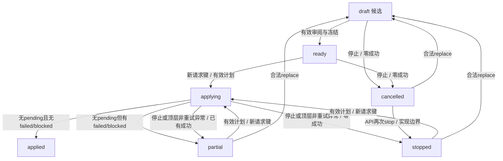

# 代码与资料生成规格：发布、停止与恢复规则

> 固定实现的现状梳理稿（observed_in_code），pilot 有界范围。需求候选尚未业务批准；测试计划未执行。

## 版本、来源与身份

- 项目 `19Q4K7PDARXQ9JHW6R6F`；仓库 `P1KRPDABN4RD0YXMX64E`；namespace `source-04d73353-be80-4433-8c5e-0b49a9c12c63`。

- 固定 run `W3Q0P72K24AE9E89P021`；snapshot `6ae5e5a9dcd182e094d62b22bab59607a716b8e2ce3e5d2b0d1b8fd9149a7b86`；提交 `92728fbec04cfa34fee4421cb0a9319d1b755164`。原始固定代码通过本机 mapping 阅读；当前 checkout 不是来源。

- 原代码清单 `ff35759feaa60e388f608f46c754806537515f7c9b96da6f01ca8b2b172b9555`；本 pack 含知识资料清单 `686f79282c10dab77fc72b6bd63c1e99280e31b0762153df29a90529d01ac20e`，共 639 个来源文件；来源/输入身份保持不变。

- handoff `code-knowledge.json` schema=1、kind=published_code_knowledge_document、source_key=code-knowledge-8f7e34577ed57a1d8d08；artifact `ad46b751ec67903374c6961b78d18e58b4ef0873d737ae994fd240b69103e65e`；知识解释为 agent_inference，非业务批准。

- 工作流 SKILL 2.2.0；固定旧实现 contracts 的 INTAKE_SKILL_VERSION=2.1.0（packages/contracts/src/intake.ts:6）。工作流版本与被分析实现版本不同，未冒充同一版本。

- 插件 ua：engine 2.9.8、adapter 1.0.0、protocol 1、digest `d22a4a731809299030ee783710407af1e4ce37d5f1930345cb1d4b6a8cfb39a5`。

- 插件 codegraph：engine 1.6.2、adapter 1.0.0、protocol 1、digest `c7ce675c6c763726449fccb22159735859ad17eccbce1475c9617287479bf8da`。

- UA overview/search/relations 均查询同 run，线索：`ua:flow:code-material-intake`→capture/interpret/draft/freeze/publish。本地 codegraph context 定位 `applyNext`，native ID `function:d87393af8993fa832fe4fa18cb22eedc`；callers 接受的 ID 为 `cg:function:d87393af8993fa832fe4fa18cb22eedc`，返回 apply→applyNext。首次未加前缀被真实 CLI 拒绝，已保留两次日志。

- 图谱证据示例 `cg-e:b4e0ca943c91b7c58076b0986aa00837fcf0f465d4dd2780a08132189dc22899` 指向 intake-use-cases.ts:32；它只是导航锚点，不用于证明本稿全部规则。事实依据为下表逐段原始源码及 SHA-256。

- codegraph 索引447/638文件，191未索引、41024未解析引用；UA覆盖638/638仅表示有文件证据，不代表语义正确。prepare 知识文档和 overview/search 结果有截断；未返回内容不表示不存在。

- 已绑定能力身份继续使用 `tsp-module-intake`→RGSSZ3S5V8YHN2A2K0HT、`tsp-feature-intake-review`→PY27P0A7P4FR0V8YJGVH、`tsp-doc-intake`→8YSYRGW6K13XMD985Q80。6个新细化需求无已有同能力 requirement 绑定；不另造发布 Feature。

## 业务范围与角色

本模块将成员整理的代码/资料候选先保存为草稿。当前项目负责人或管理员逐项选择新增、关联已有或跳过，冻结计划后再执行。逐项成功的数据立即成为已提交事实；批次停止或后项失败均不撤销它。新建需求仍是 draft，发布完成、资料目录齐备和需求批准是不同事实。

普通可写成员可准备并暂存候选；仅本人未冻结草稿可以停止/替换。观看者不能读候选，无关系统管理员不因全局身份获得项目资格。UI 的停止按钮仅对 can_review 暴露，API 的作者例外更宽。

发现7个范围项：4个included能力（合计6个结构化需求，均有父链、AC和计划）、2个excluded、1个unknown。不是全项目覆盖率；所有验证均待执行。完整规格在 source.production；不存在已获得业务审批的推断。

## 主流程与状态

入口：CLI apply/stop、Web审阅/停止按钮或 HTTP review/apply/stop/replace 路由。路由要求认证会话并做请求结构校验；应用服务核对当前角色、修订、计划及来源映射。输出是持久批次/逐项状态、目标编码和诊断，不是对全批次做一次总回滚。



图示区分批次与 attempt：无 pending 时 attempt=completed，即使 batch=partial；显式停止 running attempt=stopped。已有键处于终态时只读现时结果；“继续”要新键。apply 在 HTTP 请求内循环，未见自动后台恢复机制，断线后的实际执行进度只能再读持久状态。

## 决策规则表

| 规则 | 条件 | 决策/结果 | 副作用或保留项 | 异常/边界 | 原码依据 | 验证断言 |
|---|---|---|---|---|---|---|
| BR-ACCESS | 访问候选或执行治理操作 | 观看者不能读候选；审阅和发布要求当前项目 owner/admin；stop/replace 另有作者例外。 | 每次逐项发布重新检查用户有效性、项目及管理权限。 | 非活动/删除中用户、无权限项目拒绝；归档项目拒绝写入。 | S-ACCESS S-ITEM | 拒绝后无新增业务项；先前已提交项保留。 |
| BR-FREEZE | 当前修订、非 applying/applied/cancelled 批次请求审阅 | 每项明确 create/bind/skip；修订加一并进入 ready，生成绑定候选、决策、档位和质量依据的 plan_hash。 | 冻结是发布依据，approval 始终 not_requested。 | 旧修订、缺项/重项、执行中或终态审阅拒绝。 | S-REVIEW S-RESULT S-CONTRACT | 错误审阅不改变决策、修订和计划。 |
| BR-QUALITY | 冻结、新键发布，或已有 running 尝试恢复 | 新冻结/新键均校验档位和质量依据：企业有 blocker 不可冻结，历史无档位须显式选择，企业不可降 pilot。已有 running 仅在 profile 或 frozen_quality_json 至少一个存在时检查冻结质量；两者都缺失的历史 running 跳过恢复入口与逐项两处冻结质量校验。 | 历史兼容分支仍检查当前权限、attempt与批次计划一致、停止/运行状态及逐项依赖/目标；不代表获得质量合格结论。pilot可记录缺口，门禁不证明语义正确或业务批准。 | 需要质量校验的分支遇依据缺失/过期/变化拒绝；新审阅/新键不能借历史兼容分支绕过质量。 | S-REVIEW S-QUALITY S-RECOVER S-ITEM | 新键过期质量拒绝；历史双缺失running原键按兼容分支继续，未执行实测。 |
| BR-BIND | 审阅或发布 bind / 尚未完成候选已有同来源映射 | bind 要求同项目同类型、当前指纹一致及父归属吻合。已有映射的未完成候选可以 skip；若非 skip，则只能显式 bind 同一目标，不能 create 重复目标。 | bind只保存映射和 bound 收据，不更新目标正文或版本；skip保留原映射与目标，不生成新的发布写入。 | 已完成 applied/bound 行的审阅决策不可更改，包括不能改 skip；非skip子项不能依赖已跳过父项。跨项目/类型或目标漂移拒绝/逐项失败。 | S-REVIEW S-ITEM S-IDENTITY S-CLIENT | bind后正文/修订保留；另批次未完成的同来源映射可skip，映射和实体数量不变。 |
| BR-START | 新请求键发布 ready/partial/stopped 批次 | 须当前 plan_hash、完整审阅、有效冻结质量且无 running 尝试；失败/阻塞项重置 pending，创建 running attempt，批次 applying 且 stop_requested=false。 | 已 applied/bound/skipped 项不重新排队。 | 未冻结、错误计划、cancelled/draft/applied 或已有 running 时拒绝新尝试。 | S-APPLY | 非法启动没有新增 attempt 和业务项。 |
| BR-ORDER | 选择下一 pending 项 | 按 module→feature→requirement_document→architecture→requirement，再按数据库候选 id 升序；不是标题或业务优先级排序。 | 父候选须 applied 或 bound 才执行子项。 | 父项未成功则本项 blocked；随后继续其他 pending 项。 | S-ITEM | 打乱输入类型后按种类执行；同类型按保存 id；依赖失败不写子项。 |
| BR-ATOMIC | 单项新增或关联 | 业务写入、来源映射、项状态、审计和 attempt 收据在该项保存点中一起提交。 | 单项失败回滚该项保存点；之前成功项及无关数据保留。 | 非重试类异常写 failed 与诊断；重试类异常交上层处理。 | S-ITEM | 注入业务写后异常，无该项残留实体/映射/审计；failed 收据留存。 |
| BR-FINISH | 没有 pending 项 | 有 failed/blocked 时批次 partial，否则 applied；attempt 为 completed。 | applied_count 只计 applied/bound，skipped 单列；全跳过也可批次 applied，created=0。 | completed attempt 可对应 partial 批次；不能据此宣称所有项已创建。 | S-ITEM S-RESULT | 部分失败后独立项仍成功；全 skip 不产生业务实体。 |
| BR-DRAFT | create 需求项发布成功 | 新需求与首修订保存 AC 和 open_questions，需求 state=draft。 | 不创建任务、不批准需求；文档创建为 active 不等于需求 approved。 | 正文/关联校验失败回滚该项。 | S-ITEM S-RESULT | 发布后 requirement.state=draft，approval.not_requested，既有正文不被覆盖。 |
| BR-STOP-AUTH | 请求 stop，携带 base_revision | 管理员可停止已审阅计划；普通可写成员仅可停止本人且无 plan_hash 的批次。 | 修订必须与数据库一致；已 applied 通过检查后返回现状。 | 旧修订冲突；非作者/已冻结计划普通成员拒绝。 | S-STOP S-ACCESS | 越权 stop 不改 stop_requested/修订。 |
| BR-STOP-STATE | 合法 stop 且非 applied | 有 applied/bound→partial；无成功项且原 draft/ready→cancelled；其他原状态→stopped。修订加一、stop_requested=true，running attempts 标 stopped。 | 保留已提交业务项、收据、来源、审阅决策、plan_hash；更新质量报告修订。 | stop 与单项事务通过治理锁串行化；已提交一项不会被撤销；不承诺即时中断。 | S-STOP S-ITEM S-QUALITY | 受控单项提交后 stop：partial、后续无写入、首项仍存在。 |
| BR-STOP-REPEAT | 直接 API/CLI 再次 stop 非 applied 批次 | 实现未把 stop 做成幂等操作：每次有效修订都加一；零成功 ready→cancelled 后再 stop 可变 stopped。 | 保留原 plan_hash；stopped 状态可进入新键发布检查。 | Web 不提供 cancelled/stopped 的停止按钮；不要把该边界默认为期望业务政策。 | S-STOP S-APPLY S-CLIENT | 独立记录两次 stop 的状态；是否改变该行为列待决事项。 |
| BR-KEY | 同一 batch 再次使用已有 apply 请求键 | 必须同 plan_hash 且同操作者；prior=running 时可继续原尝试，冻结质量校验按BR-QUALITY的历史资格分支执行；prior=completed/stopped 时仅返回当前详情。 | 终态旧键不会新建尝试、不会重置 failed/blocked；返回的是当前详情。 | 同键换计划或操作者冲突；profile与frozen_quality_json双缺失只豁免旧running的两处冻结质量校验，不豁免权限或计划一致性。 | S-RECOVER S-ITEM | 响应丢失后原键恢复不重复已完成项；终态旧键无副作用；历史兼容分支单独验收。 |
| BR-RESUME | partial/stopped 需要明确继续 | 使用新键并通过当前权限、计划、目标与质量复核；仅 failed/blocked 重置，成功项不变。 | stop 的修订更新不单独破坏冻结内容指纹；新审阅会产生新 plan_hash。 | cancelled 不能直接新键 apply；符合 BR-REPAIR 权限者可 replace 后重新审阅；恢复不绕过旧质量依据。 | S-RECOVER S-QUALITY S-REPLACE | 停止后新键继续，原目标编码保留、失败项重新处理。 |
| BR-ERROR-STOP | 发布已创建 attempt 后遇到非重试类顶层异常 | running attempt 改 stopped；批次有成功项→partial，否则 stopped，stop_requested=true。 | 保留已提交项；权限恢复/重新审阅后用新键继续。 | 单项普通写入异常仅 failed，不必顶层停止；二者必须区分。 | S-RECOVER S-ITEM | 执行中撤销管理权限后下一项不写，既有项留存。 |
| BR-BUSY | 资料围栏忙、40P01 死锁或 40001 串行化冲突，须区分发生阶段 | 仅资料初始化与applyNext使用materialTransaction：从该段开始计5000ms截止，失败后按20+10×尝试次数、最多100ms延迟重试。初始创建/查找attempt的db.transaction直接执行，没有该重试循环；两阶段重试类错误都可返回资料忙提示。 | 若K1已提交后资料事务耗尽，已持久running attempt和已成功项保留，外层不将其置stopped，可原键重试。事前没有K1的新键创建事务若提交前失败，插入随事务回滚，不存在持久K1，也未进入业务项写入；已有K1的查找事务失败不抹除该旧attempt。 | 5000ms不是全请求或锁等待SLA；只有明确发生在materialTransaction内的故障才适用其延迟公式。未持久创建的同键重试是重新创建，不是恢复已有attempt。 | S-RETRY S-APPLY S-ITEM | 首项提交后在下一applyNext资料事务注入忙故障，断言保留running及首项；另测事前无K1的初始创建事务失败无attempt且无资料重试循环。 |
| BR-REPAIR | 请求 replace 修正允许编辑的候选 | 管理员或本人未冻结草稿作者、最新修订、非 applying/applied；项目/来源仓库/namespace不变，企业不降档。存在applied/bound行时这些候选及source必须完全不变；零完成行时可接受协议有效的changed source。 | 保留applied/bound原行，其他项重建pending；成功替换修订加一、draft、清除计划/冻结依据与stop_requested；零完成时有效新source写入source_json。 | 仅在存在applied/bound行时，改/删已完成候选或改变source被拒绝并需新批次；身份变更和企业降档独立拒绝。替换后须重新审阅。本分析pack仍遵守采集身份不可改的工作流约束。 | S-REPLACE | partial中改source拒绝；独立零完成草稿同身份替换有效新source成功；二者不可泛化合并。 |
| BR-OBSERVE | 请求断线或 Web 重新挂载 | API apply 在请求内逐项执行并读持久结果；读取状态不启动恢复；Web 显示刷新/停止后继续指引。 | Web 的请求键存组件 useRef；重新挂载不承诺持有原键。stop 另走通道，先读取最新修订。 | 源码未证明断线后自动后台完成、自动恢复或发布完成时限。 | S-APPLY S-CLIENT | 重挂 applying 页面无自动 apply；停止可用，后续按服务端状态恢复。 |

## 源码证据索引（路径、SHA-256、真实行范围）

以下锚点均从固定 mapping 读取并核对文件 hash；同一来源的多段范围分别列出。

- S-ACCESS：`packages/application/src/intake-use-cases.ts:72–88` SHA-256 `e4b23ef9267259f6c944e06220d8ae3786b4b8522f67dad7f16c0e26e1be44a4`。

- S-ACCESS：`packages/application/src/project-access.ts:22–26` SHA-256 `872f740e928765689270c2405518ef32c75b46b371e05ac4d7fdf91e6c8bf1dd`。

- S-ACCESS：`packages/application/src/project-access.ts:65–74` SHA-256 `872f740e928765689270c2405518ef32c75b46b371e05ac4d7fdf91e6c8bf1dd`。

- S-REVIEW：`packages/application/src/intake-use-cases.ts:237–278` SHA-256 `e4b23ef9267259f6c944e06220d8ae3786b4b8522f67dad7f16c0e26e1be44a4`。

- S-REVIEW：`packages/application/src/intake-use-cases.ts:135–143` SHA-256 `e4b23ef9267259f6c944e06220d8ae3786b4b8522f67dad7f16c0e26e1be44a4`。

- S-QUALITY：`packages/application/src/intake-quality-gate.ts:19–61` SHA-256 `74c3210549ce2b7994a7218248ec5b991923c3ce4c59bef5962466896b437513`。

- S-APPLY：`packages/application/src/intake-use-cases.ts:299–358` SHA-256 `e4b23ef9267259f6c944e06220d8ae3786b4b8522f67dad7f16c0e26e1be44a4`。

- S-ITEM：`packages/application/src/intake-use-cases.ts:376–463` SHA-256 `e4b23ef9267259f6c944e06220d8ae3786b4b8522f67dad7f16c0e26e1be44a4`。

- S-STOP：`packages/application/src/intake-use-cases.ts:281–296` SHA-256 `e4b23ef9267259f6c944e06220d8ae3786b4b8522f67dad7f16c0e26e1be44a4`。

- S-RECOVER：`packages/application/src/intake-use-cases.ts:304–348` SHA-256 `e4b23ef9267259f6c944e06220d8ae3786b4b8522f67dad7f16c0e26e1be44a4`。

- S-RECOVER：`packages/application/src/intake-use-cases.ts:359–372` SHA-256 `e4b23ef9267259f6c944e06220d8ae3786b4b8522f67dad7f16c0e26e1be44a4`。

- S-RETRY：`packages/application/src/intake-use-cases.ts:32–43` SHA-256 `e4b23ef9267259f6c944e06220d8ae3786b4b8522f67dad7f16c0e26e1be44a4`。

- S-RETRY：`packages/application/src/intake-use-cases.ts:147–156` SHA-256 `e4b23ef9267259f6c944e06220d8ae3786b4b8522f67dad7f16c0e26e1be44a4`。

- S-RETRY：`packages/application/src/intake-use-cases.ts:359–360` SHA-256 `e4b23ef9267259f6c944e06220d8ae3786b4b8522f67dad7f16c0e26e1be44a4`。

- S-REPLACE：`packages/application/src/intake-use-cases.ts:210–235` SHA-256 `e4b23ef9267259f6c944e06220d8ae3786b4b8522f67dad7f16c0e26e1be44a4`。

- S-RESULT：`packages/application/src/intake-use-cases.ts:108–132` SHA-256 `e4b23ef9267259f6c944e06220d8ae3786b4b8522f67dad7f16c0e26e1be44a4`。

- S-RESULT：`packages/application/src/intake-entity-writers.ts:49–86` SHA-256 `4c21f48658f4221a5d5192645c7c344f82dead6ac52cda8d2f41e4415bf4f952`。

- S-IDENTITY：`packages/persistence/drizzle/0039_project_intake.sql:23–36` SHA-256 `7ec13baccab984664dd18e144fa25c2210301f12f1e7dfa0083de8b36451691e`。

- S-IDENTITY：`packages/persistence/drizzle/0042_intake_material_sources.sql:1–8` SHA-256 `82f9054856fc43949e9888215a3644e0f18e07fb5907e0e5fb73c30145a3b5a0`。

- S-CONTRACT：`packages/contracts/src/intake.ts:184–191` SHA-256 `0bc616778999ef6197c59a0823185f2f3c8cf4870186201869906c7506d7b9af`。

- S-CONTRACT：`apps/core-api/src/routes/intake.ts:39–57` SHA-256 `1e1dbbc38f84ca76e13c8359f848dfffb400aa4fbc6060b4ee9b595dea517de3`。

- S-CLIENT：`apps/cli/src/intake.ts:164–178` SHA-256 `a93e6c950db17fadf91d4056daa642be014a56b3347b5dafcdc33c9f74cea8e4`。

- S-CLIENT：`apps/web/src/IntakeWorkbench.tsx:119–137` SHA-256 `ac1894ad396092a1af37248931db23d871bcc3a37ed61fca09804d92ca801254`。

- S-CLIENT：`apps/web/src/IntakeWorkbench.tsx:146–151` SHA-256 `ac1894ad396092a1af37248931db23d871bcc3a37ed61fca09804d92ca801254`。

- S-CLIENT：`apps/web/src/IntakeWorkbench.tsx:187–192` SHA-256 `ac1894ad396092a1af37248931db23d871bcc3a37ed61fca09804d92ca801254`。

- S-STAGING：`packages/application/src/intake-use-cases.ts:182–207` SHA-256 `e4b23ef9267259f6c944e06220d8ae3786b4b8522f67dad7f16c0e26e1be44a4`。

- T-HTTP：`apps/core-api/tests/intake.test.mjs:39–70` SHA-256 `53a0df08170484b99c74082822bf68ff35860ecd5d78dbe521bd8e36f82599b6`。

- T-HTTP：`apps/core-api/tests/intake.test.mjs:73–123` SHA-256 `53a0df08170484b99c74082822bf68ff35860ecd5d78dbe521bd8e36f82599b6`。

- T-HTTP：`apps/core-api/tests/intake.test.mjs:126–203` SHA-256 `53a0df08170484b99c74082822bf68ff35860ecd5d78dbe521bd8e36f82599b6`。

- T-WEB：`apps/web/tests/intake-workspace.test.mjs:5–24` SHA-256 `2095bf557e01a803d87fcb9949126143039a3cc6cd38f436892e7c4d12bed7a5`。

- T-WEB：`apps/web/tests/intake-workspace.test.mjs:162–191` SHA-256 `2095bf557e01a803d87fcb9949126143039a3cc6cd38f436892e7c4d12bed7a5`。

- S-TEST-RUN：`package.json:10–22` SHA-256 `18c72b7f1ea3a543589328df8e833a24d5b50a478ad793c72b4898e8f2fbd16b`。

- S-TEST-RUN：`apps/core-api/package.json:6–11` SHA-256 `79b70ee3ef4222932564cf5ba4bda8f264b2c52d9ac687be965557c3b79553a9`。

- S-TEST-RUN：`apps/web/package.json:6–11` SHA-256 `fabf70a5430042529c22cd8c95dff7e34ebbe2912904ee51b0b7608f12fb7752`。

- S-TEST-RUN：`apps/core-api/tests/test-db.mjs:6–9` SHA-256 `0ce3963aa05bddc2a9ffd90a0d4a1a1e02a7704eb9f85a4969551e3b9282893d`。

- S-TEST-RUN：`apps/core-api/tests/test-db.mjs:39–54` SHA-256 `0ce3963aa05bddc2a9ffd90a0d4a1a1e02a7704eb9f85a4969551e3b9282893d`。

## BR→需求→AC 矩阵

每条规则对应具体可观察的AC；跨需求测试保留在此矩阵中，不把同需求全部AC当成每条规则的覆盖证据。

| 规则 | 结构化需求稳定key | AC |
|---|---|---|
| BR-ACCESS | tsp-req-intake-plan-control | AC-PLAN-01 |
| BR-ACCESS | tsp-req-intake-failure-isolation | AC-FAIL-02 |
| BR-FREEZE | tsp-req-intake-plan-control | AC-PLAN-02, AC-PLAN-05 |
| BR-QUALITY | tsp-req-intake-plan-control | AC-PLAN-03 |
| BR-QUALITY | tsp-req-intake-resumption | AC-REC-02, AC-REC-05 |
| BR-BIND | tsp-req-intake-plan-control | AC-PLAN-04, AC-PLAN-05 |
| BR-START | tsp-req-intake-publish-items | AC-PUB-01, AC-PUB-02 |
| BR-ORDER | tsp-req-intake-publish-items | AC-PUB-01 |
| BR-ORDER | tsp-req-intake-failure-isolation | AC-FAIL-01 |
| BR-ATOMIC | tsp-req-intake-failure-isolation | AC-FAIL-01 |
| BR-FINISH | tsp-req-intake-publish-items | AC-PUB-03 |
| BR-FINISH | tsp-req-intake-failure-isolation | AC-FAIL-01 |
| BR-DRAFT | tsp-req-intake-publish-items | AC-PUB-01 |
| BR-STOP-AUTH | tsp-req-intake-stop-control | AC-STOP-01 |
| BR-STOP-STATE | tsp-req-intake-stop-control | AC-STOP-02, AC-STOP-03 |
| BR-STOP-REPEAT | tsp-req-intake-stop-control | AC-STOP-03 |
| BR-KEY | tsp-req-intake-resumption | AC-REC-01, AC-REC-05 |
| BR-RESUME | tsp-req-intake-resumption | AC-REC-02 |
| BR-ERROR-STOP | tsp-req-intake-failure-isolation | AC-FAIL-02 |
| BR-BUSY | tsp-req-intake-resumption | AC-REC-03, AC-REC-06 |
| BR-REPAIR | tsp-req-intake-repair-candidates | AC-REPAIR-01, AC-REPAIR-02, AC-REPAIR-03 |
| BR-OBSERVE | tsp-req-intake-resumption | AC-REC-04, AC-REC-07 |

## 验收计划与执行基线

以下为建议 P0/P1 优先级和 not_run 计划，不是生产风险测量或测试结果。实际执行须在隔离环境。现有 HTTP/Web 测试只标 defined。

在隔离测试数据库复用 apps/core-api/tests/intake.test.mjs 的 setup/openTestDb 与 app.inject；每个用例全新数据库或回滚重建，UTC 固定时钟 2026-10-18T00:00:00Z。私有活动项目 P 中 owner O、admin A、member M、viewer V 均为活动用户，M 为批次作者；无关用户 X 无项目权限。配置项目有效仓库。候选 P0 为 pilot，包含模块 m、功能 f→m、文档 d→m、架构 a、需求 r→m/f/d；正文/图源/来源清单与哈希有效，所有项有真实证据。调用 POST /projects/P/intake 暂存后，O 用当前 revision 对所有项 create 冻结，保存 plan_hash H，得到 ready。该前置夹具必须在隔离环境执行，不得对生产项目调用。

故障/锁/中断及历史running构造用例需要测试专用事务屏障或故障注入适配器。当前源码没有现成可调用注入API；先实现隔离测试夹具，禁止在生产调用或修改原始固定快照。AC-REC-03限定首项已提交后的下一applyNext资料事务，AC-REC-06单独验证初始创建事务提交前失败，不能混用延迟/持久状态预期。Web现有renderToStaticMarkup只能产出静态HTML，AC-REC-04只复用HTML/源码断言；AC-REC-07另需尚未实现的真实浏览器/DOM挂载、事件与network spy夹具，两者均not_run。请求apply同步循环，不假设后台worker。真实超时阈值待运行负责人设定；不宣称端到端完成SLA。

| 用例 | BR / AC | 操作者与初始数据 | 动作 | 可观察期望 | 优先级 | 状态 |
|---|---|---|---|---|---|---|
| TC-PLAN-01 | BR-ACCESS / AC-PLAN-01 | 共享基线； 重建四份 P0；member/观看者/无关用户各用自己的身份，不继承前次修改。 | 以 M、V、X 分别调用 review 和 apply(H,新键)。；读取批次 revision/plan_hash、intake_attempts 和业务表。 | 各未授权请求失败；未产生 attempt 或业务写入，批次及原审阅不变。 | P0 | not_run |
| TC-PLAN-02 | BR-FREEZE / AC-PLAN-02 | 共享基线； 另建尚未冻结的 P0 draft，记录 revision b。 | O 用 b 对每项 create 调用 review。；记录返回的 b+1、H，再重放 b。；比较业务表及审阅前后批次。 | 首次 ready/H 非空；业务表仍空；旧 b 请求 intake_conflict，保持 b+1 与 H。 | P0 | not_run |
| TC-PLAN-03 | BR-QUALITY / AC-PLAN-03 | 共享基线； 重建三份：enterprise 单模块不完整草稿；profile=null 历史草稿；ready pilot P0。数据库篡改仅用于隔离故障夹具。 | 企业草稿 review；历史草稿不提供 profile review，随后显式 pilot review。；将第三份 quality_rule_version 改 obsolete 后新键 apply。；读取 approval 和业务表。 | 企业/无档位审阅失败；显式 pilot 可冻结；过期依据 apply 失败且无业务写入；approval=not_requested。 | P0 | not_run |
| TC-PLAN-04 | BR-BIND / AC-PLAN-04 | 共享基线； 重建 P0；预置同项目模块/功能/文档目标，取得当前 fingerprint。各错误变体单独重建。 | 把 m/f/d 决策 bind 至匹配目标，其余 create 后 review/apply。；比较目标全文/修订。；分别用错误指纹、跨项目目标、跳过 m 但 create f 的决策 review。 | 合法 bind 形成 bound 映射且已有正文/修订不变；非法变体冲突且无新增业务项。 | P0 | not_run |
| TC-PLAN-05 | BR-BIND, BR-FREEZE / AC-PLAN-05 | 共享基线； 三份独立隔离场景。A/B：预置旧批次对独立架构key=a的有效来源映射，记录target编码/正文/修订；新P0用同project/repository/namespace/kind/key，a尚未完成且无子项依赖。C：P0的a已applied且其余项待完成，记录a原create决策。 | A中O对新批次a选择skip、其余create，review后新键apply，比较原映射和目标。；B独立重建，a选择create后review；再以有效同目标指纹bind重新review。；C独立重建，O试图把已applied的a旧create决策改skip并review。 | A的a为skipped、旧映射/目标/修订不变且无新a；B的create冲突，同目标bind可审阅；C决策修改冲突，原完成行/目标保留。 | P0 | not_run |
| TC-PUB-01 | BR-START, BR-ORDER, BR-DRAFT / AC-PUB-01 | 共享基线； P0 暂存时输入顺序故意 r/a/d/f/m；追加第二模块 m2，保持同类插入顺序。记录数据库 item.id。 | O 用 H 和全新键 K1 调用 apply。；按 attempt.results_json 检查实际提交序列。；查询业务编码、父归属、需求 revision/AC/state 和 approval。 | 模块→功能→文档→架构→需求；模块内顺序等于 id 升序；批次 applied、attempt completed，新需求 draft/AC保留，approval not_requested。 | P0 | not_run |
| TC-PUB-02 | BR-START / AC-PUB-02 | 共享基线； 每种变体重建：draft、已 stop 的零完成 ready→cancelled、受控 running 和正常 ready P0。 | 用新键对 draft/cancelled/running 分别 apply；对 ready 用错误 H。；读取 attempt 数、批次状态和业务表。 | 请求 intake_conflict；不产生新 attempt，不改变既有成功项或业务实体。 | P0 | not_run |
| TC-PUB-03 | BR-FINISH / AC-PUB-03 | 共享基线； 全新 P0 draft；所有项决策均 skip 后冻结。 | 用新键 apply。；读取 publication 与 attempt 状态；查询业务表。 | batch applied，attempt completed，skipped=候选数、created=bound=applied_count=0，业务表为空，approval not_requested。 | P1 | not_run |
| TC-FAIL-01 | BR-ORDER, BR-ATOMIC, BR-FINISH / AC-FAIL-01 | 共享基线； 重建 P0；另加独立架构 a2；用测试专用写入故障钩子在 m 业务插入后抛普通异常，勿编辑固定原始源码。故障钩子尚需测试实现。 | apply K1 至返回。；读取 m/f/d/r/a/a2 结果与 attempt 收据。；查业务、binding 和审计，确认 m 保存点完整回滚。 | m failed；f/d/r blocked；独立架构 applied；batch partial/attempt completed；无 m 实体、映射或成功审计；失败/阻塞诊断存在。 | P0 | not_run |
| TC-FAIL-02 | BR-ACCESS, BR-ERROR-STOP / AC-FAIL-02 | 共享基线； 重建 P0；在首项提交与下一项开启前设置可控测试屏障；令 A 为发布者且 O 保持有效。测试屏障尚需实现。 | A apply K1；首项完成屏障处 O 在隔离数据库把 A 降为 member。；释放屏障，等待请求返回；由 O 读取状态。；比对首项目标和后续实体。 | 权限错误；attempt stopped、batch partial、stop_requested=true；首项编码/实体保留，下一项无写入；不把错误称作单项普通 failed。 | P0 | not_run |
| TC-STOP-01 | BR-STOP-AUTH / AC-STOP-01 | 共享基线； 各用例重建；一份 M 本人 draft，一份 M 创建后 O 冻结 ready，另一份由 X 尝试停止。 | M stop 本人 draft。；M stop ready；X stop 任一批次；O 用过期 revision stop ready。；逐一读取修订/stop_requested。 | 本人草稿 cancelled、revision+1；其余越权或旧修订失败且原状态保留。 | P0 | not_run |
| TC-STOP-02 | BR-STOP-STATE / AC-STOP-02 | 共享基线； 三份隔离 P0：ready；在首项提交后屏障；已创建 attempt 但首项前屏障。O 拥有最新 revision。 | 在三份夹具各由 O stop；释放发布屏障并等待返回。；对比 stop 前后 plan/source/decisions/receipts 和业务实体。 | 分别 cancelled/partial/stopped；running attempts stopped；stop_requested=true、修订+1，plan/source/decisions及已提交项保留，后续项不再写。 | P0 | not_run |
| TC-STOP-03 | BR-STOP-STATE, BR-STOP-REPEAT / AC-STOP-03 | 共享基线； 两份独立场景：已全部发布 P0；ready P0 尚无成功项。 | O 对 applied 用最新 revision stop，比较记录。；O 对 ready stop 得 cancelled，再按新 revision stop，读取状态。；仅在隔离环境用新键和保留 H 对 resulting stopped 调用 apply。 | applied 无修订/状态改变；第二场景 cancelled→stopped 且每次+1，冻结内容仍有效时新键可继续；记录为当前实现边界，需业务决定是否保留。 | P1 | not_run |
| TC-REC-01 | BR-KEY / AC-REC-01 | 共享基线； 三份独立夹具：P0 首项后模拟请求中断留 running K1；已 completed K1；已 stop K1。明确保留原 K1，A/O 均有效管理员。 | 对 running 用同操作者/H/K1 重试至返回，比较首项编码与数量。；另重建 running，分别用不同 H、不同管理员复用 K1。；对 completed/stopped 复用原 H/K1 并读取 attempts/结果。 | 原 running 可继续且无重复；换计划/操作者冲突；终态旧键不建新 attempt、不重置项；返回现时批次详情。 | P0 | not_run |
| TC-REC-02 | BR-QUALITY, BR-RESUME / AC-REC-02 | 共享基线； 两份隔离夹具：由普通单项故障形成 partial/attempt completed，撤除故障；首项后 stop 为 partial；均记录成功编码和 H。 | 先用终态旧键读取，确认无继续；再以 H/新键 K2 apply。；比对编码、failed/blocked状态与 K2 收据。；独立重建 partial，把质量规则版本改 obsolete 后新键 apply。 | 可恢复项完成、成功编码不变、无重复写；过期变体无新业务写入且要求重新审阅。 | P0 | not_run |
| TC-REC-03 | BR-BUSY / AC-REC-03 | 共享基线； 重建P0。先放行初始db.transaction(304–346)、系统目录初始化materialTransaction(350–356)及首项applyNext至提交；在首项提交后、下一applyNext(376–382)开始前屏障暂停，确认数据库已有running K1及首项applied/目标编码。只对下一applyNext内tryLockProjectSystemFolders(382)注入false（引发IntakeMaterialBusy），或在同一materialTransaction抛40P01/40001；不对初始创建事务注入。控制Date.now/延迟推进5000ms截止。屏障/注入适配器尚未实现，not_run。 | 在上述屏障记录K1、首项编码/收据及事务提交，启用仅下一applyNext资料事务的故障后释放屏障。；记录该materialTransaction每次失败后的delay，推进其截止并读取返回忙诊断；查询K1状态、首项及后续项。；撤销故障，用同操作者/H/K1重试；等待逐项返回并比较首项编码和数量。 | 指定资料事务截止失败返回资料忙及同键提示；持久K1仍running、batch applying，首项保留、无下一项写入；delay为20+10×尝试次数且封顶100ms。恢复后首项不重复。该结论不外推到初始事务或真实耗时≤5秒。 | P0 | not_run |
| TC-REC-04 | BR-OBSERVE / AC-REC-04 | 共享基线； 复用apps/web/tests/intake-workspace.test.mjs:19–24的renderToStaticMarkup夹具。分别独立渲染running batch：can_review=true/applyPending=false；true/true；false/false。只读源码119–137及146–151，不点击事件、不声称真实挂载/重挂。 | 静态渲染三种输入，检查提示文本与停止按钮/disabled属性。；读取源码，检查stop有独立useMutation，其mutationFn文本先await getIntake再stopIntake(current.revision)；检查requestKey使用useRef。；将HTML/源码观察与AC-REC-07尚未实现的互动网络断言分开记录。 | 管理者且非本地请求中有恢复提示；本地applyPending时停止按钮静态不禁用；无管理权限不显示停止。源码存在独立stop通道和先读修订调用顺序；静态SSR不能证明网络调用、事件处理或重挂生命周期。 | P1 | not_run |
| TC-REC-05 | BR-QUALITY, BR-KEY / AC-REC-05 | 共享基线； 三组独立数据库夹具，均不修改本分析pack。通过测试屏障在K1创建提交后停止原调用推进，保留status=applying、stop_requested=false、完整决策及attempt.plan_hash=batch.plan_hash=H。L组将profile/frozen_quality_json/quality_report_json/quality_rule_version均置null；B组分别只保留profile=pilot或只保留frozen_quality_json而令报告缺失；N组复刻L但旧attempt=stopped且batch=stopped，无running。历史行构造和中断屏障尚需实现，not_run。 | L中同操作者/H/K1重试，读取逐项结果、quality_gate和既有目标数量。；B的两个独立变体同H/K1重试。；N用H/新键K2apply；另在独立无档位draft中不传profile请求review。 | L跳过恢复入口与逐项两处冻结质量检查，但仍执行当前权限/计划一致/停止状态/依赖目标检查，可完成且quality_gate保持unknown；B进入冻结检查并拒绝/停止running；N新键因缺质量依据拒绝，无档位新review仍须显式profile。无测试已执行或质量合格声明。 | P0 | not_run |
| TC-REC-06 | BR-BUSY / AC-REC-06 | 共享基线； 独立全新ready P0，无attempt、无已发布项。在初始db.transaction(304–346)内attempt插入后/事务提交前注入一次SQLSTATE40001，确保整个创建事务回滚；不进入350–356或376–382的materialTransaction。事务边界故障适配器及delay spy尚需实现，not_run。 | 以H/K1apply，在指定初始事务提交前抛错并读取返回。；独立连接检查attempts、batch状态/stop_requested、业务表；spy检查materialTransaction专用delay未调用。；移除故障后仍以H/K1重试，确认此时新建一个持久attempt并正常执行。 | 首请求返回资料忙且无持久K1，batch保持ready、无业务写入、无materialTransaction的5000ms延迟循环；同键再试是创建新attempt，不是恢复已存在running。 | P0 | not_run |
| TC-REC-07 | BR-OBSERVE / AC-REC-07 | 共享基线； 尚未实现的隔离浏览器/DOM挂载fixture与网络spy，必须真实挂载React/QueryClient并能派发点击、卸载/重挂及控制fetch响应；不能使用renderToStaticMarkup替代。准备can_review=true、server status=applying的完整响应，applyPending=false；预置旧UI revision和GET返回新revision。第二独立场景挂起apply响应且applyPending=true；第三场景can_review=false。fixture及路由stub均未实现，not_run，不增加依赖或执行本轮测试。 | 首场景挂载后等待当前查询稳定，记录网络；卸载/重新挂载再观察，期间不点击apply。允许查询轮询GET，但断言没有自动POST apply。；点击停止，由spy控制该通道GET返回新revision，检查随后POST stop的body使用该新revision；记录持久状态响应呈现。；第二场景在apply挂起时点击停止，验证stop请求独立发出；第三场景检查无停止交互入口。每场景重置挂载树、spy和请求状态。 | 真实挂载/重挂没有自动POST apply，也不宣称原useRef请求键持久；停止事件产生GET最新批次→POST stop(新revision)；apply挂起不阻塞停止通道；无管理权限无按钮。只有运行该新fixture才能形成交互证据，目前全部not_run。 | P0 | not_run |
| TC-REPAIR-01 | BR-REPAIR / AC-REPAIR-01 | 共享基线； 重建 P0，受控单项错误形成 partial；保存完整 source/成功候选/目标编码和旧 H。O 为操作者。 | 仅修改 failed 项正文，完整保留成功项与 source，以当前 revision replace。；比较成功行/目标/source；读取新 revision/plan/status。；使用旧 H/新键 apply；随后按新修订重新 review。 | replace 成功为 draft、revision+1、plan=null、stop=false；成功项不变，其余重新 pending；旧 H 发布失败；重新审阅产生新计划。 | P0 | not_run |
| TC-REPAIR-02 | BR-REPAIR / AC-REPAIR-02 | 共享基线； source/完成项负例分别独立重建partial且至少一行applied/bound；身份负例使用另一允许替换的草稿；降档负例另备enterprise草稿。各自记录完整前态，不据此推断零完成行来源不可改。 | 在有完成行的三个独立partial变体中分别改成功项正文、删成功项、只改测试bundle.source.analyzed_at后replace。；在独立草稿分别换namespace/repository/project；在企业草稿改profile=pilot后replace。；比较每份批次修订/计划/source及业务/映射记录。 | 上述有完成行的来源变更、已完成候选改删以及独立身份/降档负例均拒绝，原状态/业务与来源不变；零完成合法来源变更结果另由AC-REPAIR-03验证。 | P0 | not_run |
| TC-REPAIR-03 | BR-REPAIR / AC-REPAIR-03 | 共享基线； 独立P0草稿，作者M可写且本人无plan_hash，所有行pending、无applied/bound；记录revision/source/payload_hash。只复制测试bundle，把source.analyzed_at换为另一合法UTC时间，其余来源证据/manifest及project/repository/namespace保持有效；不改本分析intake捕获身份或真实源文件。 | M用当前revision和复制测试bundle调用replace。；读取source_json、payload_hash、revision、plan/frozen_quality/stop_requested与候选状态；查询业务表。；O按新revision重新review，确认新计划基于已替换source。 | 零完成分支接受合法changed source并保存新source_json/payload_hash，revision+1、draft、plan/frozen质量清空、stop=false，所有候选pending且业务表仍空；后续新审阅使用新来源。当前分析包来源不随测试计划改变。 | P0 | not_run |

### 可执行入口与交接

以下命令供后续在独立测试副本执行；本轮没有执行。固定实现要求Node≥22、pnpm 10.33.0。先确认副本仍为提交92728fbec04cfa34fee4421cb0a9319d1b755164，并使用既有锁定依赖环境。不要在原始捕获目录生成dist或在生产数据库运行测试。现有 openTestDb 会对指定数据库的 public 表执行 TRUNCATE/RESTART IDENTITY；必须由运行者配置专用 TSP_TEST_DATABASE_URL，并确认该库可销毁。

```text
# 在固定提交的独立可写测试副本根目录，确认专用测试数据库后：
pnpm -r build
pnpm --filter @team-synergy/core-api exec node --test --test-concurrency=1 tests/intake.test.mjs
pnpm --filter @team-synergy/web exec node --test --test-concurrency=1 tests/intake-workspace.test.mjs
```

上述是已存在测试定义的可执行入口，不能替代本稿23项验收矩阵。后续测试工程师按TC编号实现缺失的失败/停止/恢复/历史边界用例；浏览器互动AC-REC-07还须新挂载与network spy夹具，不能由现有SSR命令替代。建议新增测试文件当前不存在，不列入tests已定义路径。每个TC记录命令、时间、Node/PostgreSQL版本、提交/清单hash、请求及数据库观察，执行成功才可记录passed。当前全部not_run，含可复用现有静态定义的用例。

## 已观察事实、待决事项与边界

以上18条 BR 和6个需求均为当前固定实现 observed_in_code；已有测试定义只是旁证，未执行。UA说明和静态调用关系继续保留 inferred 属性，不自动成为 observed_in_code。没有 supplied decision 证明业务负责人批准了这些政策。

1. **待业务决策（非已实现修复）**：BR-STOP-REPEAT 中 cancelled 经再次 stop 可变 stopped 并满足新键启动状态条件。候选忠实保留当前代码；若希望取消不可恢复，需要另立 proposed 变更并审批。不能悄悄把异常边界改写为“取消永不可恢复”。影响 REQ-STOP/AC-STOP-03。

2. **待产品取舍**：API 的本人未冻结草稿作者可 stop，Web 只向 can_review 管理者显示停止按钮。两入口观察均保留，不将 UI 限制当作后端权限政策。影响 BR-STOP-AUTH/BR-OBSERVE；是否统一入口属 proposed，未生成假装已实现的要求。

3. **未知运行保证**：生产 PostgreSQL锁等待、并发峰值、网络中断后的进程存活、持续 running 的运维判断时限和实际完成时延没有证据。5000ms只用于每段资料事务重试截止。

4. **测试覆盖缺口**：已读取HTTP权限/冻结/发布/重放与Web静态恢复定义；尚未逐个读取638个代码文件或全部测试。历史双缺失running、已有映射skip、零完成来源替换、初始/资料事务分阶段忙异常均已补具体计划但未执行。Web静态SSR不运行真实事件/重挂，新增互动夹具尚未实现。单项失败、停止竞争、反复stop、崩溃和全skip亦未执行。

5. **范围限制**：未系统梳理 prepare 的所有输入/脱敏/文件排除、diff、其他仓库/模块、单篇系统Agent作业或正式需求基线审批；当前checkout及历史实验报告不构成事实来源。pilot并非完整企业dossier。

## 交付与复核

初始独立语义复核semantic-review.json/.md发现F01–F05（4 warning、1 needs_review），初稿及报告原样保留。本修订按发现限定已有映射skip、旧running质量兼容、完成行来源保护，分开两阶段忙异常和静态/互动Web计划；修复不等于独立复核通过或业务批准，仍待原reviewer定向复查。

本轮仅本地生成候选/规则稿并运行intake validate/export。无submit/review/apply/stop/replace API请求，无业务实体发布或需求批准。初始validation-final.json和首导出预览保留；本修订实际校验摘要以validation-revised.json、导出以ua-cg-rules-preview-20261109-reviewed为准。协议/证据检查不能替代语义审查。
