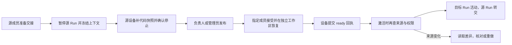

# TeamSynergy 项目总览与成员交接

固定草稿快照 `256f8b15f9dc0fa80e7f56aa9d1b2b59f4ef5104a16926dfbc9ad47f4b64137b`，基准提交 `92728fbec04cfa34fee4421cb0a9319d1b755164`。本文路径相对该快照。

**intent**　产品、研发、测试和负责人共用项目背景与交付证据。接手人应能回答当初为何做、依据的是哪一版、谁有权决定、怎样证明已经完成。来源为本轮独立产品说明 `intent.md`。

## 新成员从哪里开始

假设你今天接手一个修复任务。先从项目主页找概览、引导及项目规范，再沿任务查看 Feature、原需求或缺陷及固定基线。如有进行中的交接，向交接单查源 Run、目标账号、代码快照和上下文快照。要了解讨论经过，找议题条目和评审；要签收成果，找产物、自测与验证记录。项目主页读取与冻结进交接的字段见 `packages/application/src/project-home-use-cases.ts:71-86`、`packages/application/src/handover-use-cases.ts:145-159`。

| 成员要找的东西 | 平台对象与入口（observed_in_code） |
| --- | --- |
| 我能看哪些团队、项目和资料 | 账号、设备会话、团队成员、项目显式角色及继承策略。登录和治理入口见 `apps/core-api/src/server.ts:127-139`，项目与设备路由见 `apps/core-api/src/server.ts:261-271`。 |
| 当前计划和共同约定 | 项目概览、结构、接入、架构在项目工作区切换。模块有活跃/归档，阶段和里程碑各有生命周期与日期。见 `apps/web/src/ProjectWorkspace.tsx:8-28`、`packages/application/src/project-structure-use-cases.ts:18-23`、`packages/application/src/project-structure-use-cases.ts:59-96`。 |
| 项目的用户需求和方案 | 想法、议题、需求文档评审、基线、设计原型、架构文档由不同用例维护。基线冻结版本，原型可修订并按版本取附件。见 `apps/core-api/src/server.ts:249-259`、`packages/application/src/design-prototype-use-cases.ts:408-427`。 |
| 谁在做、怎么验收 | CLI 提供任务领取、执行、提交、验证和关闭。测试执行记录关联固定用例、资料和结果；缺陷修复由绑定任务推进。见 `apps/cli/src/index.ts:378-381`、`packages/application/src/testing-use-cases.ts:239-260`、`packages/application/src/defect-use-cases.ts:199-226`。 |
| 跨工具找同一份资料 | Agent CLI/MCP 可列目录、筛虚拟路径、搜正文、读指定修订以及查询代码图。项目文档、需求文档、架构和测试资料有独立来源。见 `apps/cli/src/agent-tools.ts:37-54`、`apps/cli/src/agent-capabilities.ts:70-85`。 |
| 管理、审计与维护 | API 注册审计、登录安全、所有权、技能、系统设置与治理；服务还注册系统 Agent、代码理解及接入。迁移由独立 Compose 服务执行，完整性检查报告孤立记录计数。见 `apps/core-api/src/server.ts:127-151`、`compose.yaml:15-25`、`packages/persistence/src/integrity-check.ts:215-225`。 |

## 把一项进行中的工作交给另一位成员

源执行者通过任务的 prepare 入口指定当前 Run、任务版本和接手人，读取者可通过快照和差异入口核对材料。接口在 `apps/core-api/src/routes/handovers.ts:53-85`。以下为 **observed_in_code**。

### 项目权限从何而来

**BR-PROJECT-ACCESS**　先检查账号，再按项目所有者、显式成员、团队继承的顺序确定项目角色。团队成员在 team_write 下继承 member，在非私密的其他继承策略下得到 viewer。manage 允许 owner/admin；write 和 manage 还要求项目活跃。

源码依据　`packages/application/src/project-access.ts:41-55`、`packages/application/src/project-access.ts:65-74`。

### 谁可以交出工作

**BR-HANDOVER-PREPARE**　设备登录的当前执行者持有 active 的 builder Run，任务为 running 或 self_tested，任务版本一致且无未决交接；目标必须是另一位有效可写成员。准备事务增加任务代数、暂停源 Run、撤销租约并固定上下文。

源码依据　`packages/application/src/handover-use-cases.ts:52-72`、`packages/application/src/handover-use-cases.ts:301-332`。

### 交接包何时可接收

**BR-HANDOVER-PUBLISH**　源设备给出有效准备凭据、明确停止和认可的确认方式；项目负责人或管理员核对快照、停止回执、来源漂移和目标权限后发布。目标成员接收才进入 accepted。

源码依据　`packages/application/src/handover-use-cases.ts:207-223`、`packages/application/src/handover-use-cases.ts:357-382`。

### 接手何时生效

**BR-HANDOVER-ACTIVATE**　恢复绑定目标用户的设备、独立目录与准确 commit。重复恢复使用原请求收据。ready 校验尝试、设备、snapshot_commit 及上下文快照哈希，workspace_digest 只检查是否为 64 位小写十六进制。activate 再查漂移，并在同一事务将源标记 transferred、目标 active、更新负责人和发放新租约。

源码依据　`packages/application/src/handover-use-cases.ts:384-407`、`packages/application/src/handover-use-cases.ts:410-446`、`packages/application/src/handover-use-cases.ts:265-276`。

### 资料又改了怎么办

**BR-HANDOVER-DRIFT**　准备时复制基线与选定修订。来源版本变化会阻止继续；管理者可写明理由接受已核对的资料版本，这会清掉 ready 回执。任务合同变化无法用该理由豁免。取消只关闭尚在准备的目标 Run，源恢复需另走 resume。

源码依据　`packages/application/src/handover-use-cases.ts:97-127`、`packages/application/src/handover-use-cases.ts:207-215`、`packages/application/src/handover-use-cases.ts:452-470`、`packages/application/src/handover-use-cases.ts:548-556`。

**inference**　汇报交接进度宜说清“已接受”“工作区已恢复”或“目标 Run 已激活”。三个阶段允许的操作和可核验记录不同。

**untested**　本次只核对固定代码。目标机是否真已下载远端 commit、源进程是否实际停止、组织成员当前角色与运行实例的配置，须在具体交接环境核验。ready 接受的保证级别为客户端报告。见 `packages/application/src/handover-use-cases.ts:410-418`。
