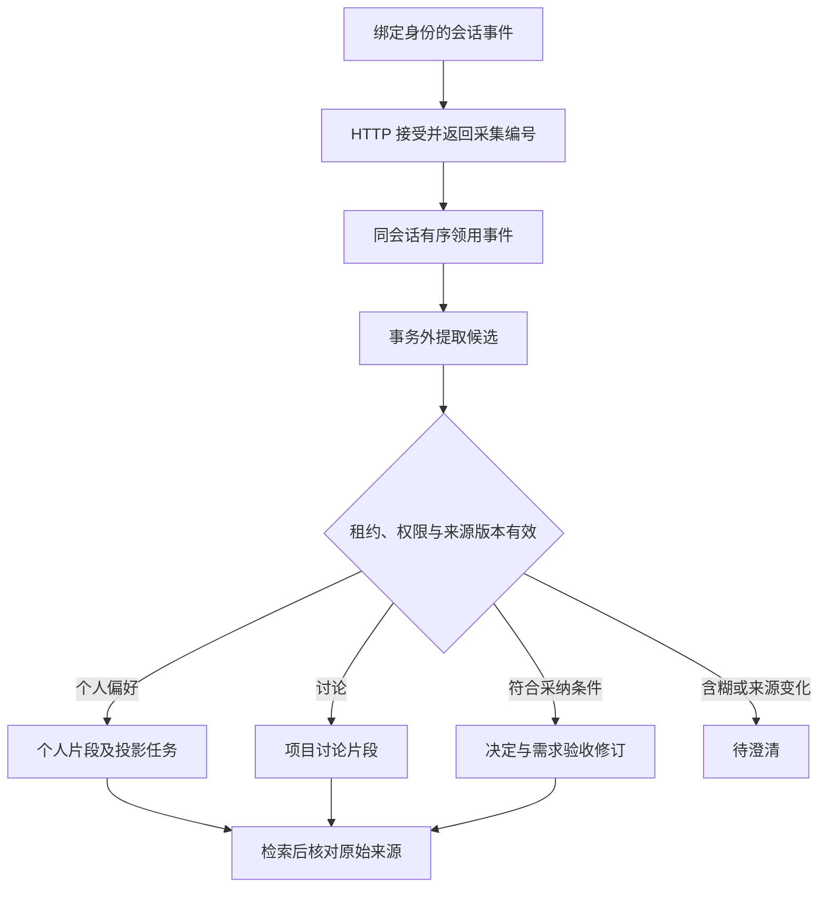

# 系统架构、Agent 接口与记忆边界

固定草稿快照 `256f8b15f9dc0fa80e7f56aa9d1b2b59f4ef5104a16926dfbc9ad47f4b64137b`，基准提交 `92728fbec04cfa34fee4421cb0a9319d1b755164`。本文路径相对该快照。

**intent**　每位成员可以使用自己的工具；项目知识要能读到确定版本，个人经验要按账号和适用范围使用，具体动作取决于本次授权。本章从请求、持久化、后台投影和执行主体四处核查这一意图。

## 谁持有事实，谁帮助查找

| 部件 | 责任、边界与回查入口（observed_in_code） |
| --- | --- |
| Web、CLI、MCP | Web 工作区选择项目页面；CLI 提供设备登录和任务操作，资料命令与 MCP 复用 Agent 工具会话。会话绑定切换要求重开。见 `apps/web/src/ProjectWorkspace.tsx:20-28`、`apps/cli/src/index.ts:192-201`、`apps/cli/src/memory-mcp.ts:71-92`。 |
| core-api、application、domain | Fastify 注册认证及各资源路由，应用用例按当前身份、对象及版本决策，任务状态机负责转换约束。见 `apps/core-api/src/server.ts:127-140`、`packages/application/src/project-access.ts:65-74`、`packages/domain/src/task-state-machine.ts:71-87`。 |
| contracts、persistence | 图投影协议约束节点、边和出处；数据库迁移与应用对象写入构成可追溯记录。部署样例为 PostgreSQL 16，实际运行版本需另查。见 `packages/contracts/src/code-understanding.ts:17-35`、`compose.yaml:1-25`、`packages/application/src/testing-use-cases.ts:244-260`。 |
| 本机 agentd、工作区 | supervisor 先对设备会话/租约做 API 操作，才在本机工作区启动子进程；监控与退出处理在同一 supervisor。服务端的运行状态只能说明其收到的回执。见 `apps/agentd/src/supervisor.ts:20-40`、`apps/agentd/src/supervisor.ts:48-75`。 |
| 后台索引与检索引擎 | 维护器以项目为单位重算索引。材料目录卡携带文档类型、版本、摘要及引用；Wiki/Core 或个人 Viking 返回候选后，平台重新核对权限及当前版本。见 `apps/core-api/src/memory-material-runtime.ts:51-58`、`apps/core-api/src/memory-material-runtime.ts:150-172`、`apps/core-api/src/routes/memory.ts:38-76`。 |
| 后台任务的开关 | 管理路由始终注册。服务自建数据库连接时，无论是否启用记忆，都会定时维护原生资料索引。启用记忆后才注册采集和个人记忆路由，自建连接还会启动采集工作器。外部投影同时要求启用记忆、自建连接和有效引擎配置。见 `apps/core-api/src/server.ts:63-69`、`apps/core-api/src/server.ts:201-247`。 |

## Agent 接手时的读取路线

1. 用工具目录确认当前宿主开放的能力。资料场景可执行 `list_project_materials`、`glob_project_materials`、`grep_project_materials`、`read_project_material`，使用返回的虚拟路径、修订和 range。见 `apps/cli/src/agent-tools.ts:37-54`。
2. 查符号与影响面时，从 `read_code_catalog` 选 run 或 view，再用 `query_code_graph` 查已发布投影，或用 `query_local_code` 查本机固定运行的原生索引。含源码的知识另有角色限制。见 `apps/cli/src/agent-capabilities.ts:78-85`、`packages/application/src/code-understanding-use-cases.ts:31-39`。
3. 查项目讨论或个人习惯时先选 scope，读 brief、搜索、回查明确的 source。当前议题决定能说明方案被采用；实现是否落地，要核对任务、提交或测试执行。完整的资料正文由带权限的原文读取接口提供。见 `apps/core-api/src/routes/memory.ts:88-104`、`packages/application/src/memory-slice-use-cases.ts:365-394`。

## 会话发言如何成为可检索来源

### 源码理解绑定哪版代码

**BR-CODE-SNAPSHOT**　源码知识拒绝 viewer。快照按排序清单、提交、树、范围及排除项校验身份，已绑定的 Run 不接受不同快照。只有创建者推进或发布；产物匹配后标 succeeded，组合视图另选各仓库成功 Run。

源码依据　`packages/application/src/code-understanding-use-cases.ts:31-39`、`packages/application/src/code-understanding-use-cases.ts:62-66`、`packages/application/src/code-understanding-use-cases.ts:126-150`、`packages/application/src/code-understanding-use-cases.ts:153-163`。

### 从检索结果回读原文

**BR-MATERIAL-READ**　目录合并项目、需求、架构和测试资料，按虚拟路径排序。read 按路径/来源、明确修订读取，在返回前再查权限与当前元数据，返回正文哈希、实际修订和 current。二进制只返回元数据；grep 有截断、跳过计数和超时边界。

源码依据　`packages/application/src/project-material-catalog.ts:35-69`、`packages/application/src/project-material-query.ts:72-89`、`packages/application/src/project-material-query.ts:91-110`。

### 一句新发言何时落库

**BR-CAPTURE-QUEUE**　异步入口返回 202。事件按项目、账号、会话及事件键去重，同键不同原文指纹冲突。每会话优先处理较早的未完成事件，按 ID、跳过行锁，租约两分钟，最多五次；模型工作在事务外，业务写入与完成回执在有效租约事务中提交。

源码依据　`apps/core-api/src/routes/memory.ts:111-128`、`apps/core-api/src/memory-capture-queue.ts:41-71`、`apps/core-api/src/memory-capture-queue.ts:88-112`、`apps/core-api/src/memory-capture-queue.ts:117-142`。

### 采纳讨论的约束

**BR-MEMORY-ADOPT**　无议题绑定的采纳要求澄清。绑定采纳需管理权限、当前议题 head、需求修订及精确的方案确认语句。最近决定之后（无既往决定则从议题起点），只允许一条未撤回备选；该备选须有同一议题及需求的 discussed 来源，来源的基准修订等于当前需求修订，片段原文等于备选正文，否则要求核对或澄清。事务将决定与新增验收条件连同来源收据、片段和投影任务保存。讨论、确认、个人偏好分别标记。

源码依据　`packages/application/src/memory-slice-use-cases.ts:131-143`、`packages/application/src/memory-slice-use-cases.ts:224-245`、`packages/application/src/memory-slice-use-cases.ts:248-283`、`packages/application/src/memory-slice-use-cases.ts:184-197`。

### 个人记录能否跨项目使用

**BR-MEMORY-PRIVACY**　默认把偏好的适用范围落在项目。只有原文内匹配无附加条件的账号声明才可跨项目；个人片段限本人。本人按预期修订编辑或撤回，旧投影排队清理，留存版本、适用范围与来源收据。

源码依据　`packages/application/src/memory-slice-use-cases.ts:116-125`、`packages/application/src/memory-slice-use-cases.ts:299-309`、`packages/application/src/personal-memory-use-cases.ts:16-30`、`packages/application/src/personal-memory-use-cases.ts:95-114`。

### 搜索结果从哪里来

**BR-MEMORY-RETRIEVE**　项目搜索可走 Wiki/Core，个人可走 Viking。外部失败降级；项目绑定代数改变时丢弃旧命中。平台重新检查可见性，字面命中优先，再按外部引用顺序，最终最多 30 条；材料索引携带有界目录卡与来源引用。

源码依据　`apps/core-api/src/routes/memory.ts:38-76`、`packages/application/src/memory-slice-use-cases.ts:318-336`、`apps/core-api/src/memory-material-runtime.ts:51-58`。

### 会话重启与操作授权

**BR-AGENT-CONTEXT**　CLI 和 MCP 共用已绑定账号/项目的工具会话。短期检查点保存来源与版本，重置会话代数；新聊天清空引用。独立的进程内 git_push 许可绑定账号、项目、会话、仓库及 commit，限定人类确认、到期时间，执行前消耗。

源码依据　`apps/cli/src/memory-mcp.ts:71-92`、`apps/cli/src/memory-working-context.ts:31-40`、`apps/cli/src/memory-working-context.ts:117-144`、`apps/cli/src/memory-authorization.ts:45-75`、`apps/cli/src/memory-authorization.ts:102-122`。

**inference**　“通常先提交再推送”可作为本人偏好帮助表达流程。在准备执行具体推送时，适配器须从当次操作者获得与实际目标匹配的授权。代码实现了供可信宿主调用的一次性授权账本；不能从这个组件推断所有终端、Git 客户端或第三方工具都受其约束。

**untested**　本轮未调用模型、远程 Wiki/Core、Viking 或用户设备，无法从静态索引推断检索召回率、投影时延或模型拆句正确率。亦未观测某个会员或宿主的当前工具列表。若要判定一条具体记忆，应以其账号、项目、来源引用、当前修订及检索说明为准。
