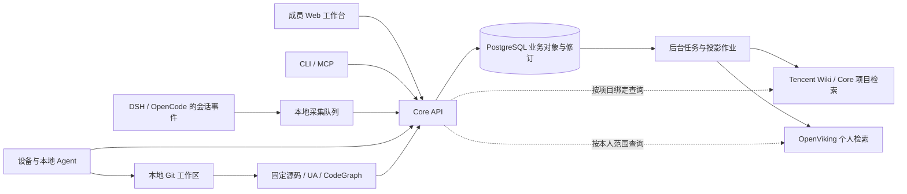

# 系统设计、数据所有权与跨模块流程

本文据固定工作区草稿 256f8b15（基准提交 92728fb）复核实现。分层和模块名用于设计沟通；每个模块的独立业务要求见对应功能规格。系统服务软件团队、操作者的自带 Agent、项目管理者和平台管理员。用户可从没有任务的项目讨论出发，也可领取已有工作。

Web、CLI 与 MCP 通过服务端授权读取业务原件。Agent 本机工作区持有源码字节、原生索引和执行现场；平台登记固定快照身份与上传的代码投影。服务以 TSP_MEMORY_ENABLED=1 启用记忆入口；没有外部绑定时可在平台检索，有绑定时去对应引擎找候选。Core 查询还要求 semanticAgentId，引擎故障可回退到平台能核实的证据。资料索引维护与这些入口分别注册。见 `apps/core-api/src/server.ts:65-69`、`apps/core-api/src/memory-project-runtime.ts:6-15`。服务握有账户、项目和资料的当前权限，并在返回引擎候选前重新确认有效来源。业务写入、后台完成和外部实际效果有不同的观察点。入口与证据见 `apps/core-api/src/server.ts:201-259`、`apps/core-api/src/routes/code-understanding.ts:9-32`、`apps/core-api/src/routes/memory.ts:38-76`、`apps/agentd/src/supervisor.ts:20-75`。

| 数据及所有者 | 稳定引用或版本 | 哪个变化会影响下游 |
| --- | --- | --- |
| 项目成员、团队策略与所有者（M01/M02） | 当前身份、显式成员、团队继承 | 同一人可因显式授权、继承或归档而取得不同能力，写入时重新验权。见 `packages/application/src/project-access.ts:41-74` |
| 需求及基线（M04） | 项目内的需求编码与指定修订，基线选择列表 | 改当前需求后要比较旧基线；当前任务、交接单可能继续引用先前固定版本。见 `packages/persistence/src/schema.ts:825-859`、`packages/application/src/baseline-use-cases.ts:169-199` |
| 设计与资料（M05/M06） | 原件管理编码、不可变修订、附件或 HTML/图源 | 展示层选择具体修订；正文留在原业务源，四类目录共享检索入口。见 `packages/persistence/src/schema.ts:534-578`、`apps/core-api/src/routes/project-materials.ts:11-42` |
| 执行与验收（M07/M08/M09） | 任务、Run、交接包、固定用例及执行结果 | Run 的准备、交接的 ready 回执和目标激活有不同条件；用例结果只证明这次执行，转回归另查修复任务。见 `packages/persistence/src/schema.ts:1059-1093`、`packages/application/src/handover-use-cases.ts:410-446`、`packages/application/src/testing-use-cases.ts:239-260` |
| 代码知识与系统工作（M10/M11） | 固定仓库版本、运行、产物摘要；技能修订 | 选视图、展示源码说明和批准写入候选各有调用入口，不能从一次分析完成推定业务决定。见 `packages/application/src/code-understanding-use-cases.ts:105-167` |
| 平台治理与审计（M12） | 管理员身份、元数据快照、变更原因与审计事件 | 管理者可治理跨项目元数据，这项身份不授予项目正文权限。归档检查仍在运行的 Run，成功变更和审计在同一事务提交。见 `packages/application/src/admin-governance-use-cases.ts:125-156` |
| 记忆与检索（M13） | 来源回执、片段根与修订、资料索引版本、投影代数 | 撤回后平台停止把该来源当作当前证据；物理清理与确认另有状态。见 `packages/persistence/src/schema.ts:1526-1561`、`packages/persistence/src/schema.ts:1562-1613` |

**跨模块例子。** 管理者在议题里发布决定只改变议题。经 M13 的正式采纳操作，并校验议题、需求绑定与双方版本后，才会同时记录决定、写入验收条件并产生需求修订。研发接手时依 M07/M08 的任务及交接依据核对版本。测试人员依 M09 记录环境、版本和实际结果。M13 能帮助找到决定和测试出处。“已记载”“已采纳”“已验证”分别需要文档、决定和执行证据。查 `packages/application/src/memory-slice-use-cases.ts:238-283`、`packages/domain/src/task-state-machine.ts:71-87`。

**设计评审边界。** UA/CodeGraph 用于发现上下游，多个函数在图中相关不能证明提交顺序或外部调用已成功。用户负载、跨区容灾、性能指标和组织授权习惯需要系统负责人提供运行数据。此稿覆盖本次源码与已记录的本地验证环境。
