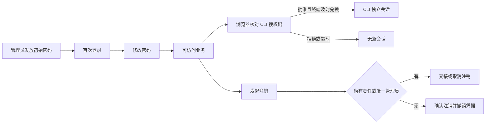

# M01 账号、登录与设备身份

成员先取得独立的登录账号，再用浏览器或 CLI 建立自己的会话。一次授权对应一个设备上的一次登录。注销账号还须处理本人掌管的项目和未交接的工作。以下结论取自 2026-11-12 固定草稿快照 `256f8b15f9dc0fa80e7f56aa9d1b2b59f4ef5104a16926dfbc9ad47f4b64137b`，测试仅核对定义，未运行。

## 成员能完成的操作

| 功能 | 角色、准备和操作 | 成功后看到什么 | 限制、拒绝和证据 |
| --- | --- | --- | --- |
| M01-F01 领取账号和初始凭据 | 平台管理员在账号页输入登录名和显示名，复制发放的短时密码。普通成员用账号登录，后续项目关联使用系统生成的用户编码。管理员也可为有效账号重新发放初始密码，或签发独立的一次性 CLI 绑定凭据。 | 创建响应返回用户编码、规范化登录名、初始密码和到期时间；弹窗关闭后清除本次显示。初始密码 15 分钟，绑定凭据 24 小时，重新签发同类凭据覆盖旧值。 | 登录名去空格转小写，长度 3–64、首位字母或数字，其余允许字母、数字、点、下划线、@、连字符；拒绝重复名和空显示名。禁用账号不能补发，两位不同系统管理员之间不能代重置密码。重置初始密码吊销既有设备。普通成员的人员目录和管理员账号列表有独立权限。 `apps/web/src/AccountWorkbench.tsx:63-97`、`apps/web/src/AccountWorkbench.tsx:137-157`、`apps/core-api/src/routes/users.ts:9-54`、`packages/application/src/user-use-cases.ts:12-36`、`packages/application/src/user-use-cases.ts:80-156`、`packages/application/src/user-use-cases.ts:156-226` |
| M01-F02 登录、核验当前身份及退出 | 成员在登录页提交账号与密码；浏览器重新打开页面时从服务器恢复用户。终端可使用密码登录，或一次性绑定凭据；用 whoami 核对当前账号，退出后再查询应要求重新认证。 | Web 返回用户和 CSRF 信息，浏览器持有 HttpOnly 会话 Cookie；CLI 成功后保存本机会话。一次性凭据只有成功绑定才消费；退出撤销当前会话。 | 未知账号、错密及不可用账号对外统一拒绝；限流回复 429 并给出等待时间。连续密码失败可锁账号，默认 5 次、900 秒，阈值受运行配置影响。Web 登录要求可信来源，Cookie 写操作还要匹配会话的 CSRF 证明；初始密码过期需补发。 `apps/web/src/LoginPage.tsx:15-53`、`apps/core-api/src/routes/auth.ts:14-45`、`apps/core-api/src/routes/auth.ts:84-112`、`apps/core-api/src/routes/auth.ts:130-161`、`apps/core-api/src/web-session.ts:62-87`、`packages/application/src/auth-use-cases.ts:18-85`、`packages/application/src/auth-use-cases.ts:139-145`、`apps/cli/src/index.ts:192-255` |
| M01-F03 首次改密和日后换密 | 使用初始密码登录的成员进入改密页，输入当前密码、新密码并二次确认；终端可登录时换密或使用 passwd。 | 成功清除强制改密标志，当前会话可以继续；其他设备、其租约以及当前设备上的其他会话失效。 | 初始密码登录后普通业务请求被拒；无当前密码、当前密码错误、新密码不在 8–128 字符范围不能提交，页面两次输入不一致也不能完成。 `apps/web/src/PasswordChangePage.tsx:15-53`、`apps/core-api/src/auth.ts:55-94`、`packages/application/src/auth-use-cases.ts:90-116`、`packages/application/src/auth-device.ts:83-87`、`apps/cli/src/index.ts:249-347` |
| M01-F04 用已登录浏览器授权 CLI | CLI 发起登录，展示地址与授权码；成员核对设备名称、平台及码，勾选确认后批准，亦可拒绝。终端可手动打开地址，成功后由发起终端一次兑换。 | 浏览器显示可返回终端；终端另获绑定到该账号的设备和会话。用户在浏览器批准时还未完成终端登录。 | 请求有效十分钟，默认每五秒轮询；过快会增加间隔。未决继续等待；拒绝、过期、已兑换不能成功；初始密码未修改不可批准。兑换时再核验账号，批准后被禁用也不能换取会话。 `apps/web/src/DeviceAuthorization.tsx:8-29`、`apps/cli/src/browser-auth.ts:26-58`、`apps/core-api/src/routes/auth.ts:47-73`、`packages/application/src/device-authorization-use-cases.ts:16-73` |
| M01-F05 核对、改名和撤销设备或会话 | 已认证成员查看本人的设备和会话并按需改名、单独撤销会话或撤销整台设备。管理员可选择其他用户进行同类操作。 | 会话按创建时间从新到旧显示当前标记、过期或吊销状态。单独撤销只影响所选会话，设备吊销撤销其所有未撤销会话及运行租约。退出登录后可用同一合法安装身份重新登录并取得新的会话。 | 每账号最多十台未吊销设备；匹配安装身份可复用设备。新会话有效期 90 天；设备同名不构成安装身份证明。不能把已占用的安装身份合并到另一设备。普通用户越权、空设备名或名称超过 200 字符均被拒。 `apps/web/src/DeviceManagement.tsx:13-50`、`apps/core-api/src/routes/devices.ts:10-79`、`packages/application/src/auth-device.ts:31-86`、`packages/application/src/auth-use-cases.ts:148-168` |
| M01-F06 准备、取消和完成账号注销 | 登录用户打开“我的账号”查看其团队、项目、未完成任务和运行，开始注销，向其他成员转移所有权及工作，重新检查后勾选确认并完成。待注销期间可取消并恢复普通状态。 | 开始仅标记待注销，仍可转出所有权；完成后禁用账号、清除密码与绑定凭据、吊销设备与相关租约、取消以此人为接收人或发起人的未决转移，保留历史与用户编码。 | 归档项目和未决历史负责人也计入阻塞项。任务仅 closed/failed/cancelled 排除，运行 active/preparing/suspended 均阻塞。未先开始、仍有阻塞、最后一位有效平台管理员均不能完成。完成时在事务内重新检查；前端勾选仅是确认体验。 `apps/web/src/AccountClosurePanel.tsx:13-30`、`apps/web/src/AccountClosurePanel.tsx:52-67`、`apps/core-api/src/routes/ownership.ts:33-36`、`packages/application/src/ownership-use-cases.ts:226-286` |

## 验收场景

下表每行独立准备账号和设备。优先级为本次验收建议，所有场景均未执行。

| 用例 / 功能 | 前置与动作 | 观察结果与断言依据 |
| --- | --- | --- |
| AC01 P0 · M01-F01/F03 | 管理员创建有效新账号；以初始密码登录，先读项目，再用原密码改密。另用未授权普通成员创建用户。 | 新用户最初访问业务收到强制改密，成功换密后可按自身权限访问；普通成员创建失败。 `apps/core-api/tests/auth.test.mjs:162-225`、`packages/application/tests/user-use-cases.test.mjs:43-61` |
| AC02 P0 · M01-F02 | 建立 Web 会话，刷新身份，用缺少有效 CSRF 的写请求对照正常退出，然后以原会话读身份。 | 读回本人；写请求拒绝；正常退出清除 Cookie，旧会话无法恢复。连续错密至限制后核对 Retry-After 和持久锁。 `apps/core-api/tests/web-cookie-auth.test.mjs:15-45`、`apps/core-api/tests/auth-throttle.test.mjs:15-34`、`apps/core-api/tests/auth-throttle.test.mjs:63-75` |
| AC03 P0 · M01-F04 | 分别新建两次 CLI 请求，批准 A、拒绝 B；让 A 正常兑换后再次兑换，用 B 轮询。 | A 只得到一个新会话；重复兑换提示过期或已消费，B 收到拒绝。 `apps/core-api/tests/device-sessions.test.mjs:49-72`、`apps/cli/tests/browser-auth-http.test.mjs:11-31` |
| AC04 P0 · M01-F03/F05 | 在同一设备及另一设备各建会话；先撤销单个会话，再用仍有效的当前会话改密；普通成员另尝试管理他人设备。 | 单独操作后兄弟会话可用；改密后仅调用会话保留，另一设备失效；越权拒绝。 `apps/core-api/tests/device-sessions.test.mjs:25-48`、`apps/core-api/tests/auth.test.mjs:409-454` |
| AC05 P0 · M01-F06 | 用持有归档项目或未结束运行的用户开始注销；交接后完成。另准备仅剩一名有效管理员的独立环境。 | 首次列出具体阻塞，交接后账号无法再登录，历史仍在；唯一管理员无法完成注销。 `packages/application/tests/permissions-ownership.test.mjs:169-230`、`packages/application/tests/permissions-ownership.test.mjs:251-262` |

**取证边界。** UA 文件清单定位登录页、设备和所有权入口，Codegraph 原生节点 `function:02d86ff4f10226d9a581c8a9869d8db1` 定位认证路由，再复核上述原件。有效期均为实现值或注明的默认值。未取得线上身份提供商、实际锁定参数或真实成员登录记录。
