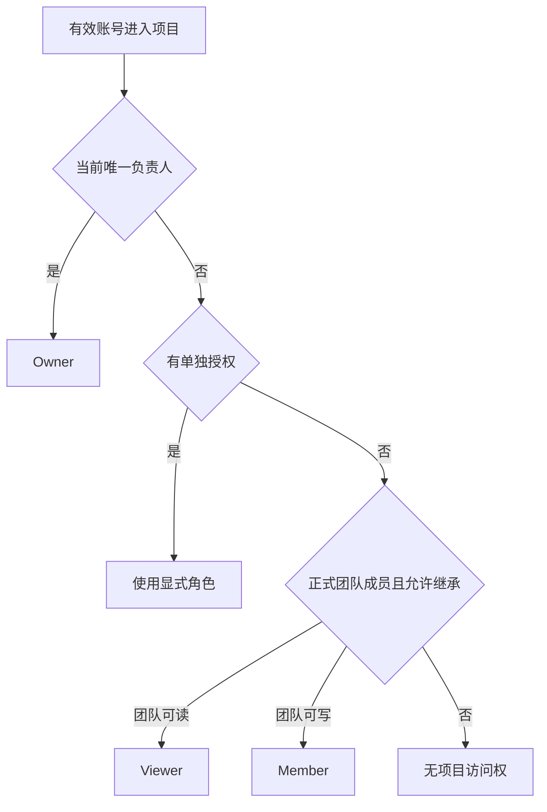

# M02 团队、项目与所有权

团队正式成员关系、项目单独授权和项目所有权是三种不同记录。产品和 QA 应先判断这个人以什么身份访问，再判断他能对谁做什么。结论取自固定快照 `256f8b15f9dc0fa80e7f56aa9d1b2b59f4ef5104a16926dfbc9ad47f4b64137b`，以下为源码观察和待执行验收。

## 团队与项目操作

| 功能 | 角色、前置、动作和成功结果 | 权限、异常及证据 |
| --- | --- | --- |
| M02-F01 建立团队并组织个人列表 | 有效且非待注销的账号创建非空名称的团队，成为创建者和唯一负责人；团队正式成员可查看团队名册。负责人或团队管理员可改名；个人排序保存到自己的成员关系。 | 新角色由唯一负责人字段决定，创建者的普通成员关系底层存为 admin。改名不改团队编码，同名无变更。排序须完整包含当前用户所有正式团队且无重复；默认按个人顺序、创建时间、团队编码升序。团队管理者可查看该团队项目责任元数据；对私有项目的内容访问另按项目判定。 `apps/core-api/src/routes/teams.ts:8-46`、`packages/application/src/team-use-cases.ts:35-109`、`packages/application/src/team-use-cases.ts:113-146`、`packages/application/src/team-use-cases.ts:250-270` |
| M02-F02 添加、调整和移出正式成员 | 团队负责人可任免管理员；管理员可管理普通成员。移出前预览该成员的项目、角色、待交接工作，再确认；成功移出团队并清理该团队下其显式项目授权，继承访问随正式关系消失。 | 不可用普通操作设置/移除 Owner；管理员不能管理同级或授予 admin。不能重复添加现有成员。若目标仍是该团队任一项目负责人，或有未完成任务、active/preparing/suspended 运行，提交整体拒绝，返回相关编码；其他团队的项目授权保留。 `apps/core-api/src/routes/teams.ts:38-82`、`apps/cli/src/permissions.ts:22-24`、`packages/application/src/team-use-cases.ts:148-245` |
| M02-F03 建项目、选择协作范围、切换或整理项目 | 团队 Owner/Admin 在正式团队下输入项目名和说明，选择默认成员策略。创建人成为项目唯一负责人，默认策略 team_read。成员可从全部已授权项目、团队或外部协作筛选进入；项目编码、团队安全摘要、本人角色和来源随项目返回。 | 普通团队成员或待注销用户不能创建；无正式团队但具有单独授权的用户仍能进入相应项目。团队内排序是个人偏好，需提交该团队全部可访问项目，不增加单独授权；跨团队列表不提供团队排序操作。 `apps/core-api/src/routes/projects.ts:52-81`、`packages/application/src/project-use-cases-project.ts:42-108`、`packages/application/src/project-use-cases-project.ts:126-179`、`apps/web/tests/teams-project-access.test.mjs:54-130` |
| M02-F04 编辑项目、归档及恢复 | 有项目管理权的 Owner/Admin 可改活动项目名称、说明；项目 Owner 可归档或恢复。项目编码及已有资料保留。成员仍可读归档项目，恢复后按当前权限继续。 | 编辑和生命周期分别复查权限；相同名称与说明或相同目标状态走无变更分支。归档后不接受内容、策略或成员变更。平台治理另有必须说明原因、检查快照与未结束运行的分支，见 M12-F02。旧错误文案部分写“只有 Owner”，项目编辑的有效条件是管理角色。 `apps/core-api/src/routes/projects.ts:83-105`、`packages/application/src/project-use-cases-project.ts:182-240`、`packages/application/src/project-use-cases-project.ts:249-303`、`packages/application/tests/permissions-policy.test.mjs:196-208` |
| M02-F05 预览并修改项目成员继承策略 | 项目 Owner 在成员与权限页选择 private、team_read 或 team_write，先看获得读写、失去写或失去访问的人数及前后角色，再保存。private 不自动授权；team_read 继承 viewer；team_write 继承 member。 | 优先序为唯一负责人、单独授权、团队继承。显式 viewer 可覆盖团队可写，外部协作者不因本项目授权加入团队。预览与提交都需 Owner；唯一负责人未完成确认不能管理策略。将团队可写收紧前，继承写者若尚有工作则拒绝；事务重新核验，已获显式权限的人不受默认策略改变。 `apps/core-api/src/routes/projects.ts:32-41`、`apps/cli/src/permissions.ts:37-41`、`packages/application/src/project-access.ts:23-74`、`packages/application/src/project-policy-use-cases.ts:12-74` |
| M02-F06 授予例外和外部协作，撤销单独授权 | 有效项目成员可读有效名册；Owner/Admin 在当前活动项目中添加有效账号，授予 admin/member/viewer 或覆盖继承角色。撤销单独授权后响应给出剩余有效角色及来源。 | Owner 才能任免/移除 admin；Owner 自身受保护。纯继承关系没有可单独撤销的记录。正式团队成员撤销例外后可能回到团队策略，外部成员通常失去本项目访问。结果若只读或失去访问，先检查未完成任务或运行；拒绝后保留原权限。 `apps/web/src/ProjectMemberManagement.tsx:24-60`、`apps/core-api/src/routes/projects.ts:167-199`、`packages/application/src/member-use-cases.ts:14-98`、`packages/application/src/member-use-cases.ts:103-125` |
| M02-F07 转移、恢复或确认历史所有权 | 当前 Owner 选择本团队内有效且非待注销成员；发起后看到七天有效的待接收请求，责任仍在原人。接收人本人确认后，更新唯一负责人，原负责人保留 admin；创建者不变。参与人可取消。 | 每个对象最多一笔有效待接收。到期不能接收，重新申请会关闭过期请求；接受时复查双方、归属、期限、接收资格。旧负责人失效时，团队 Owner 可发起项目恢复、平台管理员可发起团队恢复，需理由且仍由接收人确认。没有唯一负责人的历史数据先由旧 Owner 或平台管理员从原有负责人中确认，不可任意指定新用户。 `apps/web/src/OwnershipTransferPanel.tsx:16-41`、`apps/core-api/src/routes/ownership.ts:8-31`、`packages/application/src/ownership-use-cases.ts:49-72`、`packages/application/src/ownership-use-cases.ts:108-180`、`packages/application/src/ownership-use-cases.ts:186-220` |

## 独立验收场景

| 用例 / 功能 | 准备和操作 | 预期与断言依据 |
| --- | --- | --- |
| AC01 P1 · M02-F01/F03 | A 为团队管理员，B 为普通成员，C 仅在一项私有项目获得外部 viewer。分别创建项目并打开“全部项目”，给项目排序。 | A 成功并成为新项目负责人；B 创建失败；C 可进入获授权项目但不获得团队名册；个人排序不制造显式授权。 `packages/application/tests/permissions-policy.test.mjs:52-80`、`apps/web/tests/teams-project-access.test.mjs:54-81` |
| AC02 P0 · M02-F02 | 为成员安排一个未交接任务、同团队一个显式项目权限及另一团队外部权限。先预览并尝试移出，办妥交接后重试。 | 第一次拒绝且角色保留；第二次该团队关系与其下显式授权移除，另一团队的外部权限仍有效。 `packages/application/tests/permission-members.test.mjs:100-145`、`packages/application/src/team-use-cases.ts:193-245` |
| AC03 P0 · M02-F05/F06 | 团队可写项目设甲继承 member、乙显式 viewer、丙外部 member；预览改私有，甲仍有未结束工作。 | 仅甲属于继承损失，第一次收紧拒绝；交接后提交，甲无访问权，乙、丙保留原角色。撤销丙单独权限后无剩余角色。 `packages/application/tests/permissions-policy.test.mjs:91-125`、`packages/application/tests/permission-members.test.mjs:66-99` |
| AC04 P0 · M02-F07 | A 发起给 B；外部协作者尝试接收，再让 B 并发接收两次，另测 B 在申请后进入待注销。 | 发起不改归属；非接收人失败；合法请求仅一次成功；待注销资格阻断，原 Owner 保留。恢复请求接受时也复查原负责人仍失效。 `packages/application/tests/permissions-ownership.test.mjs:28-120` |
| AC05 P1 · M02-F04 | 活动项目 Admin 改说明并尝试归档，Owner 归档后由普通成员读取、管理员尝试修改成员，最后 Owner 恢复。 | 说明更新保留编码；Admin 不能归档，归档后可读但不能改成员；Owner 恢复后重新按权限写入。 `packages/application/src/project-use-cases-project.ts:188-216`、`packages/application/tests/project-use-cases.test.mjs:209-234`、`packages/application/tests/permissions-policy.test.mjs:196-208` |

**追溯与待确认。** UA 清单定位团队、项目、所有权路由和权限命令；Codegraph 原生节点 `function:45aa27b19ffd1d533966f10569e5f7d2`、`function:3f379e6886b2307a7f455aa71a1f5d4c` 引导读取团队用例及项目权限判定。历史迁移是否已在部署环境完成、实际角色分布及浏览器端兼容分支未实测。
