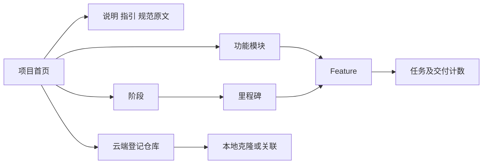

# M03 项目首页、规划与仓库

接手成员先在首页找项目目的、参与指引与规范，再从功能结构确认交付内容，从计划页核对交付时间，最后选对仓库开始工作。项目文档、平台仓库登记和本地 Git 克隆各自保存独立记录。本稿据固定快照 `256f8b15f9dc0fa80e7f56aa9d1b2b59f4ef5104a16926dfbc9ad47f4b64137b` 撰写。

## 可操作功能

| 功能 | 角色、取用步骤与产出 | 边界、失败和证据 |
| --- | --- | --- |
| M03-F01 从首页查找和维护参与资料 | 有效成员打开首页，在说明、参与指引、项目规范中打开具体文档，并查阅成员及仓库摘要。活动项目的 Owner/Admin 可给前两个栏目各绑定一份文档、新建后绑定、改已有正文或清空单个绑定；另一栏目保留。CLI 可读首页或分别设置/解除两个关联。 | 关联必须来自本项目“项目说明”系统目录且仍有效。归档文档或无绑定时栏目为空。规范来自“项目规范”有效目录树，只收活动文档，按标题再编码升序，不接收单份规范绑定。编辑正文检查最新修订；新建与绑定分步，界面在同次弹窗重试绑定会复用已创建的文档。旧版项目文档读写定位首页说明，避免覆盖无关原件。 `apps/web/src/ProjectOverviewWorkbench.tsx:27-97`、`apps/web/src/ProjectOverviewWorkbench.tsx:154-193`、`packages/application/src/project-home-use-cases.ts:40-68`、`packages/application/src/project-home-use-cases.ts:87-126`、`packages/application/src/project-standards.ts:22-43`、`apps/cli/src/index.ts:2542-2569`、`apps/core-api/tests/project-home.test.mjs:155-174` |
| M03-F02 建立功能模块，整理模块及 Feature 顺序 | Owner/Admin 在功能结构页创建模块，填写名称、说明、顺序；成员按模块浏览 Feature。管理者可改名、拖动或键盘调整排序，归档或恢复模块。 | 名称非空。归档前须将关联的未归档 Feature 移出或归档，已交付但未归档的 Feature 同样阻塞。批量重排必须包含当前项目完整、无重复的编码集合；在过滤视图移动 Feature 时页面合并回完整顺序。模块/Feature 列表按 sort_order 升序，使用内部 ID 升序消除并列。 `apps/web/src/ProjectStructureWorkbench.tsx:180-241`、`apps/core-api/src/routes/projects.ts:222-268`、`packages/application/src/project-structure-use-cases.ts:145-245`、`packages/application/src/project-use-cases.ts:144-207` |
| M03-F03 描述、归属和交付 Feature | Owner/Admin 新建有标题的 Feature，可补目标、模块、里程碑和独立起止日期。成员可用 CLI 或页面看列表/详情；管理者更新归属、内容或 active/delivered/archived 状态。 | 模块和里程碑若给定必须在本项目。可先不排日期；只填一端、先后倒置、无里程碑、里程碑窗口未完整或日期越界均被拒；恰好等于边界允许。调整归属时已有排期也要在新窗口内。未给出的更新字段沿用原值。 `apps/core-api/src/routes/tasks.ts:312-364`、`packages/application/src/project-use-cases.ts:90-138`、`packages/application/src/project-use-cases.ts:214-245`、`packages/application/src/project-use-cases.ts:265-326`、`packages/application/src/schedule.ts:5-49` |
| M03-F04 建立阶段与里程碑，核对交付进度 | 管理者为活动项目设阶段名称、目标、开始/结束、顺序和状态，再建里程碑，可关联本项目阶段、成员负责人和起止窗口。成员看到阶段、里程碑、Feature 与任务统计；列表按顺序再内部 ID 升序。 | 阶段有 planned/active/completed/archived，里程碑有 planned/active/at_risk/completed/cancelled。名称非空、日期必须是有效日历日；结束不能在开始之前。新里程碑不能直接设完成；完成前至少有一个未归档 Feature，且全为 delivered。改窗口排除已排 Feature 会失败；计数中的“已关闭任务”只数 closed，完成门槛检查 Feature 状态。 `apps/core-api/src/routes/projects.ts:270-343`、`packages/application/src/project-structure-use-cases.ts:18-23`、`packages/application/src/project-structure-use-cases.ts:262-355`、`packages/application/src/project-structure-use-cases.ts:371-418`、`packages/application/src/project-structure-use-cases.ts:439-480`、`packages/application/src/project-structure-use-cases.ts:530-591` |
| M03-F05 在计划页安排或解除交付时间 | 成员读甘特图、切换时间尺度、按阶段或搜索过滤；管理者从待规划抽屉选择 Feature，指定里程碑及日期后刷新树。双击对应对象可进入阶段、里程碑或排期编辑。 | 待规划包含没有里程碑、引用不存在、缺任一端日期的 Feature。抽屉按标题、目标、编码、模块检索。取消里程碑绑定时界面一并清空起止时间；仅绑定里程碑还没有完整日期，继续列入待规划。图表日期不能推定为真实承诺日期。 `apps/web/src/ProjectPlanWorkbench.tsx:70-152`、`apps/web/src/ProjectPlanWorkbench.tsx:157-208`、`apps/web/src/ProjectPlanWorkbench.tsx:650-695`、`apps/web/tests/project-plan-handoff.test.mjs:42-93` |
| M03-F06 管理云端仓库登记 | Owner/Admin 在活动项目登记多个仓库，输入名称、用途、远端地址、可选默认分支，修改或归档。项目成员读取列表和各仓库是否可管理。 | 非空名称；支持 HTTP(S)、SSH、Git 和 SCP 风格地址，拒绝空白、密码、查询片段及 HTTP(S) 内嵌用户名；项目内同一已登记远端拒绝重复创建。仓库配置只声明来源和分支，登记本身不会验证外部 Git 服务可访问。 `apps/core-api/src/routes/projects.ts:107-142`、`packages/application/src/project-use-cases-project.ts:20-39`、`packages/application/src/project-use-cases-project.ts:540-640`、`packages/application/src/project-use-cases-project.ts:666-731` |
| M03-F07 绑定项目工作空间、检出或关联本地仓库 | 有写权限成员可登记有名称的云端工作空间；终端绑定项目后，从子目录向上识别本地绑定，列出项目仓库，按需 clone 到工作区 code 下，或 attach 已存在的独立 Git 根。status 返回本地检出状态，匹配时附 HEAD 与是否有未提交修改。 | 云端登记保存项目、创建者和名称，本机路径留本地。工作空间避免嵌套初始化到其他 Git 根内；新克隆拒绝目标越界或已存在；关联检查本地 Git 根、指定 remote 和地址匹配。状态区分未检出、缺目录、无效根、缺 remote、地址不符、就绪；真实凭据和远程连通性需另验。 `apps/core-api/src/routes/projects.ts:144-150`、`packages/application/src/project-use-cases-project.ts:741-770`、`apps/cli/src/project-workspace.ts:45-86`、`apps/cli/src/project-workspace.ts:155-242`、`apps/cli/src/index.ts:2651-2697` |

项目产物也可按项目列出或由有写权限成员登记标题、URI 等引用，列表可附任务和运行编码。执行证据、提交与验收归 M07。仓库工作空间用于定位代码；运行租约与交接由 M08 说明。 `apps/core-api/src/routes/projects.ts:201-219`、`packages/application/src/project-use-cases-project.ts:458-517`

## 验收场景

| 用例 / 功能 | 前置和动作 | 可观察结果与断言依据 |
| --- | --- | --- |
| AC01 P0 · M03-F01 | 为两栏各绑一份有效文档；批量提交一个本项目合法引用、一个跨项目引用；随后只清空“指引”。 | 批次因跨项目引用失败，两栏仍为原值；合法清空后只剩说明。成员可读，普通成员改绑失败。 `apps/core-api/tests/project-home.test.mjs:49-114` |
| AC02 P1 · M03-F02/F03 | 在模块里放一个 delivered Feature，先归档模块；移出 Feature 再归档。对两个模块提交重复编码，再提交完整顺序。 | 首次归档失败，移出后成功；重复集失败，完整排序刷新仍在。 `packages/application/src/project-structure-use-cases.ts:183-244`、`packages/application/tests/project-use-cases.test.mjs:492-533` |
| AC03 P0 · M03-F03/F04/F05 | 里程碑 3 月 1–31 日。给 Feature 仅填 3 月 1 日、再填 3 月 1–31 日；随后把里程碑结束改成 30 日。交付前后分别尝试完成。 | 半段排期失败，完整贴边排期成功，待规划抽屉不再包含该项；缩窗失败。最后一个未归档 Feature delivered 后里程碑可完成。 `packages/application/tests/project-use-cases.test.mjs:534-729`、`apps/web/tests/project-plan-handoff.test.mjs:60-93` |
| AC04 P1 · M03-F06/F07 | 管理者录两仓库，尝试重复地址；普通成员查看。准备本地测试 Git 源，绑定工作区、克隆，改变本地 remote 后查状态。 | 成员可读，重复记录拒绝；根仓库不追踪工作区 code 中的独立克隆。匹配时显示 ready，改 remote 后 remote_mismatch，云端未写本机绝对路径。 `packages/application/tests/project-use-cases.test.mjs:235-302`、`apps/cli/tests/project-cli.test.mjs:27-106` |

**证据范围。** UA 定位首页、计划、仓库工作空间及路由；Codegraph 原生节点 `function:79f295b7ab73476205c2004bc3dedf99`、`function:6ebed6a9be2b41975eb9defc63f01960`、`function:222e3f25c2820f5c7bc5708a7f3729a2` 引导核对页面与用例。以上验收均未执行；无用户真实计划数据，也未检出或修改任何真实仓库。
