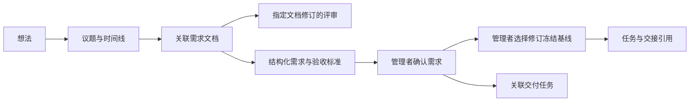

# M04 想法、议题与需求基线

产品成员可以先留下一条想法，集齐多方讨论后记录决定，再把决定落实为可修订的文档和可验收的需求。基线供研发、交接和验收引用一组已经选定的需求修订。发起文档评审、确认单条需求和确认整组基线是三个独立动作，各有自己的权限、对象和结果。

## 对象与入口

Web 的项目需求工作台包括想法、议题、需求文档、结构化需求清单。项目有效读者可查本项目资料，有写权限的成员贡献内容，项目管理者包括 Owner 和 Admin。文档维护人有自己的修订与发起评审权限。基线另有带项目身份的查询、创建、比较和绑定查询接口。旧 Web 基线路径实际落到需求文档页。依据 `apps/web/src/RequirementsWorkbench.tsx:79-124`、`apps/web/src/workspaceRouting.ts:48-55`、`apps/core-api/src/routes/baselines.ts:11-50`、`packages/application/src/project-access.ts:22-35`。

文档修订保存正文、摘要、关键词和变更说明。结构化需求修订保存正文、验收标准及未决问题；标题、状态和关联另保存在需求主记录。基线项目保存指定修订的内容，以及冻结当时的标题、状态、Feature、模块、来源文档。即使选的是旧正文，其状态和关联也取冻结时的值。依据 `packages/application/src/requirement-document-use-cases.ts:411-441`、`packages/application/src/requirement-use-cases.ts:43-72`、`packages/application/src/baseline-use-cases.ts:68-83`。

## 操作场景与验收

以下正反验收均为待执行场景。每组从独立项目或干净夹具开始，同行连续操作继承上一步的状态。

| 功能 | 谁在什么条件下操作，得到什么 | 正向验收 | 反向验收或恢复 | 实现依据 |
| --- | --- | --- | --- | --- |
| M04-F01 收集与整理想法 | 可写成员在想法池提交标题，可补充说明和来源；产生 active 想法。作者或管理者可修改、归档或恢复。读者按状态及关键字查询，可看到关联议题数量。 | 创建一个带来源的想法，按标题找到它，再归档、筛出、恢复，检查编码相同。 | 空标题应拒绝；换普通非作者编辑应拒绝，原内容仍可查。 | `packages/application/src/requirement-collaboration-use-cases.ts:165-224`、`apps/web/tests/requirements-lifecycle.test.mjs:24-35` |
| M04-F02 汇聚想法，界定一个议题 | 可写成员在议题页直接建题，或选择本项目多个想法并填入问题、目标。创建后状态为 open。可追加想法和已有需求文档；议题作者或管理者可改文字，手动改变状态需管理权限。 | 选两个同项目想法建题，再重复关联一个想法并加入一份需求文档，详情只列两条想法和一份文档。 | 混入其他项目的想法或文档，整次关联请求应拒绝。普通作者手动改变议题状态应拒绝。 | `packages/application/src/requirement-collaboration-use-cases.ts:241-264`、`packages/application/src/requirement-collaboration-use-cases.ts:300-316`、`packages/application/src/requirement-collaboration-use-cases.ts:394-419` |
| M04-F03 讨论、发布决定和撤回误发记录 | 可写成员在未归档议题发表讨论、备选方案或反馈；管理者可发布决策。决策使议题进入 decided，新反馈把已决定议题重新打开，可在新决策中引用本题的历史决策。作者或管理者可软撤回非决策，详情保留撤回人、时间及原因，隐藏正文、来源和图片，并按剩余记录重算状态。 | 管理者决定 → 成员带图反馈 → 议题 reopened → 成员撤回这条唯一的后续反馈；重新进入详情应为 decided，原反馈只剩占位。再发决定替代旧决定，旧决定仍可追溯。 | 普通成员发决策、撤回决策、在已归档议题发言均应失败。单条最多 4 张 PNG/JPEG/WebP/GIF，单张 2 MiB、总计 5 MiB；超出上限拒绝整条记录。 | `packages/application/src/requirement-collaboration-use-cases.ts:23-51`、`packages/application/src/requirement-collaboration-use-cases.ts:274-295`、`packages/application/src/requirement-collaboration-use-cases.ts:321-350`、`packages/application/src/requirement-collaboration-use-cases.ts:359-388` |
| M04-F04 发布与修订需求文档 | 可写成员在文档页选择归属模块，填写标题、摘要、Markdown 正文及可选关键词。创建后成员即可查阅、检索。作者或管理者带变更说明提交修订，保留历史正文，可在详情追到关联结构化需求。 | 建 R1，另一成员读取；作者发布 R2，读者能核对两个版本及变更说明，原文档编码相同。 | 省略变更说明、由其他普通成员修订、归档项目后修订均应失败；历史仍可读。 | `packages/application/src/requirement-document-use-cases.ts:206-249`、`packages/application/src/requirement-document-use-cases.ts:295-363`、`packages/application/src/requirement-document-use-cases.ts:384-443` |
| M04-F05 对指定文档版本评审 | 文档维护人或管理者对当前修订发起评审；同版已有开放评审则返回已有记录。可写成员表达支持、需要修改或弃权并可更新自己的意见。管理者收口为通过、要求修改或未达共识，保留结论与关闭人。评审进行中可继续写新版。 | 对 R1 发起两次，核对同一开放评审；发布 R2，再给 R1 评审改票，检查此人只占一票，评审版本仍为 R1。 | 普通参与者关闭应被拒。管理者关闭后再投票应被拒；不用等到评审关闭才能读取 R2。 | `packages/application/src/requirement-collaboration-use-cases.ts:434-449`、`packages/application/src/requirement-collaboration-use-cases.ts:465-497`、`packages/application/tests/requirement-collaboration-use-cases.test.mjs:140-174` |
| M04-F06 把讨论落实为结构化需求 | 可写成员从需求清单或来源文档建草稿，写标题、背景及目标、验收标准、未决问题；须有同项目的模块、Feature 或来源文档之一。管理者可修订或调整绑定，详情回看任务及历史。正文、标题、验收或问题变化产生新修订；只改变绑定可保留修订号。 | 在文档下创建 R1，后补同项目 Feature，确认修订号未增加；调整验收条件，应出现 R2 和可读的 R1。 | 跨项目绑定、移除全部归属、非管理者改正文应拒绝。读写间状态、修订或绑定变化应提示重新加载。 | `apps/web/src/RequirementsWorkbench.tsx:626-697`、`packages/application/src/requirement-use-cases.ts:92-98`、`packages/application/src/requirement-use-cases.ts:264-302`、`packages/application/src/requirement-use-cases.ts:333-374`、`packages/application/src/requirement-use-cases.ts:557-565`、`packages/application/src/requirement-use-cases.ts:595-663` |
| M04-F07 确认、交付、提出变更或废弃需求 | 管理者在需求生命周期操作中推进状态。草稿和澄清中可确认；确认后可实施，有至少一个关联任务且全部关闭才可由实施中标为已交付。已确认、实施中、已交付可进入变更提议，重新编辑并澄清或确认。废弃为终态。 | 给草稿补一条可验证标准、清空未决问题并确认；先创建一个关联任务再进入实施；关闭此任务后交付；提出变更、发布新修订再确认。 | 仍有未决问题或无验收标准不能确认；零任务不能进入实施，尚有未关闭任务不能交付；已确认时直接改正文应拒绝。 | `packages/application/src/requirement-use-cases.ts:31-41`、`packages/application/src/requirement-use-cases.ts:595-603`、`packages/application/src/requirement-use-cases.ts:722-771` |
| M04-F08 冻结一组需求修订 | 管理者在活动项目提交名称、范围、原因及 1–1000 个不同需求的指定修订。只收本项目、当前已确认/实施中/已交付的需求。事务保存内容、哈希、父基线与审计；提交预期父基线可发现别人先确认。 | 选已确认需求 R1 建 V1，发起变更写 R2；重读 V1 应仍含 R1，哈希不变。以同一父级并发确认新基线，核对仅一份获准。 | 含草稿、重复需求、外项目需求、未知修订或已过期的显式父级应失败，清单不出现半份基线。若省略预期父级，服务端采用当时最新父级。 | `apps/core-api/src/routes/baselines.ts:24-38`、`packages/application/src/baseline-use-cases.ts:36-59`、`packages/application/src/baseline-use-cases.ts:169-199` |
| M04-F09 比较基线并追查谁在使用 | 有效项目成员可比较两份基线，或以基线对照项目当前需求；按需求编码列出新增、移除、修改及字段前后值。绑定查询罗列有无基线的任务、可见交接及其冻结基线，帮助接手人核对依赖。 | 以仅含 A 的基线对照增加了 B 且修改 A 验收条件的现状，检查新增 B、修改 A 及对应字段；在绑定查询中寻找一个未绑基线的任务。 | 他项目基线编码不能读取或比较；未发布交接对非来源成员、非管理者不可见；基线内容哈希不匹配时读取失败。 | `packages/application/src/baseline-use-cases.ts:49-64`、`packages/application/src/baseline-use-cases.ts:86-139`、`packages/application/src/baseline-use-cases.ts:203-224` |

## 排序、测试依据与待确认项

想法和议题列表按最近更新时间降序；议题详情按创建时间、记录 ID 降序，图片按上传顺序。文档集合按模块标识、标题升序，基线按版本降序。列表未设置额外并列条件时，验收不固定并列项的相对次序。依据 `packages/application/src/requirement-collaboration-use-cases.ts:165-181`、`packages/application/src/requirement-collaboration-use-cases.ts:226-240`、`packages/application/src/requirement-collaboration-use-cases.ts:275-284`、`packages/application/src/requirement-document-use-cases.ts:279-300`、`packages/application/src/baseline-use-cases.ts:142-154`。

已有测试定义（本次未运行）：议题反馈与决策、撤回及固定评审版本见 `packages/application/tests/requirement-collaboration-use-cases.test.mjs:29-82`、`packages/application/tests/requirement-collaboration-use-cases.test.mjs:108-164`；需求修订与迁移见 `packages/application/tests/requirement-use-cases.test.mjs:135-216`；基线差异、非法选择、并发和绑定可见性见 `packages/application/tests/baseline-use-cases.test.mjs:56-125`、`packages/application/tests/baseline-use-cases.test.mjs:144-205`。P0 建议优先执行 F03、F05、F07–F09 的状态与权限分支，其他场景 P1。

待确认：未发现基线独立 Web 管理页，客户端应以明确支持的入口验收。评审关闭由管理者选择结论，代码未发现票数或比例自动裁决。议题决策替代校验只在找到被替代记录时执行；传入不存在的决策编码可能写成无替代关系，该行为应由产品决定是否保留。依据 `apps/web/src/workspaceRouting.ts:48-54`、`packages/application/src/requirement-collaboration-use-cases.ts:330-343`、`packages/application/src/requirement-collaboration-use-cases.ts:481-497`。
