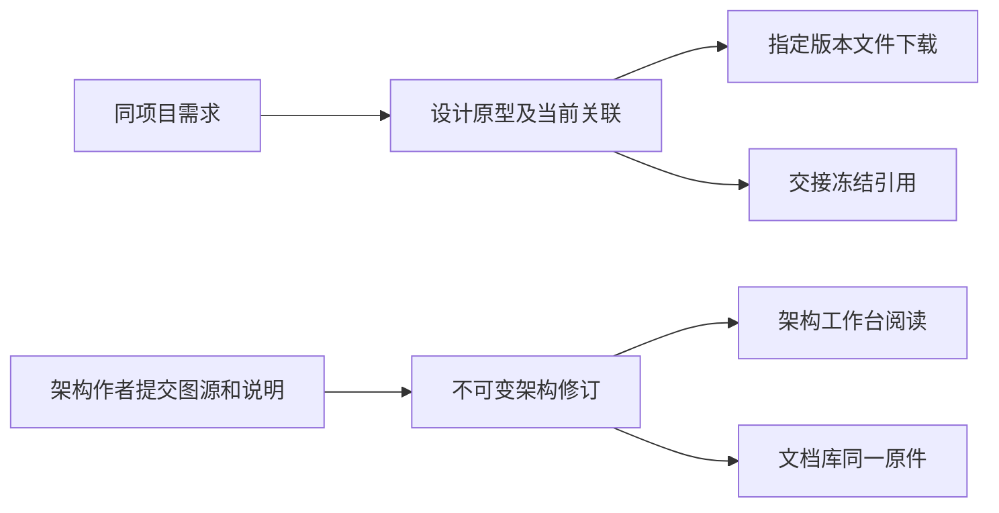

# M05 原型与架构设计

设计者可把可交互页面、效果图、外站地址或原始文件交给团队，并说明设计回应哪些需求。架构作者维护图源及解释。成员既能从项目设计工作台看当前版本，也能从有权访问的资料页核对架构历史。原型需求关联属于当前原型；架构图、图源预览和说明按修订成套保存。

## 对象与阅读顺序

原型主记录包含项目、作者、标题、摘要、状态及当前版本号。修订保存源、配套说明、变更说明、作者、时间；文件修订还记录文件名、大小、类型及 SHA-256。详情给当前内容、历史元数据和可编辑标志。列表默认按最近更新时间降序。架构详情可读每版完整图源、说明、同版预览及变更记录；列表按更新时间、记录 ID 降序。依据 `packages/application/src/design-prototype-use-cases.ts:241-273`、`packages/application/src/design-prototype-use-cases.ts:276-314`、`packages/application/src/design-prototype-content.ts:48-60`、`packages/application/src/architecture-document-use-cases.ts:65-99`。

## 可执行的操作场景

正反两栏为设计验收，均未在本次运行。除注明串联外，每个用例独立准备活动项目及相应角色。

| 功能 | 角色、入口、前提和结果 | 正向验收 | 反向验收或恢复 | 固定源码 |
| --- | --- | --- | --- | --- |
| M05-F01 创建设计原型并关联需求 | 有写权限的项目成员在原型工作台填标题、选内容、可填配套 Markdown，并选择同项目需求。可从 draft 或 ready 起步，保存主记录、R1 和需求关联。 | 附一条同项目需求建草稿，另一读者打开列表和详情，核对需求编码、R1、创建人和说明。 | 空标题、直接以 archived 创建、跨项目需求均应拒绝，列表无新增。仅查看者不能创建。 | `apps/web/src/DesignWorkbench.tsx:466-506`、`packages/application/src/design-prototype-use-cases.ts:93-122`、`packages/application/src/design-prototype-use-cases.ts:175-221` |
| M05-F02 预览 HTML、效果图或外部页面 | 成员在预览页对照不同视口。HTML 以受限框架呈现；效果图作为图像原型，在 Web 编辑器接受 PNG/JPEG/WebP/GIF，上传限 4 MiB。外链初始展示地址，成员可选择尝试预览或前往原站。 | 查看一份 HTML 和一张效果图并切换显示宽度；对一个有效外链，页面先展示地址，点击后加载外页。 | 非 HTTP(S) 或带登录凭据的地址拒绝保存。外站拒绝嵌入时仍可使用原站链接；外站页面后续变动属于外部系统。 | `apps/web/src/DesignWorkbench.tsx:43-90`、`apps/web/src/DesignWorkbench.tsx:340-355`、`apps/web/src/DesignWorkbench.tsx:389-410`、`packages/application/src/design-prototype-content.ts:63-85` |
| M05-F03 保存并下载特定修订的原型附件 | 有写权限的成员提交文件；读者可检查文件名、媒体类型、大小并下载指定修订。服务端验证文件名、媒体类型、Base64 与解码后大小（最多 20 MiB），按修订保存字节和摘要，下载使用附件响应。 | R1 上传文件 A、R2 换为 B，分别指定版本下载，计算摘要，与对应修订一致。确认交接包记录固定文件修订、元数据。 | 上传超限文件应拒绝。未登录、非本项目成员、非法修订号或指向非文件修订的下载不能返回文件字节。 | `packages/application/src/design-prototype-content.ts:86-109`、`packages/application/src/design-prototype-use-cases.ts:408-434`、`apps/core-api/src/routes/design-prototypes.ts:67-80`、`packages/application/tests/handover-use-cases.test.mjs:318-343` |
| M05-F04 修订内容、配套说明和状态 | 在活动项目中，作者或管理者为未归档原型填写变更说明后提交。新修订保存该版源与说明，原型当前需求关联按提交的完整清单替换；Web 单改说明时会带上已有需求。可提交 archived 完成归档，此后不能再修订。 | 给一份链接 A 的原型只改说明，检查 R2 的来源不变且仍关联 A；再显式改为 B，详情只显示 B，版本记录列出改动者及原因。 | 非作者普通成员、缺变更说明、归档后续改均应拒绝。直接调用修订接口省略需求清单会清空当前关联，应在客户端回归中验证。 | `apps/web/src/DesignWorkbench.tsx:57-64`、`packages/application/src/design-prototype-use-cases.ts:321-380`、`packages/application/src/design-prototype-use-cases.ts:382-400` |
| M05-F05 建立架构图和可下载的设计依据 | 有写权限的成员在架构工作台导入 Mermaid、draw.io 或 PNG/JPEG/WebP 图片，可加说明及同版 SVG 预览。图源最多 6 MiB，预览最多 2 MiB。创建后可查看或导出图源；文档库的架构目录显示同一个对象。 | 导入合法 draw.io，添加解释和预览并保存；在架构页及资料库打开，核对文档编码、R1、图源和说明；导出源后检查其内容。 | 危险 XML 声明、图片声明与文件签名不符、预览超限应拒绝；归档项目不可新建。 | `packages/application/src/architecture-document-content.ts:25-75`、`packages/application/src/architecture-document-use-cases.ts:103-118`、`apps/web/tests/architecture-workbench.test.mjs:179-210`、`packages/application/src/project-document-use-cases.ts:445-463` |
| M05-F06 修订架构，复查历史和并发冲突 | 作者或管理者从架构工作台或文档库原地编辑，提交打开编辑器时的基础修订和变更说明。服务端锁住当前对象，匹配版本才追加完整修订。更换图源且未提交新预览会清除旧预览；只改说明可沿用同版图源的预览。历史阅读器可回到当前版。 | 两人各从 R1 开始，第一人换图源形成 R2。另一人用旧 R1 提交，应收到冲突；重新载入并合并后写 R3。回看 R1，核对原图及预览均保留。 | 其他普通成员、非正基础修订、空变更说明或归档项目不能修订；冲突后不应自动将旧草稿改为 R2 基础后再次提交。 | `packages/application/src/architecture-document-content.ts:65-75`、`packages/application/src/architecture-document-use-cases.ts:122-159`、`apps/web/tests/project-architecture-directory.test.mjs:77-108`、`apps/web/tests/architecture-workbench.test.mjs:46-90` |

## 证据与交付边界

已有测试定义：设计 CLI 上传与说明导出见 `apps/cli/tests/cli-skeleton.test.mjs:92-107`；交接引用行为见 `packages/application/tests/handover-use-cases.test.mjs:318-343`；架构完整修订、越权、并发和源/预览配对见 `packages/application/tests/architecture-document-use-cases.test.mjs:27-118`。这些是固定源码的断言，本次未执行。P0 建议覆盖 F03 的跨项目及指定版本、F06 的冲突；其余预览、编辑和导出为 P1。

原型详情只返回当前 HTML 与说明，以及各历史版本元数据；文件类另有按修订下载。当前证据无法支持为所有类型逐版播放历史内容的承诺。原型修订未提供架构编辑器的显式基础版本字段，两位作者并发编辑的用户提示仍待验证。外站可用性及特定浏览器对嵌入的行为需独立试验。依据 `packages/application/src/design-prototype-use-cases.ts:296-313`、`packages/application/src/design-prototype-use-cases.ts:321-332`、`apps/web/src/DesignWorkbench.tsx:351-355`。
