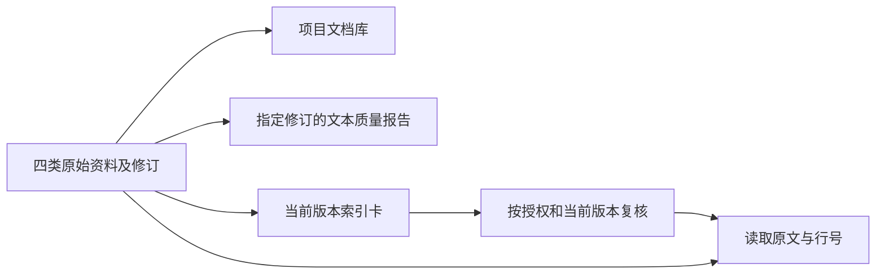

# M06 资料库与文档质量

成员在资料库保存项目资料，并集中阅读需求、架构和测试资料的原始修订。接手成员或其 Agent 可以先找有权读取的资料，再带上版本和行范围获取引用。质量报告帮助审阅者找空章节、占位内容及待人工判断的问题，正式批准与采用另有各自的记录。

## 对象、入口和来源

| 来源 | 业务写入口 | 资料库或查询可取得的内容 |
| --- | --- | --- |
| 项目文档 | 项目资料库创建、上传、修订 | Markdown、标题、摘要、用途、目录、修订号、变更说明 |
| 需求文档 | 需求工作台，或从资料库进入需求编辑器 | 来源文档、所选版本正文、关联需求、该版本的评审 |
| 架构资料 | 架构工作台，或资料库的架构编辑器 | 指定版本的图源、说明、预览；是否可全文检索取决于图源类型 |
| 测试资料 | 测试工作台 | 原测试资料及修订；文本可读，文件以元数据定位 |

依据 `packages/application/src/project-document-use-cases.ts:149-192`、`packages/application/src/project-document-use-cases.ts:417-476`、`packages/application/src/project-material-catalog.ts:35-69`。同一文档编码在当前版和历史版保持稳定；引用历史时应同时保存修订编码或来源引用。Web 目录是面向成员的树；Agent 使用的虚拟路径形如 `requirement/<对象编码>.md`，不会因 UI 文件夹名称改变而变成磁盘路径。依据 `packages/application/src/project-material-query.ts:59-89`、`packages/contracts/src/project-materials.ts:4-25`。

## 操作和验收

以下均为待执行验收，先准备独立项目、可写成员、普通读者及非成员。每个正反组合从同一已知版本开始。

| 功能 | 角色、前提、操作及结果 | 正向验收 | 反向验收或恢复 | 固定源码 |
| --- | --- | --- | --- | --- |
| M06-F01 整理文件夹 | 可写成员从资料库建普通多级目录；创建者或管理者可改名、移动或归档。系统树含项目资料、项目说明、项目规范、需求文档、架构设计、测试资料。固定目录按角色标记识别，历史同名普通根目录保留为独立对象。 | 在普通 A 建 B，把 B 移到普通 C，按目录编码重读。历史项目首次访问，核对固定目录只补齐一套。 | 把 A 移入自己的子目录、同层创建同名目录、改名固定目录或向系统树移入子目录，均应拒绝。归档项目应只读。 | `packages/application/src/project-document-folders.ts:7-23`、`packages/application/src/project-document-folders.ts:39-75`、`packages/application/src/project-document-use-cases.ts:79-95`、`packages/application/src/project-document-use-cases.ts:253-288`、`packages/application/src/project-document-use-cases.ts:305-334` |
| M06-F02 新建、归档及修订项目文档 | 可写成员在允许的目录录入或上传 Markdown，填写标题、正文，摘要为空时从内容生成。Web 新建可选 DOC/API/DIAGRAM。作者或管理者可调整目录、内容或状态，写变更说明，保留旧版本并触发索引记录。已有旧类型只编辑内容时应保留用途。 | 建 R1 后用 R1 作基础提交 R2；重读 R1、R2 的内容、变更说明。归档再恢复，核对新修订及状态。 | 发布时空正文、缺变更说明、将普通文档写入需求/架构/测试资料目录应拒绝。声明旧基础版本有冲突时，重新载入合并，不能产生多余修订。 | `apps/web/src/ProjectDocumentsWorkbench.tsx:176-200`、`apps/web/src/ProjectDocumentsWorkbench.tsx:451-468`、`packages/application/src/project-document-use-cases.ts:341-395`、`packages/application/src/project-document-use-cases.ts:541-594` |
| M06-F03 从目录阅读原始业务资料 | 读者从树或搜索定位标题、打开原始文档，检查正文、历史和来源类型。需求、架构、测试资料按原件生成视图；需要编辑时遵循原模块角色、修订和只读限制。合并列表按标题、文档编码排列，目录按顺序及 ID 排列。 | 在 M04 或 M05 更改原件，刷新对应目录，核对同一编码显示新当前版、旧版仍可读取。 | 普通项目文档修订入口接收业务源编码应拒绝。跨项目账号读取原件也应失败；不得经关联视图获取编辑权限。 | `packages/application/src/project-document-use-cases.ts:192-245`、`packages/application/src/project-document-use-cases.ts:417-482`、`packages/application/src/project-document-use-cases.ts:537-546`、`apps/web/src/ProjectDocumentsWorkbench.tsx:363-385` |
| M06-F04 检查选定文档版本及定位问题 | 读者在阅读器打开“文档质量”，可调整用途，查看规则、问题、行号和人工待核项。报告绑定项目、来源、修订及内容哈希；架构图和说明分别绑定，需求评审只取同版。测试外部附件标明未解析。 | 让 R1 含模板占位，R2 修复；选择 R1、检查并定位原行，再切到 R2 重查。有效计数将人工待核与程序已检项目分别呈现。 | 请求无此修订、非法用途或外项目资料，应出错。读取质检不初始化系统目录。规则通过不产生评审票、基线或正式采用结果。 | `apps/web/src/DocumentQualityPanel.tsx:12-50`、`apps/core-api/src/routes/document-quality.ts:46-83`、`apps/core-api/src/routes/document-quality.ts:87-147`、`packages/contracts/src/document-quality.ts:238-279` |
| M06-F05 跨四类资料找候选 | 有效项目读者或其授权 Agent 从 CLI 的 docs index/glob 或对应工具，按类型、状态、标题/摘要/路径关键字或路径模式筛选；得到元数据、修订、来源、分页游标与截断标志。默认 active，可明确请求 archived/all。 | 同项目放四类资料，用 index 分页列出，再用 glob 限定需求类；列表应无完整正文且按虚拟路径稳定排序。 | 外项目查询、危险路径、过大页长应拒绝。目录或响应预算截断时检查标志并翻页，不把当前页当全集。 | `apps/cli/src/agent-tools.ts:32-55`、`packages/contracts/src/project-materials.ts:4-17`、`packages/application/src/project-material-catalog.ts:42-79`、`packages/application/src/project-material-query.ts:18-32`、`packages/application/src/project-material-query.ts:59-71` |
| M06-F06 搜索正文并回读准确出处 | 用 docs grep 按字面或正则搜索当前文本，得到匹配行、上下文、出处及跳过计数。用 docs read 按编码、虚拟路径或指定来源引用取原始修订、正文片段、行范围、哈希及是否当前。分页按 UTF-16 游标前进，避免切断代理对。 | 令 R1 含指定短语、R2 修改。用 R1 引用读取旧行，结果标历史；对当前版本 grep 新短语，按返回范围回读并核对同版。 | 二进制文件返回元数据及不可读正文原因，grep 跳过；起始行越界拒绝。搜索最多扫描 128 份、总输入 100 万字符，单份最多 10 万字符；超限或超时检查截断/错误，不能据此断言没有匹配。 | `packages/application/src/project-material-query.ts:10-19`、`packages/application/src/project-material-query.ts:38-56`、`packages/application/src/project-material-query.ts:72-110`、`packages/application/src/project-material-search.ts:9-33` |
| M06-F07 从语义索引定位当下可引用的资料 | 系统对活动项目的当前资料维护短索引卡。替换修订或元数据变化时，旧卡退役并排队删除，新卡排队投影；有效命中要回源校验版本和元数据，成员再按授权读原文。 | 等待示例 R1 已索引后改为 R2，送回一个迟到的 R1 命中，检查不会作为当前 R2 卡片显示。相同修订和元数据重扫应不再创建新的索引版本。 | 归档来源、待删除投影或旧哈希都应排除在当前可用结果外。索引任务入队时不能断言外部引擎已经同步。 | `packages/application/src/project-material-catalog.ts:82-91`、`packages/application/src/project-material-index.ts:8-44`、`apps/core-api/src/memory-material-runtime.ts:170-196`、`packages/application/tests/project-material-query.test.mjs:151-184` |

## 质量证据与待确认项

已有测试定义覆盖资料树与原始权限、修订同源、版本冲突（`packages/application/tests/project-document-use-cases.test.mjs:143-195`、`packages/application/tests/project-document-use-cases.test.mjs:312-365`、`packages/application/tests/project-document-use-cases.test.mjs:439-453`），覆盖四类来源、历史回读与迟到命中（`packages/application/tests/project-material-query.test.mjs:33-105`、`packages/application/tests/project-material-query.test.mjs:151-184`），也覆盖同版质检、历史版本缺失及附件边界（`apps/core-api/tests/document-quality.test.mjs:83-119`、`apps/core-api/tests/document-quality.test.mjs:139-205`）。本次没有执行业务测试；P0 建议优先执行 F03/F04 的越权和历史绑定、F06/F07 的旧版与迟到结果，其余为 P1。

外部语义引擎的索引延迟和召回率需结合真实服务验证。资料库是否可写、是否可全文检索、某段话是否得到人工批准是三项独立判断。报告会区分需要修改、待人工核验、规则通过，也会说明未核验采用情况；外部附件的真实内容及图是否表达正确不在已运行的检查范围内。依据 `apps/core-api/src/routes/document-quality.ts:101-147`、`packages/contracts/src/document-quality.ts:263-280`。
