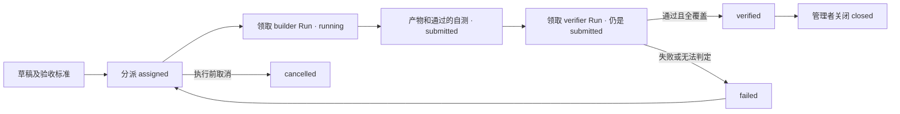

# M07 任务与执行证据

一次交付由三次决定组成。项目管理者决定做什么、分给谁，执行者提交产物并声明自测覆盖范围，验证者按同一份任务契约作出结论。项目管理者最后确认关闭。系统按 Run 区分执行和验证，两种身份可以由同一名有权限的成员先后使用，源码没有实施双人分离。权限判定中的项目管理者包含有效 Owner 和管理员。前端或错误提示中的“Owner”须结合实际角色判断。证据见 `packages/application/src/project-access.ts:22-26`、`packages/application/src/task-service.ts:419-456`、`packages/application/src/project-use-cases.ts:570-615`。

## 从哪里开始

Web 项目任务板可筛选任务、打开详情、查看事件、改契约或取消，详情中的需求基线面板负责绑定。项目需求和缺陷工作台也能创建任务。CLI 的 `tsp task` 提供分派、领取、提交、验证、关闭和历史查询。前端详情展示的 Run、产物、自测证据和审核证据来自服务端任务视图。API 的任务列表、依赖图、证据、详情和审计历史是不同查询。见 `apps/web/src/App.tsx:442-469`、`apps/web/src/TaskDetail.tsx:212-279`、`apps/web/src/RequirementsWorkbench.tsx:180-199`、`apps/web/src/DefectsWorkbench.tsx:133-148`、`apps/core-api/src/routes/tasks.ts:64-122`、`apps/cli/src/index.ts:1027-1094`。

## 功能与验收

下面每行是一项可独立验收的用户任务。“反向”列说明拒绝条件或相邻状态的不同结果。并发字段 `base_snapshot` 是任务变更序号，命名的需求基线另有项目、版本和条目。

| 功能 | 谁从哪里开始、输入与成功结果 | 反向或边界验收 | 固定源码 |
| --- | --- | --- | --- |
| M07-F01 创建可执行契约 | 项目可写成员可提 ad-hoc；其他来源需项目管理者。对已存在的 Feature 提供标题、Profile、验收项，可带需求、范围、简报、验证接缝、依赖。事务登记 draft、初始序号 0、依赖、审计；按来源记录需求修订等追溯字段。 | 空验收项、缺失依赖、跨项目依赖均失败；defect-fix 必须绑定同 Feature 的缺陷，其他来源不得夹带缺陷。 | `packages/application/src/project-use-cases.ts:359-451`、`packages/application/src/project-use-cases.ts:484-531` |
| M07-F02 固定需求基线 | 管理者在创建时选 M04 生成的项目基线；即使需求已升级，也固定所选版本的需求修订。现有任务可在详情选择同项目且包含原修订的基线，首次绑定推进序号并审计，同一绑定按当前序号重试返回原结果。 | 指向其他项目、缺少该需求或试图改写已固定修订均拒绝。已有任何 Run，即便状态又回到 assigned，仍须创建后续任务。 | `apps/web/src/TaskBaselinePanel.tsx:8-29`、`packages/application/src/project-use-cases.ts:453-484`、`packages/application/src/task-baseline-use-cases.ts:14-62` |
| M07-F03 查看队列、证据与依赖 | 有可见项目的成员按项目、负责人、状态查询。分页按创建时间降序、ID 降序，返回总数和本页结果；依赖图只纳入本次可见的任务和边。打开任务可追溯实际 Run、产物、证据及审计。 | 越界页为空；limit 不在 1–500 或 offset 非法被拒绝；无权的项目不会从任务图或列表泄露。详情的派生显示状态不可用作写请求的版本。 | `packages/application/src/task-service.ts:234-269`、`packages/application/src/task-service.ts:294-324`、`packages/application/src/task-service.ts:570-633`、`apps/core-api/src/routes/tasks.ts:77-121` |
| M07-F04 执行前修订或取消 | 管理者读最新序号，修改标题、简报、验收等契约字段，或说明原因取消。仅 draft、ready、assigned 可操作，成功推进序号并保留审计。 | 普通成员、空标题/验收、运行中、过期序号和待交接状态会分别被拦截。取消留下历史并进入 cancelled。 | `packages/application/src/task-service.ts:976-1035`、`packages/application/src/task-service.ts:1048-1108` |
| M07-F05 分派与失败重派 | 管理者用最新序号指定有写权限的项目成员。draft 和 failed 先通过 ready 的验收守卫，再持久化 assigned、负责人和新序号，允许返工选回原执行者或改派。 | viewer、项目外账号、失效管理权、待交接、状态不允许或序号过期均失败。锁内再次检查实际权限。 | `packages/application/src/task-service.ts:326-394`、`packages/domain/src/task-state-machine.ts:89-95` |
| M07-F06 领取执行 | 被分派人选与契约一致的 Profile，提交当前序号。所有依赖都须 closed，创建绑定本人、任务、工作区的 Run，固定技能并将任务置 running、推进序号、写领取审计。上下文和本机执行见 M08。 | 另一人、错误 Profile、仍有依赖处于 verified、同任务已有活动 Run 或过期序号皆拒绝。技能无法交付也会使数据库领取事务回滚。 | `packages/application/src/task-service.ts:178-232`、`packages/application/src/task-service.ts:419-442`、`packages/application/src/task-service.ts:478-565` |
| M07-F07 提交产物和自测 | 本人用活动 Run、当前序号、产物 kind/URI/hash、自测结论和验收 ID 提交。至少覆盖一个存在的验收项，自测必须是 self_test/pass。服务检查 running→self_tested→submitted，事务实际保存 submitted、完成 Run、产物和证据及审计。 | fail/inconclusive、假冒 Run、未知或空验收引用均失败；待交接或已转移的 Run 不可写。提交阶段允许仅覆盖部分验收项。 | `apps/core-api/src/routes/tasks.ts:210-249`、`packages/application/src/task-service.ts:821-883`、`packages/application/src/task-service.ts:885-955` |
| M07-F08 领取独立验证并决定是否返工 | 有项目写权限的成员对 submitted 用 verifier Profile 再领新 Run；任务保持 submitted、序号不因验证领取推进。该 Run 本人提交 verifier_review；pass 必须覆盖所有验收 ID，任务进 verified。fail 或 inconclusive 写失败证据、完成验证 Run、任务进 failed，然后由 F05 重派。 | builder Run 无法验证；冒用、过期序号、未知引用或 pass 漏项均拒绝。失败结论不要求覆盖全部，系统保留此前提交和作者。 | `packages/application/src/task-service.ts:419-476`、`packages/application/src/project-use-cases.ts:570-619`、`packages/application/src/project-use-cases.ts:633-694` |
| M07-F09 关闭与 Feature 交付 | 管理者对 verified 和最新序号执行 close，持久化 closed、增加序号并审计。若同一 Feature 所有任务均 closed/cancelled 且 Feature 为 active，才将其置 delivered。下游依赖此任务的领取条件随之满足。 | submitted/failed、普通成员、旧序号均不关闭。仍有其他未完结任务时，单项关闭成功但 Feature 保持原状态。 | `packages/application/src/project-use-cases.ts:703-755`、`packages/application/src/project-use-cases.ts:756-790`、`packages/application/src/task-service.ts:502-514` |

## 可复查的测试设计

下列是固定源码中的测试定义及补充验收设计，本轮未运行这些数据库或 CLI 业务测试。每个场景使用独立任务，行内的前后步骤共享状态。

| 优先级 / 对应功能 | 前置与动作 | 可观察断言与测试定义 |
| --- | --- | --- |
| P0 · F01/F02 | 管理者以旧基线创建后推进需求，在另一已有 Run 的任务尝试换基线 | 第一项保留旧修订，第二项拒绝，现有绑定不动。`packages/application/tests/baseline-task-creation.test.mjs:33-75`、`packages/application/tests/task-baseline-use-cases.test.mjs:29-49`、`packages/application/tests/task-baseline-use-cases.test.mjs:72-82` |
| P0 · F05/F06 | 管理者合法分派；另一成员、错误 Profile、未关闭依赖、双领取、旧序号分别重试 | 每类有独立错误，成功仅一个活动 Run。`packages/application/tests/task-service.test.mjs:141-228`、`packages/application/tests/task-service.test.mjs:229-264` |
| P0 · F07/F08/F09 | 从两项验收的契约提交一项 pass 自测，尝试用 verifier 漏一项通过，再补全后关闭 | 自测可提交；缺项拒绝；独立验证 Run 全覆盖可通过，管理员能关闭。全链与负例定义见 `packages/application/tests/task-service.test.mjs:265-354`、`packages/application/tests/project-use-cases.test.mjs:796-912`。补充设计：以 inconclusive 重跑并从 failed 新领 Run，比较两轮审计、产物和执行者。 |
| P1 · F03/F04 | 用私有项目外账号查图；将空页、相同创建时间两任务和已 running 的取消输入分开检查 | 可见性、分页并列、执行期锁定分别有定义。`packages/application/tests/task-service.test.mjs:450-486`、`packages/application/tests/task-service.test.mjs:487-536` |

## 取证边界与复用

固定草稿快照 `256f8b15f9dc0fa80e7f56aa9d1b2b59f4ef5104a16926dfbc9ad47f4b64137b`。在该次 UA 扫描的 importMap 查 tasks 路由，并在合成图定位 `concept:BR-TASK-EVIDENCE`；在原生 CodeGraph 投影按 `claimTask`、`verifyTask` 查出边。节点 `cg:function:e96799736b901eb7a3a42cb1b3df9bd8` 指向 createRunWorkspace 和 transitionOrThrow，`cg:function:72bb5a7ae89ee4b5c2295c702c37eff6` 指向 assertExecutionWrite 和 insertAudit。逐行比对状态机和实际数据库更新才能判定哪些状态只在一次请求内部经过。线上产物 URI 是否可取、自测命令是否真的运行和验证者的组织独立性，均不能由这些字段证明。
