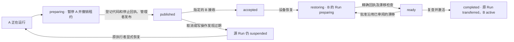

# M08 本地运行、设备租约与成员交接

成员领取 M07 的任务后，平台登记 Run、本机准备代码工作区。换人时，A 停止原工作，项目管理者发布固定材料，B 在自己的设备上恢复并激活独立 Run。项目管理者含 owner/admin。任务板上的当前负责人、Run 的历史作者和最后操作的设备分别有记录；只在激活成功时改变负责人。入口见 `apps/cli/src/index.ts:689-769`、`apps/cli/src/handover.ts:114-125`、`apps/web/src/ProjectHandoversWorkbench.tsx:19-64`、`apps/core-api/src/routes/handovers.ts:53-86`。

## 功能与验收

| 功能 | 谁从哪里开始、成功后能看到什么 | 例外、恢复与业务边界 | 固定源码 |
| --- | --- | --- | --- |
| M08-F01 建立或附着工作区 | 当前负责人从 CLI 的 task claim 以独立 Git worktree 领取；在指定根目录下生成元数据、工作简报、项目/需求/设计/交付/技能索引，并向平台绑定 Run。task attach 则利用已有 Git 目录，在该目录的 .agent/runs 下隔离任务资料。 | 云端领取前失败会尝试清理新建工作区；领取已成功而材料写入失败时，错误带回 Run 和路径并保留现场。‘已有工作目录’不能等同于独立 worktree。 | `apps/cli/src/index.ts:480-502`、`apps/cli/src/index.ts:527-594`、`apps/cli/src/index.ts:602-666`、`packages/integrations/src/git-workspace.ts:25-79` |
| M08-F02 启动执行与本地收尾 | task run 先领取，在工作区 repo 中执行成员指定命令，提供任务、Run、简报和资料路径。成功后收集 Git 改动及下一步提交指引，交给 M07 显式提交。workspace identify 向上识别元数据，cleanup 支持 dry-run、补丁和回收。 | 进程非零退出返回 executor_failed，保留已有工作区。常规回收检查 active/suspended/preparing 和待交接；读取服务失败不静默删目录。显式 force 可跳过引用检查。 | `apps/cli/src/index.ts:762-839`、`apps/cli/src/index.ts:1712-1757`、`packages/integrations/src/git-workspace.ts:100-175` |
| M08-F03 管理设备租约 | 已登录的 Run 本人用有效设备查运行上下文/会话，对 active Run 获取默认 30 秒租约，使用 token 和执行代数续租。同设备有效期内重复获取可返回同一 token，过期后本人另一台有效设备可获取新租约。 | 同时绑定另一设备、旧代数、撤销设备、失去项目写权、归档均阻止执行写入。初代双方 epoch=0 有提交兼容路径；完成交接后的非零代数必须与当前设备、租约匹配。 | `apps/core-api/src/routes/execution.ts:7-32`、`packages/application/src/execution-use-cases.ts:14-56`、`packages/application/src/execution-use-cases.ts:73-86`、`packages/application/src/execution-guard.ts:19-54` |
| M08-F04 管理托管 Agent 会话 | 本机 agentd 从 Run 启动、恢复、列举或停止会话。启动先核验 Run、当前固定技能及租约，按启动键防止重复启动。监督进程维护心跳，写回进程、状态、退出码和输出尾部。会话终止不等于完成任务。 | 租约失效阻止继续执行；受托管进程可被停止，外部进程需要操作者提供停止确认。失联后按本机记录核查进程；平台接到 client_reported 回执本身不能证明远端 OS 上所有程序都已停止。 | `packages/application/src/execution-use-cases.ts:87-125`、`apps/agentd/src/supervisor.ts:28-84`、`apps/cli/src/handover.ts:120-154` |
| M08-F05 准备转交并冻结材料 | A 用自身设备指定 source Run、另一位可协作成员、项目登记仓库和审阅后的摘要。CLI 先检查仓库归属与 remote。平台要求 builder、任务 running/self_tested、本人正是负责人、Run active、无未完结交接、序号匹配。一个事务暂停 Run，推进任务 epoch/序号、撤销租约，生成准备授权和不可变上下文。 | 自己、viewer、失活成员、错仓库、重复活跃交接不接受。准备授权为 30 分钟，包自准备时设 24 小时期限；幂等键只重放原请求和设备，发生冲突要查原记录。 | `apps/cli/src/handover.ts:120-151`、`packages/application/src/handover-use-cases.ts:227-238`、`packages/application/src/handover-use-cases.ts:301-340` |
| M08-F06 形成可恢复的 Git 与资料快照 | CLI 从源工作树生成固定 commit/tree、专用远端引用和清单，保留审阅的摘要。平台冻结任务契约、固定需求及其文档、项目资料角色、设计版本等来源和版本向量；文件型原型仅随元数据，正文按来源类型处理。源设备带准备授权保存草稿并作人工或托管停止确认。 | 默认排除私人路径，显式选择私人路径直接拒绝；符号链接、LFS、子模块和不支持的二进制变更拒绝。相同引用已发布且内容不同不可覆盖。源停机确认缺失不能发布。 | `packages/integrations/src/handover-workspace.ts:47-109`、`packages/application/src/handover-use-cases.ts:87-145`、`packages/application/src/handover-use-cases.ts:146-182`、`packages/application/src/handover-use-cases.ts:343-375` |
| M08-F07 发布、查阅、接收 | 项目管理者在 Web 详情或 CLI 发布。需存在停止回执、工作区清单、仍有协作权的目标，且来源检查通过。B 从项目交接队列看摘要、快照和状态后接收。仅指定接手人可将 published 变 accepted，重复接收 accepted 保留状态。 | 未发布时仅源执行者和管理者可见，选为接手人尚不获得草稿阅读权。读取共享上下文会核对内容哈希。任务列表按交接 ID 升序；项目队列按更新时间及 ID 降序。 | `packages/application/src/handover-use-cases.ts:239-264`、`packages/application/src/handover-use-cases.ts:367-383`、`packages/application/src/handover-use-cases.ts:473-503`、`packages/application/src/handover-use-cases.ts:515-529` |
| M08-F08 在 B 的独立目录恢复 | B 以接收设备和同一个操作键恢复；登记目标目录、确切 commit、attempt 和 preparing Run，Run 指向源 Run。复制固定技能而后在本机拉取指定引用，校验 commit、tree、必要材料及上下文，写工作简报。 | 来源漂移、目录等同 A、目标目录已有无关文件、同一目录另一 attempt、远端引用被移动或缺少材料均阻止继续。恢复已在平台登记但本地失败，使用原 attempt/幂等键查回或取消，不能凭失败提示推断远端已回滚。 | `apps/cli/src/handover.ts:158-174`、`packages/application/src/handover-use-cases.ts:385-408`、`packages/integrations/src/handover-workspace.ts:115-162` |
| M08-F09 确认就绪、激活和续写 | B 发送本机 worktree digest、attempt、snapshot commit、context hash 及 client_reported 回执。ready 时检查技能授权和来源，activate 再检查来源、设备和两端 Run 状态。事务内 A→transferred、B→active、任务负责人→B，增加代数/序号、生成租约，交接 completed。随后可选择启动新的 Agent。 | B 同账号另一设备、脏工作树、错哈希、权限变化、在就绪后发生漂移均不能激活。相同成功激活请求可找回原 Run 和有效租约；A 的历史署名保留。 | `apps/cli/src/handover.ts:175-199`、`packages/application/src/handover-use-cases.ts:410-450`、`packages/integrations/src/handover-workspace.ts:115-136` |
| M08-F10 处理来源漂移 | 项目成员查看固定快照相对当前来源的 diff。发布、恢复、就绪、激活均重算版本向量；管理者可审阅变化、填理由批准沿用旧内容。批准保存的是当前审过的版本，清除就绪回执；原来是 ready 会退回 restoring，由 B 重新确认。 | 任务契约本身改变不能豁免；批准之后再变又要处理。可选择取消后重新准备新包。自动更新旧快照会使交接双方失去共同依据，此处保留原文。 | `packages/application/src/handover-use-cases.ts:194-214`、`packages/application/src/handover-use-cases.ts:462-470`、`packages/application/src/handover-use-cases.ts:530-538`、`apps/web/src/HandoverPanel.tsx:157-183` |
| M08-F11 取消、过期和显式恢复 | 源、目标或项目管理者可取消处于允许状态的交接。写操作发现已发布且到期则标 expired，取消尚 preparing 的目标 Run；旧源仍 suspended。原负责人在无待处理交接时从本人设备显式 resume，推进代数、重新领租约。 | 不能取消 completed 来反向改写交付；待交接不能 resume，已经转交的旧 Run 无法续写。未观察到读取列表即可触发自动过期、自动恢复源的机制。 | `packages/application/src/handover-use-cases.ts:265-293`、`packages/application/src/handover-use-cases.ts:452-461`、`packages/application/src/handover-use-cases.ts:539-562` |

## 验收矩阵

这里列出测试定义，本轮没有运行真实双设备、远端 Git 或数据库业务测试。并发和重试各使用独立交接。

| 优先级 / 功能 | 初始数据、操作和可观察断言 | 测试定义 |
| --- | --- | --- |
| P0 · F01–F04 | A 领取后本地执行非零退出，仍可找到工作区。分别在同设备、另一设备、过期后重复领租，验证 token 复用、抢占拒绝与到期接管。 | `apps/cli/tests/run-cli.test.mjs:109-159`、`apps/agentd/tests/agentd.test.mjs:350-393`、`apps/agentd/tests/agentd.test.mjs:409-437` |
| P0 · F05–F09 | A 准备即用旧 Run 提交，应失败；无停止回执无法发布；正确 B 恢复、就绪、激活后数据库保留两个作者和续接关系。换 B 的第二台设备提交旧回执，拒绝。 | `packages/application/tests/handover-use-cases.test.mjs:235-301`、`packages/application/tests/handover-use-cases.test.mjs:533-577` |
| P0 · F09/F10 | 在 ready 之后修改来源，激活失败。管理者批准当前版本，再改一次来源，旧批准无效；契约冲突不能以理由消除。 | `packages/application/tests/handover-use-cases.test.mjs:473-504`、`packages/application/tests/handover-use-cases.test.mjs:612-655`；契约特例依据 `packages/application/src/handover-use-cases.ts:462-469` 补充验收。 |
| P0 · F08/F11 | 两个激活并发仅一个目标 Run；另建交接到期，源仍暂停；取消后显式 resume；于恢复中移除 B 的项目权限或撤销设备，均不能激活。 | `packages/application/tests/handover-use-cases.test.mjs:505-556`、`packages/application/tests/handover-use-cases.test.mjs:656-697` |

## 取证边界与复用

依据固定草稿 `256f8b15f9dc0fa80e7f56aa9d1b2b59f4ef5104a16926dfbc9ad47f4b64137b`。UA 中沿 handover CLI 的 importMap 找到项目绑定、工作区和技能材料，语义入口为 BR-HANDOVER-PREPARE/PUBLISH/ACTIVATE/DRIFT。原生图按 checkDrift 找到 `cg:function:756d1e538d857f4ecb3a253d60cb9395` 的 snapshot、compileContext、changes 调用，按 issueRunLease 找到 `cg:function:b8c0902e236efddc5f083ef9f8ee0fe6` 的身份检查。复查时要同时读 CLI、Git 集成、服务事务与设备回执，尤其检查远端先成功、本机后失败的顺序。实际部署的 Git 权限、网络可达性、设备上的外部进程与人工确认可信度仍依赖现场。
