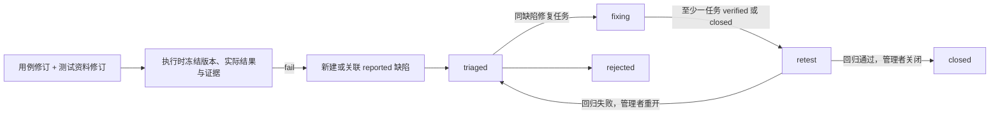

# M09 测试用例、资料、执行与缺陷回归

测试人员先维护“如何测”和“需要什么”，再针对环境、版本填写一次实际执行。失败结果可成为带复现步骤的缺陷，正式修复任务在 M07 完成验证后才允许进入回归。测试记录可以关联 Task；只有 M07 的 verifier_review 和关闭动作能推进任务验收。Web 项目测试工作台有用例、资料、执行三个入口，缺陷工作台单独处理分诊、修复和回归。设备或成员 Agent 可用 `tsp test case/asset/execution` 和 `tsp defect`。见 `apps/web/src/TestingWorkbench.tsx:16-41`、`apps/cli/src/testing.ts:108-144`、`apps/cli/src/testing.ts:194-211`、`apps/cli/src/index.ts:1461-1495`。

## 功能与验收

| 功能 | 前提、动作与数据结果 | 反向或边界验收 | 固定源码 |
| --- | --- | --- | --- |
| M09-F01 建立测试用例 | 项目有写权成员从用例编辑器填写标题，选模块/需求、套件、优先级、人工或自动方式、前置条件、步骤及预期、资料引用。创建首版并记录作者和初始说明，拿到可复用编号。 | 最多 200 步；存在的步骤要求提供操作文字。仅输入标题可创建初稿，源码没有要求所有步骤都已有预期。跨项目模块、需求或资料拒绝。 | `apps/web/src/TestCases.tsx:10-24`、`packages/application/src/testing-content.ts:53-69`、`packages/application/src/testing-use-cases.ts:48-65`、`packages/application/src/testing-use-cases.ts:126-140` |
| M09-F02 维护测试资料与下载原件 | 可写成员按指南、脚本、数据、环境或报告登记 Markdown、文件、HTTP(S) URL 或 Git 引用。原始文件由服务校验字节、计算 SHA-256 与大小，详情/指定历史版本可供授权成员读。CLI 可把指定修订的原始文件或 Markdown 下载到本地。M06 资料库可按同一来源定位。 | 文件以 6 MiB 为限，伪造大小/摘要、不合法文件名或带凭据的 URL 拒绝；列表及执行快照去掉文件字节。下载默认保护已有输出。Git/URL 是引用，登记不拉取远端或执行脚本。 | `packages/application/src/testing-content.ts:22-51`、`packages/application/src/testing-content.ts:70-86`、`packages/application/src/testing-use-cases.ts:311-320`、`apps/cli/src/testing.ts:176-193` |
| M09-F03 查找并修订可复用版本 | 当前项目可读成员按编号/关键词、模块、需求、套件/方法或资料用途/存储方式查询当前版本，按更新时间及 ID 降序，详情按修订号降序。作者或管理者持当前写权提交 base_revision 和变更说明，事务中锁记录、添新修订、更新表头、留审计。 | 旧 base_revision 的并发编辑返回冲突，旧版仍可读；普通同事能读但不能改别人的定义；归档项目或作者降为 viewer 后不可写。搜索不含文件字节。 | `packages/application/src/testing-use-cases.ts:24-43`、`packages/application/src/testing-use-cases.ts:94-123`、`packages/application/src/testing-use-cases.ts:143-162` |
| M09-F04 记录一次实际执行 | 人、Agent 或 CI 提供标题、环境、被测版本、来源，可附 commit 和同项目任务。录入 1–500 个不同用例及各自修订、结果、实际观察、备注、报告链接，并列出关联资料精确版本。事务保存执行人（认证账号）、时间、用例和资料快照、每项结果及审计。 | 同一用例在同次执行重复、找不到修订、关联资料未指定版本、跨项目任务均拒绝。合法结果含 not_run、pass、fail、blocked、skipped；客户端送入结果不会触发测试程序。 | `apps/web/src/TestExecutions.tsx:29-57`、`packages/application/src/testing-use-cases.ts:209-230`、`packages/application/src/testing-use-cases.ts:244-263`、`apps/cli/src/testing.ts:194-205` |
| M09-F05 冻结代码和回看执行 | Git 类型资料在快照中包含仓库、remote、路径和 commit；单一仓库且资料版本缺 commit 时可继承本次执行完整 SHA。详情显示认证执行人、五种结果计数、版本、任务、逐项结果和证据。文件按精确资料修订下载。 | 多仓库且某资料未钉住 commit 时禁止用一个公共 SHA 补全。后来修改用例、资料或默认分支不改该次执行内容；一次记录全 pass 也不代替 M07 验收。 | `packages/application/src/testing-content.ts:28-31`、`packages/application/src/testing-use-cases.ts:176-208`、`packages/application/src/testing-use-cases.ts:228-252`、`apps/web/src/TestExecutions.tsx:14-28` |
| M09-F06 从失败结果生成或关联缺陷 | 写用户在失败结果上指定同项目既有缺陷，或选择同项目 Feature 新建。新缺陷带冻结的环境、版本、前置、步骤/预期、实际结果和报告，默认中等严重度；恰有一项需求时尝试建立结构化关联。事务锁结果行并保存 defect_code 和关联审计。 | 非 fail 拒绝；已关联同编号重放有效，改绑另一缺陷或再次要求新建会冲突。不能将结果关联另一项目。结果原有结论仍为 fail。 | `apps/web/src/TestExecutions.tsx:63-70`、`packages/application/src/testing-use-cases.ts:266-306` |
| M09-F07 直接报缺陷、查询和分诊 | 有项目写权成员可直接按 Feature 填标题、严重度、发现版本、描述和可选同项目需求，得到 reported 编号。队列限可见项目，可按 Feature、状态过滤，API 按缺陷 ID 降序。项目管理者把 reported 确认为 triaged 或判 rejected。 | viewer 或项目外人员不能上报；非法严重度、跨项目需求拒绝。转为 triaged、closed 或 rejected 都需 owner/admin；即使报告者是原作者也无额外流转权。 | `packages/application/src/defect-use-cases.ts:38-96`、`packages/application/src/defect-use-cases.ts:103-123`、`packages/application/src/defect-use-cases.ts:174-197`、`packages/application/src/project-access.ts:22-26` |
| M09-F08 建立修复并进入回归 | 管理者可在 Web 从 reported 先分诊、创建同 Feature 的 defect-fix 任务（附验收条件），再提交 fixing；已有正确修复任务也可引用。任务的交付/证据由 M07 管。具有写权限的成员可在 fixing 转 retest，守卫检查至少一个关联任务 verified/closed。 | 未指定修复任务、来源不对、绑定其他缺陷/项目被拒。一个已提交但未验证的任务不足以回归。Web 三个请求逐个发生，中断时应重读缺陷与已有任务后继续，不能假定都回滚。 | `apps/web/src/DefectsWorkbench.tsx:133-160`、`packages/application/src/project-use-cases.ts:417-432`、`packages/application/src/defect-use-cases.ts:199-228` |
| M09-F09 回归决定与终态 | 管理者在 retest 结合回归结果选择 closed、回到 triaged 重开，或 rejected，写状态与审计。reported/triaged/fixing/retest 均允许走拒绝支路；closed、rejected 无后续转换。 | 进入 retest 和管理者关闭分别是两个动作；此处 close 没有强制关联一条新的 pass 执行。缺陷流转先更新后单独写审计，源码未在此包裹事务或校验客户端版本，双人同时处置的结果需另验。 | `packages/application/src/defect-use-cases.ts:21-29`、`packages/application/src/defect-use-cases.ts:189-197`、`packages/application/src/defect-use-cases.ts:220-245`、`apps/web/src/DefectsWorkbench.tsx:273-317` |

## 验收矩阵

以下为已存在测试定义和可复用验收场景，本轮未实跑业务测试。

| 优先级 / 功能 | 数据、动作与应观察结果 | 测试定义 |
| --- | --- | --- |
| P0 · F01–F03 | 作者和管理者同时对用例 r1 递交不同修订，只有一份 r2；降为 viewer 后仍读历史但不能写；另一项目资料不能挂到本用例。 | `packages/application/tests/testing.test.mjs:31-75`、`packages/application/tests/testing.test.mjs:149-168` |
| P0 · F04/F05 | 用 v1 用例和资料录结果，再把定义修到 v2。历史详情应仍为 v1 及当时执行人；两个仓库共用未分解 commit 会拒绝；任务状态不因录入改变。 | `packages/application/tests/testing.test.mjs:76-121`、`packages/application/tests/testing.test.mjs:169-175` |
| P0 · F06/F07 | 一次执行各有 pass、fail。仅 fail 可建缺陷；比对复现步骤与报告；重放关联同缺陷编号、尝试再建和跨项目关联的结果要分开断言。 | `packages/application/tests/testing.test.mjs:122-148`、`apps/cli/tests/testing-cli.test.mjs:127-140` |
| P0 · F08/F09 | 报告者上报，管理者分诊并建修复任务，任务尚未 verified 时拒绝回归；达标后转回归并关闭。另建样例拒绝后再次流转，应被终态拦截。 | `packages/application/tests/defect-use-cases.test.mjs:26-120`、`packages/application/tests/defect-use-cases.test.mjs:122-137` |
| P1 · F02 | 从资料库和测试侧读取同一历史文件，核对版本与字节，未授权用户读不到；下载到已有输出应显式选择覆盖。 | `packages/application/tests/testing-library.test.mjs:24-49`、`packages/application/tests/testing-library.test.mjs:72-87`、`apps/cli/tests/testing-cli.test.mjs:92-111` |

## 取证边界与复用

固定草稿 `256f8b15f9dc0fa80e7f56aa9d1b2b59f4ef5104a16926dfbc9ad47f4b64137b`。UA 的 BR-TEST-EXECUTION、BR-DEFECT-RETEST 和 testing-use-cases 的导入指向测试内容校验与项目鉴权；原生 CodeGraph 节点 `cg:function:bfdbd24deec680cb030beeab341962e0`、`cg:function:bfe1c73aac26747daeb68bd76a2560ff`、`cg:function:357649ef0957895434acfb984670e661` 分别对应记录执行、从结果建立缺陷、变更缺陷状态。复查这三处写操作的事务范围，可辨明一条点击路径包含哪些独立提交。外部报告内容、CI 结论真实性、Git 对象可取性以及真实并发冲突表现没有现场记录。
