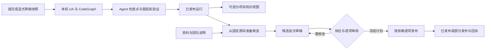

# M10 代码理解与规格接入

研发成员要回答“这份规格依据哪一版代码”，评审人要决定“哪些候选应写入本项目”。代码分析运行固定仓库内容，发布后供导航与复核；规格接入批次独立保存来源、候选、质量报告、逐项决策和发布回执。代码图发布成功不会创建正式需求。纯资料项目也可进入规格接入流程。

## 状态、证据与外部边界

快照身份含 commit/tree、commit 或 draft 类型、文件哈希与行数、清单摘要、范围与排除。运行另有修订号、创建人、插件版本、产物摘要；项目视图按仓库选定一个运行。批次保存来源命名空间、协议、档位、批次修订、候选键。发布计划绑定候选内容、逐项决定、质量依据及其版本；发布尝试用独立请求键识别。依据 `apps/cli/src/code-understanding-snapshot.ts:73-84`、`packages/application/src/code-understanding-use-cases.ts:50-66`、`packages/application/src/intake-use-cases.ts:182-205`、`packages/application/src/intake-quality-gate.ts:31-56`。

## 业务功能与双向验收

以下是可分别执行的验收设计。本机插件与 SaaS 联调均需另行运行，不能把准备完成或 Web 页面可读写作业务通过。

| 功能 | 谁从哪里做什么，产生什么 | 正向验收 | 反向验收或恢复 | 实现依据 |
| --- | --- | --- | --- | --- |
| M10-F01 固定代码分析范围 | 有写权限的成员在已绑定的本地仓库选择提交引用（默认 HEAD）或显式工作区草稿，登记本机插件，选择目录；登记活动项目仓库并生成独立源码副本。草稿仅在明确选择时纳入未跟踪文件。 | 在提交后改工作树，分别捕获提交、草稿。核对提交文件与 Git 对象一致，草稿清单体现当前改动且保留类型。 | 同时给提交引用和草稿、在提交模式请求未跟踪文件、捕获草稿期间内容变化均拒绝。空范围或总量超过 128 MiB 应缩小范围重试。 | `apps/cli/src/code-understanding.ts:123-153`、`apps/cli/src/code-understanding-snapshot.ts:26-77`、`packages/application/src/code-understanding-use-cases.ts:111-123` |
| M10-F02 完成 UA 语义与 CodeGraph 索引，提交产物 | 运行创建者在本机准备固定插件产物；Agent 接收固定待处理批次，回传 UA 图、快照 ID、批次 ID 与输入摘要。CLI 用预期修订接收检查点、校验本地结果后发布。服务端校验运行修订、来源、图及证据和摘录预算，再保存 succeeded。 | 同一请求键登记相同内容应回到同一运行；合法检查点校验发布，重发同一成功产物应回到同一成功运行。 | 其他成员替创建者更新、过期检查点、快照不一致、取消后迟到上传应失败；中断后 resume 应核对原快照和插件，已取消或失败须另起运行。 | `apps/cli/src/code-understanding.ts:49-83`、`apps/cli/src/code-understanding.ts:168-216`、`packages/application/src/code-understanding-use-cases.ts:80-99`、`packages/application/src/code-understanding-use-cases.ts:126-151` |
| M10-F03 查询图并验证一个业务判断 | 有原代码知识读取资格的成员从代码理解工作台/CLI 选运行，按 UA 概览、词条、节点、关系或方向查到节点与证据。远端查询给已发布投影；调用者、被调用者、影响及相关测试等原生查询依赖对应本机索引。查询结果有范围、行号、快照、总量与截断信息，作者回读原文确认规则。 | 指定同一运行及节点，分别取入边/出边。记录节点定位，打开相同行号核实实际条件；再验证下一页/缩窄查询。 | viewer 和无关的系统管理员无权看含代码知识；未发布运行无可查投影。没有命中或边被截断不能当作业务不存在。 | `apps/web/src/CodeUnderstandingWorkbench.tsx:28-80`、`apps/cli/src/code-understanding.ts:222-242`、`packages/application/src/code-understanding-use-cases.ts:33-44`、`packages/application/src/code-understanding-use-cases.ts:180-237` |
| M10-F04 组合和选定项目知识视图 | 可写成员用已发布运行更新各仓库选择，也可基于旧视图只替换一个仓库。组合内容相同复用原视图；只要含草稿就归入草稿视图。显式选择才更新对应“当前”指针。 | 组合两个已提交仓库，选为当前；用草稿替换其中一个并选为草稿当前，核对原提交指针和另一个仓库不变。 | 同时从同一个旧指针选择两份不同视图，只允许一个更新，另一人须刷新；未发布运行、仓库不符或超 50 仓库不能组合。 | `packages/application/src/code-understanding-use-cases.ts:153-179`、`packages/application/tests/code-understanding.test.mjs:171-188` |
| M10-F05 准备和编写候选规格 | 编写者在接入工作台取准备指令，再用 CLI 从固定代码运行、已绑定仓库或材料/访谈文字建准备包。企业档位生成档案模板和生产范围；作者输入模块、Feature、需求文档、结构化需求和架构候选，填验收、证据、缺口。可在本地检验协议、来源和质量，导出可阅读的规格。 | 固定分析以后改变实时 HEAD，再用该运行准备；候选证据应仍来自固定源。纯资料模式省略仓库，至少提供一个资料来源，可正常准备。 | 混入固定运行未捕获的目录、用错误项目/仓库、重定向源码映射、准备后擅改来源均应拒绝；没有资料也没有仓库不能建立包。空模板须先填写。 | `apps/cli/src/intake.ts:56-89`、`apps/cli/src/intake.ts:108-145`、`apps/cli/src/intake.ts:164-175`、`apps/cli/src/intake-code-knowledge.ts:14-50`、`apps/cli/src/intake-materials.ts:147-153` |
| M10-F06 提交草稿、查看覆盖和质量、修复候选 | 可写成员上传草稿；只建立批次和 pending 候选，报告按档位、内容哈希与批次修订绑定。工作台展示档案、已形成规格/待补/范围外/范围待确认、问题与定位。普通成员仅能改本人未冻结批次，管理者可按规则替换；必须使用预期修订，替换会清除旧计划并重评。 | 上传带企业阻断项的有效候选，看到草稿、证据问题和定位，正式对象数不变；修正后用正确修订替换并重查。重复提交相同内容且键相同只得原批次。 | 借旧键提交不同内容、修改命名空间、企业降级为试点、改变已成功候选或其来源，应拒绝；保留已有成功回执。 | `apps/web/src/IntakeQualityReport.tsx:12-43`、`apps/web/src/IntakeCoverage.tsx:4-27`、`packages/application/src/intake-use-cases.ts:182-233`、`packages/contracts/src/intake-quality.ts:106-147` |
| M10-F07 做出逐项采纳决定并冻结 | 管理者在批次阅读器逐项选新增、绑定本项目同类型现有对象、跳过；绑定要核对目标指纹和父级，已有来源映射必须显式绑定同一目标，非跳过项不能依赖跳过的父项。企业档位有阻断不能冻结；历史无档位批次要明确选择。通过后批次 ready，保存计划摘要与质量依据。 | 模块选择绑定、其子需求选择新增，另一独立候选跳过，检查每项状态和冻结计划摘要；此时查正式对象数仍未变。 | 少做一项、目标指纹过期、选择跳过父项而新增子项、企业阻断或普通成员冻结均应拒绝。修正相应草稿/决策并重新冻结。 | `apps/web/src/IntakeWorkbench.tsx:111-165`、`packages/application/src/intake-use-cases.ts:237-275`、`packages/application/src/intake-quality-gate.ts:31-56` |
| M10-F08 按冻结计划写入项目 | 管理者提供当前 plan_hash 和请求键开始发布，每一项都再检查权限、目标与依赖。新增可产生模块、Feature、需求文档、需求和架构设计；绑定项保留现有业务对象、建立来源映射。逐项提交业务写入、映射、审计和回执。 | 按父子依赖发布一个完整批次；核对正式对象编码、绑定目标和逐项回执。以同账号、同请求键和计划重试，正式对象数应不变。 | 未冻结、质量依据过期、权限撤回、项目归档或目标变化应拒绝或停止。单项失败撤销该项写入，其依赖标 blocked，其他可执行项仍可完成；末态 partial 或 applied。 | `packages/application/src/intake-use-cases.ts:299-344`、`packages/application/src/intake-use-cases.ts:376-425`、`packages/application/src/intake-use-cases.ts:427-462` |
| M10-F09 停止、恢复并核对部分成功 | 草稿作者可停止本人未冻结批次；冻结后停止需管理者。停止保留已提交条目；已有成功给 partial，无成功的 draft/ready 给 cancelled，其余按状态给 stopped。以相同键恢复未知结果的运行中尝试，另开尝试须仍满足当前计划和质量条件。 | 对两项批次在第一项提交后请求停止，检查第一项编码仍在，剩余项未写入；按当前允许状态重试，旧目标不重复创建。 | 过期批次修订停止应拒绝；不同操作者/计划复用旧键应冲突；已完成批次请求停止不会撤回正式对象。资料锁忙按同请求键重试，已提交结果保留。 | `packages/application/src/intake-use-cases.ts:281-295`、`packages/application/src/intake-use-cases.ts:304-343`、`packages/application/src/intake-use-cases.ts:347-370` |

## 优先级、测试和待确认项

建议 P0 覆盖 F01、F02、F05 的同快照身份，F07–F09 的冻结、执行、权限变化及重复请求；P1 覆盖视图组合、查询分页和草稿交互。发布执行按对象种类及同种类内部记录 ID 选择下一条 pending 项，依赖未成功即标为阻塞；发布过程中已经确认成功的业务对象仍有自己的生命周期。依据 `packages/application/src/intake-use-cases.ts:376-406`。

已有测试定义覆盖创建者与 viewer、视图指针并发和取消后发布（`packages/application/tests/code-understanding.test.mjs:58-108`、`packages/application/tests/code-understanding.test.mjs:171-202`），不同 HEAD 和来源篡改（`apps/cli/tests/intake-code-knowledge.test.mjs:69-142`），企业阻断、纯资料接入、幂等发布、越权和目标变化（`apps/core-api/tests/intake.test.mjs:39-110`、`apps/core-api/tests/intake.test.mjs:126-195`）。本次未执行这些套件。真实插件集成测试显式依赖指定本机 UA/CodeGraph 安装位置，外部引擎性能、图语义正确率及企业评审人是否认可每条结论仍须单独验收。依据 `apps/cli/tests/code-understanding-plugins.test.mjs:11-33`。

可复核样例：本次导航直接读取固定 run 的 UA 文件清单与 CodeGraph 节点。UA 列出 677 个文件；CodeGraph 覆盖 585，存在 92 个未索引文件、56,969 个未解析引用。应从图取入口和行段，再读固定源码及测试。上述数值属于这一次离线索引产物，不是平台并发量、测试通过率或需求覆盖率。
