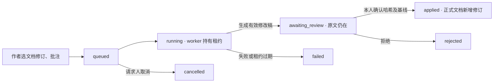

# M11 系统 Agent 修改稿与技能版本

项目文档作者可以委托平台系统 Agent 拟稿，再亲自决定是否采用。团队和项目也可以发布技能包，让成员的设备按项目或 Run 拉取固定版本。两条链路的发行人不同：服务启动时验证随平台构建分发的指导包；任务执行领取的是项目已采用的用户技能。见 `apps/core-api/src/server.ts:142-159`、`packages/application/src/skills-run.ts:18-47`。

## 从批注到正式文档

| 功能 | 角色、触发、结果 | 失败或边界验收 | 固定源码 |
| --- | --- | --- | --- |
| M11-F01 检查服务并选取目标 | 运维配置服务端运行环境，Web 项目系统 Agent 面板查询状态。服务验证随包指导的版本、文本预算、摘要和运行配置，满足条件时启动 worker。文档创建者或项目管理者须有写权并选择本项目活动原生文档；批注可选精确原文片段。 | 指导包缺失或配置不全只显示不可用，创建请求会失败；归档文档、只读业务映射目录、非本人且无管理权均禁止。标准/概览目录可编辑的原生文档另行判断。 | `apps/core-api/src/server.ts:142-164`、`apps/core-api/src/system-agent-guidance.ts:8-17`、`apps/core-api/src/routes/system-agent.ts:8-19`、`packages/application/src/system-agent-use-cases.ts:62-91` |
| M11-F02 创建可恢复的委托 | 成员从系统 Agent 面板或文档批注提交目标编号、当前正整数版本、指令、可选片段和请求键。保存原文标题/摘要/正文与版本，生成 queued 工作。相同请求键及内容重放返回原工作。 | 同键改指令、选段不存在、版本已变、正文超过 100000 字符或内容与批注合计超过 300000 UTF-8 字节均拒绝。确认排队后即可离开，正式文档此时未变。 | `apps/web/src/SystemAgentPanel.tsx:72-90`、`apps/web/src/SystemAgentPanel.tsx:201-219`、`packages/application/src/system-agent-use-cases.ts:140-174` |
| M11-F03 执行、超时与恢复 | worker 以排队时间升序检视最多 10 条，跳过锁住的记录。当前版本及权限合格后独占领取一条，记执行器、版本/摘要、令牌和租约，定时续租。受限运行环境只取提供的任务及资料，生成结构化稿，按内容算哈希和文档质量报告，发布到 awaiting_review。 | 取消/失去当前权限/错令牌/租约过期防止迟到结果写回；过期任务恢复为可见 failed，需要重新发起。无效结构不会成为可采纳稿。相同创建时间未显示最终并列排序键。 | `packages/application/src/system-agent-use-cases.ts:222-256`、`packages/application/src/system-agent-use-cases.ts:258-326`、`apps/core-api/src/system-agent-worker.ts:30-85`、`apps/core-api/src/system-agent-runtime.ts:78-131` |
| M11-F04 查看、取消或拒绝 | 请求者在项目面板查最近 50 项本人工作，打开原文与修改稿的差异或预览，核对理由、证据、警示、质量报告和可采纳状态。可取消 queued/running/awaiting_review，只能对 awaiting_review 拒绝；重复同一处置保留终态。 | 其他成员含项目管理者不能凭工作编号读取别人的委托。只剩读权限的原请求者可读历史，采纳按钮取决于当前可写状态及原文版本。 | `packages/application/src/system-agent-use-cases.ts:93-138`、`packages/application/src/system-agent-use-cases.ts:177-190`、`apps/web/src/SystemAgentPanel.tsx:165-201` |
| M11-F05 核对并采用 | 原请求者检查差异后，指定原 base_revision 和看到的 proposal_hash。事务锁工作及文档，重新核对写权与版本；成功写正式修订、更新文档、标 applied、记录采纳人及审计，并排入文档记忆投影。匹配的已采纳请求重放不会新增修订。 | 确认哈希不同、人工修改过文档、未经审阅/已拒绝或写权已撤销时不覆盖。质量报告随稿可见，采用条件按当前权限、状态和确切版本执行。新稿应从最新文档另发。 | `apps/core-api/src/routes/system-agent.ts:20-30`、`packages/application/src/system-agent-use-cases.ts:192-220`、`packages/application/src/system-agent-use-cases.ts:285-299` |

## 从撰写技能到任务使用

| 功能 | 角色、触发、结果 | 失败或边界验收 | 固定源码 |
| --- | --- | --- | --- |
| M11-F06 查找技能与可见版本 | 在团队或项目技能库选来源、可用或共享视图，按关键词找技能；用 Web 阅读器或 tsp skill show 读取允许的修订及包内文件。源成员只能看到允许的草稿/发布版，外部项目普通成员只读已采用且获准交付的版本。 | 不能同时指定团队和项目；有团队管理权不自动获得私有项目技能管理权。来源管理者和可写作者能看草稿；隐藏草稿不能借版本计数枚举。 | `apps/web/src/SkillsWorkbench.tsx:15-60`、`apps/cli/src/skills.ts:61-90`、`packages/application/src/skills-use-cases.ts:37-110`、`packages/application/src/skills-access.ts:103-129` |
| M11-F07 创建草稿并追加版本 | 来源可写者提交含根 SKILL.md 的完整文件清单，新技能 r1 署名作者。作者仍有来源写权或来源管理者可提交基于当前修订的完整新包与变更说明。服务核验规范相对路径、文件内容与 SHA，按路径排序派生包摘要，保留各版字节。 | 链接/特殊文件、大小写碰撞、路径越界、伪造摘要、超过 6 MiB 或缺少有效入口拒绝；并发旧 base_revision 不能覆盖新草稿。 | `packages/application/src/skills-content.ts:16-42`、`packages/application/src/skills-content.ts:62-95`、`packages/application/src/skills-use-cases.ts:20-31`、`packages/application/src/skills-use-cases.ts:112-145` |
| M11-F08 发布、归档或恢复 | 来源 owner/admin 选确切修订发布，保留作者、发布时间与审计；后续修改须新修订。来源管理者可归档或取消归档，历史版本保留。 | 普通草稿作者不能自行发布；归档阻止新增修订、共享和交付。取消归档只恢复这个状态，仍须核对每个目标的当前授权。 | `apps/core-api/src/routes/skills.ts:24-39`、`packages/application/src/skills-use-cases.ts:130-171`、`packages/application/src/skills-access.ts:92-101` |
| M11-F09 精确授权与撤销 | 来源管理者选择团队或项目及明确的已发布版本，共享可控制目标团队是否允许用于其项目、是否允许有外部成员的项目使用。匹配已有授权可返回原结果；撤销写 revoked_at 并留下历史。 | 不能分享草稿、归档包或向自身重复授权。团队共享默认供发现，目标团队项目采用需 allow_projects；有外部成员还需 allow_external。项目自有技能与同团队且无外部成员的团队技能有内建使用路径。离线已下载的副本无法远程收回。 | `packages/application/src/skills-use-cases.ts:172-209`、`packages/application/src/skills-access.ts:81-101`、`apps/cli/src/skills.ts:117-132` |
| M11-F10 项目采用、升级与停用 | 项目管理者选精确修订、唯一别名、启用状态，并提交读取时的项目技能 generation。安装/升级后返回新 generation。项目列表按别名排序，可查看授权失效提示。管理员可停用现有失效版本以恢复其余技能的交付。 | 同名冲突、无交付授权、旧 generation 不能写；项目从内部变为含外部成员后，原隐式团队授权可能失效。已发布的新版本不会自动更改项目选择。 | `packages/application/src/skills-use-cases.ts:215-237`、`packages/application/src/skills-use-cases.ts:241-270`、`apps/cli/src/skills.ts:133-151` |
| M11-F11 Run 固定版本、同步与交接 | M07 领取时冻结启用包的修订、别名和摘要，M08 交接复制源 Run 清单。设备用 tsp skill manifest/sync --run 读取精确版本；下载时再核对项目当前授权与包摘要。项目同步和按 Run 同步有分离的根目录；--check 只查差异，常规同步保护本地已改的文件。 | 老 Run 无快照时返回空清单，即使项目后来采用了技能也不补填。更新项目不影响旧 Run 版本；授权撤销、归档、摘要变化会阻断读取或后续启动。同步是文件交付，不会启动包内脚本。 | `packages/application/src/skills-run.ts:18-47`、`packages/application/src/skills-run.ts:56-83`、`apps/cli/src/skills.ts:153-168`、`apps/cli/src/skill-sync.ts:179-232` |

## 验收矩阵

下列业务测试为源码已有定义，本轮未实际调用模型、数据库或真实共享项目。

| 优先级 / 功能 | 前置、动作与可见断言 | 测试定义 |
| --- | --- | --- |
| P0 · F01–F03 | 配置缺失时不可发起；为 r3 选原文片段重复提交相同请求，返回相同工作；改变指令撞键拒绝。双 worker 仅一方领取，过期后该工作可见 failed。 | `apps/core-api/tests/system-agent-runtime.test.mjs:53-83`、`packages/application/tests/system-agent.test.mjs:63-85`、`packages/application/tests/system-agent.test.mjs:133-153` |
| P0 · F04/F05 | 请求者读差异后确认确切哈希，正式文档仅增一次。分别插入一次人工修订、撤销权限或先拒绝后试同一操作，确认旧稿不能覆盖。 | `packages/application/tests/system-agent.test.mjs:36-62`、`packages/application/tests/system-agent.test.mjs:86-105`、`packages/application/tests/system-agent.test.mjs:118-132`、`packages/application/tests/system-agent.test.mjs:154-176` |
| P0 · F06–F09 | 普通作者草稿由来源管理者发布 r1，作者继续写 r2。外部项目仅获 r1，普通已授权成员不应读 r2；受众新增外部成员和撤销授权时分别重查。 | `packages/application/tests/skills.test.mjs:38-79`、`packages/application/tests/skills.test.mjs:80-129` |
| P0 · F10/F11 | A 的 Run 固定 r1 后项目升级 r2，B 接手仍为 r1；撤销 r1 的当前授权后对新领取、读取和恢复分别检查是否阻断。没有快照的老 Run 保持空。 | `packages/application/tests/skills-run.test.mjs:49-99`、`packages/application/tests/skills-run.test.mjs:100-123` |
| P1 · F10/F11 | 两名管理员用同 generation 修改项目清单；本地有人改过技能文件后执行同步。应返回并发/别名或本地冲突，不暗中覆盖。 | `packages/application/tests/skills.test.mjs:130-150`、`apps/cli/tests/skills-sync.test.mjs:46-70` |

## 取证边界与复用

固定草稿 `256f8b15f9dc0fa80e7f56aa9d1b2b59f4ef5104a16926dfbc9ad47f4b64137b`。UA 的 BR-AGENT-ADOPT 和 BR-SKILL-PIN 指向两类使用意图，importMap 中 worker 导入 runtime，skills-run 导入权限服务。原生投影的 `cg:function:fa2baa70464273e2f008176182affa3c`（applyJob）指向 writable、enqueueProjectDocumentMemory、insertAudit；`cg:function:6f63235a51d6b477618bf3c59daab598`（captureRunSkills）指向 projectSkillManifest 和 skillManifestMetadata。复用方法是分别追谁写草稿、谁发布正式版本、谁在使用时重查权限。缺少部署端模型可用率、真实输出质量以及已下发文件的离线使用数据，未据此推断平台效果。
