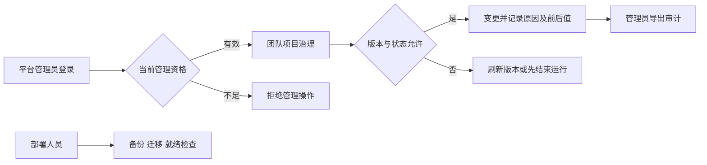

# M12 管理、审计与系统运维

平台管理员要能纠正团队和项目的元数据、停用失效账号、核对操作依据。部署人员还需判断服务是否就绪、分发物是否可用，以及哪些维护只能在服务器本机办理。以下结论来自固定快照 `256f8b15f9dc0fa80e7f56aa9d1b2b59f4ef5104a16926dfbc9ad47f4b64137b`。

## 管理控制台与维护入口

| 功能 | 谁在什么前提下做什么、得到什么 | 规则、异常及证据 |
| --- | --- | --- |
| M12-F01 跨团队查找治理对象 | 有效平台管理员在“团队项目管理”按名称/编码检索，可按团队、项目状态缩小范围，翻页查看责任、状态、计数和项目快照；管理者无需是该业务项目成员。 | 团队/项目 Owner、匿名、仅声称身份的旧请求均不能借此查看全局目录。服务端复查管理员是否有效、已删除或待注销。治理列表按编码升序游标分页，默认 100，1–200；总数对应筛选条件。获取元数据不会授予私有业务内容或成员关系。 `apps/web/src/AdminNavigation.tsx:4-10`、`apps/web/src/AdminWorkspace.tsx:8-13`、`apps/web/src/AdminTeamsProjects.tsx:10-46`、`apps/core-api/src/routes/admin-governance.ts:8-24`、`packages/application/src/admin-governance-use-cases.ts:12-100` |
| M12-F02 更正元数据或归档项目 | 平台管理员选中团队或项目，填写更正理由；团队可改名，项目可改名称、说明、归档/恢复状态。提交项目变更时附读取的项目版本；成功返回当前版本并记录前后值及原因。 | 空理由拒绝，过期项目版本要求刷新。治理不支持直接改 owner 或给自己加成员。治理归档检查 active/preparing/suspended Run，若有则返回阻塞编码，不代停任务；同值提交不增加快照。团队改名路径没有项目式版本参数。 `apps/web/src/AdminTeamsProjects.tsx:52-66`、`apps/core-api/src/routes/admin-governance.ts:24-45`、`packages/application/src/admin-governance-use-cases.ts:105-157` |
| M12-F03 管理账号可用性 | 管理员在用户管理中按账号、名称、编码和状态定位人员，创建/补发密码见 M01-F01；可禁用普通用户或重新启用符合条件的账号。管理设备可查成员会话和撤销记录，见 M01-F05。 | 自己和平台管理员受禁用保护。重新启用时复查目标，正在注销或已注销不能恢复；普通账号恢复后旧设备凭据不能重用，需重新登录。重新提交已启用/已禁用相同目标具有无变更分支。 `apps/web/src/AccountWorkbench.tsx:63-132`、`apps/core-api/src/routes/users.ts:19-53`、`packages/application/src/user-use-cases.ts:231-286` |
| M12-F04 配置成员使用的公开地址 | 管理员读取当前 Web/API 公开地址与配置版本，一次提交两项；可清空。保存后刷新生效的成员客户端配置，普通有效用户只能取这两个公开地址。 | 允许 HTTPS，本机回环可用 HTTP；Web 须为根地址，API 可有受限路径；拒绝嵌入凭据、查询、片段。必须提供两项和匹配的 base_revision；同值不升版，实际修改递增并写审计。修改的是应用公布给客户端的值，证据未显示它能重配 DNS、监听端口或代理。 `apps/web/src/SystemSettings.tsx:24-48`、`apps/core-api/src/routes/system-settings.ts:6-20`、`packages/application/src/system-settings-use-cases.ts:18-46`、`packages/application/src/system-settings-use-cases.ts:63-108` |
| M12-F05 导出审计与排查异常登录 | 有效平台管理员可用 CLI 从含起点的 ISO 时间导出 NDJSON；首次请求固定最大记录 ID，之后携带 snapshot 与游标按 ID 递增。通过管理 API 可按账号哈希或 IP 哈希汇总登录失败、锁定/解锁记录供查证。两类查询均需有效认证会话。 | 审计页默认 100、最多 500，递归处理敏感字段，坏历史载荷用占位值。CLI 检查游标推进与快照一致；中途错误时已输出的行仍需按未完成导出处理。安全事件默认近 24 小时、最大 31 天；按失败数降序再按分组键升序，返回分页与区间。该入口在 API/CLI 有据，管理导航列出的页面为配置、团队项目、用户三项。 `apps/core-api/src/routes/audit.ts:7-19`、`apps/cli/src/audit-export.ts:5-26`、`packages/application/src/audit-export.ts:12-32`、`packages/application/src/audit-redaction.ts:1-15`、`apps/core-api/src/routes/login-security.ts:7-20`、`packages/application/src/login-security.ts:61-89` |
| M12-F06 核对安装包与分发能力 | 管理员在系统配置刷新版本、运行时及平台架构；成员在安装入口选择 Windows/macOS/Linux，看到实际可用的 x64/arm64 包和安装提示。发布内容由部署流程放置，界面负责检查。 | 清单只公布受支持平台、架构、文件名、版本、尺寸和摘要等允许字段；缺文件或尺寸不符的项从清单剔除。清单不可用报 503；未列入或残缺包下载报 404。安装脚本校验文件尺寸和 SHA-256；代码支持的平台数不能当作已有发布包数。 `apps/web/src/SystemSettings.tsx:54-66`、`apps/web/src/CliInstaller.tsx:32-46`、`apps/core-api/src/routes/cli-distribution.ts:17-40`、`apps/core-api/src/routes/cli-distribution.ts:43-72`、`scripts/cli-install/install.sh:56-67` |
| M12-F07 判断服务可用性、安全事件与运行状态 | 部署人员查看 health 和 ready；前者返回进程/服务描述，后者检查数据库及随服务分发的迁移，失败为 503。有效管理员读取指标，可见请求量/耗时、任务与系统 Agent 状态、登录失败等统计。 | 取指标时重新校验权限，普通已登录用户被拒；汇总不可用返回经过处理的 503。CSP 报告入口只记录允许的指令名，有载荷和记录次数上限；报告接收不是管理员审计导出。指标反映采样时状态，未提供生产监控或告警送达证明。 `apps/core-api/src/server.ts:180-199`、`apps/core-api/src/metrics.ts:15-60`、`packages/application/src/operational-metrics.ts:5-15`、`apps/core-api/src/security-headers.ts:12-32` |
| M12-F08 服务器本机恢复及只读诊断 | 有服务器本机操作权限者，在显式配置允许恢复且指定数据库后，可为有效平台管理员重置短时初始密码。恢复结果携带到期时间；需重新改密，旧设备、旧授权受清理，审计区分本机操作者与账号。另可用数据库命令检查孤儿/跨项目关系，或生成客户映射调查清单。 | 恢复需有效、非待注销的管理员账号，拒绝回显到不合适的终端或非法口令输入。诊断没有 HTTP 回退；找出孤儿返回非零，租户规划只报告缺口，不自动分配客户。部署脚本要求备份与目标库连接一致，备份后验证归档目录，再同步、迁移、启动、探测就绪；该脚本本身不能证明生产备份可成功恢复。 `apps/cli/src/admin-recovery.ts:19-69`、`packages/application/src/admin-recovery.ts:16-58`、`apps/cli/src/db-check-orphans.ts:3-24`、`apps/cli/src/db-plan-tenants.ts:3-23`、`scripts/backup-database.ps1:10-23`、`scripts/deploy-runtime.ps1:7-24` |

## 验收场景

| 用例 / 功能 | 前置、步骤 | 预期与断言依据 |
| --- | --- | --- |
| AC01 P0 · M12-F01/F02 | 没有项目成员资格的有效平台管理员筛选一私有项目，记录版本；让项目成员先更新，再以旧版本提交治理变更；另以项目 Owner 读全局目录。 | 管理员获取元数据但不获内容权限；旧版本冲突，不能覆盖新值；单纯项目 Owner 无权使用治理目录。归档含 suspended Run 时返回阻塞。 `apps/core-api/tests/admin-governance.test.mjs:37-99`、`apps/core-api/tests/admin-governance.test.mjs:132-174` |
| AC02 P0 · M12-F03 | 禁用再启用普通账号，尝试用禁用前设备凭据访问；另对已注销及平台管理员尝试恢复。 | 普通账号可重新登录，旧凭据无效；受保护对象拒绝。 `apps/core-api/tests/admin-governance.test.mjs:252-264` |
| AC03 P1 · M12-F04 | 管理员在两份视图拿到相同配置版本，先保存合法地址，再以旧版本提交另一组。单独尝试带查询参数的地址及普通成员读取公开配置。 | 首次保存生效、记录升版；旧版和非法地址被拒，公开投影仅返回两个地址。 `packages/application/src/system-settings-use-cases.ts:72-106`、`apps/web/src/SystemSettings.tsx:24-48` |
| AC04 P0 · M12-F05 | 在测试库准备跨页审计记录，导出期间插入新记录；以管理员及普通成员分别按 IP 汇总，测试超过 31 天的查询。 | 导出保持同一快照，无后来记录；错误分页明确失败；仅管理员获得分组，过长区间拒绝。 `apps/cli/tests/audit-export.test.mjs:7-22`、`apps/core-api/tests/login-security.test.mjs:38-76` |
| AC05 P1 · M12-F06/F07 | 为一架构放置有效清单及文件，另一个包故意缺失；刷新后访问缺失包。对数据库尚未就绪的环境另取 ready，并以普通会话取指标。 | 只显示实际可用架构；缺包 404，未就绪 503，普通用户无法读取受保护指标。 `apps/core-api/tests/cli-distribution.test.mjs:28-55`、`apps/core-api/src/server.ts:180-185`、`apps/core-api/tests/metrics.test.mjs:36-58` |
| AC06 P0 · M12-F08 | 用没有本机恢复开关的环境调用恢复，另在隔离测试库按授权配置恢复；对无数据库连接配置运行两个诊断命令。 | 缺门槛时不打开数据库；合法恢复结果不在结构化输出中泄露密码；诊断返回缺配置失败。 `apps/cli/tests/admin-recovery.test.mjs:13-34`、`apps/cli/tests/db-plan-tenants.test.mjs:18-31`、`apps/cli/tests/db-check-orphans.test.mjs:10-15` |

**证据与待确认。** UA 文件清单定位控制台、治理、安全与分发入口；Codegraph 原生节点 `function:47c30f410660849a6271acaf89825fab`、`function:0251ce0aaa20eab160f307e7bcfd98ef` 定位导出和配置调用，再读原件。测试定义及脚本均未执行；实际分发矩阵、告警接收、备份保留与恢复演练结果仍需部署证据。
